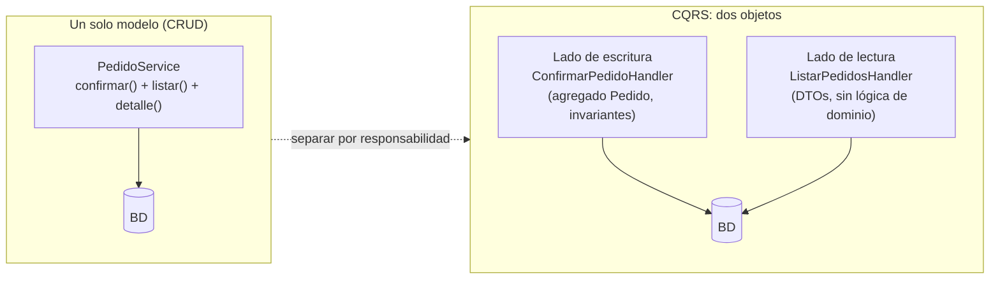
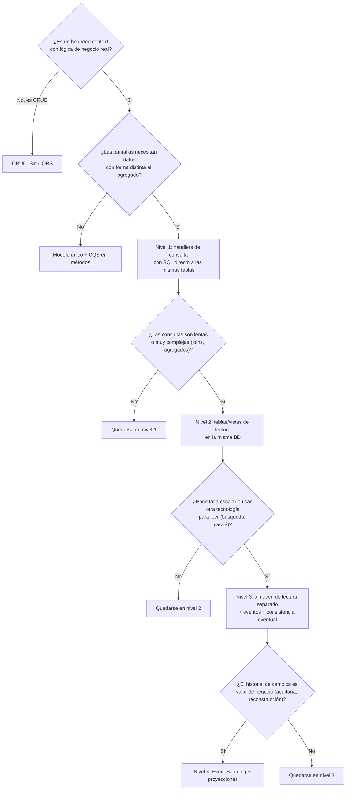
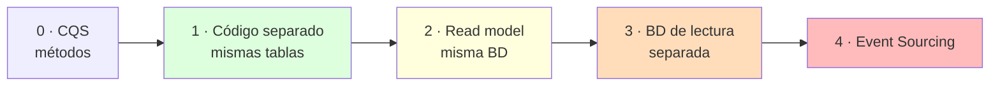
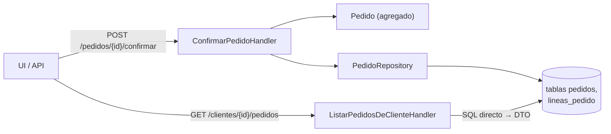
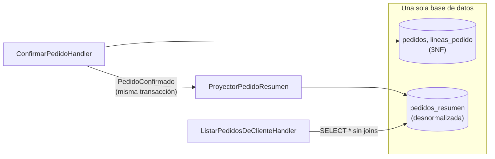
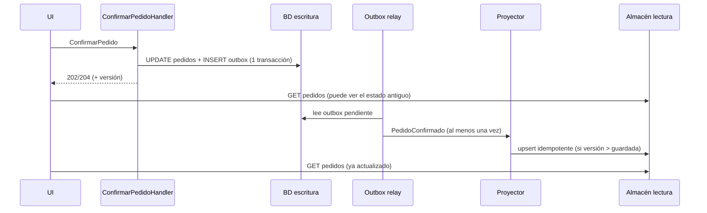
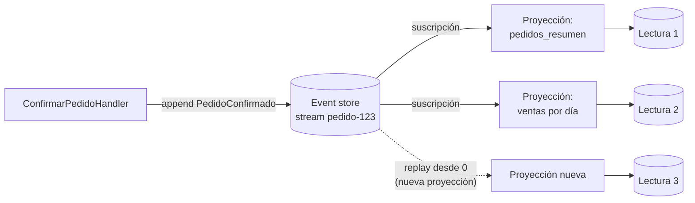
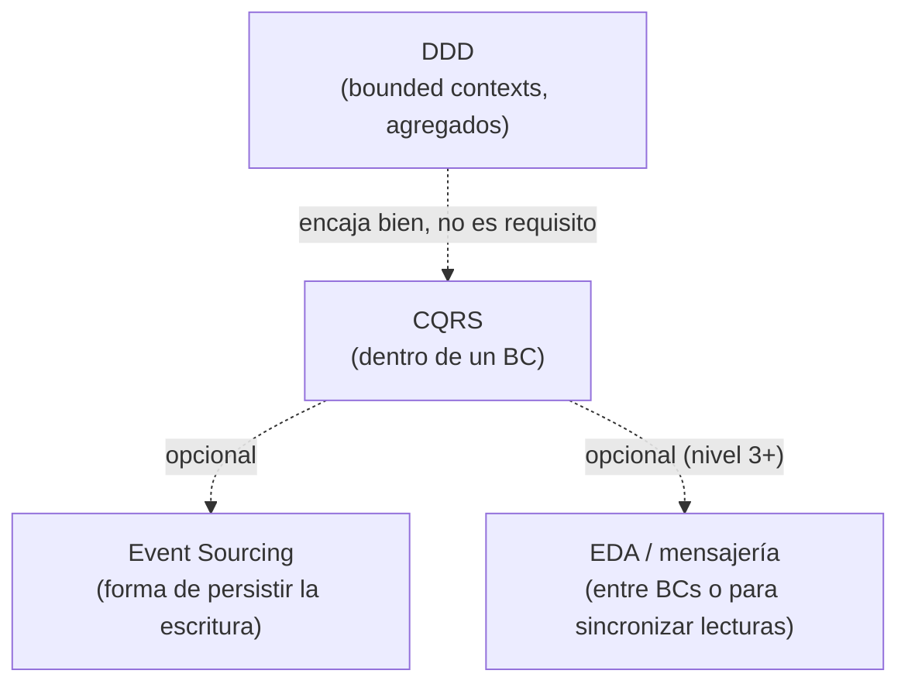
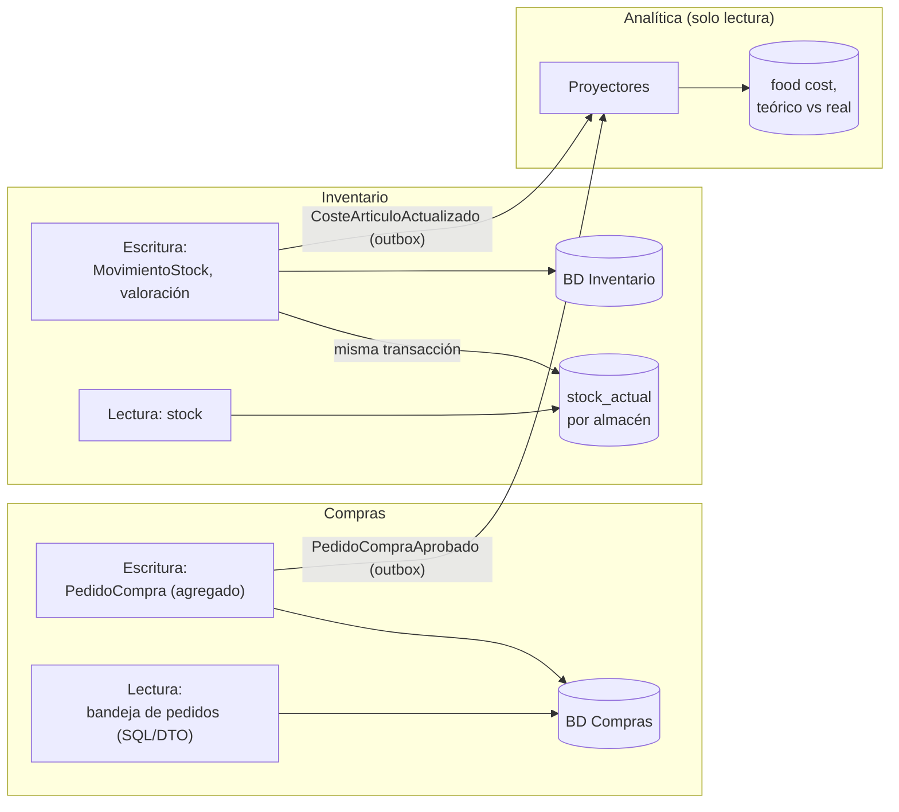
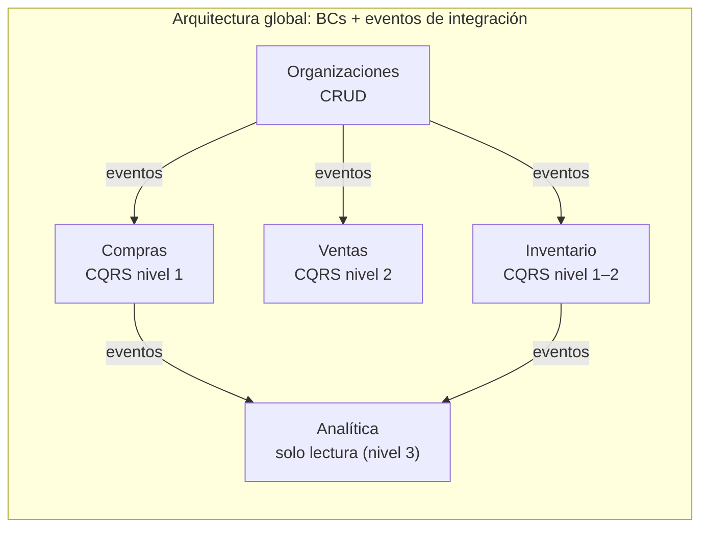

# CQRS: qué es, cuándo tiene sentido y niveles de separación

> Ejemplo conductor: el agregado `Pedido` y el evento `PedidoConfirmado` de [DDD táctico: building blocks](../ddd/building-blocks-tacticos.md). La aplicación al ERP marketplace (Compras, Ventas, Inventario, Analítica) está en [CQRS en el ERP marketplace](#cqrs-en-el-erp-marketplace).

## TL;DR

- **Qué es.** CQRS (*Command Query Responsibility Segregation*) separa el modelo que **cambia** el estado (comandos) del modelo que lo **lee** (consultas). Greg Young: *"CQRS is simply the creation of two objects where there was previously only one."* ([CQRS Journey](https://learn.microsoft.com/en-us/previous-versions/msp-n-p/jj591573(v=pandp.10)))
- **Lo que NO exige.** No exige dos bases de datos, ni Event Sourcing, ni un bus de mensajes, ni consistencia eventual, ni DDD ([Dudycz](https://event-driven.io/en/cqrs_facts_and_myths_explained/), [Comartin](https://codeopinion.com/?p=7267), [Kurrent](https://kurrentdb.kurrent.io/blog/cqrs-dispelling-the-myths/)). Todo eso son opciones que se añaden encima.
- **Cuándo.** En bounded contexts **colaborativos, complejos, con reglas cambiantes o con lecturas muy distintas de las escrituras**. No en zonas CRUD. Se aplica **dentro de un bounded context**, no a todo el sistema.
- **Advertencia.** Fowler: *"for most systems CQRS adds risky complexity"*. Udi Dahan: *"Most people using CQRS (and event sourcing too) shouldn't have done so."*
- **Niveles de separación** (síntesis mía de las fuentes, de menos a más coste): 0) CQS en métodos; 1) comandos y consultas separados en código, misma BD y mismas tablas; 2) modelo de lectura propio (vistas o tablas de proyección) en la misma BD; 3) almacén de lectura separado sincronizado por eventos (consistencia eventual); 4) Event Sourcing en la escritura y proyecciones en la lectura.

## Origen: de CQS (Meyer) a CQRS (Young)

**CQS** es un principio a nivel de **método**. Bertrand Meyer lo introdujo en *Object Oriented Software Construction*. Según el resumen de Fowler:

- **Queries:** *"Return a result and do not change the observable state of the system (are free of side effects)."*
- **Commands:** *"Change the state of a system but do not return a value."*

Fowler admite excepciones pragmáticas: *"Popping a stack is a good example of a query that modifies state."* ([CommandQuerySeparation](https://martinfowler.com/bliki/CommandQuerySeparation.html))

**CQRS** lleva la idea al nivel de **objetos/modelos**. Greg Young, citado en la CQRS Journey de Microsoft:

> *"CQRS is simply the creation of two objects where there was previously only one. The separation occurs based upon whether the methods are a command or a query (the same definition that is used by Meyer in Command and Query Separation: a command is any method that mutates state and a query is any method that returns a value)."*

> *"The object or objects on the read side contain only query methods, and the objects on the write side contain only command methods."*

Dudycz lo resume así: *"CQS defines the general principle of behaviour. CQRS speaks more specifically about implementation."* y *"Both CQS and CQRS do not tell anything about the end storage."* ([CQRS facts and myths](https://event-driven.io/en/cqrs_facts_and_myths_explained/))



## Comandos y consultas: qué son

| | Comando | Consulta |
|---|---|---|
| Intención | Cambiar estado: una **tarea de negocio** | Devolver datos sin efectos secundarios |
| Nombre | Imperativo de negocio: `ConfirmarPedido`, no `SetEstado` | `ListarPedidosDeCliente`, `DetallePedido` |
| Pasa por | Agregado, invariantes, transacción | SQL/DTO directo, sin agregados |
| Devuelve | Nada, o metadatos (id, versión, estado) | Un DTO/read model hecho para una pantalla |

- Microsoft: los comandos deben representar tareas de negocio, por ejemplo *"Book hotel room"* en lugar de *"Set ReservationStatus to Reserved"*. El read model devuelve DTOs o proyecciones *"without any domain logic"* ([Azure CQRS pattern](https://learn.microsoft.com/en-us/azure/architecture/patterns/cqrs)).
- Udi Dahan enlaza esto con la **task-based UI**: botones que capturan la intención ("hacer cliente preferente") en vez de formularios tipo Excel que la pierden y provocan conflictos de concurrencia sobre todo el formulario. Además, un comando válido *debería* tener éxito casi siempre en el servidor; los fallos son excepcionales ([Clarified CQRS](https://udidahan.com/2009/12/09/clarified-cqrs/)).
- **¿Puede un comando devolver algo?** Dudycz: *"it's okay to return id or status or any other needed metadata related to the behaviour we triggered"*, pero no datos de negocio del read model, porque entonces *"the critical element of CQRS - Segregation will be contractual at best"* ([Can command return a value?](https://event-driven.io/en/can_command_return_a_value/)).

```php
<?php
// Lado de escritura: comando = intención de negocio, inmutable
final readonly class ConfirmarPedido
{
    public function __construct(public string $pedidoId) {}
}

// Lado de lectura: consulta = petición de datos para una pantalla
final readonly class ListarPedidosDeCliente
{
    public function __construct(public string $clienteId, public int $pagina = 1) {}
}
```

## Por qué separar: el problema de un modelo único

Las fuentes coinciden en tres motivos:

1. **Un modelo para todo no hace bien ninguna de las dos cosas.** CQRS Journey: *"A single conceptual model that tries to encapsulate both read and write operations may do neither well."* El agregado `Pedido` está diseñado para proteger invariantes (no confirmar sin líneas, total coherente), no para pintar un listado con nombre de cliente, nº de líneas y total ordenado por fecha.
2. **Asimetría de carga.** *"In many business systems, there is a large imbalance between the number of reads and the number of writes... Segregating the two sides enables you to optimize them independently."* (CQRS Journey). Microsoft: *"especially beneficial when the number of reads is greater than the number of writes"*.
3. **Colaboración y datos obsoletos.** Udi Dahan: con varios actores modificando los mismos datos, lo que ve el usuario ya puede estar desfasado (*"Almost any system which makes use of a cache is serving stale data"*). Si la lectura es de todas formas "vieja", no merece la pena hacerla pasar por el modelo de dominio: mejor un **"persistent view model"** por pantalla, leído tal cual.

Microsoft añade **seguridad** (solo las operaciones de dominio tienen permiso de escritura) y **separación del trabajo** entre equipos de escritura y de lectura/UI ([Azure CQRS pattern](https://learn.microsoft.com/en-us/azure/architecture/patterns/cqrs)).

## Cuándo tiene sentido CQRS

Según las fuentes:

- **Colaborativo:** muchos usuarios modifican los mismos datos (Microsoft, Udi Dahan). CQRS Journey lo llama *"a good indicator"*, no una regla fija.
- **Dominio complejo** donde un único modelo *"does neither well"* (Fowler).
- **Lecturas y escrituras muy desiguales** en volumen o forma, que conviene escalar u optimizar por separado (Fowler, Microsoft).
- **Task-based UI** y procesos de varios pasos (Microsoft, Udi Dahan).
- **Reglas de negocio que cambian a menudo** (Microsoft, CQRS Journey).
- **Ventaja competitiva:** *"the most value in those bounded contexts that are collaborative, complex, include ever-changing business rules, and deliver a significant competitive advantage to the business."* (CQRS Journey)

## Cuándo NO tiene sentido CQRS

- **Dominio o reglas simples, CRUD suficiente.** Microsoft: *"The domain or the business rules are simple."* / *"A simple CRUD-style user interface and data access operations are sufficient."* Fowler: *"Many systems do fit a CRUD mental model, and so should be done in that style."*
- **Comandos y consultas que se solapan mucho**, de modo que compartir modelo es más fácil (Fowler).
- **Datos privados de un solo usuario:** Udi Dahan, en los comentarios de *Clarified CQRS*, dice que ahí suele bastar CRUD y que *"CQRS should only be used for the collaborative parts."*
- **Como arquitectura de todo el sistema.** Greg Young: *"CQRS is not a top-level architecture. CQRS is something that happens at a much lower level, where your top level architecture is probably going to look more like SOA and EDA."* CQRS Journey: *"you should not apply the CQRS pattern to the top level of your system"* e *"In most systems, the majority of bounded contexts will probably not benefit from using the CQRS pattern."*
- **Si el único problema son consultas pesadas** de informes, Fowler propone antes una **ReportingDatabase** (base de datos de informes aparte) que CQRS completo ([CQRS](https://martinfowler.com/bliki/CQRS.html)).

Fowler resume el riesgo: ha visto que en la mayoría de casos CQRS acaba mal, y lo describe como *"a significant mental leap for all concerned"*.



> El árbol es una síntesis mía de los criterios de Fowler, Microsoft y CQRS Journey; las fuentes no lo presentan así.

## Niveles (tipos) de separación

Las fuentes no dan una taxonomía numerada, pero todas describen el mismo eje: **cuánto se separa físicamente** el lado de lectura del de escritura. Microsoft distingue explícitamente dos enfoques, *"Separate models in a single data store"* y *"Separate models in different data stores"* ([Azure CQRS pattern](https://learn.microsoft.com/en-us/azure/architecture/patterns/cqrs)), y menciona Event Sourcing como evolución. CQRS Journey: *"applying the CQRS pattern does not mandate that you split the data store"*. Los niveles siguientes ordenan esas variantes:

| Nivel | Qué se separa | Almacén | Consistencia | Coste |
|---|---|---|---|---|
| 0. CQS | Métodos de un mismo objeto | Uno | Inmediata | Ninguno |
| 1. Código separado, mismas tablas | Handlers/modelos de comando y consulta | Una BD, mismas tablas | Inmediata | Bajo |
| 2. Modelo de lectura en la misma BD | + tablas o vistas desnormalizadas para leer | Una BD, tablas distintas | Inmediata si se actualiza en la misma transacción | Medio |
| 3. Almacenes separados | + BD de lectura distinta (otra instancia u otra tecnología) | Dos o más | **Eventual** | Alto |
| 4. Event Sourcing | + la escritura guarda eventos, no estado | Event store + proyecciones | Eventual en las lecturas | Muy alto |



Cada nivel **añade** algo al anterior; no son alternativas excluyentes. Los dos ejes que de verdad cambian el coste son: **¿hay un segundo almacén?** (introduce consistencia eventual y sincronización) y **¿la fuente de verdad son eventos?** (Event Sourcing).

## Nivel 1: comandos y consultas separados en código, misma base de datos

Es el **CQRS simplificado** que Microsoft usa en su aplicación de referencia eShopOnContainers: *"It uses a single data source or database, but two logical models plus DDD patterns for the transactional domain."* Las consultas no pasan por agregados: *"This approach keeps the queries independent from restrictions and constraints coming from DDD patterns that only make sense for transactions and updates."* ([Simplified CQRS](https://learn.microsoft.com/en-us/dotnet/architecture/microservices/microservice-ddd-cqrs-patterns/apply-simplified-microservice-cqrs-ddd-patterns))

Comartin: la separación es *"not a physical separation but more of a logical one"* ([CQRS Myths](https://codeopinion.com/?p=7267)). Dudycz: *"Nothing then stops you from using a relational database, even the same table for reading and writing."*



```php
<?php
// ---- Escritura: pasa por el agregado y el repositorio ----
final class ConfirmarPedidoHandler
{
    public function __construct(private PedidoRepository $pedidos) {}

    public function __invoke(ConfirmarPedido $cmd): void
    {
        $pedido = $this->pedidos->porId(PedidoId::de($cmd->pedidoId));
        $pedido->confirmar();              // invariantes + registra PedidoConfirmado
        $this->pedidos->guardar($pedido);
    }
}

// ---- Lectura: DTO pensado para la pantalla, sin agregados ----
final readonly class PedidoResumen
{
    public function __construct(
        public string $id,
        public string $estado,
        public int $numLineas,
        public string $total,            // ya formateado para la UI
        public string $fecha,
    ) {}
}

final class ListarPedidosDeClienteHandler
{
    public function __construct(private PDO $db) {}

    /** @return list<PedidoResumen> */
    public function __invoke(ListarPedidosDeCliente $q): array
    {
        $stmt = $this->db->prepare(<<<SQL
            SELECT p.id, p.estado, COUNT(l.id) AS num_lineas,
                   SUM(l.cantidad * l.precio_unitario) AS total, p.creado_en
            FROM pedidos p JOIN lineas_pedido l ON l.pedido_id = p.id
            WHERE p.cliente_id = :cliente
            GROUP BY p.id ORDER BY p.creado_en DESC
            LIMIT 20 OFFSET :offset
        SQL);
        $stmt->execute(['cliente' => $q->clienteId, 'offset' => ($q->pagina - 1) * 20]);

        return array_map(
            fn (array $r) => new PedidoResumen($r['id'], $r['estado'], (int) $r['num_lineas'],
                number_format((float) $r['total'], 2, ',', '.') . ' €', $r['creado_en']),
            $stmt->fetchAll(PDO::FETCH_ASSOC),
        );
    }
}
```

- **Gana:** el agregado deja de tener getters para pantallas; las consultas se optimizan con SQL libre; cada handler es una *vertical slice* (*"Each command/query handler is a separate silo"*, Dudycz).
- **No cambia:** una sola BD, consistencia inmediata, sin mensajería.
- **Límite:** si la consulta necesita muchos joins o cálculos caros en cada lectura, pasar al nivel 2.

## Nivel 2: modelo de lectura propio en la misma base de datos

Se añade un **esquema de lectura desnormalizado** junto al transaccional. CQRS Journey: *"The write side may use a database schema that is close to third normal form (3NF) and optimized for data modifications, while the read side uses a denormalized database that is optimized for fast query operations."* Comartin pone como ejemplo **vistas SQL** que solo usa el lado de consultas.

Dos variantes:

- **Vista / vista materializada** calculada por la BD.
- **Tabla de proyección** que la aplicación actualiza cuando cambia el agregado. Si se actualiza **en la misma transacción** que la escritura (p. ej. con un manejador de domain event dentro de la unidad de trabajo, como en [building blocks, sección 4](../ddd/building-blocks-tacticos.md)), la lectura sigue siendo **consistente de inmediato**. CQRS Journey recuerda que *"Events are not the only way to manage the push synchronization of updates from the write side to the read side."*



```php
<?php
// Se ejecuta dentro de la misma transacción que guarda el Pedido
final class ProyectorPedidoResumen implements DomainEventHandler
{
    public function __construct(private PDO $db) {}

    public function __invoke(PedidoConfirmado $e): void
    {
        $this->db->prepare(<<<SQL
            UPDATE pedidos_resumen
            SET estado = 'confirmado', total = :total, confirmado_en = :en
            WHERE id = :id
        SQL)->execute([
            'id' => $e->pedidoId->valor,
            'total' => $e->total->cantidad,
            'en' => $e->ocurridoEn->format(DATE_ATOM),
        ]);
    }
}

// La consulta queda trivial
final class ListarPedidosDeClienteHandler
{
    public function __construct(private PDO $db) {}

    public function __invoke(ListarPedidosDeCliente $q): array
    {
        $stmt = $this->db->prepare('SELECT * FROM pedidos_resumen WHERE cliente_id = ? ORDER BY fecha DESC LIMIT 20');
        $stmt->execute([$q->clienteId]);
        return $stmt->fetchAll(PDO::FETCH_CLASS, PedidoResumen::class);
    }
}
```

- **Gana:** lecturas rápidas sin joins; un read model por pantalla (el *persistent view model* de Udi Dahan).
- **Paga:** código de proyección que mantener; escrituras algo más lentas (se escribe dos veces).
- **Sigue sin:** segundo almacén ni consistencia eventual (si la proyección es síncrona).

## Nivel 3: almacén de lectura separado y consistencia eventual

La lectura vive en **otro almacén**: réplica, otra BD, un motor de búsqueda o un documento por pantalla. Microsoft: *"Separation of the read and write data stores allows you to scale each model to match the load. It also enables you to use a different storage technology for each data store."* Ejemplo que da: documental para leer y relacional para escribir.

Hay que sincronizar los dos lados, normalmente con eventos que publica la escritura. Como *"You usually can't enlist message brokers and databases into a single distributed transaction"*, Microsoft recomienda **Transactional Outbox** y **consumidor idempotente**, y advierte de mensajes fallidos, duplicados y reintentos ([Azure CQRS pattern](https://learn.microsoft.com/en-us/azure/architecture/patterns/cqrs)). El outbox ya está descrito en [building blocks](../ddd/building-blocks-tacticos.md) y en [comunicación entre bounded contexts](../ddd/comunicacion-entre-bounded-contexts.md).



```php
<?php
// Consumidor idempotente: el mismo evento puede llegar dos veces o desordenado
final class ProyectorPedidoResumenEnLectura
{
    public function __construct(private PDO $lectura) {}

    public function __invoke(PedidoConfirmadoIntegrationEvent $e): void
    {
        // Solo aplica si la versión es más nueva que la guardada
        $this->lectura->prepare(<<<SQL
            INSERT INTO pedidos_resumen (id, cliente_id, estado, total, version)
            VALUES (:id, :cliente, 'confirmado', :total, :version)
            ON CONFLICT (id) DO UPDATE
               SET estado = EXCLUDED.estado, total = EXCLUDED.total, version = EXCLUDED.version
               WHERE pedidos_resumen.version < EXCLUDED.version
        SQL)->execute([
            'id' => $e->pedidoId,
            'cliente' => $e->clienteId,
            'total' => $e->total,
            'version' => $e->version,
        ]);
    }
}
```

**Consistencia eventual: el coste principal.** Microsoft: *"The read data might not show the most recent changes immediately. This delay results in stale data."* CQRS Journey: el mecanismo de sincronización elegido *"is also the mechanism that controls when the data on the read side becomes stale, and how long it remains so."* Kurrent matiza que no es CQRS el que la crea: *"The separation of commands and queries does not automatically imply an eventually consistent system"*; aparece al separar almacenes de forma asíncrona.

Formas de tratarla en la UI (propuestas mías, no de las fuentes, apoyadas en que un comando puede devolver metadatos como la versión, según Dudycz):

- Devolver la **versión** desde el comando y que la consulta espere a que la proyección alcance esa versión (o reintente).
- Actualizar la UI de forma **optimista** con lo que el usuario ya envió.
- Diseñar el flujo para que el usuario no necesite releer al instante (mensaje "pedido enviado", notificación después), en la línea de Udi Dahan de notificar resultados en lugar de devolverlos.

## Nivel 4: Event Sourcing en la escritura y proyecciones en la lectura

La escritura no guarda el estado actual, sino la **secuencia de eventos**. Microsoft: el *event store* es *"the write model and the single source of truth"*; el read model construye vistas materializadas a partir de los eventos, y como estos se conservan se pueden *"easily regenerate materialized views or adapt to changes in the read model by replaying historical events."* Inconvenientes que cita: más complejidad, consistencia eventual, coste de generar vistas; recomienda **snapshots** para no reproducir todo el historial ([Azure CQRS pattern](https://learn.microsoft.com/en-us/azure/architecture/patterns/cqrs)).

Es **opcional**: *"You do not need to be Event Sourcing in order to be doing CQRS."* (Comartin); *"Event Sourcing is 'just' one of the options you can choose as a storage implementation."* (Dudycz). Microsoft avisa de que la complejidad de CQRS crece *"specifically when combined with the Event Sourcing pattern."*



```php
<?php
// Escritura: se reconstruye el agregado desde sus eventos y se añaden los nuevos
final class ConfirmarPedidoHandler
{
    public function __construct(private EventStore $store) {}

    public function __invoke(ConfirmarPedido $cmd): int
    {
        $stream = "pedido-{$cmd->pedidoId}";
        [$eventos, $version] = $this->store->leer($stream);

        $pedido = Pedido::reconstruir($eventos);   // aplica cada evento en orden
        $nuevos = $pedido->confirmar();            // devuelve [PedidoConfirmado]

        // concurrencia optimista: falla si alguien escribió después de $version
        return $this->store->añadir($stream, $nuevos, versionEsperada: $version);
    }
}
```

## Relación con DDD, EDA y Event Sourcing



- **DDD:** *"CQRS can be implemented independently of DDD"* (Kurrent). Encajan porque CQRS se aplica por bounded context y libera al agregado de las lecturas.
- **EDA / mensajería:** *"You do not need to be using a message bus to apply CQRS"* y los comandos *"do not need to be asynchronous"* (Comartin). La mensajería aparece al sincronizar almacenes (nivel 3) o al integrar BCs.
- **Event Sourcing:** combinación natural pero independiente (nivel 4).
- **Arquitectura de alto nivel:** Greg Young, ya citado: la arquitectura global se parece más a SOA/EDA; CQRS es una decisión **local**.

## CQRS en el ERP marketplace

Aplicación a los contextos de [Mapa de bounded contexts del ERP marketplace](../ddd/mapa-de-contextos-erp-marketplace.md). **Es una propuesta mía** usando los criterios de las fuentes (colaborativo, complejo, lecturas distintas de escrituras, CRUD → no):

| Bounded context | ¿CQRS? | Nivel sugerido | Por qué |
|---|---|---|---|
| Organizaciones (usuarios, permisos) | No | — | CRUD; datos de configuración |
| Compras (`PedidoCompra`) | Sí | 1, quizá 2 | Colaborativo (cliente crea, proveedor confirma/modifica), reglas de negocio; listados con datos de proveedor y totales |
| Ventas a clientes (`PedidoVenta`, catálogo del proveedor) | Sí | 2 | Muchos clientes leen el catálogo y sus tarifas; pocas escrituras del proveedor. Asimetría clara |
| Inventario (stock, valoración PMP/FIFO) | Sí | 1–2 | Escrituras con invariantes (movimientos, valoración); lecturas de "stock actual por almacén" que conviene precalcular |
| Cocina / Escandallos | Parcial | 1 | Reglas complejas en la escritura; lecturas de coste teórico |
| Analítica (food cost, varianzas) | Ya es un lado de lectura | 3 | No tiene modelo de escritura propio: son **proyecciones** de eventos de Inventario, Cocina y TPV, con consistencia eventual aceptable |
| Facturación, Comunicación externa | No (en principio) | — | Genéricos, candidatos a librería/servicio externo |



Recomendación: **empezar en nivel 1** en Compras, Ventas e Inventario (handlers de consulta con SQL directo) y subir a nivel 2 solo en pantallas concretas que lo pidan (catálogo para el cliente, stock actual). Reservar el nivel 3 para Analítica, que ya es por naturaleza un modelo de lectura alimentado por eventos. Event Sourcing solo si el historial es un requisito de negocio (por ejemplo, trazabilidad de movimientos de stock), y aun así valorar si una tabla de movimientos append-only no basta.

## ¿CQRS en todos los bounded contexts? Una decisión por contexto

**No.** La decisión de usar CQRS, y a qué nivel, se toma **por bounded context**. Cada BC elige su arquitectura interna, y las fuentes advierten de que la mayoría no lo necesita:

- CQRS Journey: *"When we say that you should apply the CQRS pattern to a portion of a system, we mean that you should implement the CQRS pattern within a bounded context."* y *"In most systems, the majority of bounded contexts will probably not benefit from using the CQRS pattern. You should only use the pattern when you can identify clear business benefits from doing so."*
- Greg Young: *"CQRS is not a top-level architecture."* La arquitectura global (SOA/EDA, cómo se comunican los BC) es independiente de lo que haga cada BC por dentro.
- Fowler: *"CQRS should only be used on specific portions of a system"*.



Dos matices prácticos (**opinión mía**, no de las fuentes):

1. **El nivel 1 es tan barato que puede ser convención.** Separar handlers de comando y de consulta sobre las mismas tablas apenas añade coste, y es el estilo por defecto que usa Microsoft en eShopOnContainers ([Simplified CQRS](https://learn.microsoft.com/en-us/dotnet/architecture/microservices/microservice-ddd-cqrs-patterns/apply-simplified-microservice-cqrs-ddd-patterns)). Puede adoptarse como convención de código en todos los BC con lógica de negocio. Los niveles 2–4 se deciden caso a caso. En los BC CRUD (p. ej. Organizaciones) ni eso: un servicio CRUD basta.
2. **La heterogeneidad también cuesta.** Que cada BC tenga su propio estilo multiplica la carga mental del equipo, la infraestructura (proyectores, outbox, event store) y el onboarding. Conviene limitar el "menú" a dos o tres variantes conocidas y documentadas (p. ej. CRUD, CQRS nivel 1, CQRS con proyecciones) en lugar de una por BC.

## Errores frecuentes (según las fuentes)

- **Creer que CQRS = dos bases de datos.** *"CQRS does not require you to have multiple databases."* (Comartin)
- **Creer que CQRS = Event Sourcing** o que exige mensajería (Comartin, Dudycz, Kurrent).
- **Aplicarlo a todo el sistema** en lugar de a los bounded contexts que lo justifican (Greg Young, CQRS Journey).
- **Aplicarlo a zonas CRUD** (Fowler, Microsoft, Udi Dahan).
- **Comandos CRUD disfrazados** (`ActualizarPedido` con todos los campos) en lugar de tareas de negocio (Microsoft, Udi Dahan).
- **Devolver read models desde los comandos**, lo que deja la segregación en *"contractual at best"* (Dudycz).
- **Ignorar los datos obsoletos** al separar almacenes: Microsoft avisa de que detectar y tratar a usuarios que actúan sobre datos viejos exige diseño explícito.

## Relacionado

- [DDD táctico: building blocks](../ddd/building-blocks-tacticos.md): agregado `Pedido`, `PedidoConfirmado`, domain vs. integration events, outbox y unidad de trabajo que usan los niveles 2 y 3.
- [Comunicación entre bounded contexts](../ddd/comunicacion-entre-bounded-contexts.md): mensajería, outbox y consistencia eventual **entre** contextos (CQRS trata la separación **dentro** de uno).
- [Mapa de bounded contexts del ERP marketplace](../ddd/mapa-de-contextos-erp-marketplace.md): contextos a los que se aplica la sección anterior.

## Fuentes

- Fowler, bliki "CQRS" — https://martinfowler.com/bliki/CQRS.html
- Fowler, bliki "CommandQuerySeparation" — https://martinfowler.com/bliki/CommandQuerySeparation.html
- Microsoft, Azure Architecture Center, "CQRS pattern" — https://learn.microsoft.com/en-us/azure/architecture/patterns/cqrs
- Microsoft p&p, "Exploring CQRS and Event Sourcing", cap. "Introducing the CQRS pattern" (incluye citas de Greg Young y Udi Dahan) — https://learn.microsoft.com/en-us/previous-versions/msp-n-p/jj591573(v=pandp.10)
- Microsoft, "Apply simplified CQRS and DDD patterns in a microservice" — https://learn.microsoft.com/en-us/dotnet/architecture/microservices/microservice-ddd-cqrs-patterns/apply-simplified-microservice-cqrs-ddd-patterns
- Udi Dahan, "Clarified CQRS" (2009) — https://udidahan.com/2009/12/09/clarified-cqrs/
- Oskar Dudycz, "CQRS facts and myths explained" (2021) — https://event-driven.io/en/cqrs_facts_and_myths_explained/
- Oskar Dudycz, "Can command return a value?" — https://event-driven.io/en/can_command_return_a_value/
- Derek Comartin, "CQRS Myths: 3 Most Common Misconceptions" (2020) — https://codeopinion.com/?p=7267
- Kurrent, "CQRS: Dispelling the Myths" (2024) — https://kurrentdb.kurrent.io/blog/cqrs-dispelling-the-myths/
