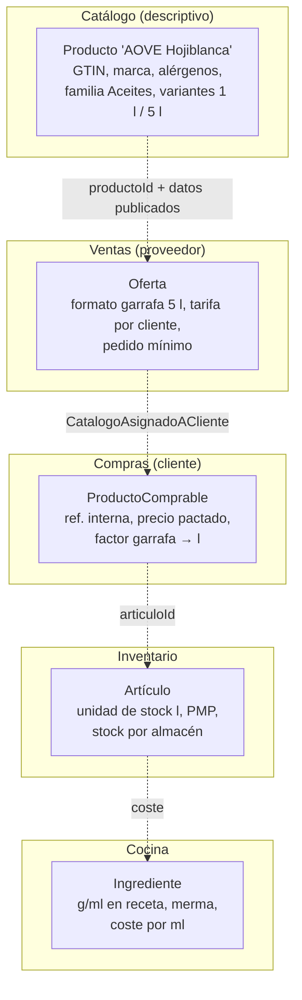
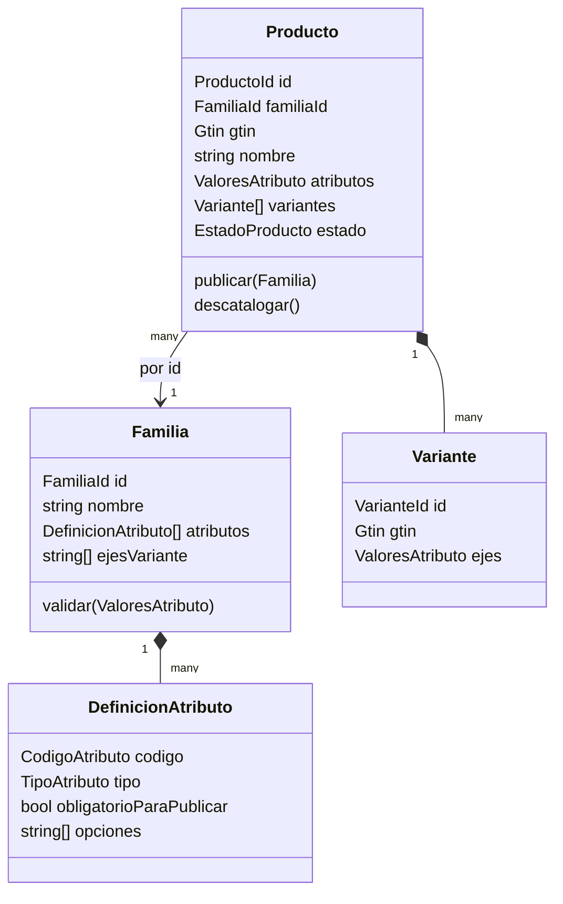
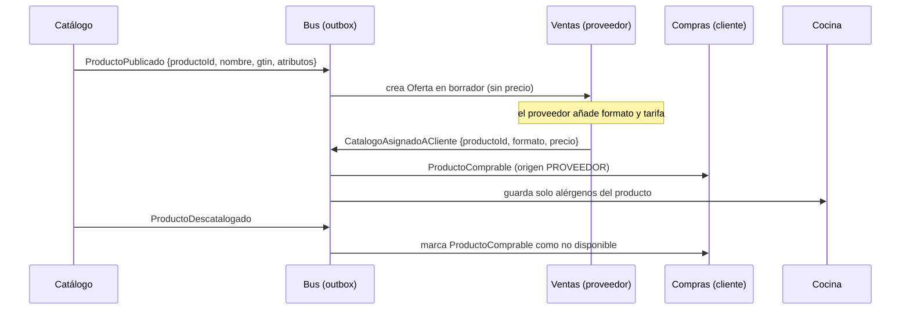

# Bounded context de Catálogo genérico

Pregunta de partida: *¿cómo debería ser un BC de Catálogo genérico que valga para todo?*

Notas relacionadas: `mapa-de-contextos-erp-marketplace.md` (dónde vive hoy el catálogo en el ERP), `unidades-de-medida-compra-stock-cocina.md` (formatos y unidades), `comunicacion-entre-bounded-contexts.md` (ACL, Published Language).

## Respuesta corta: un catálogo "que valga para todo" es una mala meta

Un catálogo **no puede valer para todo** y no debería intentarlo. Lo que sí puede ser genérico es una parte acotada: **describir e identificar productos** (identidad, nombre, clasificación, atributos tipados, variantes, imágenes, estado de publicación). Precio, stock, coste, unidades de cocina y condiciones comerciales **no son catálogo**: son otros modelos en otros contextos que *referencian* el producto por su id.

Las fuentes que lo sostienen:

- **Fowler**: "Producto" es un polisema clásico. *"Time and time again I see this confusion recur with polysemes like "Customer" and "Product"."* Y, citando a Evans, *"total unification of the domain model for a large system will not be feasible or cost-effective"* ([BoundedContext](https://martinfowler.com/bliki/BoundedContext.html)).
- **Evans**, patrón *Generic Subdomains*: separar lo genérico en módulos propios y *"Leave no trace of your specialties in them"* ([DDD Reference](https://domainlanguage.com/wp-content/uploads/2016/05/DDD_Reference_2015-03.pdf)). Lo genérico tiene que ser *pequeño y sin detalles de tu negocio*, no *grande y con todo dentro*.
- **Inner-platform effect**: *"the tendency of software architects to create a system so customizable as to become a replica, and often a poor replica, of the software development platform they are using"* ([Wikipedia](https://en.wikipedia.org/wiki/Inner-platform_effect)). Un catálogo donde todo es configurable acaba siendo un mal motor de base de datos con un mal lenguaje de reglas.

Mi recomendación para el ERP (opinión, no de las fuentes): un **Catálogo descriptivo** con un modelo de familias y atributos tipados, y todo lo comercial y operativo fuera. Más abajo está el diseño.

## Qué tipo de subdominio es el catálogo

Khononov distingue (según las notas de [Candost](https://candost.blog/books/learning-domain-driven-design-part-1-strategic-design/)):

- **Core**: da ventaja competitiva y es complejo. Prueba: *"would someone pay for a domain on its own?"*
- **Generic**: *"the domain that every company has"*; complejo pero *"solved problems"*, se puede comprar.
- **Supporting**: simple, apoya al core, *"often simpler to hack and build than to buy"*.

Aplicado al marketplace de hostelería (valoración mía):

| Parte del "catálogo" | Tipo | Por qué |
|---|---|---|
| Ficha descriptiva (nombre, marca, GTIN, alérgenos, imágenes, categoría) | **Genérico** | Lo tiene cualquier e-commerce. Hay productos (PIM como Akeneo) y estándares (GS1) que lo resuelven. |
| Formatos de venta del proveedor (caja de 6, saco de 25 kg) | **Supporting** | Específico del B2B, pero simple. |
| Tarifas por cliente, condiciones, catálogos asignados | **Core** o cerca | Es parte de lo que hace valioso el marketplace frente a un PDF de precios. |
| Catálogo de compra del cliente (su referencia, artículo vinculado) | **Core** (Compras) | Une proveedor ↔ inventario ↔ cocina. |

Conclusión: si se mete todo en un único "BC Catálogo genérico", se mezcla un subdominio genérico con uno core. Evans pide justo lo contrario en *Segregated Core*: *"Factor all generic or supporting elements into other objects and place them into other packages"*.

## El mismo "producto" en cada contexto del ERP

El motivo de fondo de no unificar es la polisemia que señala Fowler. Para el mismo aceite de oliva, cada contexto necesita datos distintos y reglas distintas:



Si un único `Producto` intenta servir a los cinco, acaba con campos `precio`, `stock`, `coste`, `mermaPorcentaje`, `precioCliente[]`... y cada cambio en Cocina obliga a tocar el modelo de Ventas. Eso es lo que Evans llama un modelo no unificable.

## Qué entra y qué no entra en un Catálogo genérico

Regla práctica (mía, derivada de *"Leave no trace of your specialties"*): entra lo que **describe** el producto y sería igual para cualquier comprador; no entra lo que depende de **quién**, **cuándo** o **cuánto**.

| Entra en Catálogo | No entra (y dónde va) |
|---|---|
| `ProductoId`, código, GTIN | Precio y tarifas por cliente → Ventas |
| Nombre y descripción (multi-idioma si hace falta) | Stock y almacenes → Inventario |
| Familia / categoría | Coste, PMP, FIFO → Inventario |
| Atributos descriptivos tipados (alérgenos, origen, grado alcohólico) | Unidad de stock y equivalencias → Inventario |
| Variantes y sus ejes (formato 1 l / 5 l) | Gramaje en receta, merma → Cocina |
| Imágenes, fichas técnicas | Referencia interna del cliente → Compras |
| Ciclo de vida: borrador → publicado → descatalogado | Disponibilidad comercial a un cliente → Ventas |

Sylius sigue esta línea: el precio y el inventario se definen en la variante (*"Variants can have their own pricing configurations, inventory tracking, and more"*, [Sylius Products](https://docs.sylius.com/the-book/products/products)), no en la ficha general. En un marketplace B2B hay que ir un paso más allá y sacar el precio del catálogo, porque depende del cliente (ver `mapa-de-contextos-erp-marketplace.md`).

## El modelo: familias y atributos tipados (Type Object)

La parte "genérica" se consigue con el patrón **Type Object**: en vez de una clase PHP por tipo de producto (`Aceite`, `Vino`, `Verdura`), una clase `Familia` cuyas instancias definen qué atributos tiene cada tipo. Nystrom lo describe como *"Allow the flexible creation of new "classes" by creating a single class"*, útil cuando *"you don't know what types you will need up front"* ([Type Object](https://gameprogrammingpatterns.com/type-object.html)).

Akeneo, un PIM de referencia, usa la misma idea:
- *"Families are used to gather attributes that are common to several products"*.
- La obligatoriedad de un atributo se define **por canal** y alimenta la *completeness*.
- La *family variant* define la estructura de variantes; *"the variant axes are attributes of the family which identify the variant product"*, y solo pueden ser de tipo estructurado (select, medida, booleano) ([Akeneo](https://help.akeneo.com/pim/v6/articles/manage-your-families.html)).

Sylius limita los tipos de atributo a una lista cerrada (texto, checkbox, entero, porcentaje, textarea, fecha, fecha-hora, select) ([Sylius Attributes](https://docs.sylius.com/the-book/products/attributes)). Esa lista cerrada es lo que evita el inner-platform effect: es flexible en *qué* atributos hay, no en *cómo* se comportan.



`Familia` y `Producto` son **agregados distintos** que se referencian por id, como recomiendan las reglas de agregados (ver `building-blocks-tacticos.md`). La familia se pasa como argumento al validar; no se navega desde el producto.

El precio a pagar, según Nystrom: el Type Object hace fácil definir **datos** por tipo y difícil definir **comportamiento** por tipo. Si una familia necesita reglas propias (por ejemplo, "las bebidas alcohólicas exigen grado y no se pueden vender a cierto canal"), eso es una señal de que esa regla pertenece a otro contexto o a código explícito, no a más configuración.

## Ejemplo PHP: Familia, atributos y Producto

```php
<?php
declare(strict_types=1);

namespace Catalogo\Dominio;

enum TipoAtributo: string
{
    case Texto = 'texto';
    case Entero = 'entero';
    case Decimal = 'decimal';
    case Booleano = 'booleano';
    case Seleccion = 'seleccion';          // una opción de una lista cerrada
    case SeleccionMultiple = 'seleccion_multiple';
}

final readonly class DefinicionAtributo
{
    /** @param list<string> $opciones */
    public function __construct(
        public string $codigo,                     // 'alergenos', 'origen', 'formato'
        public TipoAtributo $tipo,
        public bool $obligatorioParaPublicar = false,
        public array $opciones = [],
    ) {}

    public function validar(mixed $valor): void
    {
        $ok = match ($this->tipo) {
            TipoAtributo::Texto => is_string($valor),
            TipoAtributo::Entero => is_int($valor),
            TipoAtributo::Decimal => is_int($valor) || is_float($valor),
            TipoAtributo::Booleano => is_bool($valor),
            TipoAtributo::Seleccion => in_array($valor, $this->opciones, true),
            TipoAtributo::SeleccionMultiple => is_array($valor)
                && array_diff($valor, $this->opciones) === [],
        };
        if (!$ok) {
            throw new ValorAtributoInvalido($this->codigo, $valor);
        }
    }
}

final class Familia                                // agregado (Type Object)
{
    /** @var array<string, DefinicionAtributo> */
    private array $atributos = [];

    /** @param list<string> $ejesVariante */
    public function __construct(
        public readonly FamiliaId $id,
        private string $nombre,
        private array $ejesVariante = [],          // p. ej. ['formato']
    ) {}

    public function definirAtributo(DefinicionAtributo $def): void
    {
        $this->atributos[$def->codigo] = $def;
    }

    /** @param array<string, mixed> $valores */
    public function validarValores(array $valores): void
    {
        foreach ($valores as $codigo => $valor) {
            $def = $this->atributos[$codigo]
                ?? throw new AtributoNoPerteneceAFamilia($codigo, $this->nombre);
            $def->validar($valor);
        }
    }

    /** @param array<string, mixed> $valores  @return list<string> */
    public function atributosQueFaltan(array $valores): array
    {
        return array_values(array_map(
            fn (DefinicionAtributo $d) => $d->codigo,
            array_filter(
                $this->atributos,
                fn (DefinicionAtributo $d) => $d->obligatorioParaPublicar
                    && !array_key_exists($d->codigo, $valores),
            ),
        ));
    }

    public function esEjeDeVariante(string $codigo): bool
    {
        return in_array($codigo, $this->ejesVariante, true);
    }
}
```

```php
<?php
declare(strict_types=1);

namespace Catalogo\Dominio;

enum EstadoProducto: string
{
    case Borrador = 'borrador';
    case Publicado = 'publicado';
    case Descatalogado = 'descatalogado';
}

final class Producto extends AggregateRoot
{
    /** @var array<string, mixed> */
    private array $atributos = [];
    private EstadoProducto $estado = EstadoProducto::Borrador;

    public function __construct(
        public readonly ProductoId $id,
        public readonly OrganizacionId $proveedorId,   // dueño de la ficha
        private FamiliaId $familiaId,
        private string $nombre,
        private ?Gtin $gtin = null,
    ) {}

    /** @param array<string, mixed> $valores */
    public function asignarAtributos(Familia $familia, array $valores): void
    {
        $this->asegurarFamilia($familia);
        $familia->validarValores($valores);
        $this->atributos = [...$this->atributos, ...$valores];

        if ($this->estado === EstadoProducto::Publicado) {
            $this->registrar(new FichaProductoActualizada($this->id, $valores));
        }
    }

    public function publicar(Familia $familia): void
    {
        $this->asegurarFamilia($familia);
        $faltan = $familia->atributosQueFaltan($this->atributos);
        if ($faltan !== []) {
            throw new FichaIncompleta($this->id, $faltan);   // "completeness"
        }
        $this->estado = EstadoProducto::Publicado;
        $this->registrar(new ProductoPublicado(
            $this->id, $this->proveedorId, $this->nombre, $this->gtin, $this->atributos,
        ));
    }

    public function descatalogar(): void
    {
        $this->estado = EstadoProducto::Descatalogado;
        $this->registrar(new ProductoDescatalogado($this->id));
    }

    private function asegurarFamilia(Familia $familia): void
    {
        if (!$familia->id->equals($this->familiaId)) {
            throw new FamiliaIncorrecta($this->id, $familia->id);
        }
    }
}
```

Lo que **no** aparece en `Producto`: precio, stock, coste, unidad de stock, cliente. Si un día alguien propone añadir `precioCliente`, la respuesta es "eso es Ventas".

## Persistencia: columnas fijas + JSONB, no EAV

La tentación clásica para "atributos dinámicos" es la tabla EAV (`producto_id`, `atributo`, `valor`). La [Wikipedia](https://en.wikipedia.org/wiki/Inner-platform_effect) la pone como ejemplo de inner-platform effect: el modelo *"loses out on all the benefits"* de la base de datos relacional. [SQLServerCentral](https://www.sqlservercentral.com/articles/antipathy-for-entity-attribute-value-data-models) detalla los costes:

- el valor *"has to be generic and untyped"*, así que tipos, `CHECK` y `UNIQUE` hay que reimplementarlos;
- la integridad referencial es compleja y *"should not be underestimated"*;
- filtrar por varios atributos se vuelve *"exponentially complex"*.

El mismo artículo acepta EAV cuando hay muchas clases con poco en común, pocos atributos por objeto, requisitos cambiantes y lecturas por entidad, y pide que se den **al menos dos** de esas condiciones a la vez.

Alternativa que propongo (con fuente en PostgreSQL): **columnas para el núcleo fijo** (id, proveedor, familia, nombre, GTIN, estado) y **un `jsonb` para los atributos de familia**. PostgreSQL indica que `jsonb` *"supports indexing"*, que GIN acelera el operador de contención `@>`, y recomienda que los documentos tengan *"a somewhat fixed structure"* y un tamaño manejable porque *"any update acquires a row-level lock on the whole row"* ([JSON Types](https://www.postgresql.org/docs/current/datatype-json.html)). La estructura fija la aporta la `Familia` en el dominio.

```sql
CREATE TABLE catalogo_producto (
    id            uuid PRIMARY KEY,
    proveedor_id  uuid NOT NULL,
    familia_id    uuid NOT NULL REFERENCES catalogo_familia(id),
    nombre        text NOT NULL,
    gtin          varchar(14) UNIQUE,
    estado        text NOT NULL CHECK (estado IN ('borrador','publicado','descatalogado')),
    atributos     jsonb NOT NULL DEFAULT '{}'
);
CREATE INDEX idx_producto_atributos ON catalogo_producto USING GIN (atributos);

-- Productos sin gluten de la familia Harinas
SELECT id, nombre FROM catalogo_producto
WHERE familia_id = :harinas AND atributos @> '{"sin_gluten": true}';
```

## Cómo lo consumen los demás contextos

El Catálogo es **upstream** y publica un lenguaje estable (Open-host Service + Published Language, ver `comunicacion-entre-bounded-contexts.md`). Cada consumidor traduce a su propio modelo con una ACL y guarda **solo lo que necesita**.



Ejemplo de ACL en Cocina, que solo quiere los alérgenos:

```php
<?php
declare(strict_types=1);

namespace Cocina\Infraestructura\Catalogo;

use Cocina\Dominio\{Alergeno, AlergenosDeProducto, AlergenosDeProductoRepository};

final readonly class AlPublicarseProductoActualizarAlergenos
{
    public function __construct(private AlergenosDeProductoRepository $repo) {}

    /** @param array{productoId: string, atributos: array<string, mixed>} $evento */
    public function __invoke(array $evento): void
    {
        $codigos = $evento['atributos']['alergenos'] ?? [];   // lenguaje del Catálogo
        $this->repo->guardar(new AlergenosDeProducto(
            $evento['productoId'],
            array_map(Alergeno::desdeCodigoCatalogo(...), $codigos), // lenguaje de Cocina
        ));
    }
}
```

Si el Catálogo cambia el nombre interno de un atributo, solo cambia la ACL; el modelo de Cocina no se entera.

## Proveedores externos y estándares (GS1)

En el ERP los clientes pueden comprar a **proveedores externos** sin cuenta. Esos productos no tienen ficha en el Catálogo: viven solo como `ProductoComprable` con `origen = CLIENTE` dentro de Compras (`mapa-de-contextos-erp-marketplace.md`). Es otra razón para no hacer que todo dependa de un catálogo central.

Para la ficha descriptiva conviene apoyarse en un identificador estándar en lugar de inventarlo. GS1 usa el **GTIN** *"for product identification"* y la red **GDSN** *"for synchronized data"* entre fabricantes, mayoristas y compradores de food service ([GS1 Sweden](https://gs1.se/en/your-industry/food-service/)). Guardar el GTIN en `Producto` y en `Variante` permite, más adelante, importar fichas de un pool GDSN o vincular el producto de un externo que se registra en la plataforma. (Que en España el operador sea AECOC no lo he verificado con fuente en esta nota.)

## Señales de que el catálogo se ha vuelto "demasiado genérico"

Lista de comprobación (mía, basada en las fuentes anteriores):

1. Hay atributos tipo "fórmula" o "regla" configurables por familia → inner-platform effect.
2. La tabla de valores es `entity/attribute/value` con `value text` → EAV y sus costes.
3. `Producto` tiene precio, stock o coste → mezcla de contextos (Fowler, polisemia).
4. Ventas, Compras o Cocina hacen `JOIN` directo a tablas del Catálogo → no hay ACL, cualquier cambio rompe a todos.
5. Para dar de alta un producto de un proveedor externo hay que crear una ficha completa en el Catálogo → el catálogo central bloquea el core.
6. El equipo dedica más tiempo al motor de atributos que a Compras o Cocina → Evans: al genérico hay que darle *"lower priority than the core domain"*.

## Recomendación para el ERP marketplace

1. **No construir "un catálogo para todo".** Construir un **Catálogo descriptivo** pequeño: ficha, familia, atributos tipados con lista cerrada de tipos, variantes y ciclo de vida.
2. **Dueño de la ficha = proveedor de la plataforma.** El catálogo de compra del cliente sigue en Compras y cubre a los externos.
3. **Precio, formatos comerciales y tarifas por cliente en Ventas.** Stock y coste en Inventario. Gramajes y mermas en Cocina.
4. **Integración por eventos** (`ProductoPublicado`, `FichaProductoActualizada`, `ProductoDescatalogado`) con ACL en cada consumidor.
5. **Persistencia**: columnas + `jsonb` con índice GIN, no EAV.
6. **Comprar antes que construir** si aparece la necesidad multicanal (fichas para web, marketplaces externos, impresión): es el terreno de un PIM tipo Akeneo, que es justo lo que Evans sugiere para un subdominio genérico (*"consider off-the-shelf solutions"*).

Esto cambia ligeramente `mapa-de-contextos-erp-marketplace.md`, que eliminó el BC Catálogo y metió todo en Ventas. Las dos opciones son válidas: si la ficha descriptiva es poca cosa, puede seguir dentro de Ventas como un módulo; si crece (alérgenos, fichas técnicas, imágenes, GTIN, varias familias), separarla como Catálogo descriptivo evita que Ventas cargue con un subdominio genérico.
