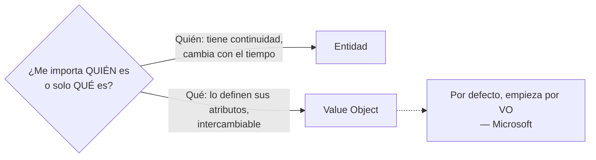
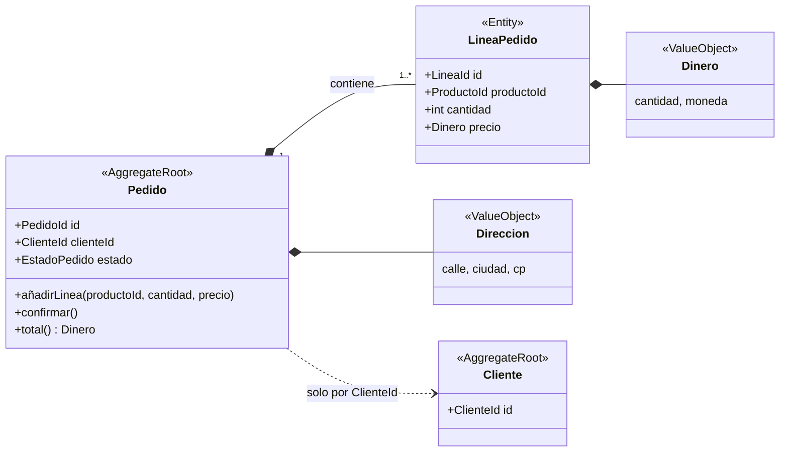
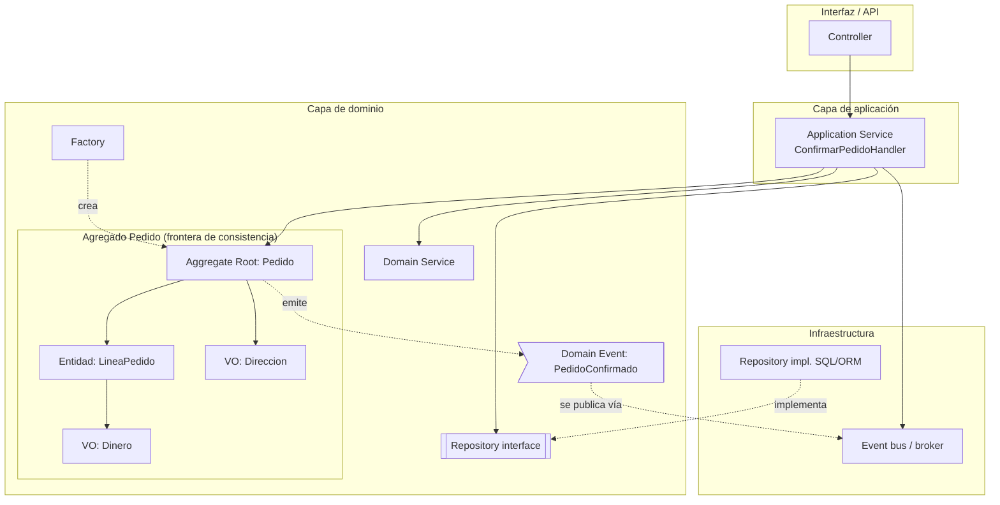
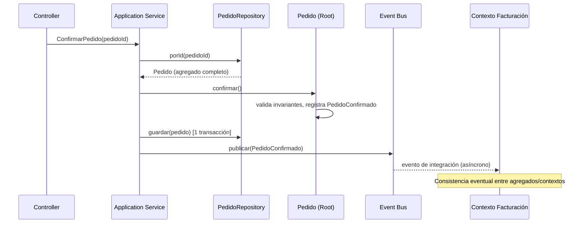

# DDD táctico: building blocks

## TL;DR

| Building block | Qué es | ¿Identidad? | ¿Mutable? | Capa | Responsabilidad |
|---|---|---|---|---|---|
| **Entidad** | Objeto definido por su identidad a lo largo del tiempo | Sí | Sí | Dominio | Comportamiento + continuidad del ciclo de vida |
| **Value Object** | Objeto definido solo por sus atributos | No | No (inmutable) | Dominio | Describir/medir algo, operaciones sin efectos laterales |
| **Agregado** | Cluster de entidades + VOs tratado como unidad, con una raíz | Sí (la de la raíz) | Sí, solo vía la raíz | Dominio | Frontera de consistencia y de transacción; protege invariantes |
| **Aggregate Root** | La entidad única de entrada al agregado | Sí (global) | Sí | Dominio | Hacer cumplir las invariantes del agregado entero |
| **Domain Event** | Registro de algo relevante que ya ocurrió en el dominio | No (es un hecho) | No (inmutable) | Dominio | Comunicar cambios; consistencia eventual entre agregados |
| **Domain Service** | Operación del dominio que no encaja en una entidad/VO | No | Sin estado | Dominio | Reglas de negocio que cruzan varias entidades/agregados |
| **Application Service** | Orquestador de un caso de uso | No | Sin estado | Aplicación | Cargar, invocar dominio, guardar, transacción, auth. **Sin lógica de negocio** |
| **Repository** | Ilusión de colección de agregados | No | — | Interfaz en dominio, implementación en infraestructura | Obtener/guardar agregados completos, uno por raíz |
| **Factory** | Encapsula creación compleja | No | Sin estado | Dominio | Crear un agregado (o VO grande) entero y válido |
| **Module** | Paquete/namespace del modelo | — | — | Dominio | Agrupar conceptos cohesivos con nombres del lenguaje ubicuo |

> Dos ejes para clasificar: **identidad vs. valor** (Entidad vs. VO; Fowler: *reference objects* vs. *value objects*) y **capa** (dominio / aplicación / infraestructura, según la *Layered Architecture* de Evans).

---

## 1. Entidad

**Fuente (Evans, DDD Reference):** *"When an object is distinguished by its identity, rather than its attributes, make this primary to its definition in the model."* El modelo debe definir *qué significa ser la misma cosa*.

**Fowler (EvansClassification):** *"Objects that have a distinct identity that runs through time and different representations."* Ejemplos: Customer, Ship, Rental Agreement.

**Microsoft:** las entidades deben *"encapsulate behavior, not only carry data"*. Ej.: una entidad `Delivery` contiene la lógica para decidir si se puede cancelar. Si solo tiene getters/setters es un **modelo anémico** (aceptable solo en servicios CRUD simples, según la misma fuente).

```ts
class Pedido {                       // Entidad: igualdad por id
  constructor(readonly id: PedidoId, private estado: EstadoPedido) {}

  cancelar(): void {                 // comportamiento, no solo datos
    if (this.estado === "ENVIADO") throw new Error("No se puede cancelar un pedido enviado");
    this.estado = "CANCELADO";
  }
  equals(o: Pedido) { return this.id.equals(o.id); }
}
```

## 2. Value Object

**Evans:** *"When you care only about the attributes and logic of an element of the model, classify it as a value object."* Inmutable, operaciones sin efectos laterales, sin identidad.

**Microsoft:** *"To update a value object, you create a new instance to replace the old instance."* y *"Prefer value objects as your default modeling choice."* Ejemplos: `Location`, `ETA`, `PackageWeight`. Fowler: Date, Money.

Importante: **la clasificación depende del contexto**. Microsoft pone el ejemplo de `Address`: es VO en un pedido, pero entidad en un sistema de facturación que necesita referenciarla.

```ts
class Dinero {                       // Value Object: igualdad por valor
  private constructor(readonly cantidad: number, readonly moneda: string) {
    if (cantidad < 0) throw new Error("Cantidad negativa");
  }
  static de(c: number, m: string) { return new Dinero(c, m); }
  sumar(o: Dinero): Dinero {         // devuelve uno nuevo, no muta
    if (o.moneda !== this.moneda) throw new Error("Monedas distintas");
    return new Dinero(this.cantidad + o.cantidad, this.moneda);
  }
  equals(o: Dinero) { return this.cantidad === o.cantidad && this.moneda === o.moneda; }
}
```



## 3. Agregado y Aggregate Root

**Evans:** *"Cluster the entities and value objects into aggregates and define boundaries around each. Choose one entity to be the root of each aggregate, and allow external objects to hold references to the root only."* Dentro de la frontera las reglas de consistencia se aplican de forma síncrona; entre agregados, de forma asíncrona. *"Use the same aggregate boundaries to govern transactions and distribution."*

**Fowler:** *"A DDD aggregate is a cluster of domain objects that can be treated as a single unit."* Ejemplo: un pedido y sus líneas. *"Transactions should not cross aggregate boundaries."*

**Microsoft (.NET):** la raíz es *"the only entry point for updates to the aggregate"*; si cambias una entidad hija por separado, la raíz no puede garantizar un estado válido. *"Thinking about transaction operations is probably the best way to identify aggregates."*

### Reglas de Vernon (Effective Aggregate Design)

1. **Modela invariantes reales en fronteras de consistencia.** Invariante = *"a business rule that must always be consistent."* Una transacción modifica **un** agregado.
2. **Diseña agregados pequeños.** Raíz + mínimo de atributos/VOs.
3. **Referencia otros agregados por identidad** (ej. `ProductId`), no por referencia de objeto.
4. **Consistencia eventual fuera de la frontera** (vía eventos de dominio).

**Ejemplo de Vernon (Scrum):** el equipo modeló `Product` como un agregado gigante que contenía `BacklogItem`, `Release` y `Sprint`. Resultado: conflictos de concurrencia (planificar un backlog item hacía fallar la programación de una release) y mal rendimiento. Lo partieron en 4 agregados enlazados por `ProductId`.



```ts
class Pedido {                                   // Aggregate Root
  private lineas: LineaPedido[] = [];
  private eventos: DomainEvent[] = [];
  constructor(readonly id: PedidoId, readonly clienteId: ClienteId) {} // otro agregado: solo su id

  añadirLinea(productoId: ProductoId, cantidad: number, precio: Dinero) {
    if (this.lineas.length >= 50) throw new Error("Máximo 50 líneas"); // invariante del agregado
    this.lineas.push(new LineaPedido(LineaId.nuevo(), productoId, cantidad, precio));
  }
  confirmar() {
    if (this.lineas.length === 0) throw new Error("Pedido vacío");
    this.eventos.push(new PedidoConfirmado(this.id, this.clienteId, new Date()));
  }
  get lineasPedido(): readonly LineaPedido[] { return this.lineas; } // solo lectura hacia fuera
}
```

## 4. Domain Event

**Evans:** *"Model information about activity in the domain as a series of discrete events."* Son inmutables, normalmente con timestamp e identidades de las entidades implicadas.

**Microsoft:** *"a record was inserted into a table"* no es un evento de dominio; *"a delivery was canceled"* sí. Distingue **eventos de dominio internos** (dentro del bounded context) de **eventos de integración** (publicados vía broker a otros contextos). Ej.: `DeliveryCompleted` lo consume el contexto de cuentas para facturar.

Se nombran en **pasado**: `PedidoConfirmado`, `PagoRechazado`.

```ts
class PedidoConfirmado implements DomainEvent {
  constructor(readonly pedidoId: PedidoId, readonly clienteId: ClienteId, readonly ocurridoEn: Date) {}
}
```

## 5. Domain Service vs. Application Service

**Evans (Services):** *"Add an operation to the model as a standalone interface declared as a service"* cuando un proceso del dominio no encaja de forma natural en una entidad o VO. Se nombra con el lenguaje ubicuo.

**Microsoft:**
- *Domain service*: sin estado; *"encapsulate business rules that span multiple entities or aggregates."* Ej.: `Scheduler` en el sistema de drones.
- *Application service*: *"orchestrate use cases. They coordinate calls to domain services and repositories, manage transactions, and handle concerns like user authentication or SMS notifications. They contain no business logic themselves."*

Regla práctica: si la clase toma **decisiones de negocio** → dominio. Si solo **coordina** (cargar, llamar, guardar, publicar) → aplicación.

```ts
// Domain Service: regla que cruza dos agregados
class ServicioTransferencia {
  transferir(origen: Cuenta, destino: Cuenta, importe: Dinero) {
    origen.retirar(importe);   // cada agregado protege sus invariantes
    destino.ingresar(importe);
  }
}

// Application Service: orquesta el caso de uso, sin reglas de negocio
class ConfirmarPedidoHandler {
  constructor(private pedidos: PedidoRepository, private bus: EventBus) {}
  async ejecutar(cmd: { pedidoId: string }) {
    const pedido = await this.pedidos.porId(PedidoId.de(cmd.pedidoId));
    pedido.confirmar();                 // la decisión vive en el dominio
    await this.pedidos.guardar(pedido); // 1 transacción = 1 agregado
    await this.bus.publicar(pedido.extraerEventos());
  }
}
```

> Ojo: la transferencia del ejemplo modifica dos agregados en una transacción, lo que choca con la regla 1 de Vernon. Vernon recomienda cuestionar ese requisito y, si el negocio lo admite, resolverlo con consistencia eventual (retirar → evento → ingresar).

## 6. Repository

**Evans:** *"Query access to aggregates expressed in the ubiquitous language."* Uno por tipo de agregado que necesite acceso global, con métodos para añadir, eliminar y seleccionar. *"Provide repositories only for aggregate roots that actually need direct access."*

Fowler, en su clasificación, lo pone como ejemplo de **Service**, no de entidad ni VO.

Capa: la **interfaz** pertenece al dominio (habla su lenguaje); la **implementación** (SQL, ORM) va en infraestructura. *Este reparto de capas es la práctica habitual derivada de la Layered Architecture de Evans; Evans no lo formula con estas palabras en la Reference.*

```ts
interface PedidoRepository {            // dominio
  porId(id: PedidoId): Promise<Pedido>;  // devuelve el agregado completo
  guardar(p: Pedido): Promise<void>;
}
// NO existe LineaPedidoRepository: LineaPedido no es raíz.
```

## 7. Factory

**Evans:** *"When creation of an entire, internally consistent aggregate, or a large value object, becomes complicated or reveals too much of the internal structure, factories provide encapsulation."* Crea el agregado entero como unidad, cumpliendo sus invariantes. Puede ser un método estático, un método en otro agregado o una clase aparte.

```ts
class Pedido {
  static crear(clienteId: ClienteId, lineas: NuevaLinea[]): Pedido {  // factory method
    if (lineas.length === 0) throw new Error("Un pedido nace con al menos una línea");
    const p = new Pedido(PedidoId.nuevo(), clienteId);
    lineas.forEach(l => p.añadirLinea(l.productoId, l.cantidad, l.precio));
    return p;
  }
}
```

## 8. Module

**Evans:** *"Choose modules that tell the story of the system and contain a cohesive set of concepts."* Sus nombres forman parte del lenguaje ubicuo (aka *packages*). Ej.: `pedidos/`, `facturacion/`, no `entities/`, `services/`.

---

## Cómo encajan todos





## Errores frecuentes (según las fuentes)

- **Agregados grandes** por "invariantes falsas" → contención y mal rendimiento (Vernon, ejemplo Scrum).
- **Modelo anémico**: entidades sin comportamiento y reglas en servicios (Microsoft/Fowler).
- **Referenciar otro agregado por objeto** en vez de por id (Vernon, Microsoft).
- **Repositorios para entidades hijas** (Evans: solo para raíces).
- **Lógica de negocio en el application service** (Microsoft).
- **Eventos técnicos** ("fila insertada") en vez de hechos del dominio (Microsoft).

## Fuentes

- Eric Evans, [Domain-Driven Design Reference (2015)](https://domainlanguage.com/wp-content/uploads/2016/05/DDD_Reference_2015-03.pdf)
- Vaughn Vernon, [Effective Aggregate Design, Part I (2011)](https://dddcommunity.org/wp-content/uploads/files/pdf_articles/Vernon_2011_1.pdf)
- Martin Fowler, [EvansClassification](https://www.martinfowler.com/bliki/EvansClassification.html)
- Martin Fowler, [DDD_Aggregate](https://www.martinfowler.com/bliki/DDD_Aggregate.html)
- Microsoft, [Using tactical DDD to design microservices](https://learn.microsoft.com/en-us/azure/architecture/microservices/model/tactical-ddd)
- Microsoft, [Design a microservice domain model](https://learn.microsoft.com/en-us/dotnet/architecture/microservices/microservice-ddd-cqrs-patterns/microservice-domain-model)
