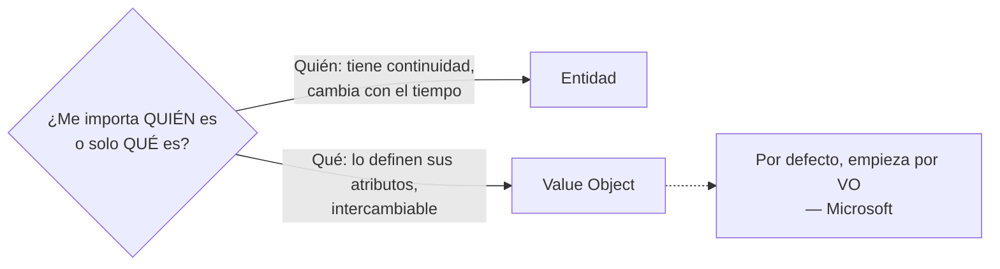
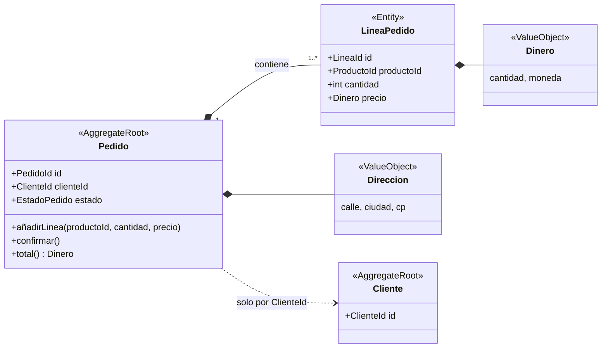
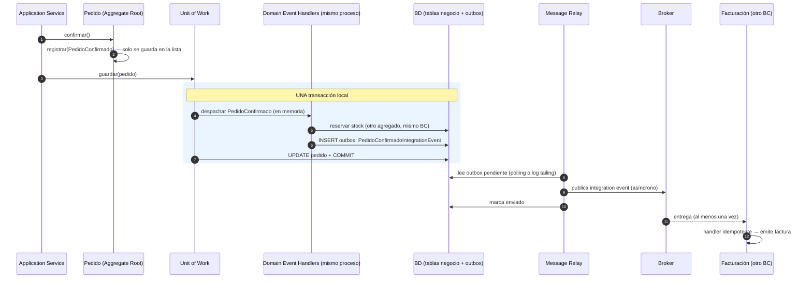
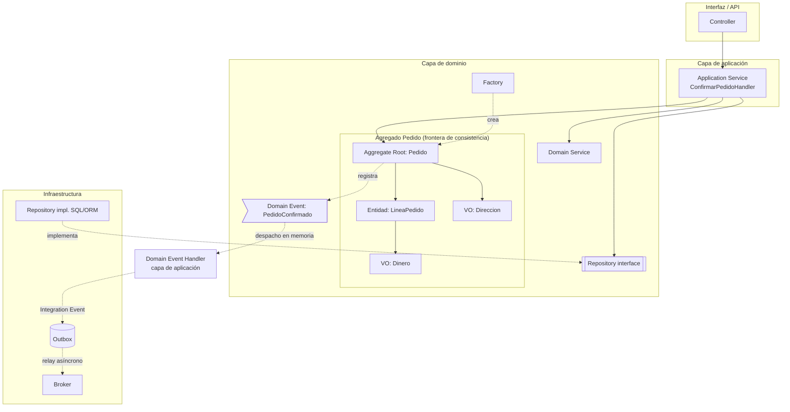
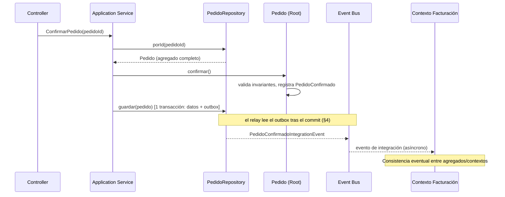

# DDD táctico: building blocks

## TL;DR

| Building block | Qué es | ¿Identidad? | ¿Mutable? | Capa | Responsabilidad |
|---|---|---|---|---|---|
| **Entidad** | Objeto definido por su identidad a lo largo del tiempo | Sí | Sí | Dominio | Comportamiento + continuidad del ciclo de vida |
| **Value Object** | Objeto definido solo por sus atributos | No | No (inmutable) | Dominio | Describir/medir algo, operaciones sin efectos laterales |
| **Agregado** | Cluster de entidades + VOs tratado como unidad, con una raíz | Sí (la de la raíz) | Sí, solo vía la raíz | Dominio | Frontera de consistencia y de transacción; protege invariantes |
| **Aggregate Root** | La entidad única de entrada al agregado | Sí (global) | Sí | Dominio | Hacer cumplir las invariantes del agregado entero |
| **Domain Event** | Registro de algo relevante que ya ocurrió en el dominio | No (es un hecho) | No (inmutable) | Dominio | Efectos laterales dentro del mismo bounded context, en memoria |
| **Integration Event** *(no es building block de Evans, ver §4)* | Hecho publicado hacia otros bounded contexts/servicios | No | No (inmutable) | Aplicación (se crea) + infraestructura (outbox, broker) | Propagar cambios fuera del contexto, siempre asíncrono y tras el commit |
| **Domain Service** | Operación del dominio que no encaja en una entidad/VO | No | Sin estado | Dominio | Reglas de negocio que cruzan varias entidades/agregados |
| **Application Service** | Orquestador de un caso de uso | No | Sin estado | Aplicación | Cargar, invocar dominio, guardar, transacción, auth. **Sin lógica de negocio** |
| **Repository** | Ilusión de colección de agregados | No | — | Interfaz en dominio, implementación en infraestructura | Obtener/guardar agregados completos, uno por raíz |
| **Factory** | Encapsula creación compleja | No | Sin estado | Dominio | Crear un agregado (o VO grande) entero y válido |
| **Module** | Paquete/namespace del modelo | — | — | Dominio | Agrupar conceptos cohesivos con nombres del lenguaje ubicuo |

> Ejemplo conductor: el agregado `Pedido` del contexto **Ventas** de un e-commerce genérico, que publica `PedidoConfirmado` hacia **Facturación**. Es el mismo ejemplo que usa [Comunicación entre bounded contexts](comunicacion-entre-bounded-contexts.md). Para el ERP marketplace real (donde el pedido es `PedidoCompra` en Compras) ver [Mapa de bounded contexts del ERP marketplace](mapa-de-contextos-erp-marketplace.md).

> Dos ejes para clasificar: **identidad vs. valor** (Entidad vs. VO; Fowler: *reference objects* vs. *value objects*) y **capa** (dominio / aplicación / infraestructura, según la *Layered Architecture* de Evans).

---

## 1. Entidad

**Fuente (Evans, DDD Reference):** *"When an object is distinguished by its identity, rather than its attributes, make this primary to its definition in the model."* El modelo debe definir *qué significa ser la misma cosa*.

**Fowler (EvansClassification):** *"Objects that have a distinct identity that runs through time and different representations."* Ejemplos: Customer, Ship, Rental Agreement.

**Microsoft:** las entidades deben *"encapsulate behavior, not only carry data"*. Ej.: una entidad `Delivery` contiene la lógica para decidir si se puede cancelar. Si solo tiene getters/setters es un **modelo anémico** (aceptable solo en servicios CRUD simples, según la misma fuente).

```php
<?php
enum EstadoPedido: string
{
    case Borrador = 'BORRADOR';
    case Confirmado = 'CONFIRMADO';
    case Enviado = 'ENVIADO';
    case Cancelado = 'CANCELADO';
}

final class Pedido                     // Entidad: igualdad por id
{
    public function __construct(
        public readonly PedidoId $id,
        private EstadoPedido $estado,
    ) {}

    public function cancelar(): void   // comportamiento, no solo datos
    {
        if ($this->estado === EstadoPedido::Enviado) {
            throw new DomainException('No se puede cancelar un pedido enviado');
        }
        $this->estado = EstadoPedido::Cancelado;
    }

    public function equals(Pedido $otro): bool
    {
        return $this->id->equals($otro->id);
    }
}
```

## 2. Value Object

**Evans:** *"When you care only about the attributes and logic of an element of the model, classify it as a value object."* Inmutable, operaciones sin efectos laterales, sin identidad.

**Microsoft:** *"To update a value object, you create a new instance to replace the old instance."* y *"Prefer value objects as your default modeling choice."* Ejemplos: `Location`, `ETA`, `PackageWeight`. Fowler: Date, Money.

Importante: **la clasificación depende del contexto**. Microsoft pone el ejemplo de `Address`: es VO en un pedido, pero entidad en un sistema de facturación que necesita referenciarla.

```php
<?php
final class Dinero                     // Value Object: igualdad por valor, inmutable
{
    private function __construct(
        public readonly float $cantidad,
        public readonly string $moneda,
    ) {
        if ($cantidad < 0) {
            throw new InvalidArgumentException('Cantidad negativa');
        }
    }

    public static function de(float $cantidad, string $moneda): self
    {
        return new self($cantidad, $moneda);
    }

    public function sumar(Dinero $otro): self   // devuelve uno nuevo, no muta
    {
        if ($otro->moneda !== $this->moneda) {
            throw new InvalidArgumentException('Monedas distintas');
        }
        return new self($this->cantidad + $otro->cantidad, $this->moneda);
    }

    public function equals(Dinero $otro): bool
    {
        return $this->cantidad === $otro->cantidad && $this->moneda === $otro->moneda;
    }
}
```



### Value Objects de identidad: *Strongly-Typed IDs*

Un VO que envuelve el identificador de una entidad (`PedidoId`, `ClienteId`) se suele llamar **Strongly-Typed ID** (o *typed ID*). Evita la *primitive obsession*: *"The problem of using primitive values to represent domain concepts is called primitive obsession."* (Andrew Lock). Con `Guid`/`string` el compilador no detecta que pasas un `userId` donde va un `orderId`; con tipos distintos, no compila (Lock lo muestra en C#). En PHP no hay compilación, pero las declaraciones de tipo de los parámetros hacen que pasar un `ClienteId` donde va un `PedidoId` lance un `TypeError` en vez de seguir con un id equivocado ([PHP manual, Type declarations](https://www.php.net/manual/en/language.types.declarations.php)). Vernon usa este tipo de identidades (`ProductId`) para referenciar otros agregados por identidad.

```php
<?php
use Ramsey\Uuid\Uuid;

final class PedidoId
{
    private function __construct(public readonly string $valor) {}

    public static function nuevo(): self
    {
        return new self(Uuid::uuid4()->toString());
    }

    public static function de(string $valor): self
    {
        if ($valor === '') {
            throw new InvalidArgumentException('PedidoId vacío');
        }
        return new self($valor);
    }

    public function equals(PedidoId $otro): bool
    {
        return $this->valor === $otro->valor;
    }
}
// obtener(PedidoId $pedidoId, ClienteId $clienteId) → invertirlos lanza TypeError
```

## 3. Agregado y Aggregate Root

**Evans:** *"Cluster the entities and value objects into aggregates and define boundaries around each. Choose one entity to be the root of each aggregate, and allow external objects to hold references to the root only."* Dentro de la frontera las reglas de consistencia se aplican de forma síncrona; entre agregados, de forma asíncrona. *"Use the same aggregate boundaries to govern transactions and distribution."*

**Fowler:** *"A DDD aggregate is a cluster of domain objects that can be treated as a single unit."* Ejemplo: un pedido y sus líneas. *"Transactions should not cross aggregate boundaries."*

**Microsoft (.NET):** la raíz es *"the only entry point for updates to the aggregate"*; si cambias una entidad hija por separado, la raíz no puede garantizar un estado válido. *"Thinking about transaction operations is probably the best way to identify aggregates."*

### Reglas de Vernon (Effective Aggregate Design)

1. **Modela invariantes reales en fronteras de consistencia.** Invariante = *"a business rule that must always be consistent."* Una transacción modifica **un** agregado.
2. **Diseña agregados pequeños.** Raíz + mínimo de atributos/VOs.
3. **Referencia otros agregados por identidad** (ej. `ProductId`), no por referencia de objeto.
4. **Consistencia eventual fuera de la frontera** (vía eventos de dominio).

**Ejemplo de Vernon (Scrum):** el equipo modeló `Product` como un agregado gigante que contenía `BacklogItem`, `Release` y `Sprint`. Resultado: conflictos de concurrencia (planificar un backlog item hacía fallar la programación de una release) y mal rendimiento. Lo partieron en 4 agregados enlazados por `ProductId`.



```php
<?php
final class Pedido                                    // Aggregate Root
{
    /** @var list<LineaPedido> */
    private array $lineas = [];
    /** @var list<DomainEvent> */
    private array $eventos = [];

    public function __construct(
        public readonly PedidoId $id,
        public readonly ClienteId $clienteId,         // otro agregado: solo su id
    ) {}

    public function añadirLinea(ProductoId $productoId, int $cantidad, Dinero $precio): void
    {
        if (count($this->lineas) >= 50) {
            throw new DomainException('Máximo 50 líneas');   // invariante del agregado
        }
        $this->lineas[] = new LineaPedido(LineaId::nuevo(), $productoId, $cantidad, $precio);
    }

    public function confirmar(): void
    {
        if ($this->lineas === []) {
            throw new DomainException('Pedido vacío');
        }
        $this->eventos[] = new PedidoConfirmado($this->id, $this->clienteId, $this->total(), new DateTimeImmutable());
    }

    /** @return list<LineaPedido> copia: el array se pasa por valor, no se puede mutar desde fuera */
    public function lineas(): array
    {
        return $this->lineas;
    }
}
```

## 4. Domain Event y Integration Event

**Evans:** *"Model information about activity in the domain as a series of discrete events."* Son inmutables, normalmente con timestamp e identidades de las entidades implicadas. Se nombran en **pasado**: `PedidoConfirmado`, `PagoRechazado`.

**Microsoft:** *"a record was inserted into a table"* no es un evento de dominio; *"a delivery was canceled"* sí.

### ¿Es el evento de integración un building block?

**No en el sentido de Evans.** El *Domain Event* sí está en la DDD Reference de Evans; el *Integration Event* es una distinción que aparece en la guía de microservicios de Microsoft (eShopOnContainers) y en el blog de Cesar de la Torre (Microsoft). Es un **mecanismo de integración entre bounded contexts**, no una pieza del modelo de dominio. Por eso aquí se documenta junto al Domain Event, pero vive en otras capas. Los patrones de relación entre contextos (Published Language, ACL, Customer/Supplier...) están en [Comunicación entre bounded contexts](comunicacion-entre-bounded-contexts.md).

### Diferencias

| | Domain Event | Integration Event |
|---|---|---|
| Alcance | Mismo dominio / bounded context / proceso | Otros microservicios, bounded contexts o apps externas |
| Transporte | En memoria (dispatcher, p. ej. MediatR) | Broker o bus de mensajes (Service Bus, colas, Kafka...) |
| Sincronía | Síncrono o asíncrono | **Siempre asíncrono** |
| Momento | Se levanta en la entidad **antes** de persistir; se despacha antes o después del commit (decisión de diseño) | **Solo tras persistir con éxito** |
| Quién lo crea | El agregado (capa de dominio) | Un handler o servicio de aplicación, a partir del evento de dominio |
| Contrato | Interno, puede llevar tipos del dominio | Público y estable: tipos primitivos/DTO, versionado |
| Ejemplo | `PedidoConfirmado` → reservar stock en el mismo servicio | `PedidoConfirmadoIntegrationEvent` → Facturación emite la factura |

Citas clave:

- Microsoft: los domain events usan *"in-memory event based communication across disconnected aggregates that are part of the same domain model"*; en ellos *"you must do everything in-process (in-memory) and within the same transaction or operation."* (de la Torre)
- Microsoft: *"Integration events, however, should always be asynchronous."* y deben ocurrir *"only if the entity is successfully persisted, otherwise it's as if the entire operation never happened."* (guía .NET)
- Microsoft: *"you should not publish integration events until you are 100% sure that your original operation"* ha tenido éxito. (de la Torre)

### Cómo se crea y se publica un Domain Event

Patrón de la guía .NET de Microsoft: **el agregado solo registra el evento** (*"the only thing that the AddDomainEvent method is doing is adding an event to the list. No event is dispatched yet"*). Se despachan al guardar, en el `SaveChanges`.

```php
<?php
// 1) Dominio: el evento es un hecho inmutable en pasado
final readonly class PedidoConfirmado implements DomainEvent
{
    public function __construct(
        public PedidoId $pedidoId,
        public ClienteId $clienteId,
        public Dinero $total,
        public DateTimeImmutable $ocurridoEn,
    ) {}
}

// 2) Dominio: la base de las entidades acumula eventos, NO los despacha
abstract class AggregateRoot
{
    /** @var list<DomainEvent> */
    private array $eventos = [];

    protected function registrar(DomainEvent $evento): void
    {
        $this->eventos[] = $evento;
    }

    /** @return list<DomainEvent> */
    public function extraerEventos(): array
    {
        $eventos = $this->eventos;
        $this->eventos = [];
        return $eventos;
    }
}

// 3) Dominio: el agregado lo levanta como parte de su comportamiento
final class Pedido extends AggregateRoot
{
    public function confirmar(): void
    {
        if ($this->lineas === []) {
            throw new DomainException('Pedido vacío');
        }
        $this->estado = EstadoPedido::Confirmado;
        $this->registrar(new PedidoConfirmado($this->id, $this->clienteId, $this->total(), new DateTimeImmutable()));
    }
}

// 4) Infraestructura: el Unit of Work despacha en memoria ANTES del commit
//    (opción por defecto de la guía .NET: los efectos laterales entran en la misma transacción)
final class UnitOfWork
{
    public function __construct(private PDO $db, private EventDispatcher $dispatcher) {}

    /** @param list<AggregateRoot> $agregados */
    public function guardar(array $agregados): void
    {
        $this->db->beginTransaction();
        try {
            foreach ($agregados as $agregado) {
                foreach ($agregado->extraerEventos() as $evento) {
                    $this->dispatcher->despachar($evento);   // handlers en el mismo proceso
                }
            }
            $this->persistir($agregados);
            $this->db->commit();
        } catch (Throwable $e) {
            $this->db->rollBack();                           // si falla, rollback de todo
            throw $e;
        }
    }
}

// 5) Aplicación: handler del evento de dominio (cero, uno o varios por evento)
final class ReservarStockAlConfirmarPedido implements DomainEventHandler
{
    public function __construct(private InventarioRepository $inventario) {}

    public function __invoke(PedidoConfirmado $evento): void
    {
        $inventario = $this->inventario->porPedido($evento->pedidoId);
        $inventario->reservar($evento->pedidoId);   // otro agregado, MISMO bounded context
    }
}
```

> Trade-off (Microsoft): despachar **antes** del commit mete los efectos laterales en la misma transacción (simple con EF Core + BD relacional). Despachar **después** da transacciones separadas, menos bloqueo y más escalabilidad, pero exige consistencia eventual y acciones compensatorias. Con la opción "antes", ten en cuenta que se modifican dos agregados en una transacción, lo que choca con la regla 1 de Vernon; es una decisión consciente.

### Cómo se crea y se publica un Integration Event (con Transactional Outbox)

Problema (microservices.io): *"How to atomically update the database and send messages to a message broker?"* 2PC no es opción y publicar dentro o después de la transacción no es fiable. Solución: **guardar el mensaje en una tabla outbox en la misma transacción** que los datos de negocio; un **message relay** separado lo envía al broker (por *polling publisher* o *transaction log tailing*). El relay puede enviar un mensaje más de una vez, así que **los consumidores deben ser idempotentes**.

```php
<?php
use Ramsey\Uuid\Uuid;

// 1) Contrato público: primitivos, versionado, sin tipos del dominio
final readonly class PedidoConfirmadoIntegrationEvent
{
    public const TYPE = 'ventas.pedido-confirmado.v1';

    public function __construct(
        public string $eventId,        // para idempotencia en el consumidor
        public string $occurredAt,
        public string $pedidoId,
        public string $clienteId,
        /** @var array{cantidad: float, moneda: string} */
        public array $total,
    ) {}
}

// 2) Aplicación: un handler del DOMAIN event traduce a INTEGRATION event
//    y lo escribe en el outbox, dentro de la MISMA transacción
final class PublicarPedidoConfirmadoHaciaFuera implements DomainEventHandler
{
    public function __construct(private Outbox $outbox) {}

    public function __invoke(PedidoConfirmado $evento): void
    {
        $this->outbox->añadir(PedidoConfirmadoIntegrationEvent::TYPE, new PedidoConfirmadoIntegrationEvent(
            eventId: Uuid::uuid4()->toString(),
            occurredAt: $evento->ocurridoEn->format(DATE_ATOM),
            pedidoId: $evento->pedidoId->valor,
            clienteId: $evento->clienteId->valor,
            total: ['cantidad' => $evento->total->cantidad, 'moneda' => $evento->total->moneda],
        ));                                    // INSERT INTO outbox ... (no se envía nada aún)
    }
}

// 3) Infraestructura: message relay (polling publisher), proceso aparte (p. ej. un comando de consola)
final class OutboxRelay
{
    public function __construct(private PDO $db, private Broker $broker) {}

    public function tick(): void
    {
        $pendientes = $this->db
            ->query('SELECT * FROM outbox WHERE enviado_en IS NULL ORDER BY id LIMIT 100')
            ->fetchAll(PDO::FETCH_ASSOC);

        foreach ($pendientes as $m) {
            $this->broker->publicar($m['type'], $m['payload']);   // solo llega aquí lo ya commiteado
            $this->db->prepare('UPDATE outbox SET enviado_en = now() WHERE id = ?')->execute([$m['id']]);
            // si cae entre publicar y UPDATE → reenvío → el consumidor debe ser idempotente
        }
    }
}

// 4) Otro bounded context (Facturación): consumidor idempotente
final class EmitirFacturaAlConfirmarPedido
{
    public function __construct(private MensajesProcesados $procesados, private Facturas $facturas) {}

    public function __invoke(PedidoConfirmadoIntegrationEvent $msg): void
    {
        if ($this->procesados->existe($msg->eventId)) {
            return;                                                 // idempotencia
        }
        $this->facturas->emitirPara($msg->pedidoId, $msg->total);
        $this->procesados->marcar($msg->eventId);
    }
}
```



### ¿Y si publico directamente los domain events al broker?

Se puede técnicamente, pero las fuentes lo desaconsejan:

- **Acoplamiento.** *"your internal model has now become your public API"*; *"Every class name, field name, enum value, and modeling decision can become something consumers depend on"*, que es *"exactly the kind of coupling bounded contexts are supposed to avoid."* (Codeartify, "Domain Events Are Not Integration Events")
- **Contratos.** Una vez otros contextos dependen del evento, *"They become contracts. And contracts are harder to change."* Los de integración deben ser estables, versionados (`...V1`) y *"intentionally published"*. (misma fuente)
- **No te ahorras el outbox.** Si sale del proceso, sigue aplicando que solo puede publicarse tras el commit (Microsoft), así que necesitas outbox igualmente.

Test que propone la fuente: *"Is this fact meaningful outside this bounded context?"* Si no, se queda interno. Si sí, se diseña un integration event a partir del domain event.

Resumen: **Domain Event = qué pasó dentro de mi modelo, en memoria. Integration Event = qué cuento hacia fuera, por broker, tras el commit y vía outbox.**

## 5. Domain Service vs. Application Service

**Evans (Services):** *"Add an operation to the model as a standalone interface declared as a service"* cuando un proceso del dominio no encaja de forma natural en una entidad o VO. Se nombra con el lenguaje ubicuo.

**Microsoft:**
- *Domain service*: sin estado; *"encapsulate business rules that span multiple entities or aggregates."* Ej.: `Scheduler` en el sistema de drones.
- *Application service*: *"orchestrate use cases. They coordinate calls to domain services and repositories, manage transactions, and handle concerns like user authentication or SMS notifications. They contain no business logic themselves."*

Regla práctica: si la clase toma **decisiones de negocio** → dominio. Si solo **coordina** (cargar, llamar, guardar, publicar) → aplicación.

```php
<?php
// Domain Service: regla que cruza dos agregados
final class ServicioTransferencia
{
    public function transferir(Cuenta $origen, Cuenta $destino, Dinero $importe): void
    {
        $origen->retirar($importe);    // cada agregado protege sus invariantes
        $destino->ingresar($importe);
    }
}

// Application Service: orquesta el caso de uso, sin reglas de negocio
final class ConfirmarPedidoHandler
{
    public function __construct(private PedidoRepository $pedidos) {}

    public function __invoke(ConfirmarPedido $cmd): void
    {
        $pedido = $this->pedidos->porId(PedidoId::de($cmd->pedidoId));
        $pedido->confirmar();                 // la decisión vive en el dominio
        $this->pedidos->guardar($pedido);     // guarda y despacha sus domain events (ver §4)
    }
}
```

> Ojo: la transferencia del ejemplo modifica dos agregados en una transacción, lo que choca con la regla 1 de Vernon. Vernon recomienda cuestionar ese requisito y, si el negocio lo admite, resolverlo con consistencia eventual (retirar → evento → ingresar).

## 6. Repository

**Evans:** *"Query access to aggregates expressed in the ubiquitous language."* Uno por tipo de agregado que necesite acceso global, con métodos para añadir, eliminar y seleccionar. *"Provide repositories only for aggregate roots that actually need direct access."*

Fowler, en su clasificación, lo pone como ejemplo de **Service**, no de entidad ni VO.

Capa: la **interfaz** pertenece al dominio (habla su lenguaje); la **implementación** (SQL, ORM) va en infraestructura. *Este reparto de capas es la práctica habitual derivada de la Layered Architecture de Evans; Evans no lo formula con estas palabras en la Reference.*

```php
<?php
interface PedidoRepository             // dominio
{
    public function porId(PedidoId $id): Pedido;   // devuelve el agregado completo
    public function guardar(Pedido $pedido): void;
}
// NO existe LineaPedidoRepository: LineaPedido no es raíz.
```

## 7. Factory

**Evans:** *"When creation of an entire, internally consistent aggregate, or a large value object, becomes complicated or reveals too much of the internal structure, factories provide encapsulation."* Crea el agregado entero como unidad, cumpliendo sus invariantes. Puede ser un método estático, un método en otro agregado o una clase aparte.

```php
<?php
final class Pedido
{
    /** @param non-empty-list<NuevaLinea> $lineas */
    public static function crear(ClienteId $clienteId, array $lineas): self   // factory method
    {
        if ($lineas === []) {
            throw new DomainException('Un pedido nace con al menos una línea');
        }
        $pedido = new self(PedidoId::nuevo(), $clienteId);
        foreach ($lineas as $l) {
            $pedido->añadirLinea($l->productoId, $l->cantidad, $l->precio);
        }
        return $pedido;
    }
}
```

## 8. Module

**Evans:** *"Choose modules that tell the story of the system and contain a cohesive set of concepts."* Sus nombres forman parte del lenguaje ubicuo (aka *packages*). Ej.: `pedidos/`, `facturacion/`, no `entities/`, `services/`.

---

## Cómo encajan todos





## Errores frecuentes (según las fuentes)

- **Agregados grandes** por "invariantes falsas" → contención y mal rendimiento (Vernon, ejemplo Scrum).
- **Modelo anémico**: entidades sin comportamiento y reglas en servicios (Microsoft/Fowler).
- **Referenciar otro agregado por objeto** en vez de por id (Vernon, Microsoft).
- **Repositorios para entidades hijas** (Evans: solo para raíces).
- **Lógica de negocio en el application service** (Microsoft).
- **Eventos técnicos** ("fila insertada") en vez de hechos del dominio (Microsoft).
- **Publicar integration events antes del commit** o directamente al broker sin outbox: otros contextos reaccionan a cambios que luego se revierten, o se pierden mensajes (Microsoft, microservices.io).
- **Exponer el domain event tal cual hacia fuera**: acopla a otros contextos con tu modelo interno; tradúcelo a un contrato de integración (práctica habitual; las fuentes citadas no lo formulan así).
- **Consumidores no idempotentes**: el relay del outbox puede reenviar mensajes (microservices.io).

## Relacionado

- [Comunicación entre bounded contexts](comunicacion-entre-bounded-contexts.md): context mapping (upstream/downstream, ACL, OHS, Published Language...), REST vs. mensajería y comunicación bidireccional. Usa los mismos `Pedido`, `PedidoConfirmado` y `ventas.pedido-confirmado.v1` de esta nota.
- [Mapa de bounded contexts del ERP marketplace](mapa-de-contextos-erp-marketplace.md): aplicación de estos building blocks y patrones al ERP (Compras, Ventas, Inventario, Cocina, Facturación).

## Fuentes

- Eric Evans, [Domain-Driven Design Reference (2015)](https://domainlanguage.com/wp-content/uploads/2016/05/DDD_Reference_2015-03.pdf)
- Vaughn Vernon, [Effective Aggregate Design, Part I (2011)](https://dddcommunity.org/wp-content/uploads/files/pdf_articles/Vernon_2011_1.pdf)
- Martin Fowler, [EvansClassification](https://www.martinfowler.com/bliki/EvansClassification.html)
- Martin Fowler, [DDD_Aggregate](https://www.martinfowler.com/bliki/DDD_Aggregate.html)
- Microsoft, [Using tactical DDD to design microservices](https://learn.microsoft.com/en-us/azure/architecture/microservices/model/tactical-ddd)
- Microsoft, [Design a microservice domain model](https://learn.microsoft.com/en-us/dotnet/architecture/microservices/microservice-ddd-cqrs-patterns/microservice-domain-model)
- Microsoft, [Domain events: design and implementation](https://learn.microsoft.com/en-us/dotnet/architecture/microservices/microservice-ddd-cqrs-patterns/domain-events-design-implementation)
- Cesar de la Torre (Microsoft), [Domain Events vs. Integration Events in DDD and microservices architectures (2017)](https://devblogs.microsoft.com/cesardelatorre/domain-events-vs-integration-events-in-domain-driven-design-and-microservices-architectures/)
- Codeartify, [Domain Events Are Not Integration Events](https://codeartify.substack.com/p/domain-events-are-not-integration)
- Milan Jovanović, [Domain Events vs Integration Events in .NET](https://milanjovanovic.tech/blog/domain-events-vs-integration-events) (handler de domain event que traduce y escribe en outbox)
- Milan Jovanović, [Event-Driven Communication Between Modules in .NET](https://milanjovanovic.tech/blog/event-driven-communication-modules)
- Cesar de la Torre (Microsoft), [Using Domain Events within a .NET Core Microservice (2017)](https://devblogs.microsoft.com/cesardelatorre/using-domain-events-within-a-net-core-microservice/)
- Andrew Lock, [Using strongly-typed entity IDs to avoid primitive obsession, Part 1](https://andrewlock.net/using-strongly-typed-entity-ids-to-avoid-primitive-obsession-part-1)
- Chris Richardson, [Pattern: Transactional outbox](https://microservices.io/patterns/data/transactional-outbox)
- PHP manual, [Type declarations](https://www.php.net/manual/en/language.types.declarations.php)
