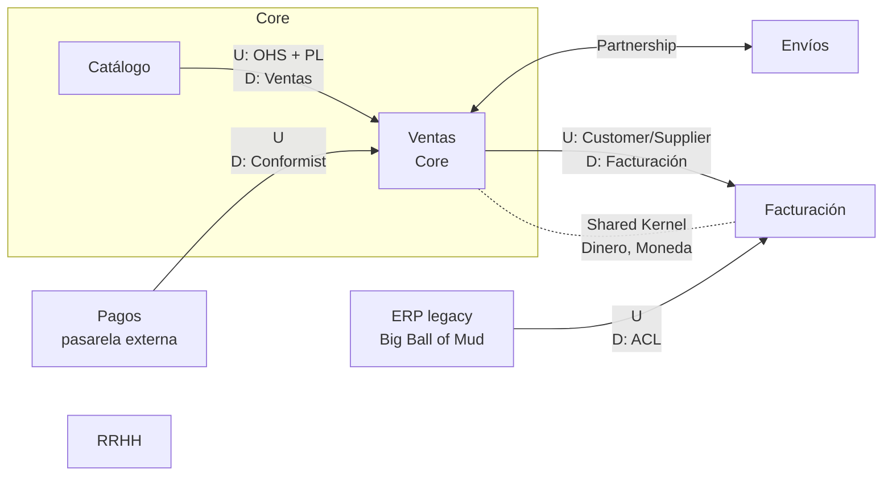
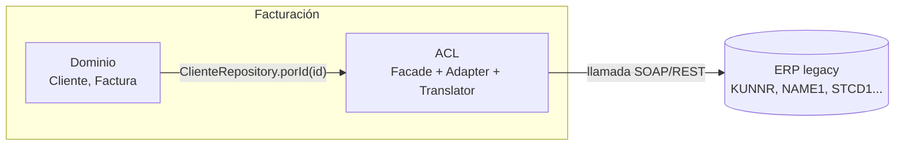
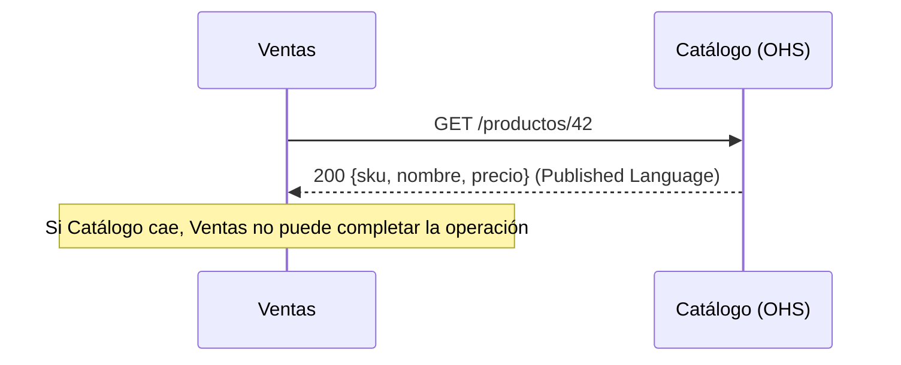
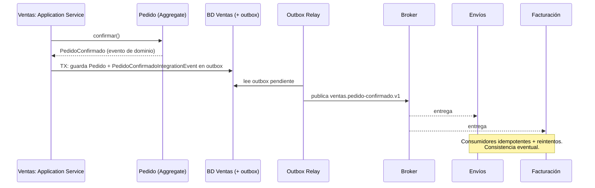
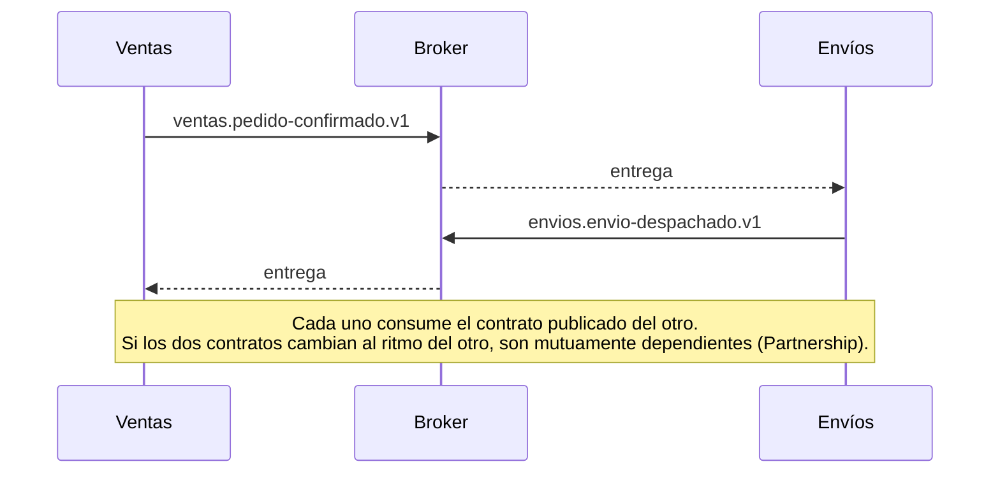
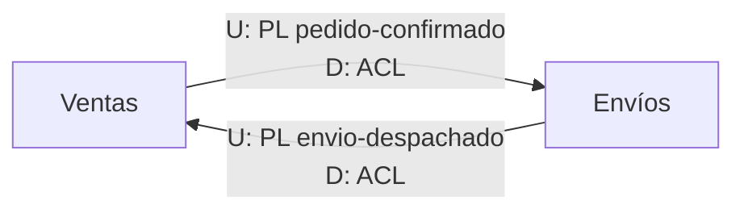

# Comunicación entre Bounded Contexts en DDD

## Resumen

La comunicación entre bounded contexts (BC) tiene dos dimensiones distintas que conviene no mezclar:

1. **Relación (context mapping):** cómo se relacionan los modelos y los equipos. Evans define estos patrones en la *DDD Reference*: Partnership, Shared Kernel, Customer/Supplier, Conformist, Anticorruption Layer, Open-host Service, Published Language, Separate Ways y Big Ball of Mud.
2. **Mecanismo técnico:** cómo viajan los datos. Puede ser síncrono (REST/RPC) o asíncrono (mensajería con eventos de integración). Vernon dedica el capítulo 13 de *Implementing DDD* a "Integration Using RESTful Resources" e "Integration Using Messaging".

Un mismo patrón de relación (por ejemplo, Open-host Service + Published Language) se puede implementar con REST o con eventos.

## Por qué hace falta: el mismo término, modelos distintos

Fowler: "total unification of the domain model for a large system will not be feasible or cost-effective". Conceptos como *Customer* o *Product* aparecen en varios contextos, cada uno los modela distinto, y hace falta un mapeo entre ellos. Fowler recomienda dibujar estas relaciones en un **context map**. ([Fowler, BoundedContext](https://martinfowler.com/bliki/BoundedContext.html))

Ejemplo: en *Ventas*, `Cliente` tiene límite de crédito y pedidos. En *Envíos*, `Destinatario` solo tiene dirección y teléfono. Son la misma persona, pero distintos modelos.

## Upstream / Downstream

- **Upstream (U):** el proveedor cuyas decisiones afectan a otros (publisher, supplier, API host).
- **Downstream (D):** el consumidor que depende de él (subscriber, customer, consumidor de la API).

Si el publisher cambia el formato del mensaje, impacta a todos los suscriptores. Lo contrario no ocurre. ([DevIQ](https://deviq.com/domain-driven-design/context-mapping))

## Patrones de context mapping

| Patrón | Tipo | Idea clave (Evans, *DDD Reference*) |
|---|---|---|
| **Partnership** | Colaborativo | Si el fallo de uno implica el fallo de ambos, "forge a partnership between the teams". |
| **Shared Kernel** | Colaborativo | Subconjunto del modelo compartido explícitamente. "Keep this kernel small." |
| **Customer/Supplier** | U → D | Relación cliente/proveedor explícita. Se negocian y presupuestan las necesidades del downstream. |
| **Conformist** | U → D | El upstream no tiene motivación para ayudar. El downstream adopta su modelo tal cual para ahorrarse la traducción. |
| **Anticorruption Layer (ACL)** | U → D | El downstream crea una capa aislante que expone la funcionalidad del upstream "in terms of your own domain model". |
| **Open-host Service (OHS)** | U → muchos D | Protocolo abierto como conjunto de servicios para que todos se integren igual. |
| **Published Language (PL)** | U ↔ D | Lenguaje compartido bien documentado como medio de intercambio (JSON Schema, XML, Protobuf, Avro según DevIQ). Suele ir con OHS. |
| **Separate Ways** | Sin relación | Sin relación significativa. Se declara que el BC no se conecta con nadie. |
| **Big Ball of Mud** | Caos | Se pone una frontera alrededor del desorden y no se modela sofisticadamente dentro. |

Fuente: [DDD Reference (Evans, 2015)](https://domainlanguage.com/wp-content/uploads/2016/05/DDD_Reference_2015-03.pdf), [DevIQ](https://deviq.com/domain-driven-design/context-mapping).

### Context map de ejemplo (e-commerce)

Ejemplo genérico, con los mismos `Pedido` y `PedidoConfirmado` de [DDD táctico: building blocks](building-blocks-tacticos.md). No es el mapa del ERP marketplace: allí no hay un contexto Catálogo propio (ver [Mapa de bounded contexts del ERP marketplace](mapa-de-contextos-erp-marketplace.md)).



*RRHH sigue Separate Ways: no tiene ninguna conexión.*

### Ejemplo: Anticorruption Layer

Facturación consume clientes de un ERP legacy cuyo modelo no quiere importar.



```php
<?php
// Puerto definido en el dominio de Facturación
final readonly class ClienteFacturable
{
    public function __construct(public ClienteId $id, public string $razonSocial, public Nif $nif) {}
}

interface ClientesFacturables
{
    public function porId(ClienteId $id): ClienteFacturable;
}

// ACL: traduce el modelo del ERP al lenguaje de Facturación
final class ClientesFacturablesDesdeErp implements ClientesFacturables
{
    public function __construct(private ErpClient $erp) {}

    public function porId(ClienteId $id): ClienteFacturable
    {
        $raw = $this->erp->getCustomer($id->valor);   // ['KUNNR' => ..., 'NAME1' => ..., 'STCD1' => ...]
        return new ClienteFacturable($id, trim($raw['NAME1']), Nif::parse($raw['STCD1']));
    }
}
```

El dominio de Facturación nunca ve `KUNNR` ni `NAME1`. Si cambia el ERP, solo cambia la ACL.

## Mecanismos de integración

### Síncrono: REST / RPC

HTTP es síncrono: "The client sends a request and waits for a response". Hay un solo receptor por petición. ([Microsoft Learn](https://learn.microsoft.com/en-us/dotnet/architecture/microservices/architect-microservice-container-applications/communication-in-microservice-architecture))



Microsoft desaconseja encadenar llamadas síncronas entre servicios: "If possible, never depend on synchronous communication (request/response) between multiple microservices, not even for queries". Llama a la cadena de peticiones un anti-patrón porque la arquitectura "won't be resilient when some microservices fail". La alternativa es replicar solo los atributos necesarios mediante eventos de integración y consistencia eventual.

### Asíncrono: mensajería con eventos de integración

Con AMQP y similares, el emisor "usually doesn't wait for a response". La comunicación con varios receptores (pub/sub) "must be asynchronous". ([Microsoft Learn](https://learn.microsoft.com/en-us/dotnet/architecture/microservices/architect-microservice-container-applications/communication-in-microservice-architecture))

**Evento de dominio vs. evento de integración** (resumen; el detalle con código, outbox y relay está en [building blocks §4](building-blocks-tacticos.md#4-domain-event-y-integration-event)) ([Microsoft Learn](https://learn.microsoft.com/en-us/dotnet/architecture/microservices/microservice-ddd-cqrs-patterns/domain-events-design-implementation), [Milan Jovanović](https://milanjovanovic.tech/blog/domain-events-vs-integration-events)):

| | Evento de dominio | Evento de integración |
|---|---|---|
| Alcance | Dentro del BC | Cruza BCs |
| Transporte | En memoria (p. ej. MediatR) | Broker (RabbitMQ, Azure Service Bus, SQS...) |
| Momento | Se despacha antes o después del commit (decisión de diseño) | Solo tras persistir con éxito |
| Sincronía | Síncrono o asíncrono | "should always be asynchronous" |
| Contrato | Interno, puede usar tipos del dominio | Público: mínimo, tipos primitivos, versionado |

Un handler de un evento de dominio puede generar el evento de integración. Para no perderlo si el proceso cae entre el commit y la publicación, se usa el **Transactional Outbox**: el mensaje se guarda en una tabla outbox dentro de la misma transacción, y un relay lo publica después en orden. ([microservices.io](https://microservices.io/patterns/data/transactional-outbox))



Ejemplo de evento de integración como Published Language (mismo contrato que `PedidoConfirmadoIntegrationEvent` en [building blocks](building-blocks-tacticos.md); la versión va en el `type`):

```json
{
  "eventId": "3f1c...",
  "type": "ventas.pedido-confirmado.v1",
  "occurredAt": "2026-10-29T18:30:00Z",
  "pedidoId": "P-1001",
  "clienteId": "C-77",
  "total": { "cantidad": 59.90, "moneda": "EUR" }
}
```

### Comparativa

| Criterio | Síncrono (REST/RPC) | Asíncrono (eventos) |
|---|---|---|
| Acoplamiento temporal | Alto: ambos deben estar disponibles | Bajo: el broker desacopla |
| Consistencia | Inmediata en la respuesta | Eventual |
| Receptores | Uno | Cero a muchos (pub/sub) |
| Complejidad | Baja al inicio | Outbox, idempotencia, reintentos, compensaciones |
| Encaja con | Consultas puntuales, OHS con API pública | Propagar cambios, réplica de datos, procesos largos |

Microsoft advierte que la consistencia eventual "requires more complex code in order to detect possible inconsistencies... and the need to implement compensatory actions". ([Microsoft Learn](https://learn.microsoft.com/en-us/dotnet/architecture/microservices/microservice-ddd-cqrs-patterns/domain-events-design-implementation))

## ¿Puede haber comunicación bidireccional entre bounded contexts?

Sí, pero hay que distinguir **flujo de datos** de **dirección de dependencia**:

- **Flujo de datos bidireccional sin dependencia mutua (lo normal).** En upstream/downstream la flecha "always points from the upstream to the downstream and thus expresses an influence flow" ([Context Mapper](https://contextmapper.org/docs/context-map/)), y "the downstream context depends on the upstream context, but not the other way around" ([Three Dots Labs](https://academy.threedots.tech/knowledge/upstream-downstream-contexts)). Una petición REST lleva datos en los dos sentidos (request y response), pero solo el cliente depende del contrato del servidor.
- **Dependencia mutua.** Según INNOQ, "*mutually dependent* means that teams can only successfully deploy both bounded contexts together". Para ese caso proponen **Partnership**, a costa de una "extremely close coordination, which typically leads to considerable overhead". El otro patrón simétrico es **Shared Kernel**, que debe ser pequeño "to prevent a *mutually dependent* relationship" ([INNOQ](https://www.innoq.com/en/blog/2020/07/domain-driven-design-in-the-large/)). Context Mapper solo modela como simétricas estas dos relaciones (`[P]<->[P]`, `[SK]<->[SK]`).
- **Riesgo técnico: ciclos.** "A cyclic chain of calls between microservices" es un anti-patrón catalogado ([Taibi et al., Microservices Anti-Patterns: A Taxonomy](https://arxiv.org/pdf/1908.04101)). En coreografía con eventos, "the system can unintentionally produce feedback loops or event storms" ([Microsoft, Choreography](https://learn.microsoft.com/en-us/azure/architecture/patterns/choreography)).

### Ejemplo: Ventas ↔ Envíos

Ventas publica `PedidoConfirmado` y Envíos lo consume. Envíos publica `EnvioDespachado` y Ventas lo consume para marcar el pedido como enviado. Los datos van en los dos sentidos.



Opciones para no acabar en dependencia mutua:

1. **Cada contexto es upstream de su propio evento** (Published Language versionado) y el consumidor traduce con una ACL. Hay dos relaciones U→D independientes, una en cada sentido, no una relación simétrica.
2. **Orquestador o process manager** que conozca a los dos y coordine el proceso, para que ninguno dependa del otro. Microsoft lo sugiere cuando la lógica requiere "a central component to handle shared logic" ([Microsoft, Choreography](https://learn.microsoft.com/en-us/azure/architecture/patterns/choreography)).
3. Si de verdad tienen que desplegarse juntos, reconocerlo como **Partnership**, o plantearse si son un único bounded context mal partido. Esto último es una inferencia propia: las fuentes consultadas no lo afirman.



## Reglas prácticas

- El context map describe la **realidad política**, no la ideal. Evans: "Map the existing terrain. Take up transformations later."
- Ante un upstream cuyo modelo no te conviene, la ACL es la defensa. Conformist solo si el modelo upstream es aceptable.
- Shared Kernel es el acoplamiento más íntimo. Mantenlo pequeño.
- Los eventos de integración son contratos públicos: versiónalos y no expongas el modelo de dominio interno.
- Evita cadenas síncronas entre BCs. Replica los datos necesarios mediante eventos.

## Relacionado

- [DDD táctico: building blocks](building-blocks-tacticos.md): agregados, strongly-typed IDs, domain events vs. integration events, outbox.
- [Mapa de bounded contexts del ERP marketplace](mapa-de-contextos-erp-marketplace.md): estos patrones aplicados al ERP, incluidas las relaciones bidireccionales Compras ↔ Ventas y Cocina ↔ Inventario.
