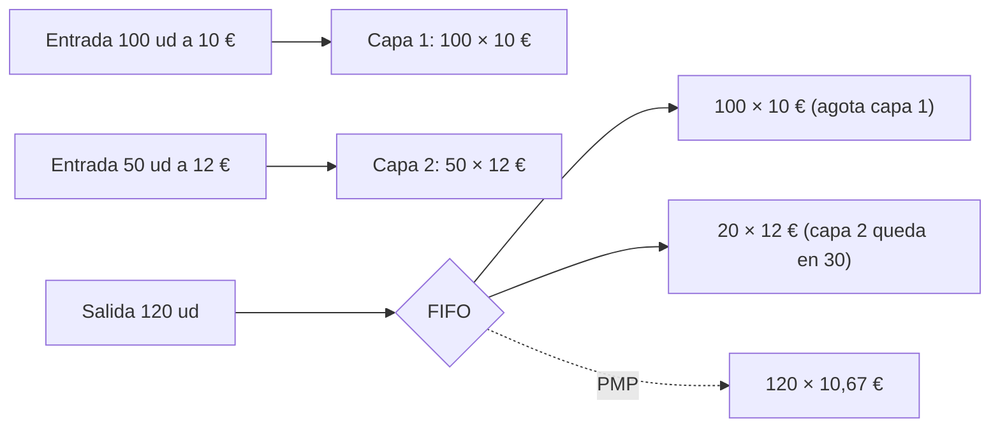
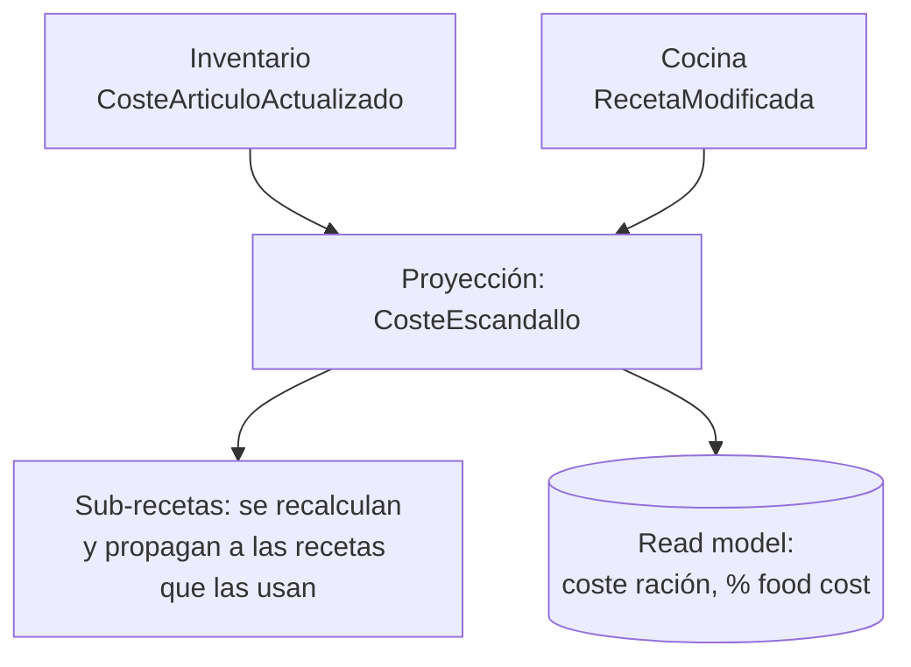
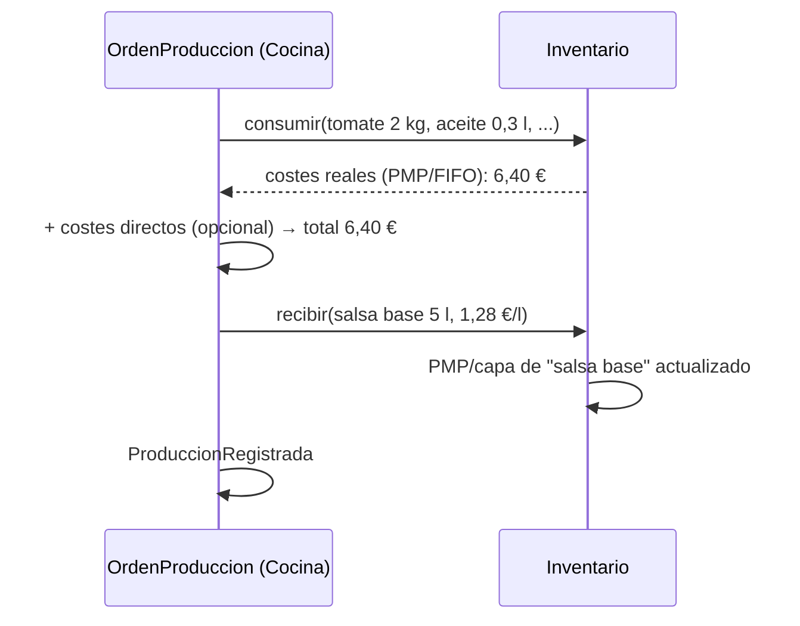

# Costes: PMP, FIFO, escandallos y producciones

Continúa `ddd/unidades-de-medida-compra-stock-cocina.md` y `ddd/facturas-en-marketplace-b2b.md`.

## Resumen

- **El coste del stock** (PMP o FIFO) se calcula con cada **movimiento de stock**: entradas de compra o producción y salidas por consumo, venta o merma. Por eso vive junto a `StockArticulo` en Inventario, o en un BC de Costes que consume esos movimientos.
- **El coste de un escandallo** es una **proyección de lectura** (CQRS): la suma de ingredientes × coste unitario ÷ rendimiento. Se recalcula cuando cambia el coste de un ingrediente. No es un agregado con invariantes.
- **Una producción** (elaboración) es un movimiento doble: consume ingredientes valorados a su coste y da entrada al elaborado con el coste resultante. A partir de ahí, el elaborado tiene su propio PMP o sus capas FIFO.

## Qué dice la norma (España)

La NRV 10ª del PGC ([texto](https://www.supercontable.com/informacion/Contabilidad/Norma_Valoracion_10a.Plan_General_Contabilidad.Existencias.html)):
- *"Se adoptará con carácter general el método del precio medio o coste medio ponderado."*
- *"El método FIFO es aceptable y puede adoptarse si la empresa lo considerase más conveniente para su gestión."*
- Coste de producción: el *"precio de adquisición de las materias primas"* más *"los costes directamente imputables al producto"* y *"la parte que razonablemente corresponda de los costes indirectamente imputables"*.

Consecuencia para un marketplace con muchos clientes: el **método de valoración es una política de cada organización**, con PMP por defecto. Se modela con el patrón *Strategy* (decisión mía).

## PMP (precio medio ponderado móvil)

*"The weighted average is recomputed immediately after each receipt"*, y *"All subsequent issues or sales use this newly computed average"* ([Cleverence](https://www.cleverence.com/articles/for-business/inventory-weighted-average-cost-4829/)).

Ejemplo de la fuente: 100 ud a 10 € + entrada de 50 ud a 12 € = 1.600 € / 150 ud = **10,67 €**. Una salida de 60 ud se valora a 10,67 € (640,20 €).

## FIFO (capas)

Cada entrada crea una **capa de coste** (SKU.io *"creates FIFO cost layers, which later feed COGS"*, [SKU.io](https://docs.sku.io/guides/orders/purchase-orders/receive-stock-against-a-po)). Cada salida consume primero las capas más antiguas.



## Modelo (TypeScript)

```ts
// Inventario: la valoración va con el stock (misma consistencia, mismo agregado)
interface MetodoValoracion {                       // Strategy, elegida por la organización
  entrada(cantidad: number, costeUnitario: Dinero): void;
  salida(cantidad: number): Dinero;               // devuelve el coste de lo que sale
  costeUnitarioActual(): Dinero;
}

class PMP implements MetodoValoracion {
  constructor(private cantidad = 0, private valor = Dinero.cero("EUR")) {}
  entrada(q: number, c: Dinero) { this.valor = this.valor.mas(c.por(q)); this.cantidad += q; }
  salida(q: number) { const coste = this.costeUnitarioActual().por(q);
                      this.valor = this.valor.menos(coste); this.cantidad -= q; return coste; }
  costeUnitarioActual() { return this.cantidad === 0 ? Dinero.cero("EUR") : this.valor.entre(this.cantidad); }
}

class FIFO implements MetodoValoracion {
  private capas: { cantidad: number; coste: Dinero }[] = [];
  entrada(q: number, c: Dinero) { this.capas.push({ cantidad: q, coste: c }); }
  salida(q: number) {
    let pendiente = q, total = Dinero.cero("EUR");
    while (pendiente > 0) {
      const capa = this.capas[0];
      if (!capa) throw new StockInsuficiente();
      const usa = Math.min(pendiente, capa.cantidad);
      total = total.mas(capa.coste.por(usa));
      capa.cantidad -= usa; pendiente -= usa;
      if (capa.cantidad === 0) this.capas.shift();
    }
    return total;
  }
  costeUnitarioActual() { return this.capas[0]?.coste ?? Dinero.cero("EUR"); }
}

class StockArticulo extends AggregateRoot {
  constructor(readonly productoId: ProductoId, readonly almacenId: AlmacenId,
              private fisico: number, private valoracion: MetodoValoracion) { super(); }

  recibir(cantidadStock: number, costeUnitarioStock: Dinero, ref: string) {
    this.fisico += cantidadStock;
    this.valoracion.entrada(cantidadStock, costeUnitarioStock);
    this.registrar(new CosteArticuloActualizado(this.productoId, this.almacenId,
                                                this.valoracion.costeUnitarioActual()));
  }
  consumir(cantidadStock: number, ref: string): Dinero {     // receta, producción, merma
    const coste = this.valoracion.salida(cantidadStock);
    this.fisico -= cantidadStock;
    this.registrar(new StockConsumido(this.productoId, cantidadStock, coste, ref));
    return coste;
  }
}
```

**Precio de entrada:** el coste por unidad de stock sale del precio por unidad de compra ÷ factor del formato (ver la nota de unidades). Si la factura llega luego con otro precio, el cotejo (nota de facturas) debería generar un **ajuste de valoración**. Esto es recomendación mía: las fuentes no lo cubren.

## Coste de escandallo (teórico)

Meez define el coste teórico como *"the cost a restaurant should incur based on its recipe data, current ingredient prices, and portion sizes"*. Avisa además de que costear con el precio de compra sin aplicar rendimiento **subestima** el coste ([Meez](https://getmeez.com/blog/actual-vs-theoretical-food-costs)). Fórmula de rendimiento: coste utilizable = coste de compra ÷ rendimiento. Ejemplo: 12,00 €/kg ÷ 0,78 = **15,38 €/kg** ([Supy](https://supy.io/blog/learn-restaurant-yield-costing)).



```ts
// Proyección (lado lectura): no es un agregado, se recalcula por eventos
function costeEscandallo(receta: Receta, costes: CostesActuales, eq: Equivalencias): Dinero {
  return receta.lineas.reduce((total, l) => {
    const enStock = eq.de(l.articuloId).aUnidadStock(l.cantidad);          // 0,3 l → 0,4 botellas
    const costeUnit = l.esSubreceta
      ? costeEscandallo(l.subreceta, costes, eq).entre(l.subreceta.raciones) // recursivo
      : costes.de(l.articuloId);                                             // PMP o capa FIFO actual
    return total.mas(costeUnit.por(enStock.valor).entre(l.rendimiento));    // ÷ rendimiento
  }, Dinero.cero("EUR"));
}
```

Para el teórico, ¿qué coste por ingrediente se usa? Lo habitual es el coste actual del artículo (PMP o capa FIFO vigente). El último precio de compra o un coste estándar son otras opciones. Es una política configurable (decisión mía); las fuentes solo piden que sea *current*.

## Coste de producción (elaboraciones)

Una producción (p. ej. 5 l de salsa base) se modela con un agregado `OrdenProduccion` en Cocina/Producción (decisión mía):
1. Consume los ingredientes en Inventario. Cada `consumir()` devuelve su **coste real** según PMP o FIFO.
2. Coste del elaborado = suma de consumos + costes directos opcionales (PGC: *"costes directamente imputables"*).
3. Da **entrada** al elaborado con coste unitario = coste total ÷ cantidad producida. A partir de ahí tiene su propio PMP o sus capas.



Consistencia: Vernon pide un agregado por transacción, así que consumir N ingredientes y dar entrada al elaborado son varias transacciones. Se orquesta con eventos (`ProduccionIniciada` → consumos → `ElaboradoRecibido`) y es idempotente por `ordenId` (ver la nota de flujo). Un único `consumirYProducir` transaccional en Inventario es una alternativa pragmática si todo vive en el mismo BC y la misma BD. Es un trade-off: elegirlo sería decisión tuya.

## Coste real vs. teórico

Coste real (Meez): *"Beginning Inventory + Purchases − Ending Inventory = Actual COGS"*. La diferencia con el teórico (varianza) se explica por raciones mayores (*"the most common cause"*), mermas, robos, precios desactualizados o rendimientos no definidos. Es otro read model que cruza Inventario (recuentos y compras) con ventas × escandallo.
