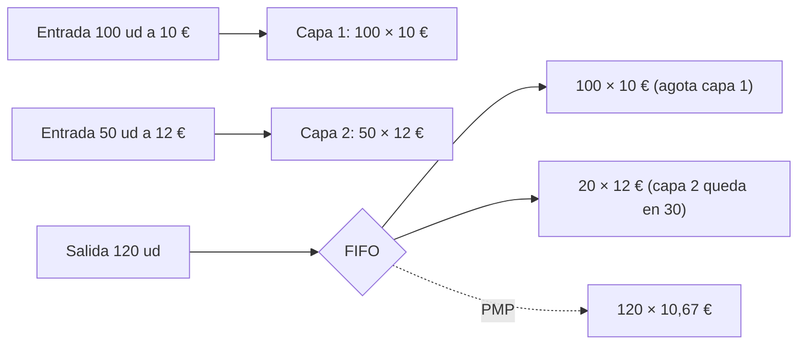
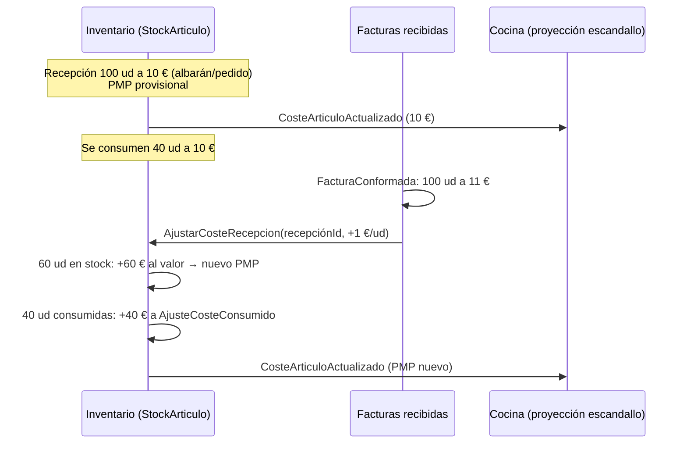
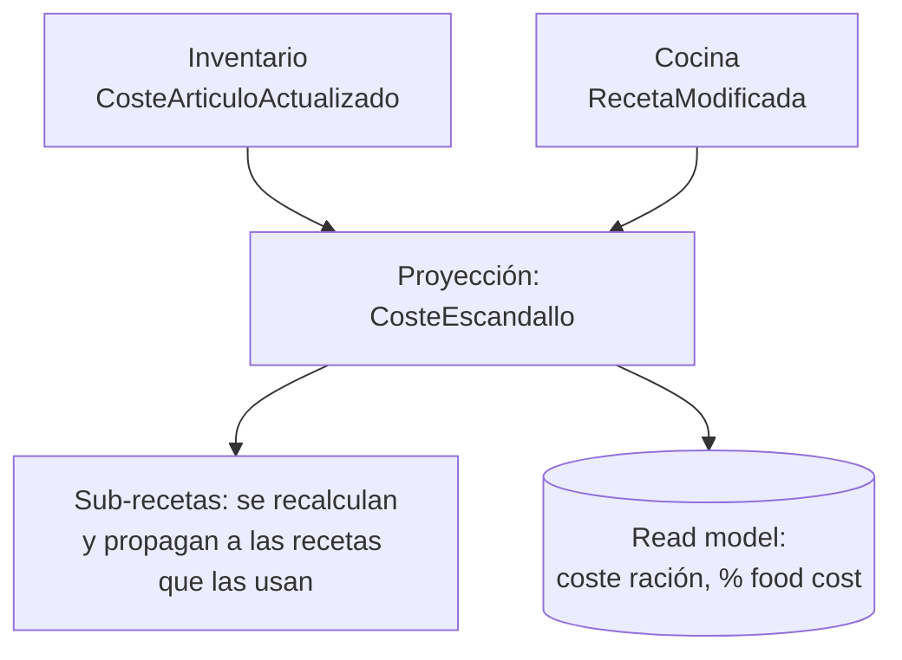
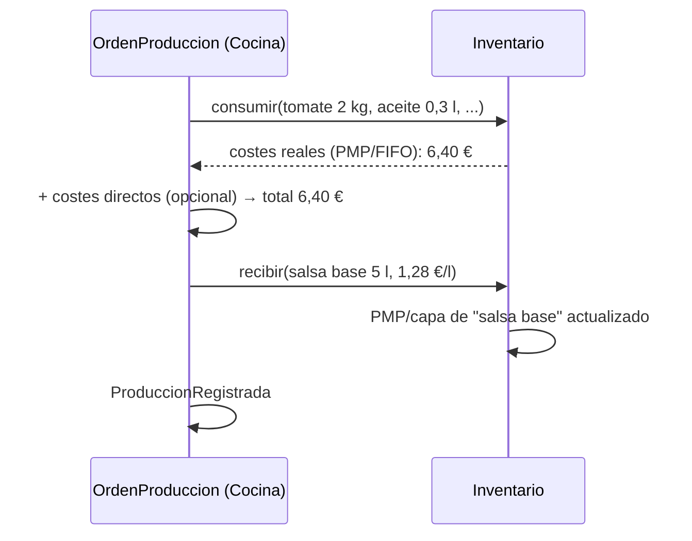
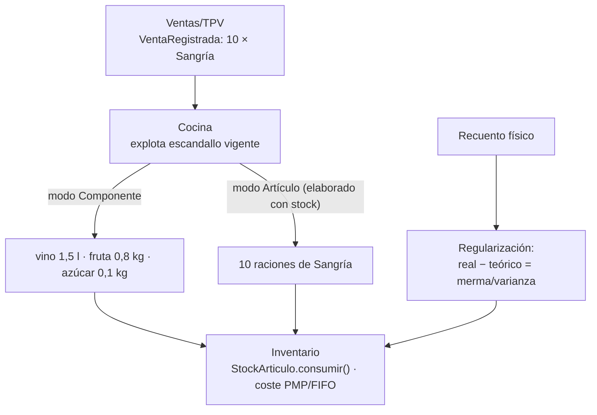

# Costes: PMP, FIFO, escandallos y producciones

Continúa `ddd/unidades-de-medida-compra-stock-cocina.md` y `ddd/facturas-en-marketplace-b2b.md`.

## Resumen

- **El coste del stock** (PMP o FIFO) se calcula con cada **movimiento de stock**: entradas de compra o producción y salidas por consumo, venta o merma. Por eso vive junto a `StockArticulo` en Inventario, o en un BC de Costes que consume esos movimientos.
- **El coste de un escandallo** es una **proyección de lectura** (CQRS): la suma de ingredientes × coste unitario ÷ rendimiento. Se recalcula cuando cambia el coste de un ingrediente. No es un agregado con invariantes.
- **Una producción** (elaboración) es un movimiento doble: consume ingredientes valorados a su coste y da entrada al elaborado con el coste resultante. A partir de ahí, el elaborado tiene su propio PMP o sus capas FIFO.

## Qué dice la norma (España)

La NRV 10ª del PGC ([texto](https://www.supercontable.com/informacion/Contabilidad/Norma_Valoracion_10a.Plan_General_Contabilidad.Existencias.html)):
- *"Se adoptará con carácter general el método del precio medio o coste medio ponderado."*
- *"El método FIFO es aceptable y puede adoptarse si la empresa lo considerase más conveniente para su gestión."*
- Coste de producción: el *"precio de adquisición de las materias primas"* más *"los costes directamente imputables al producto"* y *"la parte que razonablemente corresponda de los costes indirectamente imputables"*.

Consecuencia para un marketplace con muchos clientes: el **método de valoración es una política de cada organización**, con PMP por defecto. Se modela con el patrón *Strategy* (decisión mía).

## PMP (precio medio ponderado móvil)

*"The weighted average is recomputed immediately after each receipt"*, y *"All subsequent issues or sales use this newly computed average"* ([Cleverence](https://www.cleverence.com/articles/for-business/inventory-weighted-average-cost-4829/)).

Ejemplo de la fuente: 100 ud a 10 € + entrada de 50 ud a 12 € = 1.600 € / 150 ud = **10,67 €**. Una salida de 60 ud se valora a 10,67 € (640,20 €).

## FIFO (capas)

Cada entrada crea una **capa de coste** (SKU.io *"creates FIFO cost layers, which later feed COGS"*, [SKU.io](https://docs.sku.io/guides/orders/purchase-orders/receive-stock-against-a-po)). Cada salida consume primero las capas más antiguas.



## ¿De dónde salen las capas FIFO?

Cada **entrada** de stock crea una capa: SKU.io crea las capas FIFO al recibir el pedido de compra ([SKU.io](https://docs.sku.io/guides/orders/purchase-orders/receive-stock-against-a-po)). Generalizándolo a todas las entradas (esta tabla es mía):

| Origen de la entrada | Coste unitario de la capa | Referencia |
|---|---|---|
| Recepción de compra | Precio de la línea del pedido ÷ factor del formato (en unidad de stock) | `pedidoId:lineaId` + recepción |
| Producción (elaborado) | Coste total consumido (+ directos) ÷ cantidad producida | `ordenProduccionId` |
| Stock inicial / regularización positiva | Coste declarado en la carga o en el recuento (p. ej. el último coste conocido) | `inventarioId` |
| Traspaso entre almacenes | La capa viaja con su coste original | `traspasoId` |

Persistencia: una tabla de capas por `(productoId, almacenId)` con `fechaEntrada`, `cantidadRestante`, `costeUnitario` y `refOrigen`. Se carga con el agregado `StockArticulo`, ordenada por fecha. Otra opción es reconstruirlas reproduciendo el historial de movimientos, al estilo del event sourcing de [Salesforce](https://engineering.salesforce.com/event-sourcing-for-an-inventory-availability-solution-3cc0daf5a742).

Si la **factura** llega con otro precio (ver la nota de facturas), se corrige el coste de la capa de esa recepción en la parte que aún queda. La parte ya consumida genera un **ajuste de coste** aparte. Esto es recomendación mía.

## Coste provisional (albarán) y coste definitivo (factura)

SAP lo resuelve en dos pasos:
- En la **entrada de mercancía** de un material a precio medio móvil se contabiliza *"the delivered quantity x net order price (or invoice price)"*. El valor queda en una cuenta puente entre recepción y factura (GR/IR) ([SAP, GR for PO](https://help.sap.com/saphelp_46C/helpdata/EN/47/60ffa849f011d1894c0000e829fbbd/content.htm)).
- Si la factura trae otro precio y **todo el stock sigue en almacén**: *"The variance between the purchase order value and the invoice value is posted to the stock account"*. El precio medio cambia y la cantidad no ([SAP, MAP with stock coverage](https://help.sap.com/saphelp_46c/helpdata/en/a8/b994cc452b11d189430000e829fbbd/content.htm)).
- Si **parte ya se consumió**, la diferencia se reparte: la parte del stock que queda va al stock y el resto a *"Expenses from price differences"* ([SAP, MAP without stock coverage](https://help.sap.com/saphelp_46C/helpdata/EN/a8/b994d9452b11d189430000e829fbbd/content.htm)).

Traducido a nuestro modelo (decisiones mías):

| Momento | Precio | Efecto en Inventario |
|---|---|---|
| Recepción | Precio del **albarán valorado** si lo trae; si no, el de la **línea del pedido** | Entrada a coste **provisional**. La recepción queda como "pendiente de facturar" |
| Factura conformada | Precio de la factura | `AjustarCosteRecepcion`: la parte aún en stock corrige el PMP o la capa FIFO; la parte consumida va a un ajuste de coste del periodo |
| Factura que no llega | — | La recepción sigue provisional. Hace falta un listado de albaranes pendientes de facturar |

Los consumos pasados **no se recalculan**: quedan con el coste que tenían al consumirse, y la diferencia se lleva aparte. Así el historial de stock es estable y el escandallo se actualiza al recibir el nuevo `CosteArticuloActualizado`.



```ts
class StockArticulo extends AggregateRoot {
  // ... recibir() guarda la recepción con su coste provisional
  ajustarCosteRecepcion(recepcionId: string, nuevoCosteUnitario: Dinero, ref: string) {
    if (this.procesados.has(ref)) return;                    // idempotente por facturaId:línea
    const r = this.recepciones.get(recepcionId);
    if (!r) throw new RecepcionDesconocida(recepcionId);
    const diferencia = nuevoCosteUnitario.menos(r.costeUnitario);
    const enStock = this.valoracion.cantidadRestanteDe(recepcionId);   // PMP: proporcional; FIFO: lo que queda de su capa
    const consumida = r.cantidad - enStock;

    this.valoracion.revalorizar(recepcionId, diferencia.por(enStock)); // cambia PMP o coste de la capa
    if (consumida > 0)
      this.registrar(new AjusteCosteConsumido(this.productoId, recepcionId, diferencia.por(consumida)));
    r.marcarDefinitiva(nuevoCosteUnitario);
    this.procesados.add(ref);
    this.registrar(new CosteArticuloActualizado(this.productoId, this.almacenId,
                                                this.valoracion.costeUnitarioActual()));
  }
}
```

Con PMP no existe "la parte de esa recepción que queda", porque el stock está mezclado. Lo habitual es aplicar la proporción del stock actual sobre lo recibido, como hace SAP con la cobertura de stock (*"Since only 80 pieces of the material are in stock at the time of invoice receipt"*). Con FIFO sí se sabe: es lo que queda de la capa de esa recepción.

## Modelo (TypeScript)

```ts
// Inventario: la valoración va con el stock (misma consistencia, mismo agregado)
interface MetodoValoracion {                       // Strategy, elegida por la organización
  entrada(cantidad: number, costeUnitario: Dinero): void;
  salida(cantidad: number): Dinero;               // devuelve el coste de lo que sale
  costeUnitarioActual(): Dinero;
}

class PMP implements MetodoValoracion {
  constructor(private cantidad = 0, private valor = Dinero.cero("EUR")) {}
  entrada(q: number, c: Dinero) { this.valor = this.valor.mas(c.por(q)); this.cantidad += q; }
  salida(q: number) { const coste = this.costeUnitarioActual().por(q);
                      this.valor = this.valor.menos(coste); this.cantidad -= q; return coste; }
  costeUnitarioActual() { return this.cantidad === 0 ? Dinero.cero("EUR") : this.valor.entre(this.cantidad); }
}

class FIFO implements MetodoValoracion {
  private capas: { cantidad: number; coste: Dinero }[] = [];
  entrada(q: number, c: Dinero) { this.capas.push({ cantidad: q, coste: c }); }
  salida(q: number) {
    let pendiente = q, total = Dinero.cero("EUR");
    while (pendiente > 0) {
      const capa = this.capas[0];
      if (!capa) throw new StockInsuficiente();
      const usa = Math.min(pendiente, capa.cantidad);
      total = total.mas(capa.coste.por(usa));
      capa.cantidad -= usa; pendiente -= usa;
      if (capa.cantidad === 0) this.capas.shift();
    }
    return total;
  }
  costeUnitarioActual() { return this.capas[0]?.coste ?? Dinero.cero("EUR"); }
}

class StockArticulo extends AggregateRoot {
  constructor(readonly productoId: ProductoId, readonly almacenId: AlmacenId,
              private fisico: number, private valoracion: MetodoValoracion) { super(); }

  recibir(cantidadStock: number, costeUnitarioStock: Dinero, ref: string) {
    this.fisico += cantidadStock;
    this.valoracion.entrada(cantidadStock, costeUnitarioStock);
    this.registrar(new CosteArticuloActualizado(this.productoId, this.almacenId,
                                                this.valoracion.costeUnitarioActual()));
  }
  consumir(cantidadStock: number, ref: string): Dinero {     // receta, producción, merma
    const coste = this.valoracion.salida(cantidadStock);
    this.fisico -= cantidadStock;
    this.registrar(new StockConsumido(this.productoId, cantidadStock, coste, ref));
    return coste;
  }
}
```

**Precio de entrada:** el coste por unidad de stock sale del precio por unidad de compra ÷ factor del formato (ver la nota de unidades). Si la factura llega luego con otro precio, el cotejo (nota de facturas) debería generar un **ajuste de valoración**. Esto es recomendación mía: las fuentes no lo cubren.

## Coste de escandallo (teórico)

Meez define el coste teórico como *"the cost a restaurant should incur based on its recipe data, current ingredient prices, and portion sizes"*. Avisa además de que costear con el precio de compra sin aplicar rendimiento **subestima** el coste ([Meez](https://getmeez.com/blog/actual-vs-theoretical-food-costs)). Fórmula de rendimiento: coste utilizable = coste de compra ÷ rendimiento. Ejemplo: 12,00 €/kg ÷ 0,78 = **15,38 €/kg** ([Supy](https://supy.io/blog/learn-restaurant-yield-costing)).



```ts
// Proyección (lado lectura): no es un agregado, se recalcula por eventos
function costeEscandallo(receta: Receta, costes: CostesActuales, eq: Equivalencias): Dinero {
  return receta.lineas.reduce((total, l) => {
    const enStock = eq.de(l.articuloId).aUnidadStock(l.cantidad);          // 0,3 l → 0,4 botellas
    const costeUnit = l.esSubreceta
      ? costeEscandallo(l.subreceta, costes, eq).entre(l.subreceta.raciones) // recursivo
      : costes.de(l.articuloId);                                             // PMP o capa FIFO actual
    return total.mas(costeUnit.por(enStock.valor).entre(l.rendimiento));    // ÷ rendimiento
  }, Dinero.cero("EUR"));
}
```

Para el teórico, ¿qué coste por ingrediente se usa? Lo habitual es el coste actual del artículo (PMP o capa FIFO vigente). El último precio de compra o un coste estándar son otras opciones. Es una política configurable (decisión mía); las fuentes solo piden que sea *current*.

## Coste de producción (elaboraciones)

Una producción (p. ej. 5 l de salsa base) se modela con un agregado `OrdenProduccion` en Cocina/Producción (decisión mía):
1. Consume los ingredientes en Inventario. Cada `consumir()` devuelve su **coste real** según PMP o FIFO.
2. Coste del elaborado = suma de consumos + costes directos opcionales (PGC: *"costes directamente imputables"*).
3. Da **entrada** al elaborado con coste unitario = coste total ÷ cantidad producida. A partir de ahí tiene su propio PMP o sus capas.



Consistencia: Vernon pide un agregado por transacción, así que consumir N ingredientes y dar entrada al elaborado son varias transacciones. Se orquesta con eventos (`ProduccionIniciada` → consumos → `ElaboradoRecibido`) y es idempotente por `ordenId` (ver la nota de flujo). Un único `consumirYProducir` transaccional en Inventario es una alternativa pragmática si todo vive en el mismo BC y la misma BD. Es un trade-off: elegirlo sería decisión tuya.

## ¿De dónde sale el consumo? (ventas, escandallo y recuento)

No todo el mundo produce, así que el consumo puede tener **tres orígenes**:

1. **Venta en el TPV + escandallo** (*depletion* o *backflush*). CrunchTime lo configura **por receta** ([CrunchTime, Recipe depletion](https://help.crunchtime.com/EM/en/WebHelp_EMw/Content/EM_POSdepletion/Recipe_Depletion_and_Costing.htm)):
   - **Componente:** *"the individual recipe components equal to a single portion of the recipe will be depleted from inventory"*. Se descuentan los ingredientes.
   - **Artículo:** *"a single portion of the recipe will be depleted from inventory as a finished product"*. Se descuenta el elaborado como producto terminado. Es obligatorio cuando la receta llega hecha (comprada a un obrador central, *"To Order"*).
   - Si la receta se produce en el local, la configuración decide si los componentes se descuentan **al producir o al vender**. CrunchTime incluso crea la producción automáticamente a partir de las ventas cuando falta stock del elaborado ([Auto-Daily Prep](https://help.crunchtime.com/EM/en/WebHelp_EMw/Content/EM_Setup1/_Auto_Daily_Prep.htm)).
2. **Producción explícita:** solo para quien produce lotes (ver la sección de producción).
3. **Recuento físico:** consumo real = inicial + compras − final (Meez). Es la única fuente para quien no tiene TPV integrado, y la que capta mermas y robos.

Limitación del descuento por escandallo ([AccountingTools](https://www.accountingtools.com/articles/what-is-backflush-accounting.html)): si el escandallo o el conteo están mal, *"an incorrect count will relieve an incorrect amount of components"*. Las mermas no planificadas *"will remain in the inventory records"*, así que hay que registrarlas aparte o aflorarlas en el recuento.

Regla práctica (mía): por defecto, **descontar componentes**, explotando sub-recetas de forma recursiva hasta llegar a artículos con stock. **Descontar el artículo** solo cuando el elaborado tenga stock propio, porque se compra hecho o se produce por lotes.



```ts
// Cocina: traduce una venta a consumos (ACL entre Ventas e Inventario)
class ExplotarVentaEnConsumos {
  constructor(private recetas: RecetaRepository, private bus: Outbox) {}
  async handle(e: VentaRegistrada) {                       // idempotente por ticketId
    const consumos: ConsumoTeorico[] = [];
    for (const l of e.lineas) {
      const receta = await this.recetas.vigenteEn(l.platoId, e.fecha); // versión al vender
      receta.explotar(l.cantidad, consumos);              // recursivo según el modo de cada sub-receta
    }
    await this.bus.añadir(new ConsumosTeoricosCalculados(e.ticketId, consumos));
  }
}

class Receta {
  explotar(raciones: number, out: ConsumoTeorico[]) {
    if (this.modoDescuento === "ARTICULO") {               // tiene stock propio
      out.push({ articuloId: this.articuloId, cantidad: new Cantidad(raciones, this.unidadRacion) });
      return;
    }
    for (const c of this.componentes) {
      const q = c.cantidad.por(raciones / this.raciones);
      c.esSubreceta ? c.subreceta.explotar(q.valor, out) : out.push({ articuloId: c.articuloId, cantidad: q });
    }
  }
}
```

## Coste real vs. teórico

Coste real (Meez): *"Beginning Inventory + Purchases − Ending Inventory = Actual COGS"*. La diferencia con el teórico (varianza) se explica por raciones mayores (*"the most common cause"*), mermas, robos, precios desactualizados o rendimientos no definidos. Es otro read model que cruza Inventario (recuentos y compras) con ventas × escandallo.
