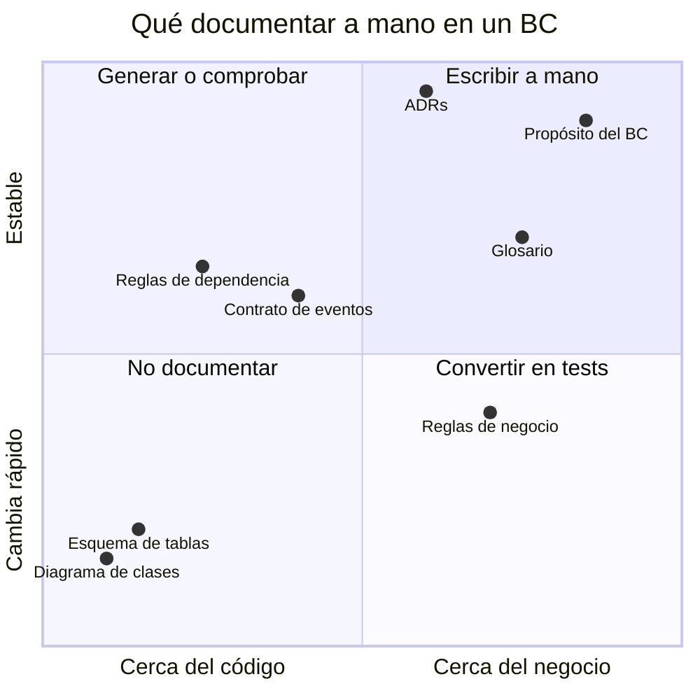
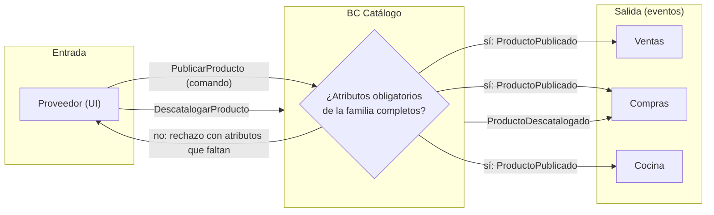
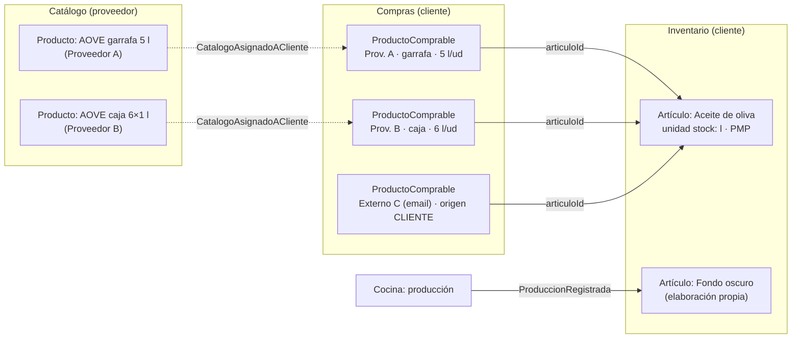
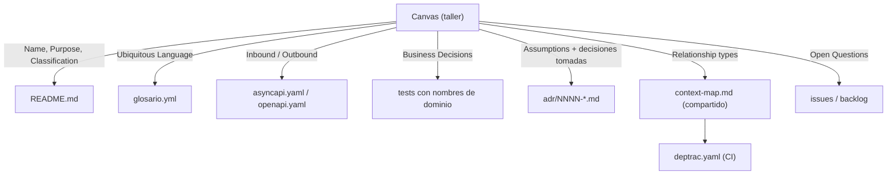
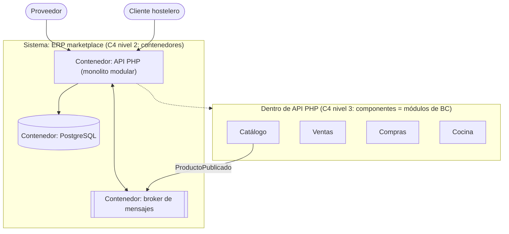
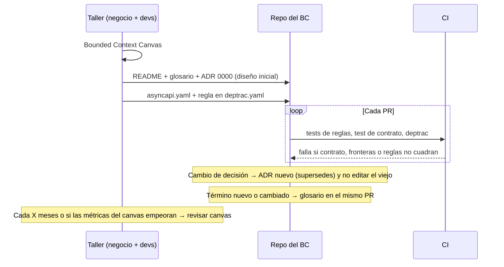

# Cómo documentar un bounded context

Pregunta de partida: *¿cómo se debe documentar un BC, tanto para implementarlo como para tenerlo de documentación?*

Ejemplo de toda la nota: el **BC Catálogo descriptivo** de `bc-catalogo-generico.md`, dentro del ERP marketplace de hostelería de `mapa-de-contextos-erp-marketplace.md`. Los patrones de relación entre contextos están en `comunicacion-entre-bounded-contexts.md`.

## Respuesta corta: dos momentos, artefactos distintos

Documentar un BC no es escribir "el documento del BC". Son **dos necesidades distintas** con artefactos distintos:

1. **Para implementarlo (diseño)**: hace falta decidir y acordar. La herramienta de referencia es el **Bounded Context Canvas** de DDD Crew: *"a collaborative tool for designing and documenting the design of a single bounded context"* ([DDD Crew](https://github.com/ddd-crew/bounded-context-canvas)). Fuerza a decidir nombre, propósito, clasificación estratégica, mensajes de entrada y salida, lenguaje, reglas, supuestos y preguntas abiertas.
2. **Para que dure (documentación)**: hace falta que siga siendo cierta. Aquí manda la idea de *living documentation* de Martraire: *"a living document must evolve at the same pace as the system"* y *"Most, but not all, of the knowledge worth sharing is already somewhere in the system itself"* ([InfoQ](https://www.infoq.com/articles/book-review-living-documentation/)). Se documenta a mano **solo lo que el código no puede decir** (el porqué, el propósito, los supuestos) y lo demás se **genera o se comprueba** desde el código.

Mi propuesta (opinión, construida con esas fuentes): el canvas se rellena antes de implementar y luego se **destila** en un paquete pequeño que vive en el repo, junto al código del BC:

| Artefacto | Qué responde | Fuente/estándar |
|---|---|---|
| `README.md` del BC (1 página) | Para qué existe, qué no hace, quién es el dueño | Canvas + *Domain Vision Statement* (Evans) |
| `glosario.yml` | Qué significa cada término **aquí** | *Ubiquitous Language* (Evans), Contextive |
| `adr/NNNN-*.md` | Por qué se decidió así | ADR (Nygard) |
| `asyncapi.yaml` / `openapi.yaml` | Qué publica y qué acepta | *Published Language*, AsyncAPI |
| `deptrac.yaml` (o test) | De quién puede depender | Documentación ejecutable |
| Context map (compartido, no por BC) | Con quién se relaciona y cómo | *Context Map* (Evans), DDD Crew |

Lo que **no** se escribe a mano: diagramas de clases, listas de tablas, listados de endpoints copiados. Se pudren (ver más abajo).

## Por qué la documentación de un BC se pudre

Nygard lo resume así: *"Large documents are never kept up to date"* y *"Nobody ever reads large documents, either"* ([Nygard](https://cognitect.com/blog/2011/11/15/documenting-architecture-decisions)). Su solución para las decisiones son documentos pequeños y modulares dentro del repositorio.

Regla práctica que saco de Nygard y Martraire: cuanto **más cerca del código** está un conocimiento, **más rápido cambia** y más se pudre si se copia a mano. Cuanto **más cerca del negocio**, más estable es y más merece texto escrito.

| Conocimiento | Velocidad de cambio | Cómo documentarlo |
|---|---|---|
| Propósito del BC, qué no hace | Muy lenta | Texto a mano (README) |
| Decisiones y su porqué | Nunca cambia (se reemplaza) | ADR inmutable, marcado como *superseded* |
| Términos del lenguaje | Lenta | Glosario en el repo, enlazado al código |
| Contrato público (eventos, API) | Media, con versionado | Especificación que se valida (AsyncAPI/OpenAPI) |
| Dependencias permitidas | Media | Regla ejecutable en CI (Deptrac) |
| Agregados, clases, tablas | Rápida | **No se documenta**: se lee el código o se genera |



Las reglas de negocio caen en el cuadrante incómodo: son de negocio pero cambian. Lo más fiable es documentarlas **como tests** con nombres en lenguaje del dominio (ver la sección del glosario y la de reglas).

## Fase de diseño: el Bounded Context Canvas

El canvas v5 de DDD Crew tiene estas secciones ([DDD Crew](https://github.com/ddd-crew/bounded-context-canvas)):

| Sección | Qué pide (según DDD Crew) |
|---|---|
| **Name** | Acordar el nombre; *"Naming is hard"* |
| **Purpose** | *"A few sentences describing the why and what of the context in business language. No technical details here."* |
| **Strategic Classification** | Core / supporting / generic; papel en el modelo de negocio (*revenue generator*, *engagement creator*, *compliance enforcer*); evolución (genesis → commodity, Wardley) |
| **Domain Roles** | Qué tipo de comportamiento tiene: ¿análisis?, ¿ejecución de un flujo?… |
| **Inbound Communication** | Mensajes que recibe (comando, consulta o evento), de qué colaborador y con qué tipo de relación |
| **Outbound Communication** | Mensajes que inicia el BC |
| **Ubiquitous Language** | *"What are the key domain terms that exist within this context, and what do they mean?"* |
| **Business Decisions** | Reglas y políticas clave |
| **Assumptions** | *"Most design happens based on assumptions and it is highly recommended to make them explicit."* |
| **Verification Metrics** | Métricas para saber si la frontera es buena |
| **Open Questions** | Preguntas sin respuesta; *"Many questions are a good indicator towards a high degree of uncertainty."* |

Cómo usarlo, según DDD Crew: empezar por nombre y propósito y luego seguir *outside-in* (desde los mensajes de entrada) o *inside-out* (desde reglas y lenguaje). Si falta información, *"you'll need to use other modelling techniques"* (por ejemplo, EventStorming o Domain Message Flow).

DDD Crew también da preguntas para criticar la interfaz pública, que conviene pasar antes de implementar: *"Is each message type optimal (e.g. should a command be an event)?"*, *"Is the interface too big (too many unique message types)?"*, *"Is the context exposing too much of its internals?"*.

Matiz importante: el canvas es una herramienta de **taller**. Existen versiones versionables (YAML, HTML, draw.io) que DDD Crew enlaza para guardarlo junto al código, pero un canvas completo mantenido a mano tiende a quedarse viejo en las secciones de comunicación. Por eso propongo **destilarlo** (sección siguiente) en vez de mantenerlo entero.

## Ejemplo: canvas del BC Catálogo descriptivo

Relleno con lo decidido en `bc-catalogo-generico.md` (los supuestos, métricas y preguntas abiertas son míos, como ejemplo):

| Sección | Catálogo descriptivo |
|---|---|
| **Name** | Catálogo (descriptivo) |
| **Purpose** | Que cada proveedor de la plataforma describa sus productos una sola vez (nombre, marca, GTIN, alérgenos, familia, variantes, imágenes) para que clientes, cocina e inventario usen la misma ficha. No fija precios, stock ni costes. |
| **Strategic Classification** | Genérico (lo tiene cualquier e-commerce; existe PIM comprable). Papel: *compliance enforcer* por los alérgenos. Evolución: *product*. |
| **Domain Roles** | Ejecución sencilla (ciclo de vida de la ficha) + publicación de datos a otros contextos. |
| **Inbound** | Proveedor (UI): `CrearProducto`, `ActualizarFicha`, `PublicarProducto`, `DescatalogarProducto`. Ventas: consulta `FichaDeProducto`. |
| **Outbound** | Eventos `ProductoPublicado`, `FichaProductoActualizada`, `ProductoDescatalogado` hacia Ventas, Compras y Cocina (OHS + Published Language). |
| **Ubiquitous Language** | Producto, Familia, Atributo, Variante, Eje de variante, Ficha publicada, Descatalogar. |
| **Business Decisions** | Solo se publica si la familia da por completos sus atributos obligatorios. Un producto descatalogado no se borra. El GTIN es único por variante. |
| **Assumptions** | Los proveedores mantienen sus propias fichas. Los externos sin cuenta no necesitan ficha: sus productos viven como `ProductoComprable` en Compras. El catálogo del cliente no es este BC (ver la sección siguiente). |
| **Verification Metrics** | Nº de cambios que obligan a tocar Catálogo **y** otro BC en el mismo PR; nº de atributos "regla" pedidos por negocio (señal de inner-platform). |
| **Open Questions** | ¿Importar fichas de un pool GS1/GDSN? ¿Quién corrige un alérgeno mal puesto: proveedor o plataforma? |

En forma de diagrama, la parte de comunicación (el formato *message in → decision → message out* que DDD Crew llama *Use Case Swimlanes*):



## El catálogo del cliente: otro modelo, no el mismo BC

El ejemplo anterior solo cubre el catálogo **del proveedor** (lo que vende). En el ERP el cliente también tiene "su catálogo": los productos que compra y con los que mide su stock. Es la misma palabra para **dos (en realidad tres) modelos distintos**, que es la polisemia de "Product" que señala Fowler (*"Time and time again I see this confusion recur with polysemes like "Customer" and "Product""*, [BoundedContext](https://martinfowler.com/bliki/BoundedContext.html)).

Separando lo que hoy se llama "catálogo del cliente" (propuesta mía, coherente con `mapa-de-contextos-erp-marketplace.md` y `unidades-de-medida-compra-stock-cocina.md`):

| Lo que el cliente llama "mi catálogo" | Pregunta que responde | Modelo | BC |
|---|---|---|---|
| Lo que puedo pedir a cada proveedor | ¿A quién lo compro, en qué formato y a qué precio? | `ProductoComprable` (uno **por proveedor**, origen PROVEEDOR o CLIENTE) | Compras |
| Lo que tengo en el almacén y cuento | ¿Cuánto me queda, en qué unidad, cuánto vale? | `Articulo` (unidad de stock, equivalencias, PMP/FIFO) | Inventario |
| Lo que el proveedor describe | ¿Qué es este producto (GTIN, alérgenos)? | `Producto` | Catálogo (del proveedor) |

Por qué no juntar los dos primeros en un único "catálogo del cliente":

- **La cardinalidad es distinta.** El cliente compra aceite de oliva a dos proveedores (garrafa de 5 l y caja de 6 botellas de 1 l), pero en el almacén cuenta **un** artículo "aceite de oliva" en litros. Son dos `ProductoComprable` apuntando a un `Articulo`.
- **El stock se mide sobre lo que se cuenta, no sobre lo que se compra.** Si el stock colgara del producto comprado, cambiar de proveedor rompería el histórico de existencias y el coste medio.
- **Hay artículos que no se compran**: elaboraciones propias (fondo, salsa base) que salen de producción en Cocina. Tienen stock pero ningún proveedor.
- **Hay productos comprables que no se inventarían** (servicios, material que se imputa a gasto): `articuloId` es opcional.



Cómo se refleja en la documentación:

1. **README de Compras y de Inventario**, cada uno con su "qué NO hace": Compras no guarda stock; Inventario no gestiona proveedores ni precios pactados (de cada recepción solo le importan cantidad en unidad de stock y coste).
2. **Glosario por BC** con la misma palabra definida dos veces (ver la sección del glosario): en Compras "producto" es alias de *Producto comprable*; en Inventario el término es *Artículo* y "producto" **no** se usa.
3. **ADR** que fija la decisión: *"El stock se lleva por Artículo, no por ProductoComprable"*, con la consecuencia negativa explícita (el usuario tiene que vincular cada producto comprable a un artículo, al menos la primera vez).

Si en la UI el cliente ve una sola pantalla "Mi catálogo" con ambas cosas, es una **vista** (read model que compone Compras e Inventario), no un BC. Ver `cqrs/cqrs-que-es-cuando-y-niveles-de-separacion.md`.

## Qué queda en el repositorio: estructura propuesta

Nygard propone guardar las decisiones *"in the project repository under doc/arch/adr-NNN.md"*. Aplico la misma idea a todo el paquete del BC: vive **junto al código del contexto**, se revisa en el mismo PR que el código y se pudre menos porque el revisor lo ve.

```text
src/Catalogo/
├── Dominio/ …
├── Aplicacion/ …
├── Infraestructura/ …
└── docs/
    ├── README.md            # propósito, límites, dueño (1 página)
    ├── glosario.yml         # lenguaje ubicuo de ESTE contexto
    ├── asyncapi.yaml        # eventos que publica (Published Language)
    └── adr/
        ├── 0001-precio-fuera-del-catalogo.md
        └── 0002-atributos-en-jsonb-no-eav.md
docs/
├── context-map.md           # mapa compartido entre todos los BC
└── adr/                     # decisiones transversales
deptrac.yaml                 # fronteras entre BC, comprobadas en CI
```



El canvas se queda como **foto del diseño inicial** (por ejemplo, en `adr/0000-diseno-inicial.md` o como imagen). Lo que se mantiene vivo son los artefactos destilados.

## El README del BC: propósito y límites en una página

Evans propone para el core un *Domain Vision Statement*: *"Write a short description (about one page) of the core domain and the value it will bring"*, y un *Highlighted Core* de *"three to seven sparse pages"* ([DDD Reference](https://domainlanguage.com/wp-content/uploads/2016/05/DDD_Reference_2015-03.pdf)). Para un BC sirve el mismo límite: **una página**. Si no cabe, el BC probablemente hace demasiado.

Lo más útil de este README es la sección **"Qué NO hace"**: es lo que evita que el BC crezca por acumulación (en el Catálogo, que alguien añada `precio`).

```markdown
# BC Catálogo (descriptivo)

**Propósito.** Que cada proveedor describa sus productos una vez
(nombre, marca, GTIN, alérgenos, familia, variantes, imágenes) para
que clientes, cocina e inventario usen la misma ficha.

**Tipo.** Subdominio genérico. Prioridad por debajo de Compras e Inventario.

**Qué NO hace.**
- Precios, tarifas y formatos comerciales → Ventas
- Stock, unidad de stock, coste (PMP/FIFO) → Inventario
- Gramajes y mermas → Cocina
- Productos de proveedores externos → Compras (ProductoComprable)

**Dueño.** Equipo Marketplace. Cambios en el contrato: avisar a Ventas,
Compras y Cocina (ver asyncapi.yaml).

**Relaciones.** Upstream de Ventas, Compras y Cocina (OHS + Published
Language). Ver docs/context-map.md.

**Decisiones.** adr/0001 precio fuera; adr/0002 atributos en JSONB.
```

## Lenguaje ubicuo: un glosario por contexto, versionado

Evans pide *"Use the model as the backbone of a language"* y *"Commit the team to exercising that language relentlessly in all communication within the team and in the code"* ([DDD Reference](https://domainlanguage.com/wp-content/uploads/2016/05/DDD_Reference_2015-03.pdf)). Y en el Context Map: *"Name each bounded context, and make the names part of the ubiquitous language."*

Consecuencia práctica: el glosario es **por BC**, no global. "Producto" significa cosas distintas en Catálogo, Compras e Inventario (ver `bc-catalogo-generico.md`). Un glosario global de empresa acaba promediando significados, que es justo lo que DDD intenta evitar.

**Contextive** es una herramienta que lee un glosario YAML del repo y muestra las definiciones al pasar el ratón sobre el término en el IDE (VS Code, IntelliJ, Neovim…), incluso dentro de nombres compuestos como `ProductoId` o `producto_id` ([Contextive](https://github.com/dev-cycles/contextive)). Su formato tiene `contexts` con `name`, `domainVisionStatement` y `terms` (cada uno con `name`, `definition`, `examples`, `aliases`, `meta`). Ejemplo para el ERP:

```yaml
# src/Catalogo/docs/glosario.yml
contexts:
  - name: Catálogo
    domainVisionStatement: Describir una vez cada producto de un proveedor para que todos usen la misma ficha.
    terms:
      - name: Producto
        definition: Ficha descriptiva de algo que vende un proveedor. No tiene precio ni stock.
        examples:
          - "El AOVE Hojiblanca está en la familia Aceites y tiene variantes de 1 l y 5 l."
        aliases: [ficha, artículo de catálogo]
      - name: Familia
        definition: Tipo de producto que define qué atributos son obligatorios para publicar.
        examples:
          - "No puedo publicar la cerveza: la familia Bebidas alcohólicas exige graduación."
      - name: Descatalogar
        definition: Retirar un producto de la venta sin borrarlo; los pedidos antiguos siguen apuntando a él.
```

```yaml
# src/Compras/docs/glosario.yml
contexts:
  - name: Compras
    terms:
      - name: Producto comprable
        definition: Lo que un cliente puede pedir a un proveedor (de la plataforma o externo), con su referencia y precio pactado.
        aliases: [producto]
        examples:
          - "El aceite se lo pedimos a Aceites Sur en garrafa y a Distribuciones Norte en caja de seis."
```

```yaml
# src/Inventario/docs/glosario.yml
contexts:
  - name: Inventario
    domainVisionStatement: Saber cuánto tiene cada cliente de cada cosa que cuenta y cuánto vale.
    terms:
      - name: Artículo
        definition: Lo que el cliente cuenta en su almacén, en una unidad de stock. Puede alimentarse de varios productos comprables o de producción propia.
        examples:
          - "Del aceite de oliva quedan 12 litros, venga de la garrafa o de las botellas."
      - name: Unidad de stock
        definition: Unidad en la que se cuenta y valora un artículo (l, kg, botella).
```

Los `examples` deben ser **frases reales** de los expertos (cocineros, jefes de compras), como recomienda la guía de Contextive. Son lo que más ayuda a distinguir significados entre contextos.

Alternativa "más viva": Martraire propone *"Extract the glossary of the ubiquitous language from the source code"* ([Hilton, Living glossary](https://hilton.org.uk/blog/living-glossary)). Hilton advierte que *"it won’t always work in practice"* y que deja fuera a quien no programa. Mi criterio: si los expertos de negocio van a revisar el glosario, YAML fuera del código; si solo lo leen desarrolladores, generarlo desde el código. Ejemplo de la segunda opción en PHP con un atributo:

```php
<?php
declare(strict_types=1);

namespace Comun\Documentacion;

#[\Attribute(\Attribute::TARGET_CLASS)]
final readonly class TerminoDelDominio
{
    public function __construct(
        public string $definicion,
        public array $aliases = [],
    ) {}
}
```

```php
<?php
declare(strict_types=1);

namespace Catalogo\Dominio;

use Comun\Documentacion\TerminoDelDominio;

#[TerminoDelDominio(
    definicion: 'Retirar un producto de la venta sin borrarlo.',
)]
final readonly class ProductoDescatalogado
{
    public function __construct(
        public string $productoId,
        public \DateTimeImmutable $ocurridoEn,
    ) {}
}
```

```php
<?php
// bin/generar-glosario.php — recorre las clases del BC y escribe el glosario
declare(strict_types=1);

use Comun\Documentacion\TerminoDelDominio;

require __DIR__ . '/../vendor/autoload.php';

/** @param list<class-string> $clases */
function glosario(string $contexto, array $clases): string
{
    $md = "# Glosario de {$contexto}\n\n";
    foreach ($clases as $clase) {
        $ref = new ReflectionClass($clase);
        foreach ($ref->getAttributes(TerminoDelDominio::class) as $attr) {
            $termino = $attr->newInstance();
            $md .= "- **{$ref->getShortName()}**: {$termino->definicion}\n";
        }
    }
    return $md;
}
```

Esto aplica la idea de Martraire de *"The best place to store documentation is on the documented thing itself"* ([InfoQ](https://www.infoq.com/articles/book-review-living-documentation/)): si la clase cambia de nombre, el glosario cambia con ella.

## Decisiones: ADR por BC, cortos e inmutables

Formato de Nygard ([arc42](https://faq.arc42.org/questions/C-9-3/), [Nygard](https://cognitect.com/blog/2011/11/15/documenting-architecture-decisions)):

- **Title**: nombre corto con número.
- **Context**: las fuerzas en juego, *"technological, political, social, and project organizational"*.
- **Decision**: qué se hace frente a esas fuerzas.
- **Status**: *proposed*, *accepted*, luego *deprecated* o *superseded*.
- **Consequences**: todas, también las negativas.

Reglas de Nygard que importan: *"The whole document should be one or two pages long"* y *"If a decision is reversed, we will keep the old one around, but mark it as superseded."* Un ADR **no se edita** para reflejar el presente; se escribe otro que lo reemplaza. Por eso no se pudre: es un registro histórico, no una descripción del estado actual.

Qué merece un ADR en un BC: lo que alguien nuevo querría **deshacer** sin saber por qué se hizo. En el Catálogo, que el precio no esté en `Producto` es exactamente eso.

```markdown
# ADR 0001: El precio no vive en el Catálogo

**Status:** accepted (2026-11-03)

**Context.** En el marketplace el precio depende del cliente (tarifas,
catálogos asignados) y lo fija el proveedor en Ventas. "Producto" es un
término polisémico (Fowler). Meter precio en la ficha obligaría a que
cada cambio de tarifa toque el Catálogo y a que Compras lea precios de
dos sitios.

**Decision.** `Producto` no tiene precio, stock ni coste. Ventas guarda
la oferta por `productoId`. Compras recibe el precio en
`CatalogoAsignadoACliente`.

**Consequences.**
+ El Catálogo puede ser genérico (o sustituirse por un PIM).
+ Cambiar tarifas no toca el Catálogo.
- Mostrar "ficha + precio" exige componer dos fuentes (read model en Compras).
- Hay que explicar a negocio por qué la ficha no muestra precio.
```

Dónde va cada ADR: en `src/<BC>/docs/adr/` si solo afecta a ese contexto; en `docs/adr/` si afecta a la relación entre contextos (por ejemplo, "Compras y Ventas se comunican por eventos con outbox").

## Contrato público: documentar el Published Language con AsyncAPI

Lo que un BC publica es lo que más daño hace si cambia sin aviso. DDD Crew lo dice para el canvas: *"The public interface of a bounded context is its contract with the rest of the system. Contracts have a big impact on collaborators and are hard to change"*.

Para eventos, **AsyncAPI** es el equivalente de OpenAPI: describe en un fichero legible por máquina los `channels`, las `operations` (`send` o `receive`) y los mensajes, y es independiente del protocolo (AMQP, Kafka, HTTP…) ([AsyncAPI](https://asyncapi.com/docs/concepts/asyncapi-document/structure), [spec](https://github.com/asyncapi/spec)). Ejemplo para el Catálogo:

```yaml
# src/Catalogo/docs/asyncapi.yaml
asyncapi: 3.0.0
info:
  title: Catálogo — eventos publicados
  version: 1.2.0
  description: Published Language del BC Catálogo. Cambios incompatibles = nueva versión mayor.
channels:
  productoPublicado:
    address: catalogo.producto.publicado
    messages:
      productoPublicado:
        $ref: '#/components/messages/ProductoPublicado'
operations:
  publicarProductoPublicado:
    action: send
    channel:
      $ref: '#/channels/productoPublicado'
components:
  messages:
    ProductoPublicado:
      summary: Un proveedor ha publicado la ficha de un producto.
      payload:
        type: object
        required: [productoId, proveedorId, nombre, familia, ocurridoEn]
        properties:
          productoId: { type: string, format: uuid }
          proveedorId: { type: string, format: uuid }
          nombre: { type: string }
          gtin: { type: string }
          familia: { type: string, examples: [aceites] }
          atributos:
            type: object
            description: Atributos descriptivos tipados (alérgenos, origen…)
          ocurridoEn: { type: string, format: date-time }
```

La especificación avisa de que no conviene derivar el documento del receptor a partir del emisor (*"It's NOT RECOMMENDED to derive a receiver AsyncAPI document from a sender one"*): cada BC consumidor documenta lo que **él** recibe, y con su ACL decide qué campos usa (ver `comunicacion-entre-bounded-contexts.md`).

Para que el contrato no se pudra, se comprueba en un test que el evento PHP real cumple el esquema:

```php
<?php
declare(strict_types=1);

namespace Tests\Catalogo\Contrato;

use Catalogo\Infraestructura\Mensajeria\SerializadorProductoPublicado;
use PHPUnit\Framework\TestCase;
use Symfony\Component\Yaml\Yaml;

final class ProductoPublicadoCumpleContratoTest extends TestCase
{
    public function test_el_mensaje_serializado_tiene_los_campos_obligatorios_del_contrato(): void
    {
        $spec = Yaml::parseFile(__DIR__ . '/../../../src/Catalogo/docs/asyncapi.yaml');
        $obligatorios = $spec['components']['messages']['ProductoPublicado']['payload']['required'];

        $mensaje = (new SerializadorProductoPublicado())->serializar(
            ProductoPublicadoMother::aoveHojiblanca()
        );

        foreach ($obligatorios as $campo) {
            self::assertArrayHasKey($campo, $mensaje, "Falta '{$campo}' del contrato");
        }
    }
}
```

Es una comprobación mínima (solo campos obligatorios). Para validar tipos completos se puede usar un validador de JSON Schema sobre `payload`; no lo detallo porque no lo he contrastado con una fuente concreta.

## Fronteras: documentación que se ejecuta en CI

El context map dice qué BC depende de cuál. Si solo está en un diagrama, nadie se entera cuando alguien importa `Ventas\Dominio\Oferta` desde el Catálogo. **Deptrac** analiza las dependencias entre "capas" definidas por directorio o nombre de clase y falla si se rompe una regla ([Rubio](https://dev.to/rubenrubiob/enforce-architecture-rules-with-deptrac-33e8)). Las "capas" pueden ser bounded contexts:

```yaml
# deptrac.yaml
deptrac:
  paths:
    - ./src
  layers:
    - name: Catalogo
      collectors:
        - type: directory
          regex: src/Catalogo/.*
    - name: Ventas
      collectors:
        - type: directory
          regex: src/Ventas/.*
    - name: Compras
      collectors:
        - type: directory
          regex: src/Compras/.*
    - name: Cocina
      collectors:
        - type: directory
          regex: src/Cocina/.*
    - name: Comun
      collectors:
        - type: directory
          regex: src/Comun/.*
  ruleset:
    Catalogo: [Comun]          # upstream: no conoce a nadie
    Ventas:   [Comun]          # se integra por eventos, no por clases
    Compras:  [Comun]
    Cocina:   [Comun]
```

```bash
vendor/bin/deptrac analyse --report-uncovered --fail-on-uncovered
```

Con `--fail-on-uncovered`, cualquier dependencia no declarada rompe el build. Así el `ruleset` **es** la documentación de las dependencias de código, y no puede quedarse desactualizada sin que el CI lo note.

Matiz: Deptrac comprueba dependencias de **código** (imports). Las dependencias por **mensajes** (quién escucha `ProductoPublicado`) no las ve; esas quedan en el context map y en los AsyncAPI de cada BC.

## Dónde encaja C4 (y dónde no)

El modelo C4 de Simon Brown tiene cuatro niveles: **Context** (el sistema y sus usuarios y sistemas externos), **Container** (aplicaciones y almacenes de datos), **Component** (piezas dentro de un contenedor) y **Code** ([Wikipedia](https://en.wikipedia.org/wiki/C4_model)).

Error frecuente: tratar BC y contenedor como sinónimos. Un **contenedor** C4 es algo que se despliega o guarda datos; un **BC** es una frontera de modelo y lenguaje. En un monolito modular (lo más probable en el ERP), todos los BC viven en **un** contenedor y C4 solo los muestra a nivel **Component**. Por eso C4 sirve para documentar **dónde corre** cada BC, no **qué significa**.



Recomendación: un diagrama C4 de nivel 1 y 2 para todo el sistema (cambia poco). **No** dibujar el nivel 4 (código) a mano: Wikipedia menciona como notación posible los *"diagrams generated by Integrated Development Environments"*, y generarlos es la única forma de que no se pudran.

## Reglas de negocio: documentarlas como tests con nombres del dominio

La sección *Business Decisions* del canvas es la que más rápido se desactualiza si se deja en texto. La forma de que siga siendo cierta es convertir cada regla en un test cuyo **nombre** sea la regla, en el lenguaje del glosario. Encaja con el principio de Martraire de documentación *"reliable"* y de *"low effort"* basada en ejemplos ya discutidos ([Hilton](https://hilton.org.uk/blog/living-documentation-principles)).

```php
<?php
declare(strict_types=1);

namespace Tests\Catalogo\Dominio;

use Catalogo\Dominio\{FaltanAtributosObligatorios, Producto};
use PHPUnit\Framework\TestCase;

final class PublicarProductoTest extends TestCase
{
    public function test_no_se_publica_una_cerveza_sin_graduacion_porque_la_familia_la_exige(): void
    {
        $familia = FamiliaMother::bebidasAlcoholicas();   // exige 'graduacion'
        $producto = ProductoMother::cervezaSinGraduacion($familia->id());

        $this->expectException(FaltanAtributosObligatorios::class);
        $producto->publicar($familia);
    }

    public function test_descatalogar_no_borra_el_producto(): void
    {
        $producto = ProductoMother::aovePublicado();
        $producto->descatalogar();

        self::assertTrue($producto->estaDescatalogado());
        self::assertSame('AOVE Hojiblanca', $producto->nombre());
    }
}
```

Listar los nombres de los tests (`phpunit --testdox`) da una lista de reglas legible por negocio que no puede mentir: si la regla cambia y el test no, el build falla.

## Ciclo de vida: qué se toca y cuándo



Las **Verification Metrics** del canvas son la señal para volver al taller. Para el Catálogo, si muchos PRs tocan Catálogo y Ventas a la vez, la frontera entre ambos está mal puesta y toca rehacer el canvas.

## Errores frecuentes al documentar un BC

Lista mía, derivada de las fuentes anteriores:

1. **Un documento grande en una wiki aparte.** Nygard: *"Large documents are never kept up to date"*. Va al repo y en piezas pequeñas.
2. **Glosario global de empresa.** Rompe la idea de BC: el mismo término tiene significados distintos en cada contexto. Un glosario por BC.
3. **Diagramas de clases o tablas a mano.** Cambian con cada refactor. Se lee el código o se generan.
4. **Editar ADRs antiguos.** Pierde el porqué histórico. Se marcan *superseded* y se escribe otro.
5. **Contrato de eventos solo en el código PHP.** Los consumidores tienen que leer otro BC para saber qué reciben. AsyncAPI + test de contrato.
6. **Context map solo dibujado.** Nadie se entera cuando se viola. Deptrac en CI para las dependencias de código.
7. **Canvas mantenido para siempre.** Es una herramienta de diseño; su valor duradero está en lo que se destila de él.
8. **No escribir el "qué NO hace".** Es la parte que más protege la frontera y la que menos se escribe.

## Checklist mínima para un BC nuevo del ERP

Para un BC como Catálogo, Compras o Inventario, en el orden en que se hace:

- [ ] Canvas rellenado en taller con alguien de negocio (al menos Name, Purpose, Classification, Inbound/Outbound, Language).
- [ ] `README.md` de una página con propósito, tipo de subdominio, **qué no hace**, dueño y relaciones.
- [ ] `glosario.yml` con los términos del canvas y ejemplos reales; los nombres de clases coinciden.
- [ ] ADR 0000 con la foto del diseño inicial y un ADR por cada decisión que alguien querría deshacer.
- [ ] `asyncapi.yaml` (y `openapi.yaml` si hay API síncrona) con lo que publica y test de contrato.
- [ ] Regla del BC en `deptrac.yaml` y entrada en `docs/context-map.md`.
- [ ] Reglas de negocio del canvas convertidas en tests con nombre en lenguaje del dominio.
- [ ] Preguntas abiertas del canvas pasadas a issues.

Si solo hay tiempo para tres cosas: **README con "qué no hace"**, **glosario** y **ADRs**. Son las que el código no puede contar por sí mismo.
