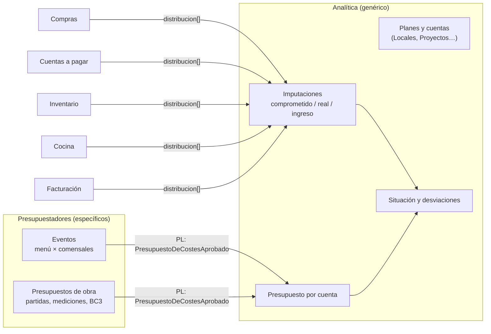

# Documentación del BC Analítica (genérico: centros de coste, proyectos, eventos, obras)

Preguntas de partida: *¿dónde van los presupuestos y la gestión de "eventos"/"obras"?*, *¿qué es una cuenta analítica, un centro de coste?* y *quiero algo genérico que sirva para todo*.

Aplicación de `documentar-un-bounded-context.md`. Vecinos: `erp-bc-ventas.md`, `erp-bc-compras.md`, `erp-bc-facturacion.md`, `erp-bc-cuentas-a-pagar.md`. El caso obras (bases de precios, BC3, partidas) se esbozó en `bc-catalogo-generico.md`.

Las decisiones son **propuestas mías** apoyadas en las fuentes.

## Conceptos: contabilidad analítica, centro de coste, cuenta analítica

- **Contabilidad analítica**: *"el conjunto de herramientas de análisis y distribución de los costes y los ingresos de la empresa"*. Frente a la financiera (*"Visión externa"*, *"Contabilidad regulada"*), la analítica tiene *"Visión interna"* y es *"Contabilidad no regulada"* ([Cegid](https://www.cegid.com/ib/es/blog/que-es-contabilidad-analitica/)). Cada empresa la organiza como le sirva.
- **Centro de coste**: *"una unidad organizativa interna de una empresa que consume recursos y genera gastos"* ([Hosteltur](https://www.hosteltur.com/hosteltur-responde/centro-costes)). Es **permanente**: un local, la cocina central, sala.
- **Cuenta analítica** (término de Odoo): cualquier "cajón" al que se imputa; *"The analytic accounts give an overview of your costs and revenue"*. Se agrupan en **planes** (*"Each analytic plan must have at least one analytic account"*) y un apunte se reparte entre cuentas: *"decide how to split the costs between the accounts by modifying the percentage"* ([Odoo](https://www.odoo.com/documentation/latest/applications/finance/accounting/reporting/analytic_accounting.html)).
- **Proyecto** (evento, obra): una cuenta analítica **temporal**, con fechas y presupuesto. En Odoo, *"every time a project gets created moving forward, a new Analytic Account will be created"* ([Hibou](https://hibou.io/docs/accounting-3/projects-analytic-accounting-111)).

Ejemplo: factura de 1.000 € de pescado. La contabilidad financiera la anota en la cuenta 600 (compras) y nada más. La analítica la reparte: 700 € al centro de coste "Local Mayor" (plan Locales) y 300 € al proyecto "Boda García" (plan Proyectos).

## Respuesta corta: qué puede ser "genérico para todo" y qué no

Lo que **sí** puede servir para todo es el **mecanismo analítico**:

1. **Planes** definidos por cada empresa (Locales, Departamentos, Proyectos, Obras, Eventos, lo que quiera).
2. **Cuentas** dentro de cada plan, opcionalmente con **fechas** y **presupuesto**.
3. **Distribución analítica** en cada documento de los demás BCs: lista de (cuenta, %).
4. **Imputaciones**, **saldos** y **desviaciones** previsto vs. comprometido vs. real.

Con eso, un centro de coste, un evento, una obra o una campaña son **la misma cosa** con distintos datos. Es lo que hacen Odoo (cuentas y planes analíticos) y ERPNext (*"You can create a Budget against a Cost Center, Project, or supported Accounting Dimension"*, [ERPNext](https://docs.frappe.io/erpnext/budget)).

Lo que **no** puede ser genérico, y no debe entrar aquí:

- **Cómo se calcula un presupuesto**: partidas, mediciones y BC3 en obra; menú × comensales con escandallos en evento. Va en un **presupuestador por vertical**.
- **Reglas que dependen del tipo** ("en obra hay certificaciones", "en evento hay prueba de menú"). Si aparecen en Analítica, el BC deja de ser genérico.

El riesgo de pedir "algo que sirva para todo" sin este límite es el *inner-platform effect*: *"a system so customizable as to become a replica, and often a poor replica, of the software development platform"* ([Wikipedia](https://en.wikipedia.org/wiki/Inner-platform_effect)). Evans, para lo genérico: *"Leave no trace of your specialties in them"* ([DDD Reference](https://domainlanguage.com/wp-content/uploads/2016/05/DDD_Reference_2015-03.pdf)). Genérico = **pocos conceptos con datos variables**, no **muchos conceptos configurables**.



## Tres "presupuestos" distintos (polisemia)

"Presupuesto" es un polisema como "producto" (Fowler, [BoundedContext](https://martinfowler.com/bliki/BoundedContext.html)):

| Término | Qué es | BC |
|---|---|---|
| **Presupuesto al cliente** (oferta) | Lo que se le cobrará; validez; aceptación | Ventas, fase previa del pedido. En Odoo confirmar *"will convert this sales quotation into a sales order"* ([Cybrosys](https://cybrosys.com/odoo/odoo-books/odoo-book-v16/sales/sales-quotations)) |
| **Presupuesto de costes** | Importes previstos por cuenta, capítulo y categoría | Analítica |
| **Presupuesto de obra / propuesta de evento** | Documento de trabajo que calcula los dos anteriores | Presupuestador del vertical |

Al aceptarse un presupuesto al cliente, Ventas emite `PresupuestoAceptado`; el presupuestador crea la cuenta analítica del proyecto (o pide crearla) y publica su presupuesto de costes.

## README del BC Analítica (propósito y límites)

**Propósito.** Que cada empresa reparta sus costes e ingresos entre las dimensiones que le importen (locales, departamentos, eventos, obras) y sepa, para cada una, cuánto preveía, cuánto lleva comprometido y gastado y dónde se desvía.

**Tipo de subdominio.** Genérico. Existe en Odoo y ERPNext; es candidato a simplificar o comprar si el ERP crece hacia contabilidad completa.

**Qué NO hace.**

| No hace | Dónde vive |
|---|---|
| Calcular presupuestos (partidas, mediciones, menús, escandallos) | Presupuestador del vertical |
| Presupuesto al cliente y su aceptación | Ventas |
| Comprar, mover stock, producir, facturar | Compras, Inventario, Cocina, Facturación (solo **etiquetan** con distribución) |
| Asientos y libros oficiales | Contabilidad financiera |
| Planificación de tareas, Gantt, turnos | Fuera de alcance |
| Reglas distintas según tipo de proyecto | Presupuestador del vertical |

**Dueño.** Equipo Plataforma.

## Canvas del BC Analítica

| Sección | Contenido |
|---|---|
| **Name** | Analítica (en la UI: "Centros de coste", "Proyectos", "Eventos", "Obras" según el plan) |
| **Purpose** | Repartir costes e ingresos por dimensiones y controlar previsto vs. real. |
| **Strategic Classification** | Genérico · ninguno de los tres papeles del canvas encaja del todo; el más cercano es *compliance enforcer* (protege el margen) · *product* |
| **Domain Roles** | Análisis (agrega imputaciones) + regla de control (avisar o bloquear) |
| **Inbound** | Usuario: `CrearPlan`, `CrearCuenta`, `CerrarCuenta`, `ImputarManual`. Presupuestadores: `PresupuestoDeCostesAprobado`. Compras, Cuentas a pagar, Inventario, Cocina, Facturación: eventos con `distribucion[]`. Ventas: `PresupuestoAceptado` |
| **Outbound** | `CuentaAnaliticaAbierta`, `CuentaAnaliticaCerrada`, `DesviacionDetectada`. Consulta: `CuentasImputables(empresa)`, `SaldoDisponible(cuenta, categoria)` |
| **Ubiquitous Language** | Plan, Cuenta analítica, Distribución, Imputación, Presupuesto de costes, Capítulo, Categoría de coste, Comprometido, Real, Desviación |
| **Business Decisions** | Ver "Reglas de negocio" |
| **Assumptions** | Toda vertical puede expresar su presupuesto como capítulos × categorías × importe. Bastan importes, no cantidades. |
| **Verification Metrics** | Nº de campos o reglas "solo para obras" o "solo para eventos" pedidos en Analítica (si sube, la frontera falla) |
| **Open Questions** | Ver última sección |

## Glosario del BC Analítica

```yaml
contexts:
  - name: Analítica
    domainVisionStatement: Saber dónde se gana y se pierde dinero, por la dimensión que cada empresa elija.
    terms:
      - name: Plan
        definition: Dimensión de análisis que define la empresa (Locales, Proyectos, Departamentos). Agrupa cuentas.
        examples:
          - "Tenemos un plan Locales y un plan Eventos."
      - name: Cuenta analítica
        definition: Cajón de un plan al que se imputan costes e ingresos. Puede ser permanente (centro de coste) o temporal con fechas y presupuesto (proyecto, evento, obra).
        aliases: [centro de coste, proyecto, evento, obra]
        examples:
          - "La boda García es una cuenta del plan Eventos; el local de la calle Mayor, del plan Locales."
      - name: Distribución
        definition: Lista de (cuenta, porcentaje) que un documento lleva para repartir su importe. Por plan, los porcentajes suman como mucho 100.
        examples:
          - "La factura de pescado va 70 % al local Mayor y 30 % a la boda García."
      - name: Imputación
        definition: Apunte de un importe a una cuenta, con su origen y su tipo (comprometido, real o ingreso).
      - name: Presupuesto de costes
        definition: Importes previstos de una cuenta por capítulo y categoría. Se revisa, no se edita.
      - name: Categoría de coste
        definition: Lista cerrada común a todos - material, mano de obra, subcontrata, alquiler, otros.
      - name: Comprometido
        definition: Coste pedido pero aún no facturado ni consumido.
      - name: Real
        definition: Coste incurrido (facturas conformadas, consumos de stock, producción).
      - name: Desviación
        definition: (Comprometido + real) − previsto, por cuenta, capítulo o categoría.
```

**Dos listas cerradas** mantienen el BC genérico sin convertirlo en plataforma configurable: los **tipos de imputación** y las **categorías de coste**. Los planes y cuentas sí los crea cada empresa libremente, porque son **datos**, no reglas (la misma idea que familias de datos y tipos de atributo cerrados en `bc-catalogo-generico.md`).

## Modelo del BC Analítica: agregados e invariantes

| Agregado / modelo | Contiene | Invariantes |
|---|---|---|
| `PlanAnalitico` | Empresa, nombre, `obligatorio` (si todo documento debe repartirse en él) | Nombre único por empresa |
| `CuentaAnalitica` | Plan, código, nombre, vigencia opcional, estado, política al superar (bloquear / avisar / ignorar), referencia externa opcional (cliente, presupuesto de obra) | No se imputa a una cuenta cerrada o fuera de vigencia |
| `PresupuestoDeCostes` | `cuentaId`, revisión, líneas (capítulo, categoría, importe), ingresos previstos | Una revisión vigente; revisión aprobada no se edita |
| `Imputacion` (*append-only*) | Cuenta, origen (tipo + id), categoría, capítulo?, importe, tipo (comprometido / real / ingreso) | Idempotente por (origen, cuenta); cuando llega el real de un comprometido, éste se libera |
| `SituacionEconomica` (proyección) | Por cuenta × capítulo × categoría: previsto, comprometido, real, desviación | Solo se recalcula desde imputaciones y presupuesto |

La **distribución** es un value object que viaja en los documentos de los demás BCs. Analítica publica su forma (Published Language); los demás solo la guardan y la reenvían.

```php
<?php
declare(strict_types=1);

namespace Comun\Analitica;   // Published Language compartido: solo el VO, sin reglas de Analítica

final readonly class Distribucion
{
    /** @param list<array{cuentaId: string, plan: string, porcentaje: float}> $repartos */
    private function __construct(public array $repartos) {}

    public static function de(array $repartos): self
    {
        $porPlan = [];
        foreach ($repartos as $r) {
            if ($r['porcentaje'] <= 0) {
                throw new \InvalidArgumentException('Porcentaje debe ser > 0');
            }
            $porPlan[$r['plan']] = ($porPlan[$r['plan']] ?? 0) + $r['porcentaje'];
        }
        foreach ($porPlan as $plan => $total) {
            if ($total > 100.0 + 1e-9) {
                throw new \InvalidArgumentException("El plan {$plan} suma más de 100 %");
            }
        }
        return new self($repartos);
    }

    public static function vacia(): self
    {
        return new self([]);
    }
}
```

```php
<?php
declare(strict_types=1);

namespace Analitica\Dominio;

enum TipoImputacion: string { case Comprometido = 'COMPROMETIDO'; case Real = 'REAL'; case Ingreso = 'INGRESO'; }
enum AccionAlSuperar: string { case Bloquear = 'BLOQUEAR'; case Avisar = 'AVISAR'; case Ignorar = 'IGNORAR'; } // ERPNext: Stop / Warn / Ignore

final class CuentaAnalitica extends AggregateRoot
{
    public function __construct(
        public readonly CuentaId $id,
        public readonly PlanId $planId,
        private string $nombre,
        private ?Periodo $vigencia = null,       // null = permanente (centro de coste)
        private bool $cerrada = false,
        private AccionAlSuperar $accion = AccionAlSuperar::Avisar,
    ) {}

    public function aceptaImputacionEn(\DateTimeImmutable $fecha): bool
    {
        return !$this->cerrada && ($this->vigencia?->contiene($fecha) ?? true);
    }
}
```

La cuenta **no tiene campo `tipo` con lógica**. Que una cuenta se llame "evento" u "obra" depende de su plan, que es dato. Si una regla necesita saberlo, va en el presupuestador.

## Cómo imputan los demás BCs (sin conocer Analítica)

Cada BC guarda una `Distribucion` en sus documentos (por defecto, la que propone Analítica según local, proveedor o proyecto activo) y la incluye en sus eventos.

| BC | Dónde va la distribución | Evento | Tipo de imputación |
|---|---|---|---|
| Compras | Pedido o línea | `PedidoCompraAprobado` / `Cancelado` | Comprometido (+ / −) |
| Cuentas a pagar | Hereda del pedido; manual si no hay | `FacturaConformada` | Real (libera comprometido) |
| Inventario | Salida de stock | `SalidaDeStock` | Real (a PMP/FIFO) |
| Cocina | Orden de producción | `ProduccionRegistrada` | Real |
| Facturación | Factura | `FacturaEmitida` | Ingreso |

```mermaid
sequenceDiagram
    participant COM as Compras
    participant ANA as Analítica
    participant CAP as Cuentas a pagar
    COM->>ANA: (solo si alguna cuenta tiene BLOQUEAR) SaldoDisponible(Boda García, MATERIAL)
    ANA-->>COM: 400 €
    COM->>ANA: PedidoCompraAprobado {1.000 €, [Local Mayor 70 %, Boda García 30 %]}
    ANA->>ANA: comprometido: Local Mayor +700, Boda García +300
    CAP->>ANA: FacturaConformada {1.050 €, pedidoCompraId, misma distribución}
    ANA->>ANA: libera comprometido; real: Local Mayor +735, Boda García +315
    ANA->>ANA: Boda García MATERIAL supera previsto → DesviacionDetectada
```

## Contrato público del BC Analítica

```yaml
asyncapi: 3.0.0
info:
  title: Analítica — presupuesto de costes de entrada
  version: 1.0.0
  description: Formato común que cualquier presupuestador (eventos, obras…) publica.
channels:
  presupuestoDeCostesAprobado:
    address: analitica.presupuesto-costes.aprobado
    messages:
      PresupuestoDeCostesAprobado:
        payload:
          type: object
          required: [cuentaId, revision, lineas, origen]
          properties:
            cuentaId: { type: string, format: uuid }
            revision: { type: integer }
            origen: { type: string, examples: [eventos, presupuestos-obra] }
            ingresosPrevistos: { type: string }
            lineas:
              type: array
              items:
                type: object
                required: [capitulo, categoria, importe]
                properties:
                  capitulo: { type: string, examples: ["01 Movimiento de tierras", "Cocina"] }
                  categoria: { type: string, enum: [MATERIAL, MANO_DE_OBRA, SUBCONTRATA, ALQUILER, OTROS] }
                  importe: { type: string }
operations:
  recibirPresupuestoDeCostes:
    action: receive
    channel: { $ref: '#/channels/presupuestoDeCostesAprobado' }
```

**Publica:** `CuentaAnaliticaAbierta` / `Cerrada` (los demás BCs actualizan qué cuentas ofrecen al imputar), `DesviacionDetectada`. **Consultas:** `CuentasImputables`, `SaldoDisponible`. **Comparte:** el value object `Distribucion` (Published Language).

## Reglas de negocio del BC Analítica (como tests)

```php
<?php
final class DistribucionTest extends TestCase
{
    public function test_los_porcentajes_de_un_plan_no_suman_mas_de_100(): void {}
    public function test_se_puede_repartir_en_varios_planes_a_la_vez(): void {}
}

final class ImputacionTest extends TestCase
{
    public function test_un_pedido_aprobado_imputa_comprometido_segun_su_distribucion(): void {}
    public function test_la_factura_conformada_libera_el_comprometido_y_suma_real(): void {}
    public function test_el_mismo_evento_imputado_dos_veces_cuenta_una(): void {}
    public function test_no_se_imputa_a_una_cuenta_cerrada_o_fuera_de_vigencia(): void {}
    public function test_un_plan_obligatorio_rechaza_documentos_sin_reparto_en_el(): void {}
}

final class PresupuestoDeCostesTest extends TestCase
{
    public function test_una_revision_aprobada_no_se_edita(): void {}
    public function test_las_categorias_son_una_lista_cerrada(): void {}
    public function test_superar_lo_previsto_emite_desviacion_si_la_politica_avisa(): void {}
}
```

## ADRs del BC Analítica

| ADR | Decisión | Consecuencia negativa aceptada |
|---|---|---|
| 0001 | Un único mecanismo analítico (planes, cuentas, distribución) para centros de coste, proyectos, eventos y obras | Los informes específicos de cada vertical se hacen en su presupuestador |
| 0002 | Planes y cuentas son datos de cada empresa; tipos de imputación y categorías de coste son listas cerradas | Una empresa que quiera categorías propias tendrá que usar capítulos |
| 0003 | El cálculo del presupuesto vive en presupuestadores por vertical, que publican un formato común | Dos o más BCs presupuestadores |
| 0004 | Los demás BCs llevan `Distribucion` (VO compartido) en documentos y eventos | Hay que tocar los eventos de Compras, Inventario, Cocina, Cuentas a pagar y Facturación |
| 0005 | Se registran comprometido y real | Hay que casar factura con pedido para liberar el comprometido |
| 0006 | Política BLOQUEAR implica consulta síncrona desde Compras | Compras depende en línea de Analítica para esas cuentas |
| 0007 | Presupuesto al cliente en Ventas, no en Analítica | Antes de aceptar no hay control de costes |

## Preguntas abiertas del BC Analítica

1. ¿Qué planes tendrá cada empresa por defecto (Locales, Proyectos)? ¿Alguno obligatorio?
2. ¿La mano de obra propia (horas del personal) se imputa? Odoo lo hace con partes de horas; aquí no hay BC de personal.
3. En obra, ¿las certificaciones las calcula el presupuestador (avance por partida) y Facturación solo emite?
4. ¿Hace falta reparto automático de costes indirectos (luz, alquiler del local) entre cuentas por criterios? Es contabilidad analítica avanzada; si no hace falta, mejor no.
