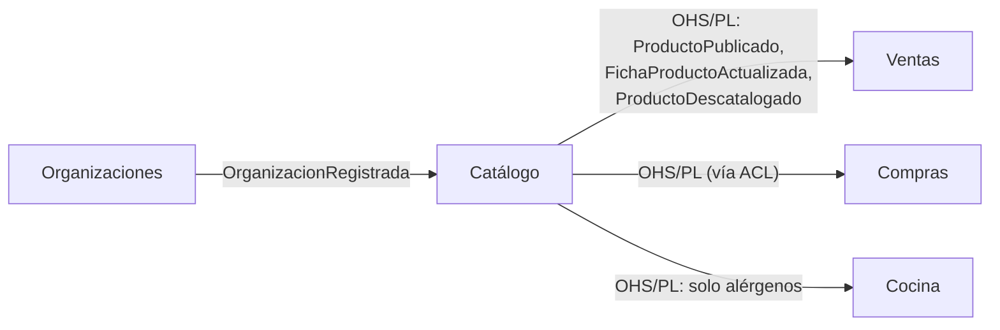
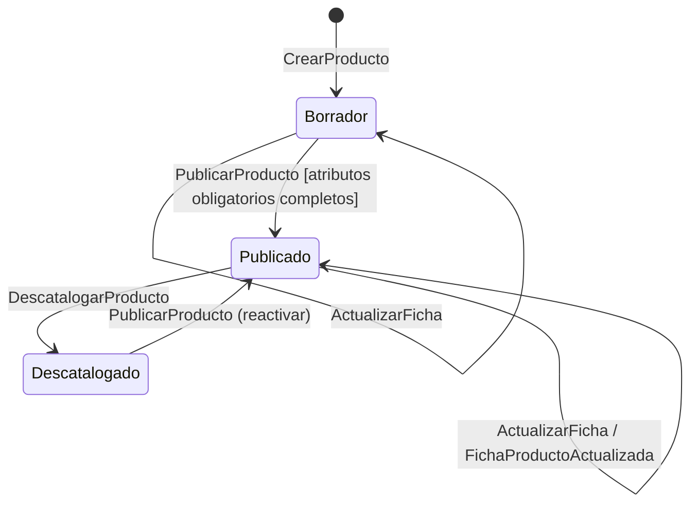

# Documentación del BC Catálogo

Aplicación de `documentar-un-bounded-context.md` al contexto **Catálogo** del ERP marketplace. El diseño de fondo está en `bc-catalogo-generico.md`; los vecinos son `erp-bc-ventas.md` y `erp-bc-compras.md`.

Cada sección `##` corresponde a un fichero del paquete del BC en el repositorio del ERP (`src/Catalogo/docs/…`). Las decisiones son **propuestas mías** sobre las fuentes citadas; las preguntas abiertas están al final.

## README del BC Catálogo (propósito y límites)

**Propósito.** Que cada proveedor de la plataforma describa **una sola vez** lo que vende (nombre, marca, GTIN, alérgenos, familia, variantes, imágenes, fichas técnicas) y que esa ficha llegue a todos sus clientes sin que nadie la vuelva a teclear. Es el único dato de producto que se **comparte entre organizaciones**.

**Tipo de subdominio.** Genérico. Lo tiene cualquier e-commerce y existen productos (PIM) y estándares (GS1) que lo resuelven. Evans: a los genéricos, *"lower priority than the core domain"* ([DDD Reference](https://domainlanguage.com/wp-content/uploads/2016/05/DDD_Reference_2015-03.pdf)).

**Qué NO hace.**

| No hace | Dónde vive |
|---|---|
| Precio, tarifas, formato comercial (caja de 6), pedido mínimo | Ventas (`Oferta`, `Tarifa`) |
| Qué productos ve cada cliente | Ventas (`AsignacionCatalogo`) |
| Referencia interna del cliente, precio pactado | Compras (`ProductoComprable`) |
| Stock, unidad de stock, coste | Inventario (`Articulo`) |
| Gramaje en receta, merma | Cocina |
| Productos de proveedores externos (sin cuenta) | Compras, con `origen = CLIENTE` |

**Dueño.** Equipo Marketplace. Cambios incompatibles en eventos: avisar a Ventas, Compras y Cocina y subir versión mayor del contrato.

**Relaciones.** Upstream de Ventas, Compras y Cocina con *Open-host Service + Published Language* (ver `comunicacion-entre-bounded-contexts.md`). No depende de ningún otro BC salvo Organizaciones (identidad del proveedor).



## Canvas del BC Catálogo

Secciones del canvas v5 de [DDD Crew](https://github.com/ddd-crew/bounded-context-canvas):

| Sección | Contenido |
|---|---|
| **Name** | Catálogo |
| **Purpose** | Ficha descriptiva única por producto de proveedor, reutilizada por todos sus clientes. |
| **Strategic Classification** | Genérico · *compliance enforcer* (alérgenos) · evolución *product* |
| **Domain Roles** | Ejecución sencilla (ciclo de vida de la ficha) + publicación de datos |
| **Inbound** | Proveedor (UI): `DefinirFamilia`, `CrearProducto`, `ActualizarFicha`, `PublicarProducto`, `DescatalogarProducto`. Cualquier BC: consulta `FichaDeProducto` |
| **Outbound** | `ProductoPublicado`, `FichaProductoActualizada`, `ProductoDescatalogado` |
| **Ubiquitous Language** | Producto, Familia, Atributo, Variante, Eje de variante, Publicar, Descatalogar |
| **Business Decisions** | Ver "Reglas de negocio" |
| **Assumptions** | Los proveedores mantienen sus fichas. Los externos no necesitan ficha. Las familias las define la plataforma, no cada proveedor. |
| **Verification Metrics** | % de PRs que tocan Catálogo y otro BC a la vez; nº de peticiones de atributos "con lógica" (señal de *inner-platform effect*, ver `bc-catalogo-generico.md`) |
| **Open Questions** | Ver última sección |

## Glosario del BC Catálogo

Formato Contextive (`src/Catalogo/docs/glosario.yml`):

```yaml
contexts:
  - name: Catálogo
    domainVisionStatement: Describir una vez cada producto de un proveedor para que todos sus clientes usen la misma ficha.
    terms:
      - name: Producto
        definition: Ficha descriptiva de algo que vende un proveedor de la plataforma. No tiene precio, stock ni formato comercial.
        examples:
          - "El AOVE Hojiblanca de Aceites Sur está en la familia Aceites."
        aliases: [ficha]
      - name: Familia
        definition: Tipo de producto que define qué atributos tiene y cuáles son obligatorios para publicar. La define la plataforma.
        examples:
          - "La familia Bebidas alcohólicas exige graduación."
      - name: Atributo
        definition: Dato descriptivo tipado de una familia (texto, número, booleano, lista cerrada, medida).
        examples:
          - "Alérgenos es un atributo de lista cerrada con los 14 alérgenos."
      - name: Variante
        definition: Versión física del producto que se distingue por un eje (envase 1 l / 5 l). Tiene su propio GTIN.
        examples:
          - "El AOVE tiene variante de 1 l y de 5 l."
      - name: Eje de variante
        definition: Atributo de la familia que distingue variantes (envase, sabor, talla).
      - name: Publicar
        definition: Hacer visible la ficha a los clientes. Exige los atributos obligatorios completos.
      - name: Descatalogar
        definition: Retirar el producto. No se borra; los pedidos antiguos siguen apuntando a él.
```

Ojo con **Variante** frente a **Formato de venta**: la garrafa de 5 l es una variante (otro objeto físico, otro GTIN); la "caja de 6 garrafas" es un formato comercial y vive en Ventas. Es el término que más se confunde entre ambos BC.

## Modelo del BC Catálogo: agregados e invariantes

| Agregado | Contiene | Invariantes que protege |
|---|---|---|
| `Familia` | Definiciones de atributo, ejes de variante | Códigos de atributo únicos; tipos de una lista cerrada |
| `Producto` | Datos base, valores de atributos, `Variante[]`, estado, `proveedorOrgId` | Publicar solo con atributos obligatorios completos; GTIN único entre sus variantes; ejes de variante válidos para la familia; transiciones de estado válidas |

`Producto` referencia a `Familia` **por id** y la recibe como argumento al publicar (ver `building-blocks-tacticos.md`). La unicidad del GTIN **entre productos** no la puede garantizar un agregado: se resuelve con un índice único en base de datos y se traduce a error de dominio.



```php
<?php
declare(strict_types=1);

namespace Catalogo\Dominio;

final class Producto extends AggregateRoot
{
    private EstadoProducto $estado = EstadoProducto::Borrador;

    /** @param list<Variante> $variantes */
    public function __construct(
        public readonly ProductoId $id,
        public readonly OrgId $proveedorOrgId,
        public readonly FamiliaId $familiaId,
        private string $nombre,
        private ValoresAtributo $atributos,
        private array $variantes = [],
    ) {}

    public function publicar(Familia $familia): void
    {
        if (!$familia->id->equals($this->familiaId)) {
            throw new \LogicException('Familia distinta a la del producto');
        }
        $faltan = $familia->atributosObligatoriosQueFaltan($this->atributos);
        if ($faltan !== []) {
            throw FaltanAtributosObligatorios::para($this->id, $faltan);
        }
        $this->estado = EstadoProducto::Publicado;
        $this->registrar(new ProductoPublicado($this->id, $this->proveedorOrgId, $this->nombre, $this->atributos));
    }

    public function descatalogar(): void
    {
        if ($this->estado !== EstadoProducto::Publicado) {
            throw new TransicionNoPermitida($this->estado, EstadoProducto::Descatalogado);
        }
        $this->estado = EstadoProducto::Descatalogado;
        $this->registrar(new ProductoDescatalogado($this->id));
    }
}
```

## Contrato público del BC Catálogo

**Eventos publicados** (`src/Catalogo/docs/asyncapi.yaml`, [AsyncAPI](https://asyncapi.com/docs/concepts/asyncapi-document/structure)):

| Evento | Cuándo | Payload mínimo | Consumidores |
|---|---|---|---|
| `ProductoPublicado` | Primera publicación o reactivación | `productoId, proveedorOrgId, nombre, familia, gtin?, variantes[], atributos` | Ventas, Compras, Cocina |
| `FichaProductoActualizada` | Cambia un dato de un producto publicado | igual que el anterior + `version` | Ventas, Compras, Cocina |
| `ProductoDescatalogado` | Se retira | `productoId, proveedorOrgId` | Ventas, Compras |

```yaml
asyncapi: 3.0.0
info:
  title: Catálogo — eventos publicados
  version: 1.0.0
channels:
  fichaProductoActualizada:
    address: catalogo.producto.ficha-actualizada
    messages:
      FichaProductoActualizada:
        payload:
          type: object
          required: [productoId, proveedorOrgId, nombre, familia, version, ocurridoEn]
          properties:
            productoId: { type: string, format: uuid }
            proveedorOrgId: { type: string, format: uuid }
            nombre: { type: string }
            familia: { type: string }
            version: { type: integer, description: "Monótona; el consumidor ignora versiones menores a la que ya tiene" }
            atributos:
              type: object
              properties:
                alergenos: { type: array, items: { type: string } }
            ocurridoEn: { type: string, format: date-time }
operations:
  publicarFichaActualizada:
    action: send
    channel: { $ref: '#/channels/fichaProductoActualizada' }
```

El campo `version` permite a los consumidores descartar mensajes que llegan desordenados (ver `eda/consistencia-eventual.md`).

**Consulta pública**: `GET /catalogo/productos/{id}` → `FichaDeProducto`. Solo para pantallas; ningún BC debe depender de ella para su lógica (usan su réplica local).

## Reglas de negocio del BC Catálogo (como tests)

Nombres de test en lenguaje del glosario; `phpunit --testdox` da la lista legible por negocio:

```php
<?php
final class ProductoTest extends TestCase
{
    public function test_no_se_publica_sin_los_atributos_obligatorios_de_la_familia(): void {}
    public function test_un_producto_publicado_se_puede_descatalogar(): void {}
    public function test_descatalogar_no_borra_el_producto(): void {}
    public function test_no_se_descatalogan_borradores(): void {}
    public function test_dos_variantes_del_mismo_producto_no_comparten_gtin(): void {}
    public function test_los_ejes_de_variante_deben_ser_atributos_de_la_familia(): void {}
    public function test_solo_el_proveedor_duenyo_puede_editar_la_ficha(): void {}  // en el handler
    public function test_actualizar_un_producto_publicado_emite_ficha_actualizada_con_version_nueva(): void {}
}
```

## ADRs del BC Catálogo

Formato [Nygard](https://cognitect.com/blog/2011/11/15/documenting-architecture-decisions), uno por fichero en `src/Catalogo/docs/adr/`. Resumen:

| ADR | Decisión | Consecuencia negativa aceptada |
|---|---|---|
| 0001 | El precio, el formato comercial y las tarifas no viven en el Catálogo (van a Ventas) | Mostrar "ficha + precio" exige componer dos fuentes |
| 0002 | Atributos en columna JSONB con índice GIN, no EAV | Validación de tipos en el dominio, no en la BD |
| 0003 | Solo los proveedores de la plataforma tienen ficha; los externos viven en Compras | El mismo producto real puede existir como ficha y como entrada manual de un cliente hasta que se vinculen |
| 0004 | Identificador estándar GTIN opcional en `Producto` y `Variante` | Productos frescos sin GTIN se identifican solo por id interno |

## Preguntas abiertas del BC Catálogo

1. ¿Importar fichas desde un pool GS1/GDSN? GS1 usa el GTIN *"for product identification"* y GDSN *"for synchronized data"* en food service ([GS1 Sweden](https://gs1.se/en/your-industry/food-service/)). Si sí, hace falta una ACL de importación.
2. ¿Quién corrige un alérgeno mal puesto: solo el proveedor o también la plataforma? Afecta a permisos y auditoría.
3. Si la ficha se queda en "nombre + foto", ¿merece BC propio o vuelve a ser un módulo de Ventas (como proponía `mapa-de-contextos-erp-marketplace.md`)? La métrica de PRs cruzados del canvas debe responderlo.
