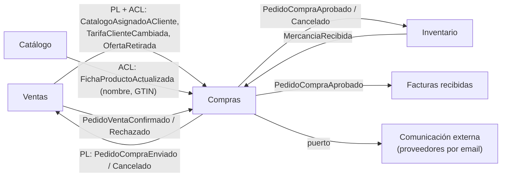
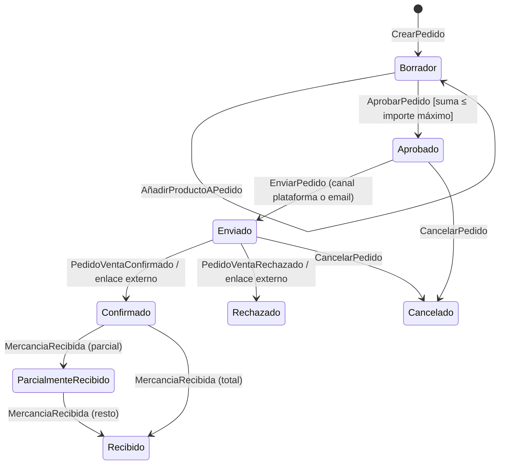

# Documentación del BC Compras (lado cliente)

Aplicación de `documentar-un-bounded-context.md` al contexto **Compras** del ERP marketplace: lo que hace un **cliente** (restaurante, hotel, cocina central) para comprar a sus proveedores. Vecinos: `erp-bc-ventas.md`, `erp-bc-catalogo.md` e Inventario. El flujo detallado de añadir líneas está en `flujo-anadir-producto-a-pedido.md`.

Las decisiones son **propuestas mías** apoyadas en las fuentes; las preguntas abiertas están al final.

## README del BC Compras (propósito y límites)

**Propósito.** Que cada cliente sepa **qué puede comprar, a quién y a qué precio**, y haga, apruebe y siga sus pedidos, tanto a proveedores de la plataforma como a externos por email.

**Tipo de subdominio.** **Core.** Une proveedor ↔ inventario ↔ cocina y es lo que el cliente usa a diario.

**Qué NO hace.**

| No hace | Dónde vive |
|---|---|
| Fijar precios o formatos de proveedores de la plataforma | Ventas (Compras recibe una copia) |
| Describir el producto (alérgenos, GTIN) | Catálogo |
| Llevar stock, unidad de stock o coste | Inventario (`Articulo`) |
| Registrar la recepción física | Inventario (emite `MercanciaRecibida`) |
| Contabilizar o cotejar facturas | Facturas recibidas |
| Enviar emails | Comunicación externa (puerto) |

**Dueño.** Equipo Compras. El contrato del pedido con Ventas se cambia de acuerdo con su equipo (*Partnership*).

**Relaciones.**



## Canvas del BC Compras

| Sección | Contenido |
|---|---|
| **Name** | Compras |
| **Purpose** | El cliente mantiene su catálogo de compra y su agenda de proveedores y gestiona sus pedidos hasta la recepción. |
| **Strategic Classification** | Core · *revenue generator* (para la plataforma, es el uso diario) · *custom built* |
| **Domain Roles** | Ejecución (flujo del pedido) + traducción de condiciones de proveedores |
| **Inbound** | Usuario cliente (UI): `AltaProveedorExterno`, `AltaProductoComprable`, `VincularArticulo`, `CrearPedido`, `AñadirProductoAPedido`, `AprobarPedido`, `EnviarPedido`, `CancelarPedido`. Ventas: condiciones y respuestas. Inventario: `MercanciaRecibida`. Externo: respuesta por enlace |
| **Outbound** | `PedidoCompraAprobado`, `PedidoCompraEnviado`, `PedidoCompraCancelado` |
| **Ubiquitous Language** | Proveedor (de cliente), Canal, Producto comprable, Origen, Formato de compra, Pedido de compra, Línea, Importe máximo, Aprobar, Enviar |
| **Business Decisions** | Ver "Reglas de negocio" |
| **Assumptions** | El cliente compra a pocos proveedores (decenas). La mayoría de compras a externos se repiten (mismos productos). |
| **Verification Metrics** | % de productos comprables sin `articuloId` (stock que no se mide); pedidos enviados sin respuesta en 48 h |
| **Open Questions** | Ver última sección |

## Glosario del BC Compras

```yaml
contexts:
  - name: Compras
    domainVisionStatement: Que cada cliente sepa qué puede comprar, a quién y a qué precio, y gestione sus pedidos.
    terms:
      - name: Proveedor
        definition: Relación del cliente con alguien que le vende, de la plataforma o externo por email. Tiene condiciones propias de este cliente.
        examples:
          - "Aceites Sur nos sirve por la plataforma; la pescadería del mercado, por email."
      - name: Canal
        definition: Cómo se comunica el pedido al proveedor. Plataforma o Email.
      - name: Producto comprable
        definition: Lo que este cliente puede pedir a un proveedor concreto, en un formato y a un precio.
        aliases: [producto, producto de compra]
        examples:
          - "El aceite se lo pedimos a Aceites Sur en garrafa y a Distribuciones Norte en caja de seis."
      - name: Origen
        definition: Quién manda en el precio y el formato de un producto comprable. PROVEEDOR (sincronizado desde Ventas) o CLIENTE (alta manual, típico de externos).
      - name: Formato de compra
        definition: Unidad en la que se pide y factura (caja de 6) y su factor a la unidad de stock del artículo.
      - name: Pedido de compra
        definition: Pedido del cliente a un proveedor. Guarda copia del precio y del factor de cada línea.
      - name: Importe máximo
        definition: Límite que no puede superar la suma de líneas de un pedido sin nueva aprobación.
```

En Compras **"producto" es alias de Producto comprable**; en Inventario el término es **Artículo** y "producto" no se usa (ver `documentar-un-bounded-context.md`, sección del catálogo del cliente).

## Modelo del BC Compras: agregados e invariantes

| Agregado | Contiene | Invariantes |
|---|---|---|
| `ProveedorDeCliente` | `clienteOrgId`, nombre, canal (Plataforma u Email), activo | No se envían pedidos a un proveedor bloqueado; vincular un externo a la plataforma conserva el historial |
| `ProductoComprable` | `proveedorId`, origen, nombre, formato de compra, precio, `referenciaInterna?`, `articuloId?`, `inventariable` | Con origen PROVEEDOR, precio y formato solo cambian por evento de Ventas; inventariable exige `articuloId` antes de pedir |
| `PedidoCompra` | `proveedorId`, estado, importe máximo, `LineaPedido[]` (copia de precio y factor, almacén) | Suma de líneas ≤ importe máximo; solo `BORRADOR` se modifica; mismo producto se consolida en una línea; todas las líneas del mismo proveedor |

La regla del importe máximo es el ejemplo canónico de Vernon: *"A purchase order is assigned a maximum allowable total, and the sum of all line items must not surpass the total"* ([Part I](https://dddcommunity.org/wp-content/uploads/files/pdf_articles/Vernon_2011_1.pdf)). Por eso las líneas viven dentro de `PedidoCompra`.

Añadir líneas **no toca el stock**: SKU.io, *"Until you receive it, ordered stock is only incoming inventory"* ([SKU.io](https://docs.sku.io/guides/orders/purchase-orders/receive-stock-against-a-po)). El stock solo sube cuando Inventario registra la recepción.

```php
<?php
declare(strict_types=1);

namespace Compras\Dominio;

final class ProductoComprable extends AggregateRoot
{
    public function __construct(
        public readonly ProductoComprableId $id,
        public readonly OrgId $clienteOrgId,
        public readonly ProveedorId $proveedorId,
        private Origen $origen,
        private string $nombre,
        private FormatoCompra $formato,      // caja → 6 l (factor a unidad de stock)
        private Dinero $precio,              // por formato de compra
        private ?ArticuloId $articuloId = null,
        private bool $inventariable = true,
    ) {}

    /** Solo desde el handler de TarifaClienteCambiada / CatalogoAsignadoACliente */
    public function aplicarCondicionesProveedor(Dinero $precio, FormatoCompra $formato, int $version): void
    {
        if (!$this->origen->esProveedor()) {
            throw new \LogicException('Un producto de alta manual no se sincroniza');
        }
        if ($version <= $this->origen->version) {
            return;                          // mensaje viejo o duplicado: idempotente
        }
        [$this->precio, $this->formato] = [$precio, $formato];
        $this->origen = $this->origen->conVersion($version);
    }

    /** Solo el cliente, y solo en altas manuales (externos) */
    public function cambiarPrecioManual(Dinero $precio): void
    {
        if ($this->origen->esProveedor()) {
            throw new PrecioGestionadoPorProveedor($this->id);
        }
        $this->precio = $precio;
    }

    public function vincularArticulo(ArticuloId $articuloId): void
    {
        $this->articuloId = $articuloId;
        $this->registrar(new ProductoComprableVinculadoAArticulo($this->id, $articuloId));
    }

    public function paraLinea(): ProductoParaLinea
    {
        if ($this->inventariable && $this->articuloId === null) {
            throw new FaltaVincularArticulo($this->id);
        }
        return new ProductoParaLinea($this->id, $this->nombre, $this->precio, $this->formato, $this->articuloId);
    }
}
```



## Contrato público del BC Compras

**Publica:**

| Evento | Cuándo | Payload mínimo | Consumidores |
|---|---|---|---|
| `PedidoCompraAprobado` | Se aprueba | `pedidoId, clienteOrgId, proveedorId, lineas[{articuloId?, almacenId?, cantidadCompra, factorAStock, precio}]` | Inventario (pendiente de recibir), Facturas recibidas |
| `PedidoCompraEnviado` | Se envía a un proveedor de plataforma | `pedidoId, clienteOrgId, proveedorOrgId, lineas[{ofertaId, cantidad, precio}]` | Ventas (crea `PedidoVenta`) |
| `PedidoCompraCancelado` | Se cancela antes de recibir | `pedidoId` | Ventas, Inventario (resta pendiente) |

**Consume (con ACL):** `CatalogoAsignadoACliente`, `TarifaClienteCambiada`, `OfertaRetirada` (Ventas); `FichaProductoActualizada`, `ProductoDescatalogado` (Catálogo, solo nombre y GTIN); `PedidoVentaConfirmado/Rechazado` (Ventas); `MercanciaRecibida` (Inventario).

`PedidoCompraAprobado` lleva cantidades **en las dos unidades** (compra y factor a stock) porque Inventario cuenta en unidad de stock y Facturas recibidas coteja en unidad de compra (ver `unidades-de-medida-compra-stock-cocina.md`).

```php
<?php
declare(strict_types=1);

namespace Compras\Infraestructura\Ventas;

/** ACL: traduce el lenguaje de Ventas al de Compras */
final readonly class AlCambiarTarifaDelCliente
{
    public function __construct(private ProductoComprableRepository $productos) {}

    /** @param array{clienteOrgId: string, ofertaId: string, precio: string, moneda: string, version: int} $e */
    public function __invoke(array $e): void
    {
        $producto = $this->productos->porOfertaDeProveedor(new OrgId($e['clienteOrgId']), $e['ofertaId']);
        if ($producto === null) {
            return;                              // el cliente aún no tiene esa oferta asignada
        }
        $producto->aplicarCondicionesProveedor(
            Dinero::de($e['precio'], $e['moneda']),
            $producto->formatoActual(),
            $e['version'],
        );
        $this->productos->guardar($producto);
    }
}
```

## Reglas de negocio del BC Compras (como tests)

```php
<?php
final class ProductoComprableTest extends TestCase
{
    public function test_el_precio_de_un_producto_del_proveedor_no_se_edita_a_mano(): void {}
    public function test_un_producto_de_alta_manual_si_permite_cambiar_el_precio(): void {}
    public function test_una_tarifa_con_version_antigua_se_ignora(): void {}
    public function test_no_se_pide_un_producto_inventariable_sin_articulo_vinculado(): void {}
}

final class PedidoCompraTest extends TestCase
{
    public function test_la_suma_de_lineas_no_supera_el_importe_maximo(): void {}
    public function test_el_mismo_producto_se_consolida_en_una_linea(): void {}
    public function test_la_linea_guarda_copia_del_precio_y_del_factor(): void {}
    public function test_cambiar_la_tarifa_no_cambia_lineas_ya_anyadidas(): void {}
    public function test_solo_se_modifica_en_borrador(): void {}
    public function test_no_se_envia_a_un_proveedor_bloqueado(): void {}   // en el handler
    public function test_recibir_parte_deja_el_pedido_parcialmente_recibido(): void {}
}
```

## ADRs del BC Compras

| ADR | Decisión | Consecuencia negativa aceptada |
|---|---|---|
| 0001 | El stock se lleva por `Articulo` (Inventario), no por `ProductoComprable` | El usuario vincula cada producto comprable a un artículo la primera vez |
| 0002 | La línea de pedido guarda copia del precio y del factor de formato | Un cambio de tarifa no corrige pedidos ya hechos; hay que cancelar y rehacer |
| 0003 | Condiciones de proveedores de plataforma replicadas localmente (eventos de Ventas), no consultadas en síncrono | Precio posiblemente desactualizado segundos; lo valida la confirmación del proveedor |
| 0004 | Origen PROVEEDOR / CLIENTE en `ProductoComprable`; en PROVEEDOR manda Ventas | Un precio negociado aparte debe darse de alta como tarifa en Ventas, no editarse en Compras |
| 0005 | El proveedor es una relación del cliente (`ProveedorDeCliente`) con canal, no la organización | Al registrarse un externo hay que vincularlo y migrar sus productos a origen PROVEEDOR |

## Preguntas abiertas del BC Compras

1. Cuando un proveedor externo se registra en la plataforma, ¿se vinculan automáticamente sus productos manuales con sus ofertas (por GTIN o nombre) o lo confirma el cliente?
2. ¿Los pedidos necesitan flujo de aprobación por importe o por rol (jefe de cocina vs. gerente)? Si sí, `AprobarPedido` pasa a ser una política con varios pasos.
3. ¿Pedidos recurrentes (lista semanal de frescos)? Podrían ser una plantilla que genera borradores, sin cambiar el agregado `PedidoCompra`.
