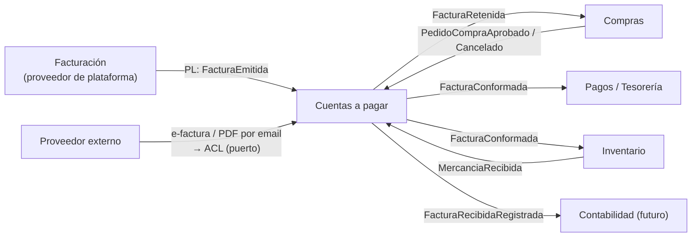
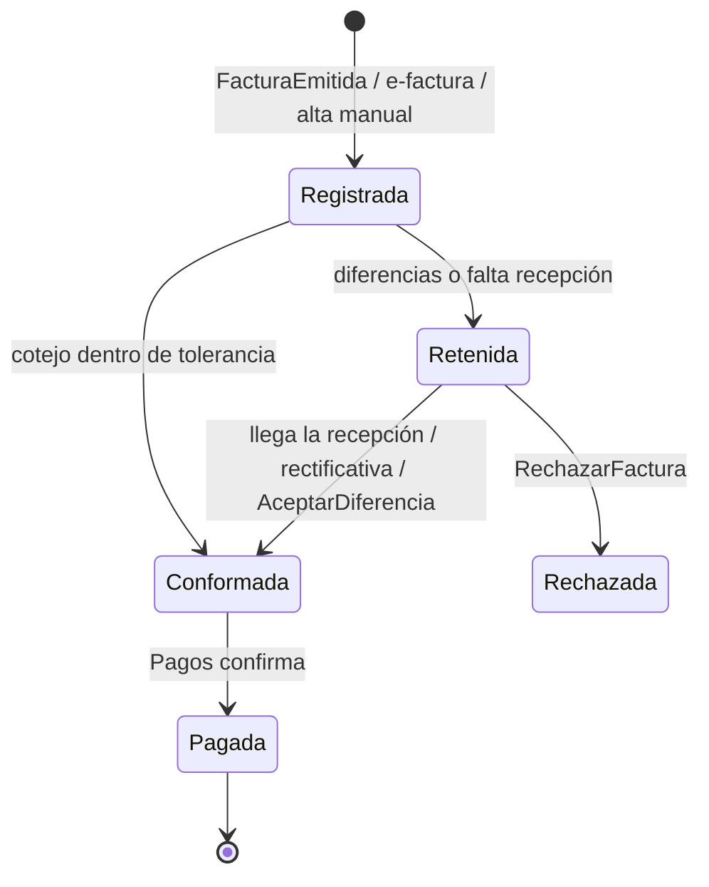

# Documentación del BC Cuentas a pagar (facturas recibidas)

Aplicación de `documentar-un-bounded-context.md` al contexto que **recibe y revisa** las facturas de proveedores, en el lado del cliente. Su pareja es `erp-bc-facturacion.md` (por qué son dos BCs y por qué estos nombres). Base del cotejo en `facturas-en-marketplace-b2b.md`.

Las decisiones de modelado son **propuestas mías** apoyadas en las fuentes.

## README del BC Cuentas a pagar (propósito y límites)

**Propósito.** Que cada cliente registre las facturas de sus proveedores, compruebe que cobran **lo que se pidió y lo que llegó**, y solo deje pagar las correctas.

**Tipo de subdominio.** **Supporting.** Necesario y con reglas propias del marketplace (cotejo automático con pedidos de la plataforma), pero no diferencia el producto por sí solo.

**Qué NO hace.**

| No hace | Dónde vive |
|---|---|
| Emitir facturas | Facturación |
| Decidir qué se pide o a qué precio | Compras |
| Registrar la mercancía recibida | Inventario |
| Ejecutar el pago (transferencias, remesas) | Tesorería / Pagos (fuera de este ERP de momento) |
| Asientos y libros de IVA | Contabilidad |
| Valorar el stock con el precio facturado | Inventario (recibe `FacturaConformada` si ajusta coste; ver `costes-escandallos-produccion-pmp-fifo.md`) |

**Dueño.** Equipo Compras (lado cliente).



## Canvas del BC Cuentas a pagar

| Sección | Contenido |
|---|---|
| **Name** | Cuentas a pagar |
| **Purpose** | Registrar facturas de proveedores, cotejarlas con pedido y recepción y dejar pagar solo las correctas. |
| **Strategic Classification** | Supporting · *compliance enforcer* (evita pagar de más) · *product* |
| **Domain Roles** | Análisis/verificación (cotejo) + flujo de aprobación |
| **Inbound** | Facturación: `FacturaEmitida`. Externo: e-factura o PDF. Compras: `PedidoCompraAprobado`, `PedidoCompraCancelado`. Inventario: `MercanciaRecibida`. Usuario (UI): `RegistrarFacturaManual`, `AceptarDiferencia`, `RechazarFactura` |
| **Outbound** | `FacturaRecibidaRegistrada`, `FacturaConformada`, `FacturaRetenida`, `FacturaRechazada` |
| **Ubiquitous Language** | Factura recibida, Cotejo, Tolerancia, Conformar, Retener, Diferencia, Duplicado |
| **Business Decisions** | Ver "Reglas de negocio" |
| **Assumptions** | La mayoría de facturas de plataforma cotejan solas. Las de externos necesitan revisión hasta que llegue la e-factura estructurada. |
| **Verification Metrics** | % de facturas conformadas sin intervención; días medios en retenida |
| **Open Questions** | Ver última sección |

## Glosario del BC Cuentas a pagar

```yaml
contexts:
  - name: Cuentas a pagar
    domainVisionStatement: Pagar solo lo que se pidió y llegó.
    terms:
      - name: Factura recibida
        definition: Factura de un proveedor tal como la registra el cliente. No se edita; se conforma, se retiene o se rechaza.
        aliases: [factura de proveedor, factura de compra]
      - name: Cotejo
        definition: Comparación de la factura con el pedido de compra y la recepción (a tres bandas), o solo con el pedido si no hay recepción (a dos bandas).
        examples:
          - "Facturan 12 cajas pero solo recibimos 10: el cotejo la retiene."
      - name: Tolerancia
        definition: Diferencia máxima de cantidad o importe que se acepta sin revisión.
      - name: Conformar
        definition: Dar la factura por buena para pagar.
      - name: Retener
        definition: Bloquear el pago hasta resolver una diferencia.
      - name: Duplicado
        definition: Factura con el mismo NIF del emisor, serie y número que otra ya registrada.
```

## Modelo del BC Cuentas a pagar: agregados e invariantes

| Agregado / modelo | Contiene | Invariantes |
|---|---|---|
| `FacturaRecibida` | Emisor (NIF), serie y número, fecha, líneas, totales, `pedidoCompraId?`, estado, diferencias | No duplicada por (NIF emisor, serie, número); solo se conforma si el cotejo pasa o un usuario acepta la diferencia; pagada no vuelve atrás |
| `PoliticaTolerancia` | Por cliente: % de importe, unidades de diferencia | Valores ≥ 0 |
| `PedidoParaCotejo` (proyección local, no agregado) | Líneas pedidas y recibidas por `pedidoCompraId`, en unidad de compra | Se alimenta solo de eventos de Compras e Inventario |

Definiciones de Tipalti ([3-way match](https://tipalti.com/en-eu/resources/learn/3-way-match/)):
- *"Three-way match is the process of comparing the purchase order, invoice, and goods receipt."*
- Tolerancias: *"predetermined thresholds that define acceptable differences between documents"*.
- Si no cuadra, la factura queda *"placed on hold, preventing payment until issues are resolved"*.
- *Two-way match*: *"only requires two documents, the invoice and purchase order"*; sirve para servicios o líneas sin recepción.

El cotejo se hace en **unidad de compra** (como factura el proveedor). Por eso `PedidoCompraAprobado` lleva cantidad de compra y factor (ver `unidades-de-medida-compra-stock-cocina.md`).

```php
<?php
declare(strict_types=1);

namespace CuentasAPagar\Dominio;

/** Domain service: compara documentos de tres orígenes */
final readonly class Cotejo
{
    public function cotejar(FacturaRecibida $factura, ?PedidoParaCotejo $pedido, PoliticaTolerancia $tol): ResultadoCotejo
    {
        if ($pedido === null) {
            return ResultadoCotejo::conDiferencias([Diferencia::sinPedido()]);
        }
        $diferencias = [];
        foreach ($factura->lineas() as $linea) {
            $esperada = $pedido->lineaDe($linea->referencia);
            if ($esperada === null) {
                $diferencias[] = Diferencia::lineaNoPedida($linea);
                continue;
            }
            // A tres bandas si hubo recepción; a dos bandas (solo pedido) si no es inventariable
            $cantidadReferencia = $esperada->esInventariable ? $esperada->recibida : $esperada->pedida;
            if (!$tol->aceptaCantidad($linea->cantidad, $cantidadReferencia)) {
                $diferencias[] = Diferencia::cantidad($linea, $cantidadReferencia);
            }
            if (!$tol->aceptaPrecio($linea->precioUnitario, $esperada->precioUnitario)) {
                $diferencias[] = Diferencia::precio($linea, $esperada->precioUnitario);
            }
        }
        return $diferencias === [] ? ResultadoCotejo::ok() : ResultadoCotejo::conDiferencias($diferencias);
    }
}
```



Una factura retenida por "falta recepción" se **re-coteja** sola cuando llega `MercanciaRecibida` de ese pedido; no hace falta que nadie la toque.

## Retenciones e impuestos no descontables (multipaís)

Con la fiscalidad "como Odoo" (`erp-bc-fiscalidad.md`), una factura recibida puede traer:

- **Retenciones** (impuestos negativos), por ejemplo ReteIVA o ReteFuente en Colombia. Odoo: *"A withholding tax, also known as retention tax, mandates the payer of a customer invoice to deduct a tax from the payment"* ([Odoo](https://www.odoo.com/documentation/19.0/applications/finance/accounting/taxes/retention.html)). Cuentas a pagar marca como **importe a pagar** el total menos retenciones, y publica la retención para que Contabilidad/Tesorería la declare y emita el certificado.
- **Impuestos no descontables** (INC en Colombia: *"no permite descontar impuestos pagados en las compras"*, [Siigo](https://www.siigo.com/blog/obligaciones-fiscales/impuesto-al-consumo-e-impuesto-sobre-las-ventas-son-lo-mismo/)). `FacturaConformada` los envía por línea para que Inventario los sume al **coste** del artículo.
- El **cotejo** compara también las cuotas con las que calcula Fiscalidad para el pedido; una diferencia de impuesto es motivo de retención de la factura.

## Contrato público del BC Cuentas a pagar

**Publica:**

| Evento | Cuándo | Payload mínimo | Consumidores |
|---|---|---|---|
| `FacturaRecibidaRegistrada` | Al registrar | `facturaRecibidaId, clienteOrgId, emisorNif, serie, numero, fecha, totales` | Contabilidad |
| `FacturaRetenida` | Cotejo con diferencias | `facturaRecibidaId, pedidoCompraId?, diferencias[]` | Compras (avisar al comprador) |
| `FacturaConformada` | Cotejo correcto o diferencia aceptada | `facturaRecibidaId, pedidoCompraId?, importe, vencimiento, lineas[{articuloId?, cantidadStock, importe}]` | Pagos, Inventario (coste real) |
| `FacturaRechazada` | El cliente la rechaza | `facturaRecibidaId, motivo` | Proveedor (vía Facturación o email) |

**Consume:** `FacturaEmitida` y `FacturaRectificativaEmitida` (Facturación), `PedidoCompraAprobado`, `PedidoCompraCancelado` (Compras), `MercanciaRecibida` (Inventario). Facturas de externos entran por el puerto `EntradaFacturasExternas`, con un adaptador para PDF (revisión manual) y otro para e-factura estructurada. Con *ports & adapters*, el núcleo no sabe por dónde llegan: *"The application should have no knowledge of who/what is sending input"* ([Graça](https://herbertograca.com/2017/09/14/ports-adapters-architecture/)).

```php
<?php
declare(strict_types=1);

namespace CuentasAPagar\Infraestructura\Facturacion;

/** ACL: de la factura emitida (lenguaje de Facturación) a la recibida (lenguaje de Cuentas a pagar) */
final readonly class AlEmitirseFacturaEnPlataforma
{
    public function __construct(private RegistrarFacturaRecibida $registrar) {}

    /** @param array<string, mixed> $e FacturaEmitida */
    public function __invoke(array $e): void
    {
        if (($e['destinatario']['orgId'] ?? null) === null) {
            return;                                   // destinatario externo: no es nuestro cliente
        }
        ($this->registrar)(new RegistrarFacturaRecibidaCmd(
            clienteOrgId: $e['destinatario']['orgId'],
            emisorNif: $e['emisor']['nif'],
            serie: $e['serie'],
            numero: $e['numero'],
            fecha: $e['fecha'],
            pedidoCompraId: $e['pedidoCompraId'] ?? null,
            lineas: array_map(LineaRecibida::desdeFacturaEmitida(...), $e['lineas']),
        ));                                           // idempotente por (NIF, serie, número)
    }
}
```

## Reglas de negocio del BC Cuentas a pagar (como tests)

```php
<?php
final class CotejoTest extends TestCase
{
    public function test_factura_que_cobra_mas_cantidad_de_la_recibida_queda_retenida(): void {}
    public function test_diferencia_de_precio_dentro_de_tolerancia_se_conforma(): void {}
    public function test_linea_no_inventariable_se_coteja_solo_con_el_pedido(): void {}
    public function test_factura_sin_pedido_queda_retenida(): void {}
    public function test_al_llegar_la_recepcion_se_vuelve_a_cotejar_la_factura_retenida(): void {}
}

final class FacturaRecibidaTest extends TestCase
{
    public function test_no_se_registra_dos_veces_la_misma_factura_del_mismo_emisor(): void {}
    public function test_una_rectificativa_ajusta_la_retencion_de_su_factura_original(): void {}
    public function test_una_factura_pagada_no_se_puede_retener(): void {}
    public function test_aceptar_una_diferencia_exige_usuario_y_motivo(): void {}
}
```

## ADRs del BC Cuentas a pagar

| ADR | Decisión | Consecuencia negativa aceptada |
|---|---|---|
| 0001 | Se llama "Cuentas a pagar" y llega hasta "conformada"; el pago real es otro BC | Hay que integrar con Tesorería o con el banco más adelante |
| 0002 | Cotejo contra una proyección local (`PedidoParaCotejo`), no consultando Compras e Inventario | Consistencia eventual: una factura puede retenerse unos segundos antes de que llegue la recepción, y se re-coteja |
| 0003 | Cotejo en unidad de compra | Los eventos de Compras e Inventario deben llevar cantidad de compra además de stock |
| 0004 | Detección de duplicados por (NIF emisor, serie, número) | Facturas de externos con datos mal leídos del PDF pueden escapar; se resuelve con e-factura |
| 0005 | Entrada de facturas externas detrás de un puerto con adaptadores PDF y e-factura | Dos caminos que mantener hasta que la factura electrónica B2B sea obligatoria |

## Preguntas abiertas del BC Cuentas a pagar

1. ¿Qué tolerancias usa el negocio (por cliente, por proveedor, por familia de producto)? En frescos el peso varía y la tolerancia por cantidad debería ser mayor.
2. ¿Quién puede aceptar una diferencia: el jefe de cocina que recibió o administración?
3. ¿El coste del stock se ajusta con el precio facturado (`FacturaConformada` → Inventario) o se queda con el del pedido? Afecta a PMP/FIFO (`costes-escandallos-produccion-pmp-fifo.md`).
4. Cuando la factura electrónica B2B sea obligatoria (ver fechas en `facturas-en-marketplace-b2b.md`), ¿se elimina el adaptador de PDF?
