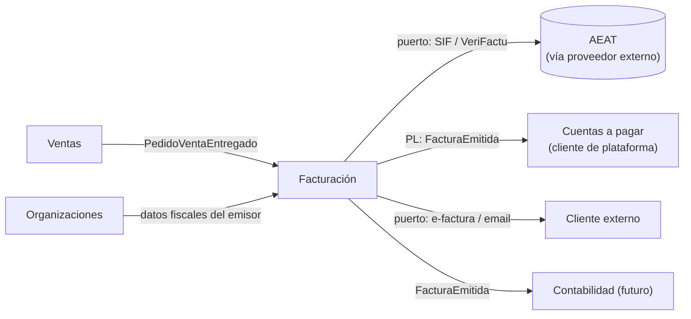
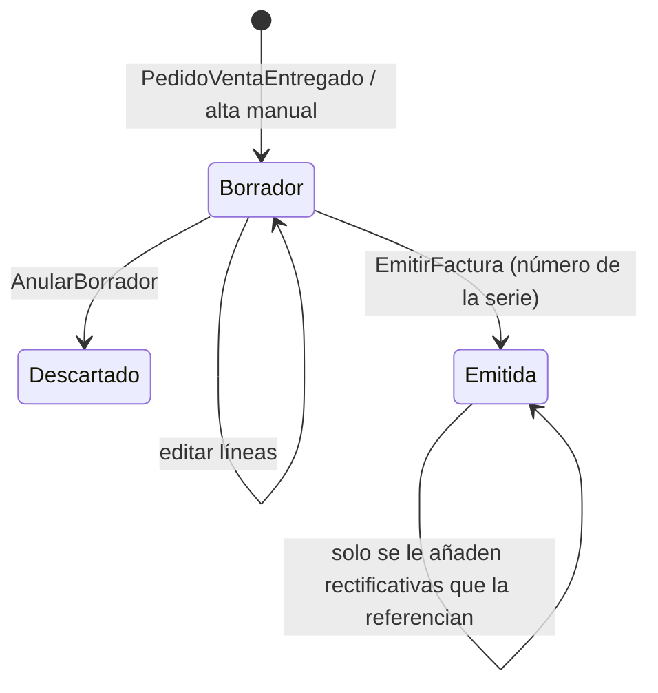

# Documentación del BC Facturación (facturas emitidas)

Aplicación de `documentar-un-bounded-context.md` al contexto que **emite** facturas en el ERP marketplace, en el lado del proveedor. Su pareja en el lado del cliente es `erp-bc-cuentas-a-pagar.md`. El porqué de separarlos está en `facturas-en-marketplace-b2b.md`.

Las decisiones de modelado son **propuestas mías**. La normativa citada es la vigente a 2026-11; conviene confirmarla con la gestoría y el BOE.

## Por qué Facturación y Cuentas a pagar no son un mismo BC

Una factura del marketplace es **un único documento legal** visto desde dos organizaciones con modelos distintos:

| | Facturación (proveedor) | Cuentas a pagar (cliente) |
|---|---|---|
| Qué hace con la factura | La **emite** | La **revisa** y decide si se paga |
| ¿Puede cambiarla? | No: solo rectificativa | No la cambia, pero la **retiene** o la conforma |
| Reglas | Numeración correlativa, contenido obligatorio, VeriFactu | Cotejo con pedido y recepción, tolerancias, duplicados |
| Estados | Borrador → Emitida | Registrada → Conformada / Retenida → Pagada |

Es la polisemia de Fowler: el mismo término con modelos distintos por contexto ([BoundedContext](https://martinfowler.com/bliki/BoundedContext.html)). Un agregado `Factura` con un campo `tipo = VENTA | COMPRA` mezclaría las dos listas de reglas.

**Nombres** (propuesta mía): "Facturación" porque es el verbo del negocio en el lado proveedor ("facturar lo entregado"); "Cuentas a pagar" porque el lado cliente cubre registrar, cotejar, retener y dejar lista para pagar (*accounts payable*). Evitar "Facturas de venta / de compra", que sugiere un único modelo con un flag. DDD Crew: *"Writing down the name of your context and gaining agreement as a team will frame how you design the context"* ([canvas](https://github.com/ddd-crew/bounded-context-canvas)).

Donde sí se juntan emitidas y recibidas es en contabilidad e impuestos (libros registro, IVA). Eso sería un BC Contabilidad o un read model que consume eventos de ambos (opinión mía).

## README del BC Facturación (propósito y límites)

**Propósito.** Que cada proveedor emita, a partir de lo que ha entregado, facturas **legalmente válidas e inalterables** y las haga llegar a sus clientes de la plataforma o externos.

**Tipo de subdominio.** **Genérico.** Lo necesita cualquier empresa y existen productos que lo resuelven. Evans sugiere para los genéricos *"consider off-the-shelf solutions or published models"* ([DDD Reference](https://domainlanguage.com/wp-content/uploads/2016/05/DDD_Reference_2015-03.pdf)). Candidato a delegar VeriFactu y e-factura en un proveedor externo detrás de un puerto.

**Qué NO hace.**

| No hace | Dónde vive |
|---|---|
| Decidir precios | Ventas (Facturación copia el precio del pedido entregado) |
| Tickets de venta en sala (facturas simplificadas del TPV) | TPV externo / Integración TPV |
| Registrar facturas que **recibe** el proveedor | Cuentas a pagar del propio proveedor |
| Cobros y conciliación bancaria | Tesorería / Cobros (fuera de este ERP de momento) |
| Asientos contables y libros de IVA | Contabilidad |

**Dueño.** Equipo Marketplace (lado proveedor) con validación de la gestoría en cambios de contenido legal.



## Canvas del BC Facturación

| Sección | Contenido |
|---|---|
| **Name** | Facturación |
| **Purpose** | Emitir facturas válidas e inalterables a partir de lo entregado. |
| **Strategic Classification** | Genérico · *compliance enforcer* · evolución *product/commodity* |
| **Domain Roles** | Ejecución con fuerte componente normativo; emisor de documentos |
| **Inbound** | Ventas: `PedidoVentaEntregado`. Proveedor (UI): `EmitirFactura`, `EmitirRectificativa`, `AnularBorrador` |
| **Outbound** | `FacturaEmitida`, `FacturaRectificativaEmitida`; envío al registro de VeriFactu; envío de e-factura a externos |
| **Ubiquitous Language** | Factura, Serie, Número, Emitir, Rectificativa, Destinatario, Línea facturada, Registro de facturación |
| **Business Decisions** | Ver "Reglas de negocio" |
| **Assumptions** | El proveedor factura lo entregado, no lo pedido. Un proveedor emite pocas series. |
| **Verification Metrics** | Facturas rechazadas por el registro de VeriFactu; rectificativas por cada 100 facturas (calidad del dato de Ventas) |
| **Open Questions** | Ver última sección |

## Glosario del BC Facturación

```yaml
contexts:
  - name: Facturación
    domainVisionStatement: Emitir facturas válidas e inalterables a partir de lo entregado.
    terms:
      - name: Factura
        definition: Documento legal emitido por un proveedor a un destinatario. Una vez emitida no se modifica ni se borra.
      - name: Serie
        definition: Secuencia de numeración del emisor. Dentro de cada serie la numeración es correlativa. Las rectificativas van en serie propia.
        examples:
          - "Usamos la serie A para ventas y la R para rectificativas."
      - name: Emitir
        definition: Asignar número de la serie, fijar el contenido y registrar la factura. A partir de aquí es inalterable.
      - name: Rectificativa
        definition: Factura que corrige otra ya emitida (error, devolución, descuento posterior). Referencia a la original.
        aliases: [abono, factura de abono]
      - name: Destinatario
        definition: Quien recibe la factura. Cliente de la plataforma o externo. Sus datos fiscales se copian al emitir.
      - name: Borrador
        definition: Factura preparada pero sin número. Se puede cambiar o descartar.
```

## Modelo del BC Facturación: agregados e invariantes

| Agregado | Contiene | Invariantes |
|---|---|---|
| `SerieFacturacion` | Emisor, código, último número | Numeración **correlativa** sin huecos ni duplicados |
| `Factura` | Serie y número (al emitir), emisor y destinatario **copiados**, líneas, bases, tipos y cuotas de IVA, estado, `facturaRectificadaId?` | Contenido obligatorio completo para emitir; inmutable tras emitir; una rectificativa referencia una factura emitida del mismo emisor |

Base normativa (RD 1619/2012, art. 6.1.a, [SuperContable](https://www.supercontable.com/informacion/IVA_Impuesto_valor_a%C3%B1adido/Articulo_6_RD_1619-2012-_Reglamento_Obligaciones_.html)): *"La numeración de las facturas dentro de cada serie será correlativa"*, y es obligatoria *"la expedición en series específicas"* de, entre otras, *"Las rectificativas"*. El art. 6 lista el contenido obligatorio (número y serie, fecha, emisor y destinatario con NIF y domicilio, descripción con base y precio unitario sin impuesto, tipo y cuota) y, para facturas informatizadas, el QR y la leyenda VERI\*FACTU (art. 6.5). La rectificativa existe porque la norma *"impide alterar la factura original"* ([Quaderno](https://quaderno.io/es/articulos/contabilidad/factura-rectificativa/)).

`SerieFacturacion` es un agregado propio porque la numeración correlativa es una invariante que abarca **todas** las facturas de la serie: dos emisiones simultáneas no pueden coger el mismo número. Es el punto caliente de concurrencia del BC; se protege con bloqueo optimista o pesimista sobre la serie (decisión mía).

```php
<?php
declare(strict_types=1);

namespace Facturacion\Dominio;

final class SerieFacturacion extends AggregateRoot
{
    public function __construct(
        public readonly SerieId $id,
        public readonly OrgId $emisorOrgId,
        public readonly string $codigo,          // 'A', 'R'…
        public readonly bool $esDeRectificativas,
        private int $ultimoNumero = 0,
        public int $version = 0,                  // bloqueo optimista
    ) {}

    public function siguienteNumero(): NumeroFactura
    {
        return new NumeroFactura($this->codigo, ++$this->ultimoNumero);
    }
}

final class Factura extends AggregateRoot
{
    private ?NumeroFactura $numero = null;

    public function emitir(SerieFacturacion $serie, \DateTimeImmutable $fecha): void
    {
        if ($this->numero !== null) {
            throw new FacturaYaEmitida($this->id);
        }
        if ($this->rectificaA !== null && !$serie->esDeRectificativas) {
            throw new SerieNoValidaParaRectificativa($serie->codigo);
        }
        $this->exigirContenidoObligatorio();     // NIF, domicilios, bases, tipos, cuotas
        $this->numero = $serie->siguienteNumero();
        $this->registrar(new FacturaEmitida($this->id, $this->numero, $this->emisor, $this->destinatario, $this->lineas, $fecha));
    }

    public function cambiarLinea(int $indice, LineaFacturada $linea): void
    {
        if ($this->numero !== null) {
            throw new FacturaInalterable($this->id); // corregir = emitir rectificativa
        }
        $this->lineas[$indice] = $linea;
    }
}
```

La emisión toca **dos agregados** (serie y factura) en una transacción. Es una excepción consciente a "un agregado por transacción" de Vernon, justificada porque el número no puede quedar asignado sin factura (hueco) ni la factura sin número. Va en un ADR.



## Facturación en varios países (localizaciones)

Tras la decisión de modelar la fiscalidad "como Odoo" (`erp-bc-fiscalidad.md`), Facturación no conoce ningún país:

- Las **líneas de impuesto** (incluidas retenciones, que son impuestos negativos) las calcula Fiscalidad y Facturación las **copia** en la factura.
- La **numeración, el contenido obligatorio y el envío** a la administración dependen del país. Lo aporta un adaptador de la localización detrás de un puerto `EmisionLegal`: en España, VeriFactu (y factura electrónica B2B); en Colombia, factura electrónica DIAN con UBL 2.1 y CUFE ([Ecosire](https://ecosire.com/blog/odoo-colombia-localization-guide-2026)).
- Las reglas de este documento sobre series y rectificativas son las de **España** (RD 1619/2012); la localización de otro país puede imponer las suyas.

```php
<?php
namespace Facturacion\Dominio;

/** Puerto: lo implementa cada localización fiscal */
interface EmisionLegal
{
    public function validarAntesDeEmitir(Factura $factura): void;   // contenido obligatorio del país
    public function registrar(FacturaEmitida $factura): RegistroLegal; // VeriFactu, DIAN…
}
```

## Contrato público del BC Facturación

| Mensaje | Cuándo | Payload mínimo | Destino |
|---|---|---|---|
| `FacturaEmitida` | Al emitir | `facturaId, serie, numero, fecha, emisor{orgId, nif}, destinatario{orgId?, nif}, pedidoVentaId?, pedidoCompraId?, lineas[{ofertaId?, descripcion, cantidad, precioUnitario, tipoIva}], totales` | Cuentas a pagar del cliente (si es de plataforma), Contabilidad |
| `FacturaRectificativaEmitida` | Al emitir rectificativa | igual + `facturaRectificadaId, motivo` | Igual |
| Registro de facturación | Al emitir | Formato del sistema VeriFactu | AEAT, vía puerto/proveedor |
| e-factura | Al emitir, si destinatario externo | Formato estructurado de factura electrónica | Cliente externo, vía puerto |

`FacturaEmitida` lleva `pedidoCompraId` (que Ventas conoce por el vínculo con Compras) para que Cuentas a pagar pueda cotejar sin buscar. Es la ventaja de que ambos lados estén en la plataforma.

## Reglas de negocio del BC Facturación (como tests)

```php
<?php
final class FacturaTest extends TestCase
{
    public function test_al_emitir_se_asigna_el_siguiente_numero_correlativo_de_la_serie(): void {}
    public function test_dos_emisiones_simultaneas_no_comparten_numero(): void {}       // integración
    public function test_una_factura_emitida_no_se_puede_modificar(): void {}
    public function test_no_se_emite_sin_nif_del_emisor_ni_del_destinatario_cuando_es_obligatorio(): void {}
    public function test_una_rectificativa_va_en_una_serie_de_rectificativas(): void {}
    public function test_una_rectificativa_referencia_una_factura_emitida_del_mismo_emisor(): void {}
    public function test_los_datos_fiscales_del_destinatario_se_copian_al_emitir(): void {}
    public function test_se_factura_lo_entregado_no_lo_pedido(): void {}
}
```

## ADRs del BC Facturación

| ADR | Decisión | Consecuencia negativa aceptada |
|---|---|---|
| 0001 | Facturación y Cuentas a pagar son BCs distintos | Un mismo documento legal existe en dos modelos; se enlazan por `facturaId` |
| 0002 | La factura emitida es inmutable; las correcciones son rectificativas en serie propia | Errores frecuentes en Ventas se convierten en muchas rectificativas |
| 0003 | VeriFactu y e-factura se delegan en un proveedor externo detrás de puertos; el adaptador lo aporta la **localización fiscal** de la sociedad emisora (`l10n_es`: VeriFactu; `l10n_co`: DIAN), ver `erp-bc-fiscalidad.md` | Dependencia y coste de un tercero; hay que vigilar su certificación |
| 0004 | Emitir modifica `SerieFacturacion` y `Factura` en la misma transacción | Excepción a "un agregado por transacción"; la serie se bloquea durante la emisión |
| 0005 | Datos fiscales de emisor y destinatario se copian en la factura | Si el cliente cambia de domicilio, las facturas antiguas conservan el viejo (correcto legalmente) |

**Fechas normativas (estado a 2026-11-03).** VeriFactu: en vigor el RD-ley 15/2025 con 1-1-2027 para contribuyentes del Impuesto sobre Sociedades y 1-7-2027 para el resto; Hacienda anunció el 5-10-2026 un aplazamiento a octubre de 2028 que **no está publicado en el BOE** ([VeriBai](https://veribai.com/calendario-verifactu), [ERPIA](https://erpia.es/verifactu-aplazamiento)). Factura electrónica B2B: ver `facturas-en-marketplace-b2b.md`. Diseñar ya para 2027 y tratar el aplazamiento como margen, no como plan.

## Preguntas abiertas del BC Facturación

1. ¿Una factura por pedido entregado o una factura que agrupe las entregas de un periodo? Es una pregunta de negocio y de normativa (hay que confirmar con la gestoría qué permite el reglamento).
2. ¿La plataforma emite facturas en nombre del proveedor (facturación por terceros, que según el art. 6 exige serie específica) o el proveedor usa su propio software? Cambia quién es el obligado por VeriFactu.
3. ¿Un cliente que vende B2B a sus locales (cocina central) usa este mismo BC? Probablemente sí, como emisor.
