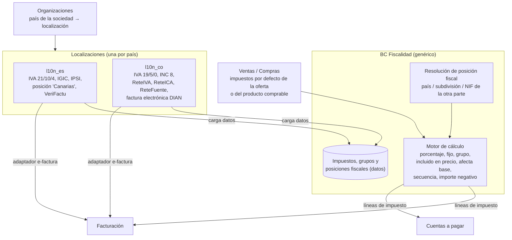

# Documentación del BC Fiscalidad multipaís (al estilo Odoo)

Preguntas de partida: *"algo para controlar los impuestos"*, *"¿esta fiscalidad es general? ¿podría meter Colombia?"* y la decisión *"vamos a solucionarlo como Odoo"*.

Aplicación de `documentar-un-bounded-context.md`. Relacionadas: `erp-bc-organizaciones.md` (país y subdivisión de cada sociedad y local), `erp-bc-ventas.md`, `erp-bc-compras.md`, `erp-bc-facturacion.md`, `erp-bc-cuentas-a-pagar.md`.

Las decisiones de modelado son **propuestas mías** sobre cómo lo resuelve Odoo. Los datos fiscales de España y Colombia son de fuentes de 2026 y deben confirmarse con una asesoría de cada país antes de cargarlos.

## Respuesta corta: motor genérico + impuestos como datos + localización por país

Odoo no tiene un "motor de reglas fiscales". Tiene tres piezas, y las tres se pueden copiar:

1. **Impuestos como datos.** Cada impuesto es un registro con su forma de cálculo: *"Group of Taxes"*, *"Fixed"*, *"Percentage of Price"*, *"Percentage of Price Tax Included"* (y *"Custom Formula"*). Puede ir *"Tax Excluded"* o *"Tax Included"* en el precio, y *"Affect Base of Subsequent Taxes"* controla *"how multiple taxes on a product line affect each other"*; *"the display order determines the application order"* ([Odoo, Tax computation](https://www.odoo.com/documentation/18.0/applications/finance/accounting/taxes/tax_computation.html)).
2. **Posiciones fiscales** que **sustituyen** unos impuestos por otros según la otra parte: sirven para *"Automatically adapt the taxes as well as the financial accounts"*, con un mapeo *"Tax on Product"* → *"Tax to Apply"* ([Cybrosys](https://www.cybrosys.com/odoo/odoo-books/complete-finance-management-with-odoo-accounting/chapter-3/fiscal-position/)); con aplicación automática *"if the matching criterias (VAT/Country) are met"* y filtros como *"Apply only if delivery country matches"* ([Odoo, Fiscal Position](https://www.odoo.com/documentation/latest/developer/reference/standard_modules/account/account_fiscal_position.html)).
3. **Localizaciones por país**: *"country-specific modules that install pre-configured taxes, fiscal positions, chart of accounts, and legal statements"*, elegidas por el país de la empresa ([Odoo, Fiscal localizations](https://www.odoo.com/documentation/saas-17.4/applications/finance/fiscal_localizations.html)). Para Colombia, `l10n_co` (plan de cuentas) y `l10n_co_edi`, que *"provides robust DIAN integration with the UBL 2.1 format and CUFE/CUDS hash chaining"* ([Ecosire](https://ecosire.com/blog/odoo-colombia-localization-guide-2026)).

Las **retenciones** no son un concepto aparte: *"In Odoo, a withholding tax is defined by creating a negative tax"*; para una retención que es un porcentaje de otro impuesto, se usa un **grupo de impuestos** ([Odoo, Withholding taxes](https://www.odoo.com/documentation/19.0/applications/finance/accounting/taxes/retention.html)).

Traducido a DDD: **Fiscalidad es un BC genérico con un motor de cálculo que no sabe de ningún país**. Lo específico de cada país entra como **datos** (impuestos, grupos, posiciones fiscales) y como **adaptadores** (factura electrónica, informes) en un **paquete de localización**. Evans, para lo genérico: *"Factor out generic models of these subdomains and place them in separate modules"* ([DDD Reference](https://domainlanguage.com/wp-content/uploads/2016/05/DDD_Reference_2015-03.pdf)).



## Por qué así y no un motor de reglas propio

La versión anterior de esta nota (solo España) proponía un `ResolverTipo` con reglas de territorio, categoría y operación. Funciona para cuatro territorios fijos, pero Colombia rompe sus supuestos:

| Supuesto del modelo anterior | Qué pasa en Colombia |
|---|---|
| Un impuesto por línea | Una línea lleva IVA **y** retenciones (ReteIVA, ReteFuente, ReteICA) |
| El tipo depende del producto y del territorio | Los restaurantes *"generalmente cobran INC (8 %) y no IVA"*, pero los de franquicia cobran IVA 19 % ([Siigo](https://www.siigo.com/blog/obligaciones-fiscales/impuesto-al-consumo-e-impuesto-sobre-las-ventas-son-lo-mismo/)): depende del **régimen del vendedor** |
| Todo impuesto es descontable | El INC *"no permite descontar impuestos pagados en las compras"* (misma fuente): es **coste** |
| "Exenta" es un solo caso | *Exento* = *"un bien gravado cuya tarifa de IVA es del 0%"*; *excluido* = *"no causa impuesto sobre la venta"* ([Rankia](https://www.rankia.co/blog/dian/4184444-que-gravado-exento-excluido)) |
| Cuatro territorios | ReteICA depende *"del código de actividad (CIIU) y del municipio"* ([Yo Facturo](https://yo-facturo.com/blog/que-es-reteiva-reteica-colombia-2026/)) |

Un motor de reglas que cubra todo eso acaba siendo un lenguaje de reglas fiscal: el *inner-platform effect* (*"a system so customizable as to become a replica, and often a poor replica, of the software development platform"*, [Wikipedia](https://en.wikipedia.org/wiki/Inner-platform_effect)). El enfoque de Odoo lo evita moviendo la complejidad a **qué impuestos se asignan** (datos que carga cada localización), y deja el motor con **pocas formas de cálculo, cerradas**.

El precio de este enfoque: la corrección depende de que los **datos** estén bien (impuestos por defecto de cada producto, posiciones fiscales de cada cliente). Por eso las localizaciones vienen preconfiguradas y la mayoría de usuarios no las tocan.

## Dónde decide cada pieza qué impuesto aplica

Orden de resolución en una línea (como en Odoo, adaptado a nuestros BCs):

1. **Impuestos por defecto** de lo que se vende o compra, **por sociedad**: la `Oferta` en Ventas (impuestos de venta) y el `ProductoComprable` en Compras (impuestos de compra). La sociedad de un restaurante colombiano en franquicia tendrá IVA 19 % por defecto; la de uno que no lo es, INC 8 %. Así se cubre el régimen del vendedor sin reglas.
2. **Posición fiscal** de la otra parte (cliente o proveedor), manual o detectada por país, subdivisión y NIF. Mapea impuesto → impuesto (o → ninguno).
3. **Motor**: calcula importes en orden, con incluido/excluido, afecta base y grupos.

Ejemplos:

| Caso | Impuestos por defecto | Posición fiscal | Resultado |
|---|---|---|---|
| Proveedor peninsular vende aceite a restaurante en Madrid | IVA 10 % (alimento, [AEAT](https://sede.agenciatributaria.gob.es/Sede/ayuda/manuales-videos-folletos/manuales-practicos/manual-iva-2026/capitulo-04-sujetos-pasivos-repercusion-impositivo/tipo-impositivo/tipo-impositivo-reducido-10-ciento.html)) | Nacional (sin mapeo) | IVA 10 % |
| Mismo proveedor vende a restaurante en Tenerife | IVA 10 % | "Canarias" (detectada por subdivisión): IVA 10 % → exento por exportación ([Quipu](https://getquipu.com/blog/facturar-a-canarias-ceuta-melilla/)) | Sin IVA, con motivo |
| Refresco con azúcar añadido en Madrid | IVA 21 % (*"se excluyen… las bebidas que contienen edulcorantes añadidos"*, AEAT) | Nacional | IVA 21 % |
| Proveedor colombiano vende a cliente agente de retención | IVA 19 % | "Cliente agente de retención": IVA 19 % → grupo [IVA 19 % + ReteIVA −15 % del IVA] | IVA 19 %, retención −2,85 % de la base |
| Restaurante colombiano (no franquicia) compra un servicio | — | — | Su venta en sala lleva INC 8 %, no descontable |

La categoría fiscal del modelo anterior desaparece como concepto aparte: se convierte en **qué impuesto por defecto tiene cada oferta o producto comprable**, que propone la localización (por familia del Catálogo) y ajusta el usuario.

## README del BC Fiscalidad (propósito y límites)

**Propósito.** Calcular, para cada línea, los impuestos y retenciones que aplican en el país de la sociedad, a partir de impuestos configurados como datos y de la situación fiscal de la otra parte.

**Tipo de subdominio.** Genérico · *compliance enforcer*. El motor es pequeño y estable; el trabajo continuo está en las localizaciones.

**Qué NO hace.**

| No hace | Dónde vive |
|---|---|
| Decidir qué impuesto por defecto lleva cada oferta o producto | Ventas y Compras (con la propuesta de la localización) |
| Saber el país, la subdivisión y el régimen de cada sociedad | Organizaciones |
| Numerar, firmar y enviar facturas (VeriFactu, DIAN) | Facturación, con el adaptador de la localización |
| Pagar el neto tras retenciones y emitir certificados | Cuentas a pagar / Tesorería |
| Plan contable, asientos, declaraciones (303, formularios DIAN) | Contabilidad (futuro) o la localización |
| Fórmulas de impuesto libres | No se soportan (ADR 0003) |

**Dueño.** Equipo Plataforma (motor). Cada localización tiene un responsable con asesoría local.

## Canvas del BC Fiscalidad

| Sección | Contenido |
|---|---|
| **Name** | Fiscalidad |
| **Purpose** | Impuestos y retenciones por línea, en cualquier país soportado, sin lógica de país en el motor. |
| **Strategic Classification** | Genérico · *compliance enforcer* · *product* (Odoo, motores comerciales) |
| **Domain Roles** | Motor de cálculo + datos de referencia por país |
| **Inbound** | Localizaciones: `InstalarLocalizacion(pais)`, `PublicarImpuestos` (alta/baja con vigencia). Organizaciones: `SociedadDadaDeAlta {pais, subdivision, regimen}`. Ventas, Compras, Facturación, Cuentas a pagar: consulta `CalcularImpuestos(lineas, sociedad, otraParte, fecha)`. Usuario: `AsignarPosicionFiscal(otraParte)` |
| **Outbound** | `ImpuestosActualizados`, `PosicionFiscalAsignada` |
| **Ubiquitous Language** | Impuesto, Forma de cálculo, Grupo de impuestos, Incluido en precio, Afecta base, Secuencia, Retención, Descontable, Posición fiscal, Mapeo, Localización |
| **Business Decisions** | Ver "Reglas de negocio" |
| **Assumptions** | Las cinco formas de cálculo (sin fórmula libre) bastan para España y Colombia. La situación fiscal de la otra parte se puede expresar como posición fiscal. |
| **Verification Metrics** | Nº de casos que piden "fórmula personalizada"; diferencias de cuota en el cotejo de Cuentas a pagar |
| **Open Questions** | Ver última sección |

## Glosario del BC Fiscalidad

```yaml
contexts:
  - name: Fiscalidad
    domainVisionStatement: Que cada línea lleve sus impuestos y retenciones correctos en cualquier país soportado.
    terms:
      - name: Impuesto
        definition: Registro de datos con nombre, país, ámbito (venta o compra), forma de cálculo, importe, grupo y vigencia. Un importe negativo es una retención.
        examples:
          - "IVA 10 % ventas España; ReteIVA −15 % Colombia."
      - name: Forma de cálculo
        definition: Lista cerrada - porcentaje del precio sin impuestos, porcentaje del precio con impuestos, fijo, grupo.
      - name: Grupo de impuestos
        definition: Impuesto compuesto por otros, aplicados en orden. Se usa para retenciones sobre otro impuesto.
      - name: Incluido en precio
        definition: El precio de la línea ya contiene el impuesto (típico de venta en sala). Si no, se suma.
      - name: Afecta base
        definition: El importe de este impuesto entra en la base de los siguientes de la misma línea.
      - name: Retención
        definition: Impuesto negativo que el pagador descuenta y paga a la administración en nombre del cobrador.
        aliases: [withholding, ReteIVA, ReteFuente, ReteICA]
      - name: Descontable
        definition: Si la cuota soportada en compras se puede recuperar. Si no, es coste del producto (INC en Colombia).
      - name: Posición fiscal
        definition: Situación fiscal de la otra parte que sustituye unos impuestos por otros (exportación a Canarias, cliente agente de retención).
      - name: Localización
        definition: Paquete de un país con sus impuestos, grupos, posiciones fiscales y adaptadores (factura electrónica).
        aliases: [l10n]
```

## Modelo del BC Fiscalidad: agregados e invariantes

| Agregado / modelo | Contiene | Invariantes |
|---|---|---|
| `Impuesto` | País, ámbito (venta/compra), forma de cálculo, importe, incluido en precio, afecta base, secuencia, descontable, grupo de presentación, vigencia, hijos (si es grupo) | Forma de cálculo de la lista cerrada; un grupo no se contiene a sí mismo; publicado no se edita (nueva versión con vigencia) |
| `PosicionFiscal` | País, nombre, criterios de detección (país, subdivisiones, exige NIF), mapeos impuesto → impuesto o → ninguno | Un impuesto origen aparece una vez por posición; los mapeos son del mismo país |
| `Localizacion` | País, versión, impuestos y posiciones que instala, adaptadores declarados | Se instala por sociedad según su país; no se cambia con documentos emitidos (como Odoo: *"As long as you haven't posted any entry, you can still select another package"*) |
| `CalculoDeImpuestos` (servicio de dominio) | Motor puro | Mismo resultado para la misma entrada; redondeo por línea definido por la localización |

```php
<?php
declare(strict_types=1);

namespace Fiscalidad\Dominio;

enum FormaCalculo: string
{
    case Porcentaje = 'PORCENTAJE';                 // sobre precio sin impuestos
    case PorcentajeIncluido = 'PORCENTAJE_INCLUIDO'; // sobre total con impuestos
    case Fijo = 'FIJO';
    case Grupo = 'GRUPO';
    // Sin "fórmula personalizada" a propósito (ADR 0003)
}

final readonly class Impuesto
{
    /** @param list<Impuesto> $hijos */
    public function __construct(
        public ImpuestoId $id,
        public string $nombre,                 // 'IVA 19 %', 'ReteIVA 15 %'
        public FormaCalculo $forma,
        public string $importe,                // '19', '-15', '0.50' (fijo)
        public bool $incluidoEnPrecio = false,
        public bool $afectaBase = false,
        public int $secuencia = 10,
        public bool $descontable = true,
        public array $hijos = [],
    ) {}
}

final readonly class LineaDeImpuesto
{
    public function __construct(
        public ImpuestoId $impuestoId,
        public string $nombre,
        public Dinero $base,
        public Dinero $cuota,                  // negativa si es retención
        public bool $descontable,
    ) {}
}

/** Motor genérico: no sabe de ningún país */
final class CalculoDeImpuestos
{
    /** @param list<Impuesto> $impuestos @return list<LineaDeImpuesto> */
    public function calcular(Dinero $precio, string $cantidad, array $impuestos): array
    {
        $impuestos = $this->expandirGrupos($impuestos);
        usort($impuestos, fn (Impuesto $a, Impuesto $b) => $a->secuencia <=> $b->secuencia);

        $base = $this->baseSinImpuestosIncluidos($precio->por($cantidad), $impuestos);
        $lineas = [];
        foreach ($impuestos as $imp) {
            $cuota = match ($imp->forma) {
                FormaCalculo::Porcentaje, FormaCalculo::PorcentajeIncluido => $base->porcentaje($imp->importe),
                FormaCalculo::Fijo => Dinero::de($imp->importe, $precio->moneda)->por($cantidad),
                FormaCalculo::Grupo => throw new \LogicException('Los grupos ya están expandidos'),
            };
            $lineas[] = new LineaDeImpuesto($imp->id, $imp->nombre, $base, $cuota, $imp->descontable);
            if ($imp->afectaBase) {
                $base = $base->mas($cuota);
            }
        }
        return $lineas;
    }

    // expandirGrupos() y baseSinImpuestosIncluidos() omitidos por brevedad
}
```

La retención "15 % del IVA" se expresa sin lógica especial: grupo [IVA 19 % con *afecta base* = no; ReteIVA −2,85 % sobre la base], o una forma "porcentaje de otro impuesto" si la localización lo necesita. Ese detalle (y el redondeo) es lo que conviene contrastar con la implementación de Odoo antes de codificarlo.

```php
<?php
declare(strict_types=1);

namespace Fiscalidad\Dominio;

final readonly class ResolverImpuestos
{
    public function __construct(
        private PosicionesFiscales $posiciones,
        private CalculoDeImpuestos $motor,
    ) {}

    /** @param list<Impuesto> $porDefecto los de la Oferta o el ProductoComprable */
    public function __invoke(array $porDefecto, Dinero $precio, string $cantidad, OtraParte $otra, \DateTimeImmutable $fecha): array
    {
        $posicion = $otra->posicionFiscal ?? $this->posiciones->detectar($otra->pais, $otra->subdivision, $otra->tieneNif);
        $impuestos = $posicion?->mapear($porDefecto) ?? $porDefecto;   // p. ej. IVA 10 % → exento
        return $this->motor->calcular($precio, $cantidad, $impuestos);
    }
}
```

## Localizaciones: España y Colombia

Una localización es un **módulo** del BC, con datos y adaptadores. Lo que contiene cada una (propuesta; los porcentajes son los de las fuentes citadas):

| | `l10n_es` | `l10n_co` |
|---|---|---|
| Impuestos de venta | IVA 21 % / 10 % / 4 %; IGIC (general 7 %); IPSI ([GuíaFiscal](https://guiafiscal.es/comparativas/iva-vs-igic-vs-ipsi/)) | IVA 19 % / 5 % / 0 % (exento); excluido; INC 8 % ([Siigo](https://www.siigo.com/blog/obligaciones-fiscales/impuesto-al-consumo-e-impuesto-sobre-las-ventas-son-lo-mismo/)) |
| Retenciones | (IRPF profesionales: fuera de alcance) | ReteIVA 15 % del IVA, ReteFuente, ReteICA por municipio y CIIU ([Yo Facturo](https://yo-facturo.com/blog/que-es-reteiva-reteica-colombia-2026/)) |
| No descontables | (casos puntuales) | INC |
| Posiciones fiscales | Nacional, Canarias, Ceuta, Melilla, intracomunitario, exportación | Cliente agente de retención, gran contribuyente, régimen simple (a confirmar con asesoría) |
| Factura electrónica | VeriFactu + factura electrónica B2B (ver `erp-bc-facturacion.md`) | DIAN, UBL 2.1, CUFE ([Ecosire](https://ecosire.com/blog/odoo-colombia-localization-guide-2026)) |
| Subdivisión relevante | Comunidad / provincia (Canarias, Ceuta, Melilla) | Municipio (ReteICA) |

```text
src/Fiscalidad/
├── Dominio/            # motor, Impuesto, PosicionFiscal (sin país)
├── Aplicacion/
└── Localizaciones/
    ├── Es/
    │   ├── datos/impuestos.yaml, posiciones.yaml
    │   └── Infraestructura/VeriFactuAdapter.php
    └── Co/
        ├── datos/impuestos.yaml, posiciones.yaml
        └── Infraestructura/DianAdapter.php
```

Una regla de Deptrac (ver `documentar-un-bounded-context.md`) impide que `Dominio` dependa de `Localizaciones`: así el motor no puede acabar con un `if ($pais === 'CO')`.

## Reglas de negocio del BC Fiscalidad (como tests)

```php
<?php
final class CalculoDeImpuestosTest extends TestCase
{
    public function test_porcentaje_sobre_precio_sin_impuestos(): void {}
    public function test_impuesto_incluido_en_precio_se_extrae_de_la_base(): void {}
    public function test_un_impuesto_que_afecta_base_aumenta_la_base_del_siguiente(): void {}
    public function test_los_impuestos_se_aplican_en_orden_de_secuencia(): void {}
    public function test_un_impuesto_negativo_produce_una_retencion(): void {}
    public function test_un_grupo_se_expande_en_sus_hijos(): void {}
}

final class PosicionFiscalTest extends TestCase
{
    public function test_cliente_en_canarias_detecta_la_posicion_canarias_y_quita_el_iva(): void {}     // l10n_es
    public function test_cliente_agente_de_retencion_anyade_reteiva_al_iva(): void {}                 // l10n_co
    public function test_sin_posicion_se_usan_los_impuestos_por_defecto(): void {}
}

final class LocalizacionTest extends TestCase
{
    public function test_el_motor_no_depende_de_ninguna_localizacion(): void {}   // Deptrac
    public function test_no_se_cambia_la_localizacion_de_una_sociedad_con_facturas_emitidas(): void {}
    public function test_el_inc_es_no_descontable_y_suma_al_coste(): void {}      // l10n_co
}
```

## Qué cambia en los demás BCs

| BC | Cambio |
|---|---|
| Organizaciones | `Sociedad` y `Local` guardan **país + subdivisión** (sustituye a la lista fija de territorios españoles) y la sociedad indica su **localización** |
| Ventas | `Oferta` lleva impuestos de venta por defecto (ids de Fiscalidad) por sociedad; `ClienteDeProveedor` puede tener posición fiscal |
| Compras | `ProductoComprable` lleva impuestos de compra por defecto; `ProveedorDeCliente` puede tener posición fiscal |
| Facturación | Las líneas copian las `LineaDeImpuesto` (snapshot). La factura electrónica la hace el **adaptador de la localización** de la sociedad emisora |
| Cuentas a pagar | El importe a pagar es el total **menos retenciones**; coteja también cuotas; las no descontables se envían como coste |
| Inventario | Suma al coste del artículo las cuotas **no descontables** de la compra |

## ADRs del BC Fiscalidad

| ADR | Decisión | Consecuencia negativa aceptada |
|---|---|---|
| 0001 | Modelo de Odoo: impuestos como datos + posiciones fiscales + localización por país | La corrección depende de la configuración; hay que cuidar los datos que instala cada localización |
| 0002 | Retención = impuesto negativo (y grupos para porcentajes sobre otro impuesto) | Informes de retenciones deben filtrar por grupo, no por un tipo de entidad propio |
| 0003 | Formas de cálculo cerradas; **sin fórmula personalizada** | Un caso exótico de un país nuevo obliga a ampliar el motor con código y tests |
| 0004 | El motor (`Dominio`) no depende de ninguna localización (regla Deptrac) | Más indirección: interfaces para adaptadores |
| 0005 | Factura electrónica por país como adaptador de la localización, usado por Facturación | Facturación conoce un puerto genérico y no los detalles de VeriFactu o DIAN |
| 0006 | Sustituye al diseño anterior "solo España con `ResolverTipo`" (*superseded*) | — |

## Preguntas abiertas del BC Fiscalidad

1. ¿Vender realmente en Colombia o es una prueba de generalidad? Si es real, hace falta asesoría local antes de cargar datos, y valorar comprar un motor fiscal o integrarse con uno.
2. ¿Cómo calcula exactamente Odoo una retención "15 % del IVA" y el redondeo por línea o por total? Hay que contrastarlo con su código o documentación antes de implementarlo.
3. ReteICA depende del municipio **y** del código de actividad (CIIU) del vendedor: ¿posición fiscal por municipio o un dato de la sociedad? Probablemente ambos.
4. ¿Hace falta *cash basis* (impuesto exigible al cobro)? Odoo lo soporta ("Cash basis taxes"); aquí no está modelado.
