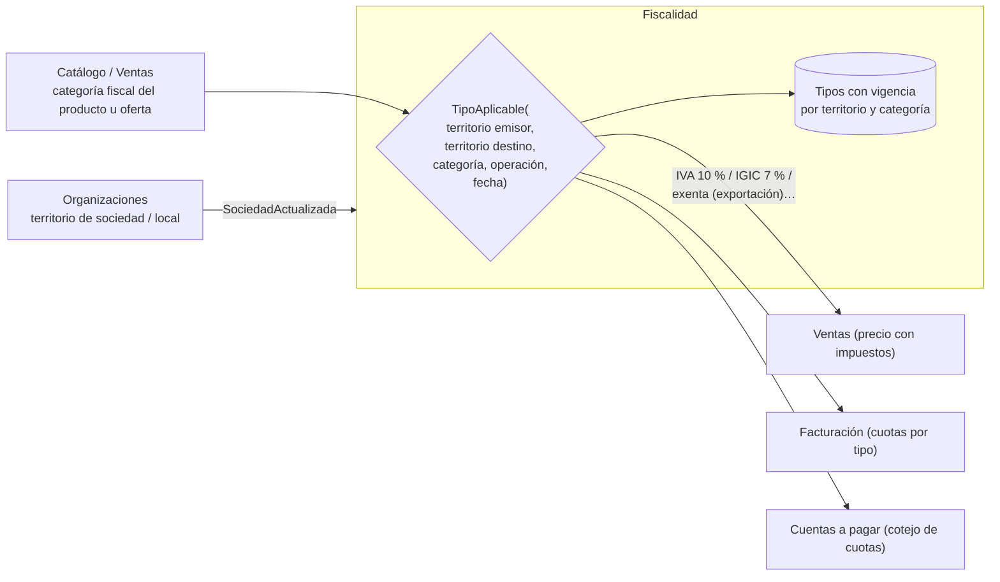

# Documentación del BC Fiscalidad (IVA, IGIC, IPSI)

Aplicación de `documentar-un-bounded-context.md`. Responde a *"algo para controlar los impuestos"*. Relacionadas: `erp-bc-organizaciones.md` (territorio fiscal de sociedades y locales), `erp-bc-ventas.md`, `erp-bc-facturacion.md`, `erp-bc-cuentas-a-pagar.md`.

Las decisiones de modelado son **propuestas mías**. Los datos fiscales citados son de 2026 y deben confirmarse con la asesoría antes de cargarlos en producción.

## Respuesta corta: un BC pequeño que responde "¿qué impuesto y a qué tipo?"

El tipo de impuesto de una operación **no es un atributo fijo del producto**. Depende de al menos cuatro cosas:

1. **Territorio**: IVA en *"Península + Baleares"*, IGIC en Canarias (general 7 %), IPSI en Ceuta y Melilla ([GuíaFiscal](https://guiafiscal.es/comparativas/iva-vs-igic-vs-ipsi/)).
2. **Qué se entrega** (categoría fiscal): en IVA, el general es *"el tipo impositivo general del 21 por ciento"*; al 10 % van, entre otros, los productos aptos *"para la nutrición humana o animal"* ([AEAT](https://sede.agenciatributaria.gob.es/Sede/ayuda/manuales-videos-folletos/manuales-practicos/manual-iva-2026/capitulo-04-sujetos-pasivos-repercusion-impositivo/tipo-impositivo/tipo-impositivo-reducido-10-ciento.html)), pero *"se excluyen de este concepto las bebidas que contienen edulcorantes añadidos"*, que van al general.
3. **Tipo de operación**: el servicio de restauración también va al 10 %: *"los de restaurantes y, en general, el suministro de comidas y bebidas para consumir en el acto"* (AEAT, misma página).
4. **Entre territorios y fecha**: una venta de bienes de la península a Canarias *"se considerará una exportación por lo que no habrá que pagar IVA"* ([Quipu](https://getquipu.com/blog/facturar-a-canarias-ceuta-melilla/)). Y los tipos cambian por ley con fecha de vigencia.

Por eso merece un BC propio (pequeño y genérico): **una consulta** `TipoAplicable(operación)` y **datos de referencia con vigencia** que mantiene la plataforma, no cada cliente. Evans, para los genéricos: *"Factor out generic models of these subdomains and place them in separate modules"* ([DDD Reference](https://domainlanguage.com/wp-content/uploads/2016/05/DDD_Reference_2015-03.pdf)).



## README del BC Fiscalidad (propósito y límites)

**Propósito.** Decidir qué impuesto indirecto y qué tipo aplica a cada línea de una operación, en cada territorio y fecha, para que nadie tenga que elegirlo a mano.

**Tipo de subdominio.** Genérico · *compliance enforcer*. Existen motores de impuestos comerciales; si se vende fuera de España, comprar uno es probablemente mejor que crecer este BC.

**Qué NO hace.**

| No hace | Dónde vive |
|---|---|
| Saber dónde está cada sociedad o local | Organizaciones (le envía el territorio) |
| Decidir la categoría fiscal de cada producto | Quien conoce el producto: Catálogo (por defecto) y Ventas (por oferta, si difiere) |
| Calcular la factura completa ni numerarla | Facturación |
| Presentar modelos (303, 390), SII, VeriFactu | Facturación / Contabilidad / proveedor externo |
| Retenciones de IRPF | Fuera de alcance de momento |

**Dueño.** Equipo Plataforma, con validación de la asesoría para cada cambio de tipos.

## Canvas del BC Fiscalidad

| Sección | Contenido |
|---|---|
| **Name** | Fiscalidad |
| **Purpose** | Qué impuesto y a qué tipo, por línea, territorio y fecha. |
| **Strategic Classification** | Genérico · *compliance enforcer* · *product* |
| **Domain Roles** | Motor de reglas sobre datos de referencia |
| **Inbound** | Plataforma: `PublicarTipos` (alta de una tabla de tipos con vigencia). Organizaciones: `SociedadDadaDeAlta`, `SociedadActualizada`, `LocalAbierto`. Ventas, Facturación, Cuentas a pagar: consulta `TipoAplicable` |
| **Outbound** | `TiposFiscalesActualizados` (para que Ventas recalcule precios con impuestos si los muestra) |
| **Ubiquitous Language** | Impuesto, Territorio fiscal, Categoría fiscal, Tipo, Vigencia, Operación, Exenta, Inversión del sujeto pasivo |
| **Business Decisions** | Ver "Reglas de negocio" |
| **Assumptions** | Solo España (IVA, IGIC, IPSI). B2B mayoritariamente. |
| **Verification Metrics** | Diferencias de cuota detectadas en el cotejo de Cuentas a pagar entre plataforma y externos |
| **Open Questions** | Ver última sección |

## Glosario del BC Fiscalidad

```yaml
contexts:
  - name: Fiscalidad
    domainVisionStatement: Que cada línea lleve el impuesto correcto sin que nadie lo elija a mano.
    terms:
      - name: Impuesto
        definition: Impuesto indirecto que aplica según el territorio - IVA, IGIC o IPSI.
      - name: Territorio fiscal
        definition: Zona con su propio impuesto indirecto (península y Baleares, Canarias, Ceuta, Melilla). Lo aporta Organizaciones.
      - name: Categoría fiscal
        definition: Clase de bien o servicio a efectos del tipo (alimento, bebida con edulcorantes, servicio de restauración, general…).
        examples:
          - "El refresco con azúcar añadido es categoría bebida edulcorada: va al general."
      - name: Operación
        definition: Qué se hace - entrega de bienes o prestación de servicios, y entre qué territorios.
      - name: Tipo
        definition: Porcentaje aplicable a una combinación de impuesto, categoría y operación, con vigencia.
        aliases: [tipo impositivo, tipo de IVA]
      - name: Vigencia
        definition: Desde cuándo y hasta cuándo aplica un tipo. Un cambio legal es un tipo nuevo con nueva vigencia, no una edición.
      - name: Exenta
        definition: Operación sin cuota del impuesto, con motivo (por ejemplo, exportación a Canarias).
```

## Modelo del BC Fiscalidad: agregados e invariantes

| Agregado / modelo | Contiene | Invariantes |
|---|---|---|
| `TablaDeTipos` | Impuesto, territorio, filas (categoría, operación, %), vigencia | No se solapan vigencias para el mismo (territorio, categoría, operación); publicada no se edita |
| `ReglaEntreTerritorios` | (territorio origen, territorio destino, tipo de operación, tipo de cliente) → tratamiento (aplicar origen, exenta, inversión del sujeto pasivo) | Toda combinación de territorios tiene regla |
| `TerritorioDeSociedad` (réplica) | `sociedadId`, `localId?`, territorio | Se alimenta solo de eventos de Organizaciones |

```php
<?php
declare(strict_types=1);

namespace Fiscalidad\Dominio;

enum CategoriaFiscal: string
{
    case Alimento = 'ALIMENTO';
    case BebidaEdulcorada = 'BEBIDA_EDULCORADA';
    case ServicioRestauracion = 'SERVICIO_RESTAURACION';
    case General = 'GENERAL';
}

final readonly class Operacion
{
    public function __construct(
        public TerritorioFiscal $origen,
        public TerritorioFiscal $destino,
        public CategoriaFiscal $categoria,
        public bool $esServicio,
        public bool $destinatarioEsEmpresa,
        public \DateTimeImmutable $fecha,
    ) {}
}

final readonly class TipoAplicable
{
    public function __construct(
        public Impuesto $impuesto,        // IVA | IGIC | IPSI
        public string $porcentaje,         // '10', '21', '7', '0'
        public ?string $motivoExencion,    // 'exportación a Canarias'…
        public TablaId $tablaOrigen,       // trazabilidad: qué tabla y versión se usó
    ) {}
}

final readonly class ResolverTipo
{
    public function __construct(
        private ReglasEntreTerritorios $reglas,
        private TablasDeTipos $tablas,
    ) {}

    public function __invoke(Operacion $op): TipoAplicable
    {
        $tratamiento = $this->reglas->para($op);       // aplicar origen, exenta, ISP…
        if ($tratamiento->esExenta()) {
            return TipoAplicable::exenta($tratamiento->motivo());
        }
        $tabla = $this->tablas->vigente($tratamiento->territorioQueTributa($op), $op->fecha);
        return $tabla->tipoPara($op->categoria, $op->esServicio);
    }
}
```

**Snapshot en el documento.** Facturación y Ventas **copian** el `TipoAplicable` en cada línea (como el precio). Si la ley cambia el tipo mañana, las facturas de hoy no cambian. `tablaOrigen` deja rastro de qué tabla se usó.

## Reglas de negocio del BC Fiscalidad (como tests)

```php
<?php
final class ResolverTipoTest extends TestCase
{
    public function test_un_alimento_en_peninsula_va_al_reducido(): void {}
    public function test_una_bebida_con_edulcorantes_anyadidos_va_al_general(): void {}
    public function test_comidas_para_consumir_en_el_acto_van_al_reducido(): void {}
    public function test_un_local_en_canarias_tributa_por_igic(): void {}
    public function test_venta_de_bienes_de_peninsula_a_canarias_va_exenta_de_iva(): void {}
    public function test_servicio_de_peninsula_a_empresa_canaria_va_sin_iva_por_inversion(): void {}
    public function test_se_aplica_la_tabla_vigente_en_la_fecha_de_la_operacion(): void {}
    public function test_no_se_publican_dos_tablas_con_vigencias_solapadas(): void {}
}
```

Los dos tests de Canarias siguen lo que describe [Quipu](https://getquipu.com/blog/facturar-a-canarias-ceuta-melilla/) (bienes: exportación; servicios a empresas: inversión del sujeto pasivo, con excepciones). Antes de implementarlos, confirmar el detalle con la asesoría.

## ADRs del BC Fiscalidad

| ADR | Decisión | Consecuencia negativa aceptada |
|---|---|---|
| 0001 | Fiscalidad es un BC propio, no un campo `iva` en el producto | Cada línea consulta un servicio (se puede cachear por tabla vigente) |
| 0002 | Tablas de tipos con vigencia, mantenidas por la plataforma; los clientes no las editan | Un cambio legal exige publicar una tabla nueva a tiempo |
| 0003 | La categoría fiscal la propone Catálogo y la puede ajustar Ventas por oferta | Dos sitios que pueden discrepar; manda Ventas |
| 0004 | Los documentos copian el tipo aplicado y la tabla de origen | Duplicación de datos (necesaria legalmente) |
| 0005 | Solo España (IVA, IGIC, IPSI) | Vender fuera obliga a revisar el BC o comprar un motor de impuestos |

## Preguntas abiertas del BC Fiscalidad

1. ¿Hay operaciones de obra con inversión del sujeto pasivo (subcontratas)? Si el ERP se usa en construcción, hay que confirmarlo con la asesoría y añadir la regla.
2. ¿Qué categorías fiscales exactas necesita el negocio (alcohol, productos al 4 %…)? La AEAT menciona que algunos bienes del 10 % pasan al 4 %, pero la lista exacta hay que sacarla de la ley.
3. ¿Los precios de Ventas se publican con o sin impuestos? En B2B lo normal es sin; en venta en sala (TPV) se muestran con.
