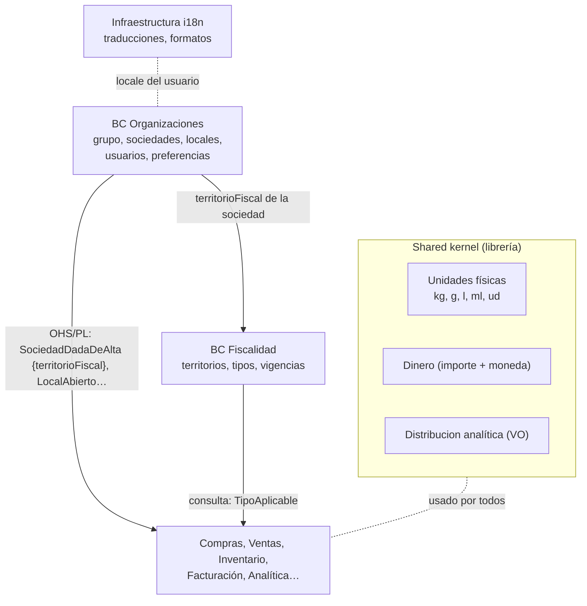

# Documentación del BC Organizaciones (y lo que no es un BC: unidades, dinero, locale)

Pregunta de partida: *¿y el BC de Organizaciones? ¿Algo para controlar los impuestos, locale, unidades…? ¿Todo eso qué?*

Aplicación de `documentar-un-bounded-context.md`. Relacionadas: `erp-grupo-multisociedad.md` (grupo → sociedad → local), `erp-bc-fiscalidad.md` (impuestos), `unidades-de-medida-compra-stock-cocina.md`, `mapa-de-contextos-erp-marketplace.md`.

Las decisiones son **propuestas mías** apoyadas en las fuentes.

## Respuesta corta: tres sitios distintos, no un "BC de configuración"

La tentación es crear un BC "Configuración" o "Maestros" con todo lo transversal. Es un cajón de sastre: mezcla cosas que cambian por motivos distintos y con dueños distintos. Lo separaría así:

| Qué | Dónde | Por qué |
|---|---|---|
| Grupo, sociedades, locales, usuarios, permisos, preferencias (idioma, zona horaria, moneda) | **BC Organizaciones** | Es **quién** usa el sistema y **en nombre de quién** |
| Tipos de impuesto, territorios fiscales, qué tipo aplica a qué | **BC Fiscalidad** (`erp-bc-fiscalidad.md`) | Tiene reglas propias que cambian por ley y con fecha de vigencia |
| Unidades físicas (kg ↔ g, l ↔ ml), `Dinero`, `Distribucion` analítica | **Shared kernel** (librería pequeña) | Son value objects sin dueño de negocio, iguales en todos los BCs |
| Formato de fechas, números, traducciones de la UI | **Infraestructura** (i18n) | No es dominio; es presentación |
| Unidad de stock y equivalencias de un artículo | Inventario (`Articulo`) | Es propia del artículo de cada cliente |

Evans, para lo compartido: *"Designate with an explicit boundary some subset of the domain model that the teams agree to share"*, que sea pequeño, y *"Define a continuous integration process that will keep the kernel model tight"* ([DDD Reference](https://domainlanguage.com/wp-content/uploads/2016/05/DDD_Reference_2015-03.pdf)). Un "BC Configuración" con todo dentro es lo contrario: un kernel grande que todos tocan.



## README del BC Organizaciones (propósito y límites)

**Propósito.** Saber **quién** trabaja en la plataforma y **en nombre de quién**: grupos, sociedades (entidades legales), locales con sus almacenes, usuarios, sus permisos por sociedad y local, y sus preferencias.

**Tipo de subdominio.** Genérico (lo tiene cualquier SaaS multiempresa). Upstream de todos los demás con *Open-host Service*.

**Qué NO hace.**

| No hace | Dónde vive |
|---|---|
| Tipos de IVA/IGIC/IPSI y qué tipo aplica | Fiscalidad |
| Series de facturación | Facturación (por sociedad) |
| Proveedores y clientes de cada sociedad (agenda) | Compras (`ProveedorDeCliente`), Ventas (`ClienteDeProveedor`) |
| Almacenes y stock | Inventario (Organizaciones solo dice qué almacén es de qué local) |
| Centros de coste, marcas, eventos | Analítica (planes) |
| Traducciones y formatos | Infraestructura |
| Autenticación (contraseñas, SSO) | Proveedor de identidad externo detrás de un puerto (genérico, comprar) |

**Relaciones.** Upstream de todos. Publica eventos; los demás guardan una réplica con lo que necesitan (por ejemplo, Compras solo `sociedadId`, `nombre`, `activa`). Es el patrón de Fowler: cada contexto tiene su propio modelo de un concepto común ([BoundedContext](https://martinfowler.com/bliki/BoundedContext.html)).

## Canvas del BC Organizaciones

| Sección | Contenido |
|---|---|
| **Name** | Organizaciones |
| **Purpose** | Identidad y estructura de las empresas que usan la plataforma, y quién puede hacer qué en cada una. |
| **Strategic Classification** | Genérico · *engagement creator* (alta y onboarding) · *commodity* |
| **Domain Roles** | Registro maestro (*master data*) y control de acceso |
| **Inbound** | Usuario: `RegistrarGrupo`, `DarDeAltaSociedad`, `AbrirLocal`, `CerrarLocal`, `InvitarUsuario`, `AsignarRol`, `CambiarPreferencias`. Proveedor de identidad: `UsuarioAutenticado` |
| **Outbound** | `GrupoRegistrado`, `SociedadDadaDeAlta`, `SociedadActualizada` (domicilio, territorio fiscal), `LocalAbierto`, `LocalCerrado`, `UsuarioInvitado`, `RolAsignado`. Consulta: `PuedeHacer(usuario, accion, sociedad/local)` |
| **Ubiquitous Language** | Grupo, Sociedad, Local, Almacén (referencia), Usuario, Rol, Ámbito, Preferencias, Territorio fiscal |
| **Business Decisions** | Ver "Reglas de negocio" |
| **Assumptions** | Un local pertenece a una sola sociedad. Un usuario puede trabajar en varias sociedades del mismo grupo. |
| **Verification Metrics** | Nº de BCs que consultan Organizaciones en síncrono (debería ser solo el control de permisos) |
| **Open Questions** | Ver última sección |

## Glosario del BC Organizaciones

```yaml
contexts:
  - name: Organizaciones
    domainVisionStatement: Saber quién trabaja en la plataforma y en nombre de qué empresa.
    terms:
      - name: Grupo
        definition: Cuenta de la plataforma. Agrupa sociedades, locales y usuarios. Un restaurante independiente es un grupo con una sociedad y un local.
        aliases: [cuenta, tenant]
      - name: Sociedad
        definition: Entidad legal con NIF y domicilio fiscal. Es quien factura, recibe facturas y paga impuestos.
        aliases: [empresa, entidad legal]
        examples:
          - "Sabores Norte SL tiene el NIF B-111 y está en Bilbao."
      - name: Local
        definition: Sitio físico de trabajo (restaurante, cocina central, obra). Pertenece a una sociedad y tiene uno o varios almacenes.
        aliases: [establecimiento, centro de trabajo]
      - name: Territorio fiscal
        definition: Dónde tributa una sociedad o un local a efectos de impuestos indirectos (península y Baleares, Canarias, Ceuta, Melilla).
      - name: Rol
        definition: Conjunto de permisos (comprador, jefe de cocina, administración).
      - name: Ámbito
        definition: Dónde aplica un rol de un usuario (todo el grupo, una sociedad, un local).
        examples:
          - "Ana es jefa de cocina solo en el Local Mayor."
      - name: Preferencias
        definition: Idioma, zona horaria, moneda por defecto y formato, por grupo y por usuario. No cambian reglas de negocio.
```

## Modelo del BC Organizaciones: agregados e invariantes

| Agregado | Contiene | Invariantes |
|---|---|---|
| `Grupo` | Nombre, preferencias por defecto, estado | Al menos una sociedad activa para operar |
| `Sociedad` | `grupoId`, NIF, razón social, domicilio fiscal, **territorio fiscal**, moneda contable | NIF válido y único en la plataforma; territorio derivado del domicilio salvo excepción explícita |
| `Local` | `sociedadId`, nombre, dirección, zona horaria, **territorio fiscal** (si difiere), ids de almacén | Pertenece a una sociedad del mismo grupo; no se cierra con almacenes con stock (lo confirma Inventario) |
| `Usuario` | Email, preferencias, asignaciones (rol + ámbito) | Un ámbito siempre dentro de su grupo |

**Territorio fiscal en sociedad y en local.** El impuesto indirecto depende del territorio: IVA en *"Península + Baleares"*, IGIC en Canarias, IPSI en Ceuta y Melilla ([GuíaFiscal](https://guiafiscal.es/comparativas/iva-vs-igic-vs-ipsi/)). Un grupo con un local en Tenerife necesita que ese dato esté en Organizaciones para que Fiscalidad elija bien. Qué tipo aplica en cada caso no es de Organizaciones: es de Fiscalidad.

```php
<?php
declare(strict_types=1);

namespace Organizaciones\Dominio;

enum TerritorioFiscal: string
{
    case PeninsulaBaleares = 'ES-IVA';
    case Canarias = 'ES-IGIC';
    case Ceuta = 'ES-IPSI-CE';
    case Melilla = 'ES-IPSI-ML';
}

final class Local extends AggregateRoot
{
    public function __construct(
        public readonly LocalId $id,
        public readonly SociedadId $sociedadId,
        private string $nombre,
        private \DateTimeZone $zonaHoraria,           // Canarias: Atlantic/Canary
        private ?TerritorioFiscal $territorio = null,  // null = el de la sociedad
    ) {}

    public function territorioFiscal(Sociedad $sociedad): TerritorioFiscal
    {
        return $this->territorio ?? $sociedad->territorioFiscal();
    }
}
```

**Preferencias ≠ reglas.** Idioma, zona horaria y formato son preferencias: cambian cómo se **muestra** algo, no qué **pasa**. La zona horaria sí afecta al dominio en un punto: qué día es "hoy" para un local (cierre de caja, fecha de factura). Por eso va en `Local` y no solo en el usuario.

## Shared kernel: unidades, dinero y distribución

Lo que todos los BCs usan igual y no tiene dueño de negocio va en una **librería pequeña**, versionada, que cambia poco:

| Value object | Contenido | Lo que **no** incluye |
|---|---|---|
| `UnidadFisica`, `Cantidad` | Magnitud (masa, volumen, unidad), conversiones físicas (1 kg = 1000 g) | Equivalencias de un artículo (1 botella = 750 ml) → Inventario. Formatos de compra (caja de 6) → Compras/Ventas |
| `Dinero` | Importe decimal + moneda ISO, suma, redondeo | Tipos de cambio (si hicieran falta, otro BC) |
| `Distribucion` | (cuenta analítica, %) | Reglas de imputación → Analítica |

Ver `unidades-de-medida-compra-stock-cocina.md` para las tres clases de conversión y dónde vive cada una.

```php
<?php
declare(strict_types=1);

namespace Comun\Medida;   // shared kernel: sin dependencias de ningún BC

enum Magnitud: string { case Masa = 'MASA'; case Volumen = 'VOLUMEN'; case Unidad = 'UNIDAD'; }

enum UnidadFisica: string
{
    case Kg = 'kg'; case G = 'g'; case L = 'l'; case Ml = 'ml'; case Ud = 'ud';

    public function magnitud(): Magnitud
    {
        return match ($this) {
            self::Kg, self::G => Magnitud::Masa,
            self::L, self::Ml => Magnitud::Volumen,
            self::Ud => Magnitud::Unidad,
        };
    }

    /** Factor a la unidad base de su magnitud (g, ml, ud) */
    public function factorABase(): string
    {
        return match ($this) { self::Kg, self::L => '1000', default => '1' };
    }
}
```

Regla del kernel (Evans): se cambia **de acuerdo entre todos los equipos** y con integración continua. Si un BC necesita algo que los demás no, no va al kernel.

## Locale: qué parte es dominio y qué parte no

| Aspecto | Dónde | Comentario |
|---|---|---|
| Idioma de la interfaz, formato de números y fechas | Infraestructura i18n + preferencia del usuario | No es dominio |
| Idioma de documentos legales (factura) | Facturación, según el destinatario | Regla de negocio de ese BC |
| Nombre de producto en varios idiomas | Catálogo (atributo traducible) | Dato del producto |
| Zona horaria del local | Organizaciones (`Local`) | Afecta a "qué día es hoy" |
| Moneda | `Dinero` (shared kernel) + moneda contable de la sociedad | En España, EUR; multimoneda solo si se vende fuera |

## Reglas de negocio del BC Organizaciones (como tests)

```php
<?php
final class OrganizacionesTest extends TestCase
{
    public function test_no_se_dan_de_alta_dos_sociedades_con_el_mismo_nif(): void {}
    public function test_un_local_sin_territorio_propio_usa_el_de_su_sociedad(): void {}
    public function test_un_local_en_canarias_tiene_territorio_igic(): void {}
    public function test_un_usuario_no_puede_tener_ambito_en_otro_grupo(): void {}
    public function test_un_jefe_de_cocina_de_un_local_no_aprueba_pedidos_de_otro_local(): void {}
    public function test_cambiar_el_domicilio_fiscal_emite_sociedad_actualizada(): void {}
}
```

## ADRs del BC Organizaciones

| ADR | Decisión | Consecuencia negativa aceptada |
|---|---|---|
| 0001 | No hay BC "Configuración": cada dato transversal va a su dueño (Organizaciones, Fiscalidad, shared kernel, i18n) | Hay que decidir el dueño de cada nuevo dato en lugar de "meterlo en configuración" |
| 0002 | Territorio fiscal en sociedad y, si difiere, en local | Un dato fiscal vive fuera de Fiscalidad; Fiscalidad lo recibe por evento |
| 0003 | Unidades físicas, `Dinero` y `Distribucion` en un shared kernel pequeño | Cambiarlo exige acuerdo de todos los equipos |
| 0004 | Autenticación delegada en un proveedor de identidad; Organizaciones solo autoriza (roles y ámbitos) | Dependencia de un tercero |
| 0005 | Los demás BCs replican de Organizaciones solo lo que necesitan; la única consulta síncrona es `PuedeHacer` | Réplicas que se actualizan por eventos |

## Preguntas abiertas del BC Organizaciones

1. ¿Los proveedores del marketplace son también "grupos" con sociedades, o una estructura más simple? (Mismo modelo parece lo más genérico.)
2. ¿Permisos por rol fijo o roles configurables por grupo? Configurables es más genérico, pero acerca al *inner-platform effect*.
3. ¿Se vende fuera de España? Si sí, territorio fiscal y moneda necesitan más valores y Fiscalidad crece mucho.
