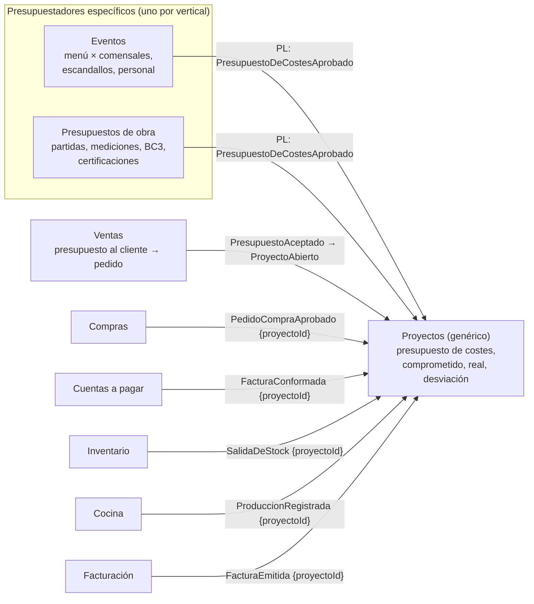
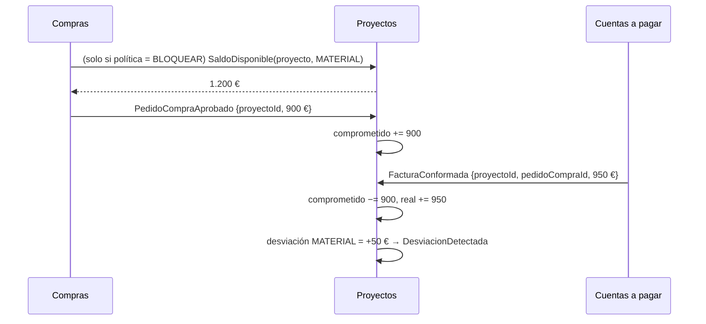

# Documentación del BC Proyectos (genérico: eventos, obras)

Pregunta de partida: *¿dónde van los presupuestos y la gestión de "eventos"/"obras", si se quiere algo genérico?*

Aplicación de `documentar-un-bounded-context.md`. Vecinos: `erp-bc-ventas.md`, `erp-bc-compras.md`, `erp-bc-facturacion.md`, `erp-bc-cuentas-a-pagar.md`. El caso obras (bases de precios, BC3, partidas) se esbozó en `bc-catalogo-generico.md`.

Las decisiones son **propuestas mías** apoyadas en las fuentes.

## Respuesta corta: genérico el control, específico el presupuestar

Lo mismo que con el catálogo: **sí se puede** tener un Proyectos genérico, pero solo si es **pequeño**. Lo genérico es **el control económico**: un contenedor al que se imputan costes e ingresos y que compara lo previsto con lo real. Lo que **no** es genérico es **cómo se construye el presupuesto**:

- **Evento** (hostelería, catering): menú × comensales, con costes de los escandallos, personal y alquileres.
- **Obra** (construcción): partidas con mediciones y precios descompuestos, importados de bases de precios en BC3, y certificaciones mensuales.

Si el BC Proyectos intenta modelar ambos con campos y reglas configurables, cae en el *inner-platform effect*: *"a system so customizable as to become a replica, and often a poor replica, of the software development platform"* ([Wikipedia](https://en.wikipedia.org/wiki/Inner-platform_effect)). Evans pide lo contrario para lo genérico: *"Leave no trace of your specialties in them"* ([DDD Reference](https://domainlanguage.com/wp-content/uploads/2016/05/DDD_Reference_2015-03.pdf)).

Los ERP generalistas lo hacen así:
- **Odoo**: con contabilidad analítica activada, *"every time a project gets created moving forward, a new Analytic Account will be created"*, *"allowing you to easily track the Cost and Revenue of any given project"* ([Hibou](https://hibou.io/docs/accounting-3/projects-analytic-accounting-111)).
- **ERPNext**: *"You can create a Budget against a Cost Center, Project, or supported Accounting Dimension"*, con control al hacer solicitud de material, pedido de compra o gasto real y tres acciones: *"Stop prevents submission"*, *"Warn informs the user but allows submission"*, *"Ignore"* ([ERPNext](https://docs.frappe.io/erpnext/budget)).

Ninguno de los dos mete la lógica de "partidas de obra" o "menú por comensal" en el proyecto: el proyecto es una **dimensión de imputación con presupuesto**.



## Tres "presupuestos" distintos (polisemia)

"Presupuesto" es otro polisema, como "producto" (Fowler, [BoundedContext](https://martinfowler.com/bliki/BoundedContext.html)). Separarlos evita la mayoría de confusiones:

| Término | Qué es | BC |
|---|---|---|
| **Presupuesto al cliente** (oferta) | Lo que se le cobrará: líneas con precio de venta, validez, aceptación | Ventas, como fase previa del pedido de venta |
| **Presupuesto de costes** | Lo que se prevé gastar, por capítulo y categoría | Proyectos (genérico) |
| **Presupuesto de obra** / **propuesta de evento** | El documento de trabajo con el que se calculan los dos anteriores (partidas, mediciones, menú, comensales) | Presupuestador del vertical |

El presupuesto al cliente como fase del pedido sigue el modelo de Odoo, donde confirmar *"will convert this sales quotation into a sales order"* ([Cybrosys](https://cybrosys.com/odoo/odoo-books/odoo-book-v16/sales/sales-quotations)). Ventas añade los estados `Borrador → Enviado → Aceptado / Rechazado / Caducado` antes del pedido.

En obra, el presupuestador produce **a la vez** el precio de venta (para Ventas) y el coste previsto (para Proyectos), porque el precio descompuesto es coste + márgenes. En evento pasa igual con menú y escandallos. Por eso el presupuestador es el que publica hacia los dos.

## README del BC Proyectos (propósito y límites)

**Propósito.** Que cada empresa sepa, para cada evento u obra, **cuánto preveía gastar e ingresar, cuánto lleva comprometido y gastado, y dónde se desvía**, a tiempo de reaccionar.

**Tipo de subdominio.** Genérico en el **mecanismo** (imputar y comparar). El valor diferencial está en los presupuestadores de cada vertical, que son core en su negocio (en obra, claramente).

**Qué NO hace.**

| No hace | Dónde vive |
|---|---|
| Calcular el presupuesto (partidas, mediciones, menú, escandallos) | Presupuestador del vertical (Eventos, Presupuestos de obra) |
| Presupuesto al cliente y su aceptación | Ventas |
| Comprar, mover stock, producir | Compras, Inventario, Cocina (solo **etiquetan** con `proyectoId`) |
| Facturar (por hitos o certificaciones) | Facturación (pide a Proyectos o al presupuestador qué toca facturar) |
| Planificación de tareas, Gantt, turnos de personal | Fuera de alcance (si hace falta, otro BC) |
| Contabilidad analítica completa | Contabilidad (Proyectos publica lo que imputa) |

**Dueño.** Equipo Plataforma (genérico, compartido por las verticales).

## Canvas del BC Proyectos

| Sección | Contenido |
|---|---|
| **Name** | Proyectos (en la UI: "Eventos" u "Obras" según el tenant) |
| **Purpose** | Control económico previsto vs. real de cada evento u obra. |
| **Strategic Classification** | Genérico (mecanismo) · ninguno de los tres papeles del canvas encaja del todo; el más cercano es *compliance enforcer* (protege el margen) · *product* (existe en Odoo, ERPNext) |
| **Domain Roles** | Análisis (agrega imputaciones) + regla de control (aviso o bloqueo por desviación) |
| **Inbound** | Ventas: `PresupuestoAceptado`. Presupuestadores: `PresupuestoDeCostesAprobado`, `PresupuestoDeCostesRevisado`. Compras, Cuentas a pagar, Inventario, Cocina, Facturación: eventos con `proyectoId`. Usuario: `AbrirProyecto`, `CerrarProyecto`, `ImputarManual` |
| **Outbound** | `ProyectoAbierto`, `ProyectoCerrado`, `DesviacionDetectada`. Consulta: `SaldoDisponible(proyectoId, categoria)` |
| **Ubiquitous Language** | Proyecto, Presupuesto de costes, Capítulo, Categoría de coste, Imputación, Comprometido, Real, Desviación, Revisión |
| **Business Decisions** | Ver "Reglas de negocio" |
| **Assumptions** | Toda vertical puede expresar su presupuesto como capítulos × categorías × importe. Basta con importes (no cantidades) para controlar. |
| **Verification Metrics** | Nº de campos o reglas "solo para obras" o "solo para eventos" que se piden en Proyectos (si crece, la frontera está mal) |
| **Open Questions** | Ver última sección |

## Glosario del BC Proyectos

```yaml
contexts:
  - name: Proyectos
    domainVisionStatement: Saber a tiempo si cada evento u obra va a ganar o perder dinero.
    terms:
      - name: Proyecto
        definition: Trabajo con principio y fin para un cliente (un evento, una obra) al que se imputan costes e ingresos.
        aliases: [evento, obra]
        examples:
          - "La boda del sábado es un proyecto; la reforma del local de la calle Mayor, otro."
      - name: Presupuesto de costes
        definition: Importes previstos por capítulo y categoría de coste. Lo aprueba el presupuestador del vertical. Se revisa, no se edita.
      - name: Capítulo
        definition: Agrupación del presupuesto que define el vertical (en obra, capítulos de partidas; en evento, cocina, sala, montaje…).
      - name: Categoría de coste
        definition: Lista cerrada común a todos los verticales - material, mano de obra, subcontrata, alquiler, otros.
      - name: Comprometido
        definition: Coste ya pedido pero no facturado ni consumido (pedidos de compra aprobados).
      - name: Real
        definition: Coste ya incurrido (facturas conformadas, consumos de stock, producción).
      - name: Desviación
        definition: Diferencia entre (comprometido + real) y lo presupuestado, por capítulo o categoría.
      - name: Revisión
        definition: Nueva versión aprobada del presupuesto de costes. La anterior se conserva.
```

La **lista cerrada de categorías** es lo que mantiene el BC genérico sin volverlo una plataforma configurable (la misma idea que la lista cerrada de tipos de atributo en `bc-catalogo-generico.md`).

## Modelo del BC Proyectos: agregados e invariantes

| Agregado / modelo | Contiene | Invariantes |
|---|---|---|
| `Proyecto` | Cliente, tipo (etiqueta: evento/obra), fechas, estado, política de control | No se imputa a un proyecto cerrado; cerrar exige no tener comprometido pendiente (o aceptarlo explícitamente) |
| `PresupuestoDeCostes` | `proyectoId`, número de revisión, líneas (capítulo, categoría, importe), ingresos previstos | Solo una revisión vigente; una revisión aprobada no se edita (se crea otra) |
| `Imputacion` (registro *append-only*) | `proyectoId`, origen (`pedidoCompraId`, `facturaRecibidaId`, `salidaId`…), categoría, capítulo?, importe, tipo (comprometido / real / ingreso) | Idempotente por origen; cuando llega el real de un comprometido, el comprometido se libera |
| `SituacionEconomica` (proyección) | Por proyecto × capítulo × categoría: previsto, comprometido, real, desviación | Se recalcula solo a partir de imputaciones y presupuesto |

**Comprometido y real a la vez.** Si solo se mira el real (facturas), la desviación se ve tarde; si solo el comprometido (pedidos), se pierde lo que se consume del almacén sin pedido. ERPNext controla en las tres fases (solicitud de material, pedido de compra, gasto real). Aquí se recogen las dos últimas: `PedidoCompraAprobado` suma comprometido; `FacturaConformada` lo pasa a real.

```php
<?php
declare(strict_types=1);

namespace Proyectos\Dominio;

enum CategoriaCoste: string
{
    case Material = 'MATERIAL';
    case ManoDeObra = 'MANO_DE_OBRA';
    case Subcontrata = 'SUBCONTRATA';
    case Alquiler = 'ALQUILER';
    case Otros = 'OTROS';
}

enum AccionAlSuperar: string   // ERPNext: Stop / Warn / Ignore
{
    case Bloquear = 'BLOQUEAR';
    case Avisar = 'AVISAR';
    case Ignorar = 'IGNORAR';
}

final class Proyecto extends AggregateRoot
{
    public function __construct(
        public readonly ProyectoId $id,
        public readonly OrgId $empresaId,
        public readonly string $tipo,               // etiqueta: 'evento' | 'obra' (sin lógica)
        private EstadoProyecto $estado,
        private AccionAlSuperar $accion = AccionAlSuperar::Avisar,
    ) {}

    public function aceptaImputaciones(): bool
    {
        return $this->estado !== EstadoProyecto::Cerrado;
    }

    public function evaluar(Desviacion $d): void
    {
        if ($d->superaPresupuesto() && $this->accion !== AccionAlSuperar::Ignorar) {
            $this->registrar(new DesviacionDetectada($this->id, $d->capitulo, $d->categoria, $d->importe));
        }
    }
}
```

`tipo` es solo una **etiqueta** para la UI y los informes: ninguna regla de Proyectos depende de si es evento u obra. Si aparece una regla que sí depende, va al presupuestador de ese vertical.

## Cómo imputan los demás BCs (sin conocer Proyectos)

Cada BC añade un `proyectoId` **opcional** a sus documentos y lo propaga en sus eventos. No conocen presupuestos ni desviaciones.

| BC | Dónde va `proyectoId` | Evento que lo lleva | Proyectos lo trata como |
|---|---|---|---|
| Compras | `PedidoCompra` o cada `LineaPedido` | `PedidoCompraAprobado`, `PedidoCompraCancelado` | Comprometido (+ / −) |
| Cuentas a pagar | Hereda del pedido; manual si no hay pedido | `FacturaConformada` | Real (libera comprometido) |
| Inventario | Salida de stock a proyecto | `SalidaDeStock` | Real (valorado a PMP/FIFO) |
| Cocina | Orden de producción para un evento | `ProduccionRegistrada` | Real |
| Facturación | Factura (o certificación) | `FacturaEmitida` | Ingreso real |

Con `AccionAlSuperar::Bloquear`, Compras necesita **preguntar antes de aprobar** (`SaldoDisponible`). Es una dependencia síncrona que se acepta solo para ese caso; con `Avisar` todo es asíncrono. Va como ADR.



## Contrato público del BC Proyectos

**Consume** (Published Language de entrada, igual para todos los verticales):

```yaml
asyncapi: 3.0.0
info:
  title: Proyectos — presupuesto de costes de entrada
  version: 1.0.0
  description: Formato común que cualquier presupuestador (eventos, obras…) publica.
channels:
  presupuestoDeCostesAprobado:
    address: proyectos.presupuesto-costes.aprobado
    messages:
      PresupuestoDeCostesAprobado:
        payload:
          type: object
          required: [proyectoId, revision, lineas, ingresosPrevistos, origen]
          properties:
            proyectoId: { type: string, format: uuid }
            revision: { type: integer }
            origen: { type: string, examples: [eventos, presupuestos-obra] }
            ingresosPrevistos: { type: string }
            lineas:
              type: array
              items:
                type: object
                required: [capitulo, categoria, importe]
                properties:
                  capitulo: { type: string, examples: ["01 Movimiento de tierras", "Cocina"] }
                  categoria: { type: string, enum: [MATERIAL, MANO_DE_OBRA, SUBCONTRATA, ALQUILER, OTROS] }
                  importe: { type: string }
operations:
  recibirPresupuestoDeCostes:
    action: receive
    channel: { $ref: '#/channels/presupuestoDeCostesAprobado' }
```

**Publica:** `ProyectoAbierto` (para que los demás BC ofrezcan el proyecto al imputar), `ProyectoCerrado` (dejan de ofrecerlo), `DesviacionDetectada` (notificaciones). **Consulta:** `SaldoDisponible`.

## Reglas de negocio del BC Proyectos (como tests)

```php
<?php
final class ImputacionTest extends TestCase
{
    public function test_un_pedido_aprobado_suma_comprometido(): void {}
    public function test_la_factura_conformada_libera_el_comprometido_de_su_pedido_y_suma_real(): void {}
    public function test_el_mismo_evento_imputado_dos_veces_cuenta_una(): void {}
    public function test_no_se_imputa_a_un_proyecto_cerrado(): void {}
    public function test_una_salida_de_stock_imputa_real_valorado_al_coste_del_almacen(): void {}
}

final class PresupuestoDeCostesTest extends TestCase
{
    public function test_una_revision_aprobada_no_se_edita(): void {}
    public function test_la_revision_nueva_sustituye_a_la_vigente_y_conserva_la_anterior(): void {}
    public function test_las_categorias_son_una_lista_cerrada(): void {}
}

final class DesviacionTest extends TestCase
{
    public function test_superar_lo_previsto_en_una_categoria_emite_desviacion_si_la_politica_avisa(): void {}
    public function test_con_politica_ignorar_no_se_emite_desviacion(): void {}
}
```

## ADRs del BC Proyectos

| ADR | Decisión | Consecuencia negativa aceptada |
|---|---|---|
| 0001 | Proyectos genérico solo controla (previsto vs. real); cada vertical tiene su presupuestador | Dos o más BCs presupuestadores que mantener |
| 0002 | Formato común de entrada `PresupuestoDeCostesAprobado` con categorías cerradas | Detalle fino del vertical (mediciones, comensales) no llega a Proyectos; los informes detallados se hacen en el presupuestador |
| 0003 | Los demás BCs solo añaden `proyectoId` opcional | Hay que tocar los eventos de Compras, Inventario, Cocina, Cuentas a pagar y Facturación |
| 0004 | Se registran comprometido y real | Hay que casar factura con pedido para liberar el comprometido |
| 0005 | Política BLOQUEAR implica consulta síncrona desde Compras | Compras depende en línea de Proyectos para esos proyectos |
| 0006 | Presupuesto al cliente en Ventas (fase previa del pedido), no en Proyectos | El proyecto se abre al aceptar; antes no hay control de costes |

## Preguntas abiertas del BC Proyectos

1. ¿La mano de obra propia (horas del personal en un evento o una obra) se imputa? Odoo lo hace con partes de horas; aquí no hay BC de personal todavía.
2. En obra, ¿las certificaciones las calcula el presupuestador (avance por partida) y Facturación solo emite? Es lo más coherente con el ADR 0001.
3. ¿Una línea de pedido puede repartirse entre varios proyectos (porcentajes)? Complica `Imputacion`; si no hace falta, mejor no.
4. ¿Un evento recurrente (menú del día de un comedor de empresa) es un proyecto o un centro de coste permanente? Si es permanente, puede que lo correcto sea contabilidad analítica, no Proyectos.
