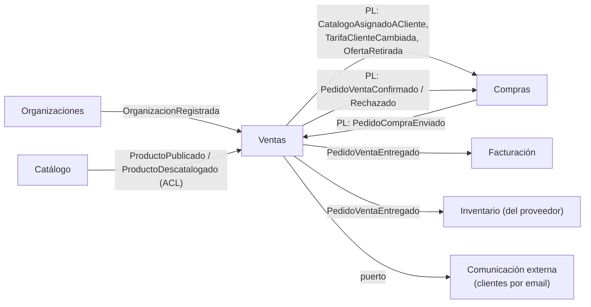
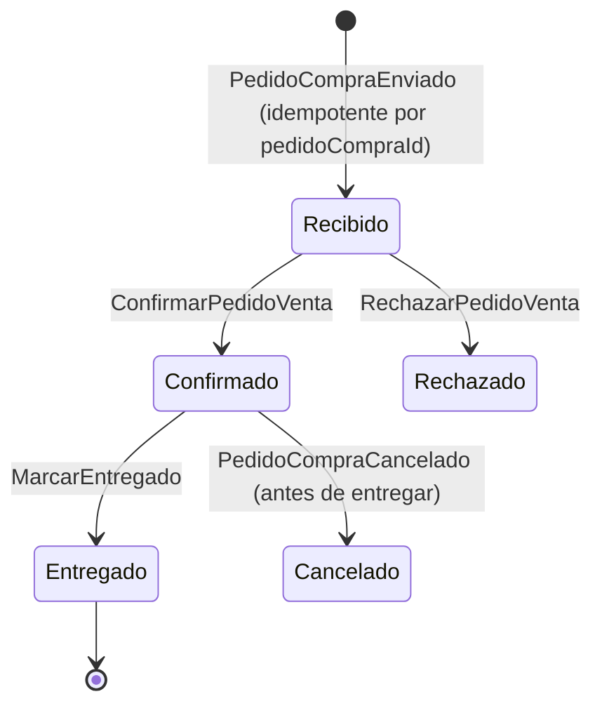

# Documentación del BC Ventas (lado proveedor)

Aplicación de `documentar-un-bounded-context.md` al contexto **Ventas** del ERP marketplace: lo que hace un **proveedor** para vender a sus clientes. Vecinos: `erp-bc-catalogo.md` (ficha descriptiva) y `erp-bc-compras.md` (el otro lado del pedido). Contexto general en `mapa-de-contextos-erp-marketplace.md`.

Las decisiones son **propuestas mías** apoyadas en las fuentes; las preguntas abiertas están al final.

## README del BC Ventas (propósito y límites)

**Propósito.** Que cada proveedor decida **qué vende, en qué formato, a quién y a qué precio**, y atienda los pedidos que le llegan (de clientes de la plataforma o de externos por email) hasta entregarlos.

**Tipo de subdominio.** **Core.** Las tarifas por cliente y los catálogos asignados son lo que diferencia el marketplace de un PDF de precios. OrderCloud lo modela así: el proveedor es dueño de catálogos y precios, y *"Suppliers can assign catalogs they own directly to buyers they have a relationship to"* ([OrderCloud](https://ordercloud.io/knowledge-base/products-pricing-ordering-in-marketplaces)).

**Qué NO hace.**

| No hace | Dónde vive |
|---|---|
| Describir el producto (GTIN, alérgenos, familia, imágenes) | Catálogo |
| Guardar el precio que paga el cliente para su pedido | Compras (copia en `ProductoComprable` y en la línea) |
| Stock del proveedor | Inventario del proveedor (si lo usa) |
| Emitir facturas (VeriFactu, e-factura) | Facturación |
| Enviar emails | Comunicación externa (puerto) |

**Dueño.** Equipo Marketplace (lado proveedor). Cambios en `CatalogoAsignadoACliente` o `TarifaClienteCambiada` afectan a Compras de todos los clientes: versión mayor del contrato.

**Relaciones.**



Compras ↔ Ventas es *Partnership + Published Language*: los dos equipos coordinan los cambios del contrato del pedido.

## Canvas del BC Ventas

| Sección | Contenido |
|---|---|
| **Name** | Ventas (a clientes) |
| **Purpose** | El proveedor gestiona su oferta comercial, las tarifas por cliente y los pedidos que recibe. |
| **Strategic Classification** | Core · *revenue generator* · evolución *custom built* |
| **Domain Roles** | Ejecución (flujo del pedido de venta) + publicación de condiciones comerciales |
| **Inbound** | Proveedor (UI): `CrearOferta`, `DefinirTarifa`, `AsignarCatalogoACliente`, `AltaClienteExterno`, `ConfirmarPedidoVenta`, `RechazarPedidoVenta`, `MarcarEntregado`. Compras: `PedidoCompraEnviado`. Catálogo: `ProductoPublicado`, `ProductoDescatalogado` |
| **Outbound** | `CatalogoAsignadoACliente`, `TarifaClienteCambiada`, `OfertaRetirada`, `PedidoVentaConfirmado`, `PedidoVentaRechazado`, `PedidoVentaEntregado` |
| **Ubiquitous Language** | Oferta, Formato de venta, Tarifa, Precio base, Asignación de catálogo, Cliente (de proveedor), Pedido de venta |
| **Business Decisions** | Ver "Reglas de negocio" |
| **Assumptions** | Un proveedor tiene pocas tarifas (decenas, no miles). El precio se fija por formato de venta, no por unidad de stock. Los clientes externos aceptan responder por enlace. |
| **Verification Metrics** | Pedidos de compra sin `PedidoVenta` creado tras X minutos (fallo de integración); nº de cambios de contrato con Compras por trimestre |
| **Open Questions** | Ver última sección |

## Glosario del BC Ventas

```yaml
contexts:
  - name: Ventas
    domainVisionStatement: Que cada proveedor decida qué vende, a quién y a qué precio, y atienda sus pedidos.
    terms:
      - name: Oferta
        definition: Lo que un proveedor vende de un producto del Catálogo en un formato concreto. Tiene precio base.
        examples:
          - "Tenemos el AOVE en oferta en garrafa de 5 l y en caja de 6 botellas."
      - name: Formato de venta
        definition: Cómo se vende y factura una oferta (caja de 6, garrafa, saco de 25 kg). No es una variante del Catálogo.
        aliases: [formato, presentación]
      - name: Tarifa
        definition: Lista de precios por oferta aplicable a un cliente o a un grupo de clientes, con vigencia.
        examples:
          - "A los hoteles del grupo Norte les aplicamos la tarifa Hoteles 2027."
        aliases: [lista de precios]
      - name: Precio base
        definition: Precio de la oferta cuando el cliente no tiene tarifa propia ni de grupo.
      - name: Asignación de catálogo
        definition: Qué ofertas puede ver y pedir un cliente concreto, y con qué tarifa.
        aliases: [catálogo asignado]
      - name: Cliente
        definition: Relación del proveedor con una empresa que le compra, de la plataforma o externa por email. No es la organización en sí.
      - name: Pedido de venta
        definition: Pedido recibido por el proveedor. Se crea a partir del pedido de compra del cliente y tiene su propio ciclo de vida.
```

"Cliente" aquí es la **relación** del proveedor con quien le compra (con condiciones propias), no la organización. Es el mismo patrón que `ProveedorDeCliente` en Compras (ver `flujo-anadir-producto-a-pedido.md`).

## Modelo del BC Ventas: agregados e invariantes

| Agregado | Contiene | Invariantes |
|---|---|---|
| `Oferta` | `productoId` (Catálogo), `varianteId?`, formato de venta, precio base, pedido mínimo, activa | Solo sobre productos publicados; una oferta por (producto, variante, formato) y proveedor |
| `Tarifa` | Destino (cliente o grupo), vigencia, precios por `ofertaId` | Sin solapes de vigencia para el mismo destino; precios > 0 en la moneda del proveedor |
| `ClienteDeProveedor` | Canal (plataforma u email), grupo, tarifa, ofertas asignadas | Una tarifa activa a la vez; solo se asignan ofertas activas |
| `PedidoVenta` | `pedidoCompraId`, cliente, líneas con precio copiado, estado | Se crea una vez por `pedidoCompraId` (idempotencia); solo `RECIBIDO` se confirma o rechaza; entregado no cambia |

Vernon: agregados pequeños y referencias por id (*"Reference other aggregates by identity"*, [Part II](https://www.dddcommunity.org/wp-content/uploads/files/pdf_articles/Vernon_2011_2.pdf)). Por eso `Tarifa` no está dentro de `Oferta`: cambian por motivos distintos y una tarifa abarca muchas ofertas.

**Resolución del precio** (regla de dominio, decisión mía): tarifa propia del cliente → tarifa de su grupo → precio base. OrderCloud permite precios distintos para el mismo producto según comprador o grupo ([Multiple prices](https://doc.sitecore.com/ordercloud/en/developers/platform/multiple-prices.html)); el orden de prioridad es mío.

```php
<?php
declare(strict_types=1);

namespace Ventas\Dominio;

/** Domain service: no pertenece a ningún agregado concreto */
final readonly class ResolverPrecio
{
    public function __construct(private TarifaRepository $tarifas) {}

    public function para(ClienteDeProveedor $cliente, Oferta $oferta, \DateTimeImmutable $en): Dinero
    {
        foreach ([$cliente->tarifaPropiaId(), $cliente->tarifaDeGrupoId()] as $tarifaId) {
            if ($tarifaId === null) {
                continue;
            }
            $precio = $this->tarifas->porId($tarifaId)?->precioDe($oferta->id, $en);
            if ($precio !== null) {
                return $precio;
            }
        }
        return $oferta->precioBase();
    }
}
```



## Contrato público del BC Ventas

| Evento | Cuándo | Payload mínimo | Consumidores |
|---|---|---|---|
| `CatalogoAsignadoACliente` | Se asigna o amplía el catálogo de un cliente | `proveedorOrgId, clienteOrgId, ofertas[{ofertaId, productoId, nombre, formato, factorAUnidad, precio, moneda}]` | Compras |
| `TarifaClienteCambiada` | Cambia un precio que afecta a un cliente | `clienteOrgId, ofertaId, precio, vigenteDesde, version` | Compras |
| `OfertaRetirada` | El proveedor deja de vender una oferta | `ofertaId, proveedorOrgId` | Compras |
| `PedidoVentaConfirmado` / `Rechazado` | El proveedor responde | `pedidoCompraId, pedidoVentaId, motivo?` | Compras |
| `PedidoVentaEntregado` | Mercancía entregada | `pedidoVentaId, lineas[]` | Facturación, Inventario del proveedor |

Decisión de contrato: `TarifaClienteCambiada` se emite **por cliente afectado**, no por tarifa. Así Compras no tiene que saber qué es un grupo ni cómo se resuelve el precio: recibe directamente "tu precio ahora es X". Es más mensajes, pero el lenguaje publicado es el de Compras y no filtra el modelo interno de Ventas (DDD Crew: *"Is the context exposing too much of its internals?"*).

```yaml
asyncapi: 3.0.0
info:
  title: Ventas — eventos publicados
  version: 1.0.0
channels:
  tarifaClienteCambiada:
    address: ventas.tarifa.cliente-cambiada
    messages:
      TarifaClienteCambiada:
        payload:
          type: object
          required: [proveedorOrgId, clienteOrgId, ofertaId, precio, moneda, vigenteDesde, version]
          properties:
            proveedorOrgId: { type: string, format: uuid }
            clienteOrgId: { type: string, format: uuid }
            ofertaId: { type: string, format: uuid }
            precio: { type: string, description: "Decimal como texto, por formato de venta" }
            moneda: { type: string, examples: [EUR] }
            vigenteDesde: { type: string, format: date }
            version: { type: integer }
operations:
  publicarTarifaClienteCambiada:
    action: send
    channel: { $ref: '#/channels/tarifaClienteCambiada' }
```

## Reglas de negocio del BC Ventas (como tests)

```php
<?php
final class ResolverPrecioTest extends TestCase
{
    public function test_la_tarifa_propia_del_cliente_manda_sobre_la_de_su_grupo(): void {}
    public function test_sin_tarifa_propia_ni_de_grupo_se_aplica_el_precio_base(): void {}
    public function test_una_tarifa_fuera_de_vigencia_no_se_aplica(): void {}
}

final class PedidoVentaTest extends TestCase
{
    public function test_el_mismo_pedido_de_compra_no_crea_dos_pedidos_de_venta(): void {}
    public function test_solo_se_confirma_un_pedido_recibido(): void {}
    public function test_un_pedido_entregado_no_se_puede_cancelar(): void {}
    public function test_cambiar_una_tarifa_no_cambia_pedidos_ya_recibidos(): void {}
}

final class OfertaTest extends TestCase
{
    public function test_no_se_crea_oferta_de_un_producto_no_publicado(): void {}
    public function test_al_descatalogar_el_producto_se_retiran_sus_ofertas(): void {}
}
```

## ADRs del BC Ventas

| ADR | Decisión | Consecuencia negativa aceptada |
|---|---|---|
| 0001 | Pedido de venta y pedido de compra son agregados distintos en BCs distintos, vinculados por `pedidoCompraId` | Dos estados que sincronizar por eventos; consistencia eventual |
| 0002 | Las condiciones comerciales se **publican** a Compras (réplica), no se consultan en síncrono al pedir | Compras puede ver un precio desactualizado unos segundos; se mitiga con `version` y con la confirmación del proveedor |
| 0003 | `TarifaClienteCambiada` se emite por cliente afectado, con el precio ya resuelto | Un cambio de tarifa de grupo genera N mensajes |
| 0004 | El precio se expresa por formato de venta; el factor a unidad base viaja en `CatalogoAsignadoACliente` | Compras debe convertir a unidad de stock con ese factor (ver `unidades-de-medida-compra-stock-cocina.md`) |
| 0005 | Los clientes externos responden por enlace con token (puerto de Comunicación externa) | Hay que gestionar caducidad y reenvío de enlaces |

## Preguntas abiertas del BC Ventas

1. ¿Descuentos por volumen o promociones? Si aparecen, ¿son parte de `Tarifa` o un agregado `Promocion` aparte?
2. ¿El proveedor puede **modificar** un pedido recibido (cantidad servida menor, sustitución de producto)? Cambia el contrato con Compras y el cotejo de facturas (`facturas-en-marketplace-b2b.md`).
3. Si un cliente también vende a otros por el marketplace (por ejemplo, cocina central → locales), actúa como proveedor aquí; ¿su `Oferta` debe vincularse a su `Articulo` de Inventario para descontar stock al entregar?
