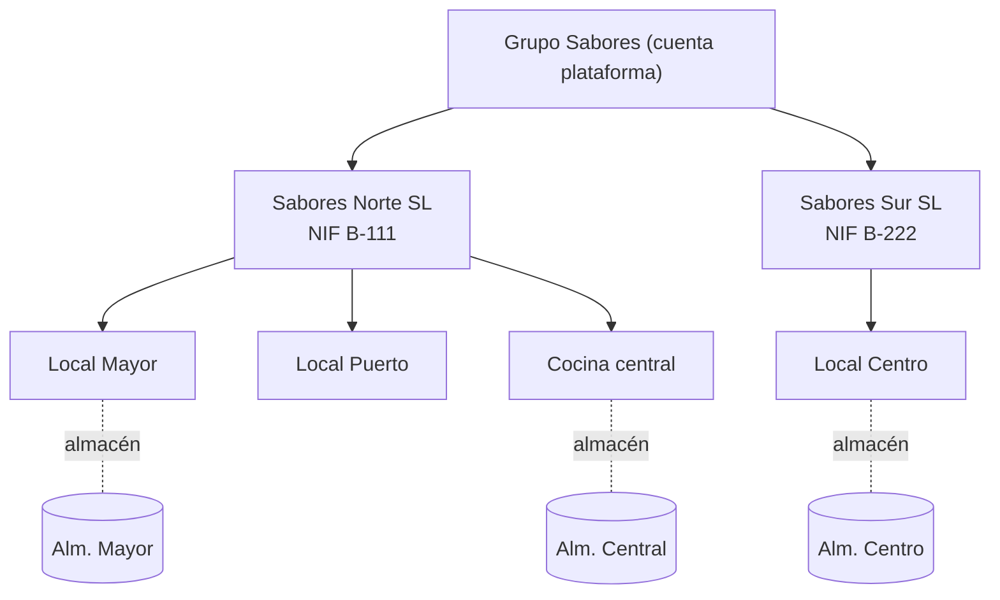
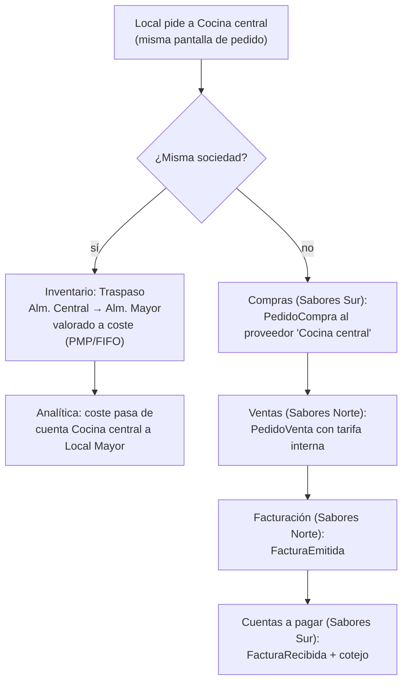

# Grupos de restaurantes: una o varias sociedades

Pregunta de partida: *¿cómo encaja un grupo de restaurantes en el modelo genérico? Puede ser una sociedad o varias, depende de cómo trabaje.*

Relacionadas: `erp-bc-analitica.md` (planes y cuentas), `erp-bc-compras.md`, `erp-bc-ventas.md`, `erp-bc-facturacion.md`, `erp-bc-cuentas-a-pagar.md`, `mapa-de-contextos-erp-marketplace.md` (BC Organizaciones).

Las decisiones son **propuestas mías**; las fuentes muestran cómo lo resuelven Odoo y ERPNext.

## Respuesta corta: dos jerarquías y una regla que decide sola

1. **Jerarquía legal** (BC Organizaciones): grupo → sociedades (NIF, quien factura) → locales.
2. **Jerarquía de gestión** (BC Analítica e Inventario): planes analíticos (Locales, Marcas, Departamentos, Eventos) y almacenes. Cada empresa la monta como quiera.
3. **Regla**: cuando un local pide a la cocina central, el sistema mira **si origen y destino son de la misma sociedad**:
   - misma sociedad → **traspaso** entre almacenes (Inventario), sin venta ni factura;
   - distinta sociedad → **venta intragrupo**: pedido de compra ↔ pedido de venta ↔ factura, el mismo flujo del marketplace.

El usuario no configura nada: la decisión sale de los **datos** (a qué sociedad pertenece cada local). Un restaurante independiente es el caso degenerado: un grupo con una sociedad y un local.

## Jerarquía legal: Organizaciones

| Concepto | Qué es | Ejemplo |
|---|---|---|
| **Grupo** | La cuenta de la plataforma; agrupa usuarios y permisos | Grupo Sabores |
| **Sociedad** | Entidad legal: NIF, series de facturación, VeriFactu, cuentas a pagar | Sabores Norte SL, Sabores Sur SL |
| **Local** (establecimiento) | Sitio físico donde se trabaja; pertenece a **una** sociedad; tiene uno o varios almacenes | Local Mayor, Local Puerto, Cocina central |

Facturación y Cuentas a pagar trabajan **por sociedad** (el emisor y el destinatario de una factura son sociedades, no locales). Inventario trabaja **por almacén**. Analítica trabaja **por cuenta**, que suele coincidir con local, marca o evento.



## Jerarquía de gestión: planes analíticos

Encima de la legal, cada grupo crea los planes que le sirvan (ver `erp-bc-analitica.md`). Odoo lo hace igual: los planes agrupan cuentas y un apunte se reparte entre ellas por porcentaje ([Odoo](https://www.odoo.com/documentation/latest/applications/finance/accounting/reporting/analytic_accounting.html)).

| Plan | Cuentas | Para qué |
|---|---|---|
| Locales | Mayor, Puerto, Centro, Cocina central | Cuenta de resultados por local (centro de coste: *"unidad organizativa interna de una empresa que consume recursos y genera gastos"*, [Hosteltur](https://www.hosteltur.com/hosteltur-responde/centro-costes)) |
| Marcas | Pizzería, Asador | Comparar conceptos que comparten locales o sociedades |
| Departamentos | Cocina, Sala, Administración | Food cost frente a coste de personal |
| Eventos | Boda García, Congreso X | Previsto vs. real por evento |

Los planes **no** dependen de las sociedades: la marca Asador puede tener un local en Sabores Norte y otro en Sabores Sur. Es justo lo que la jerarquía legal no puede responder.

## La regla: traspaso o venta intragrupo

Los ERP generalistas modelan las operaciones entre sociedades del mismo grupo con **documentos espejo**:
- Odoo: *"Purchase orders and sales orders can be related"* y *"the corresponding document is automatically created for your company"* ([Odoo 13](https://www.odoo.com/documentation/13.0/applications/inventory_and_mrp/purchase/replenishment/multicompany/setup.html)).
- ERPNext: *"Inter Company Invoices in ERPNext create the matching receivable and payable transactions"*; *"A submitted Sales Invoice can create a linked Purchase Invoice for the buying Company"*. Requiere un cliente y un proveedor que representen a la otra sociedad: *"The Customer and Supplier links are essential"* ([ERPNext](https://docs.frappe.io/erpnext/inter-company-invoices)).

En el marketplace eso ya existe: es el flujo `PedidoCompra` (Compras) ↔ `PedidoVenta` (Ventas) ↔ `FacturaEmitida` (Facturación) → `FacturaRecibida` (Cuentas a pagar). Una venta intragrupo es **ese mismo flujo** con proveedor y cliente del mismo grupo. Solo hace falta la rama "misma sociedad" para el traspaso.



```php
<?php
declare(strict_types=1);

namespace Compras\Aplicacion;

/**
 * Decide el camino de un pedido a un proveedor del propio grupo.
 * La regla depende de datos de Organizaciones, no de configuración.
 */
final readonly class EnrutarPedidoInterno
{
    public function __construct(
        private Organizaciones $organizaciones,     // puerto: réplica local de Organizaciones
        private SolicitarTraspaso $traspasos,        // puerto hacia Inventario
        private EnviarPedidoCompra $enviarPedido,    // flujo normal de Compras → Ventas
    ) {}

    public function __invoke(PedidoInterno $pedido): void
    {
        $origen = $this->organizaciones->local($pedido->localOrigenId);
        $destino = $this->organizaciones->local($pedido->localDestinoId);

        if ($origen->sociedadId->equals($destino->sociedadId)) {
            ($this->traspasos)($pedido->comoTraspaso($origen->almacenId, $destino->almacenId));
            return;
        }
        // Sociedades distintas: la cocina central es un ProveedorDeCliente con canal Plataforma
        ($this->enviarPedido)($pedido->comoPedidoCompra(proveedorOrgId: $origen->sociedadId));
    }
}
```

## Qué cambia en cada BC

| BC | Una sociedad | Varias sociedades |
|---|---|---|
| Organizaciones | Grupo → 1 sociedad → N locales | Grupo → N sociedades → N locales |
| Inventario | Traspasos entre almacenes a coste | Traspasos solo dentro de cada sociedad; entre sociedades, recepción normal |
| Compras / Ventas | Sin cambios | La sociedad proveedora (cocina central) aparece como proveedor de la otra, con **tarifa interna** |
| Facturación / Cuentas a pagar | No intervienen en suministros internos | Factura intragrupo emitida y recibida, con cotejo |
| Analítica | El traspaso mueve coste entre cuentas (Cocina central → Local) | Igual, más el margen de la venta interna en la cuenta de la cocina central |

**Compras centralizadas**: en ambos casos, una sociedad puede comprar para todos y repartir el coste con la distribución analítica (Locales 40 / 30 / 30). Si el reparto cruza sociedades, eso ya no es analítica sino una **refacturación** entre sociedades; Analítica no debe esconderlo.

## Riesgos y decisiones (ADRs propuestos)

| ADR | Decisión | Consecuencia negativa aceptada |
|---|---|---|
| 0001 | Separar jerarquía legal (Organizaciones) y de gestión (Analítica) | Dos árboles que mantener; el usuario debe entender la diferencia |
| 0002 | Traspaso vs. venta intragrupo se decide por datos (sociedad de origen y destino) | Mover un local de sociedad cambia el comportamiento de sus pedidos futuros (es lo correcto legalmente) |
| 0003 | La venta intragrupo reutiliza el flujo del marketplace (Compras ↔ Ventas ↔ Facturación ↔ Cuentas a pagar) | Más documentos que un simple traspaso; a cambio, cumple con la facturación entre sociedades |
| 0004 | La cocina central vende con una **tarifa interna** en Ventas | El margen interno infla los resultados por sociedad; los informes de grupo deben poder excluir operaciones intragrupo |
| 0005 | Un local pertenece a una sola sociedad | Si un local se explota a medias entre sociedades, hace falta modelarlo como dos locales o como refacturación |

El punto del ADR 0004 (excluir operaciones intragrupo al ver el grupo entero) es un tema de **consolidación contable**; conviene confirmarlo con la asesoría. En el ERP basta con marcar cada pedido y factura como `intragrupo = true` para poder filtrarlos.

## Preguntas abiertas

1. ¿El precio interno entre sociedades lo fija el grupo (tarifa interna única) o cada cocina central?
2. ¿Los usuarios de un local ven solo su sociedad o todo el grupo? Afecta a permisos en Organizaciones.
3. ¿Hay franquiciados? Un franquiciado es otra empresa **fuera** del grupo: le aplica el flujo del marketplace normal (cliente de plataforma), no el intragrupo.
