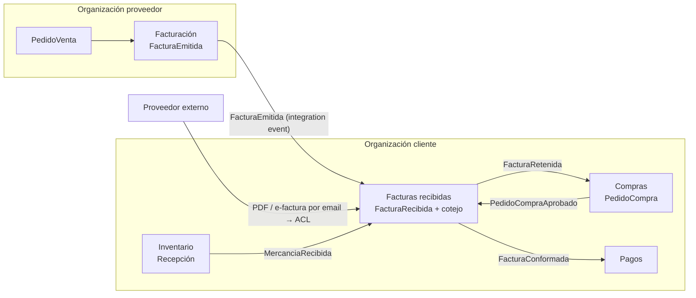
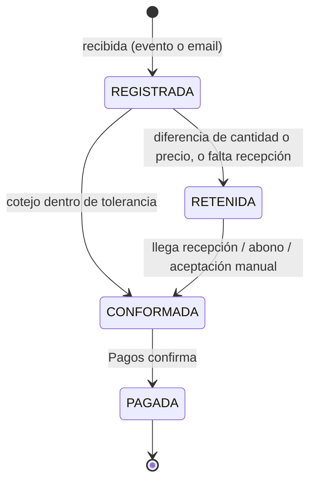

# Facturas en un marketplace B2B

Continúa `ddd/flujo-anadir-producto-a-pedido.md`, que trata Compras, Inventario y proveedores de plataforma o externos por email.

## Resumen

- La factura **no vive en Compras**. Es un documento propio, con su ciclo de vida y sus reglas legales, y emitirla y recibirla son cosas distintas.
- **Lado proveedor:** un BC **Facturación (emitidas)** genera la factura a partir del `PedidoVenta` o de lo entregado.
- **Lado cliente:** un BC **Facturas recibidas / Cuentas a pagar** registra la factura del proveedor y la **coteja** con el pedido y la recepción antes de aprobar el pago (*three-way match*).
- En el marketplace, la factura de un proveedor de plataforma llega por **integration event**. La de un proveedor externo llega por **email** y entra por una ACL.

Esta separación en contextos es criterio mío. Se apoya en la idea de Fowler de que un mismo concepto tiene modelos distintos según el contexto ([BoundedContext](https://martinfowler.com/bliki/BoundedContext.html)): una factura emitida y una factura recibida son la misma factura vista desde dos organizaciones.

## Cotejo a tres bandas (three-way match)

Tipalti lo define como *"comparing the purchase order, invoice, and goods receipt to make sure they match"* antes de aprobar la factura ([Tipalti](https://tipalti.com/en-eu/resources/learn/3-way-match/)):

| Documento | Dónde vive en nuestro modelo | Qué aporta |
|---|---|---|
| Pedido de compra | Compras (`PedidoCompra`) | Productos, cantidades y precios acordados |
| Recepción (albarán / GRN) | Inventario (`MercanciaRecibida`) | Cantidades realmente recibidas |
| Factura | Facturas recibidas (`FacturaRecibida`) | Lo que el proveedor cobra |

- **Tolerancias:** *"predetermined thresholds that define acceptable differences between documents"*, por ejemplo un 2–3 % del importe del pedido.
- **Discrepancias:** la factura fuera de tolerancia queda retenida (*on hold*) y no se paga hasta resolverlo.

Facturas recibidas **no consulta** Compras ni Inventario de forma síncrona. Mantiene una proyección local alimentada por `PedidoCompraAprobado` y `MercanciaRecibida`, siguiendo la misma regla de replicar datos que en la nota anterior.





## Código (TypeScript)

```ts
// BC Facturas recibidas
class FacturaRecibida extends AggregateRoot {
  private estado: "REGISTRADA" | "CONFORMADA" | "RETENIDA" | "PAGADA" = "REGISTRADA";
  constructor(readonly id: FacturaId, readonly clienteOrgId: OrgId,
              readonly proveedorId: ProveedorId, readonly numeroProveedor: string,
              readonly pedidoCompraId: PedidoId, readonly lineas: LineaFactura[],
              readonly origen: "PLATAFORMA" | "EMAIL") { super(); }

  // Las cantidades y precios esperados vienen de la proyección local (pedido + recepciones)
  cotejar(esperado: EsperadoPorPedido, tolerancia: Porcentaje) {
    if (this.estado !== "REGISTRADA" && this.estado !== "RETENIDA") return;
    const discrepancias = this.lineas.flatMap(l => {
      const e = esperado.linea(l.productoId);
      if (!e) return [`${l.productoId}: no está en el pedido`];
      const out: string[] = [];
      if (l.cantidad > e.cantidadRecibida) out.push(`${l.productoId}: facturado > recibido`);
      if (!l.precioUnitario.dentroDe(e.precioPedido, tolerancia)) out.push(`${l.productoId}: precio fuera de tolerancia`);
      return out;
    });
    if (discrepancias.length === 0) {
      this.estado = "CONFORMADA";
      this.registrar(new FacturaConformada(this.id, this.total()));
    } else {
      this.estado = "RETENIDA";
      this.registrar(new FacturaRetenida(this.id, discrepancias));
    }
  }
  total(): Dinero { return this.lineas.reduce((a, l) => a.mas(l.subtotal()), Dinero.cero("EUR")); }
}

// Dos puertas de entrada, el mismo agregado
class AlEmitirFacturaEnPlataforma {          // proveedor de plataforma
  async handle(e: FacturaEmitidaIntegrationEvent) {
    // idempotente por (proveedorOrgId, numeroFactura)
  }
}
class RegistrarFacturaDesdeEmail {           // proveedor externo: ACL que traduce PDF/XML
  constructor(private lector: LectorFacturaExterna /* puerto: OCR o parser de e-factura */) {}
}
```

Una regla del modelo: una factura **emitida** no se edita. Integra Tecnología describe el requisito de *"Registros inmutables, huella (hash SHA-256) y QR en cada factura"* para el software de facturación. Por eso `FacturaEmitida` en Facturación es *append-only* y las correcciones van como un documento nuevo (rectificativa o abono). Que se modele así es decisión mía; la fuente solo describe el requisito.

## Normativa española que afecta al diseño (estado a 2026-10)

Según las dos fuentes, actualizadas en octubre de 2026 (confirmar con la gestoría y el BOE):

| Obligación | Fechas | Afecta a |
|---|---|---|
| **VeriFactu** (RD 1007/2023) | En el texto vigente: 1-1-2027 para sociedades y 1-7-2027 para el resto. Hacienda anunció un aplazamiento a octubre de 2028 que **aún no estaba en el BOE** | Facturación (emitidas): registro inmutable, hash, QR |
| **Factura electrónica B2B** (Ley 18/2022, RD 238/2026, Orden HAC/1028/2026) | Desde el 6-10-2026: 12 meses para >8 M€ (octubre de 2027) y 24 meses para el resto (octubre de 2028) | Emitidas y recibidas: formato estructurado, ya no un PDF por email |

Consecuencia para el marketplace (análisis mío): el canal "PDF por email" de los proveedores externos tiene fecha de caducidad. Si la ACL de entrada se diseña desde ya para aceptar factura electrónica estructurada, el cambio será solo un adaptador nuevo detrás del mismo puerto ([ports & adapters](https://herbertograca.com/2017/09/14/ports-adapters-architecture/)).
