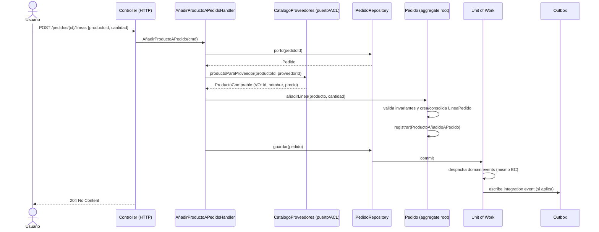
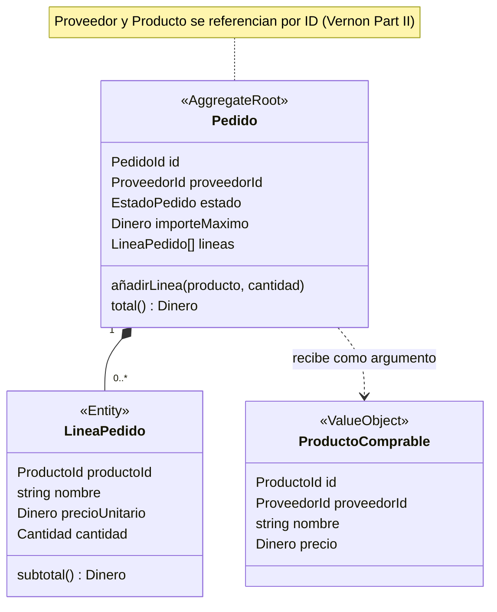
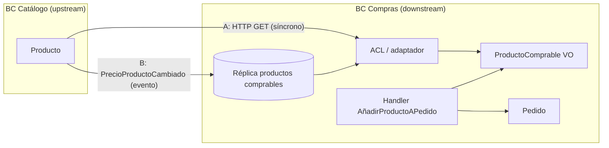
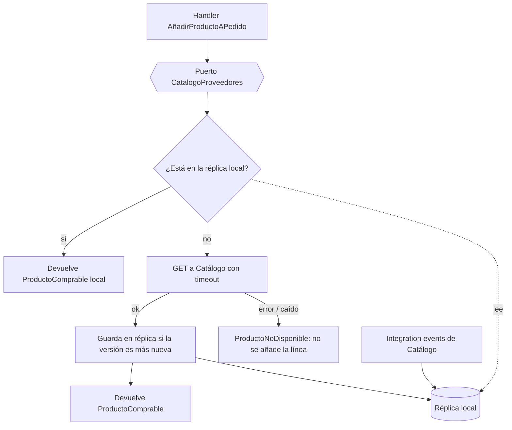
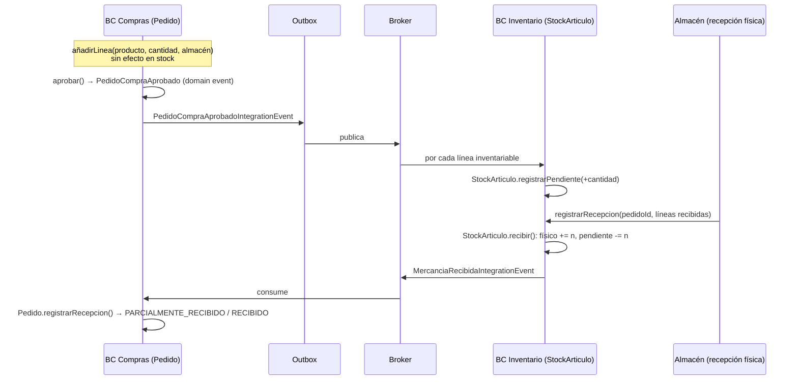
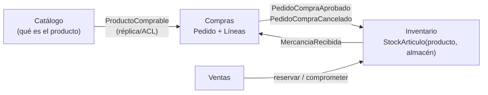
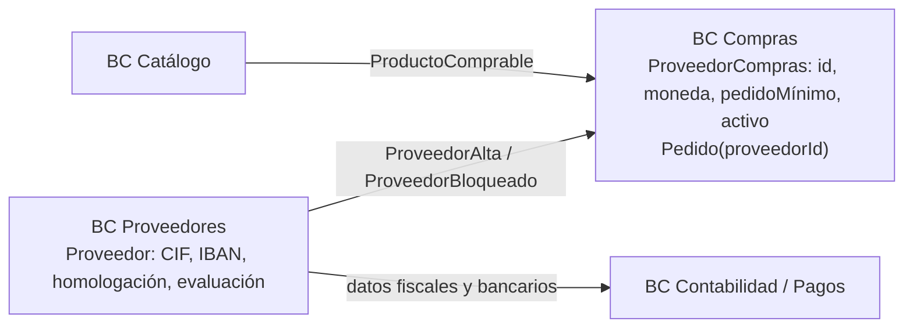
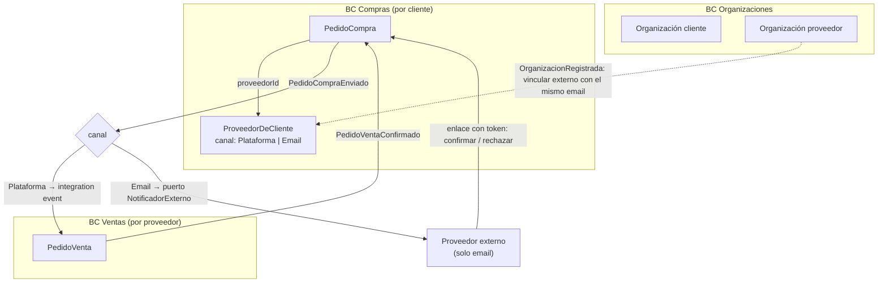
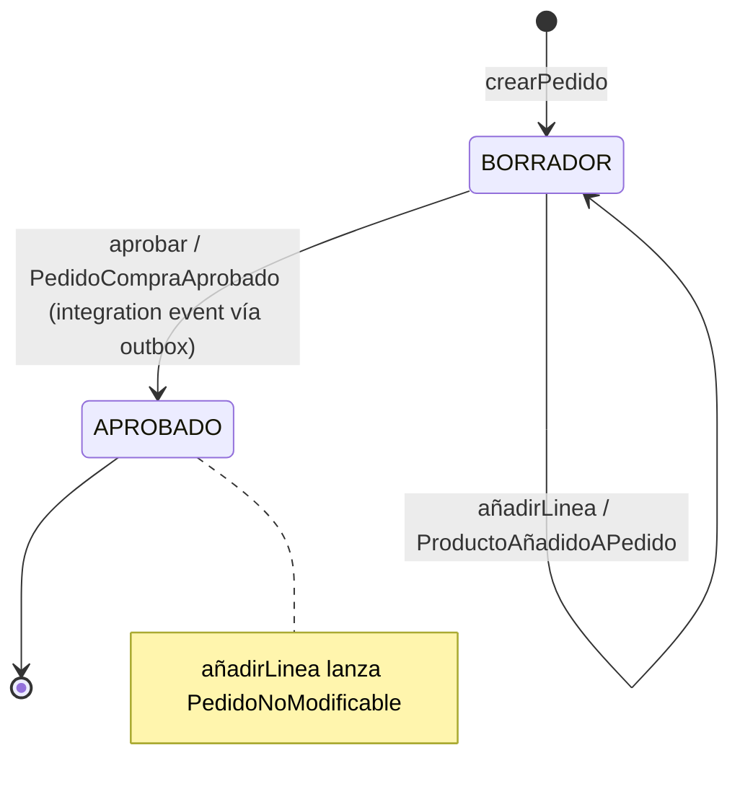

# Flujo táctico: añadir un producto a un pedido (BC Compras)

Lectura del caso: en el bounded context **Compras**, un usuario añade un producto de un proveedor a un **pedido de compra** en borrador. El producto "vive" en otro contexto (Catálogo). Notas relacionadas: `ddd/building-blocks-tacticos.md` y `ddd/comunicacion-entre-bounded-contexts.md`.

## Resumen del flujo

1. Llega un **comando** `AñadirProductoAPedido` (intención, en imperativo).
2. El **application service** (o command handler) orquesta: no tiene lógica de negocio ([Arkency](https://blog.arkency.com/application-service-ruby-rails-ddd/): *"Should the Application Service contain business logic? Nope"*).
3. Resuelve **antes** lo que el agregado necesita de fuera: los datos del producto vía un puerto hacia Catálogo. Vernon: *"Use a repository or domain service to look up dependent objects ahead of invoking the aggregate behavior"* ([Part II](https://www.dddcommunity.org/wp-content/uploads/files/pdf_articles/Vernon_2011_2.pdf)).
4. **Carga el agregado `Pedido`** con su repositorio.
5. Llama al **método de la raíz** `pedido.añadirLinea(...)`, que valida invariantes y crea la `LineaPedido`. Las líneas nunca se crean ni se modifican desde fuera ([Microsoft](https://learn.microsoft.com/en-us/dotnet/architecture/microservices/microservice-ddd-cqrs-patterns/net-core-microservice-domain-model)).
6. El agregado **registra un domain event** `ProductoAñadidoAPedido` (no lo despacha).
7. El application service **guarda** el agregado. El Unit of Work persiste y despacha los eventos. Si otro contexto lo necesita, se escribe un **integration event** en el outbox.



## Qué invariantes protege `Pedido`

Vernon define la invariante como *"a business rule that must always be consistent"* y el agregado como *"synonymous with transactional consistency boundary"* ([Part I](https://dddcommunity.org/wp-content/uploads/files/pdf_articles/Vernon_2011_1.pdf)). Su ejemplo canónico es justo de compras: *"A purchase order is assigned a maximum allowable total, and the sum of all line items must not surpass the total."* Por eso las líneas van **dentro** del agregado: la regla afecta a todas a la vez.

Reglas típicas al añadir una línea (las tres primeras salen de las fuentes; las demás son ejemplos de modelado):

| Regla | Origen |
|---|---|
| Suma de líneas ≤ importe máximo autorizado | Vernon Part I (purchase order) |
| Si el producto ya está en el pedido, se consolida en una línea con más unidades | Microsoft, `AddOrderItem` |
| Con descuentos distintos para el mismo producto, se aplica el mayor | Microsoft, `AddOrderItem` |
| Solo se modifica en estado `BORRADOR` (un pedido aprobado no cambia) | Ejemplo de modelado; análogo a la regla "no modificar tras aprobación" de [Alibaba Cloud](https://www.alibabacloud.com/blog/an-in-depth-understanding-of-aggregation-in-domain-driven-design_598034) |
| Cantidad > 0, misma moneda | Ejemplo de modelado (validación de VOs) |



## El producto viene de otro contexto: referencia por ID + snapshot

- **Referencia por identidad**: Vernon, *"Prefer references to external aggregates only by their globally unique identity, not by holding a direct object reference"* ([Part II](https://www.dddcommunity.org/wp-content/uploads/files/pdf_articles/Vernon_2011_2.pdf)). `Pedido` guarda `productoId` y `proveedorId`, nunca un objeto `Producto` de Catálogo.
- **Copia de nombre y precio en la línea**: en eShopOnContainers, `AddOrderItem(productId, productName, unitPrice, discount, pictureUrl, units)` recibe nombre y precio y los guarda en `OrderItem` ([Microsoft](https://learn.microsoft.com/en-us/dotnet/architecture/microservices/microservice-ddd-cqrs-patterns/net-core-microservice-domain-model)). El motivo, que es una inferencia mía porque las fuentes no lo dicen explícitamente: el precio pactado en el pedido no debe cambiar si Catálogo cambia el precio después.
- **Modelo propio de producto en Compras**: [Milan Jovanović](https://milanjovanovic.tech/blog/bounded-context-ddd-explained) muestra que Ordering tiene su propio `Product` con *"Just ProductId + Name + Price, not the full catalog"*, y que otro contexto mantiene sus datos de producto *"synced through events"* en vez de consultar la BD ajena.

Dos formas de obtener `ProductoComprable`:

| Opción | Cómo | Pro | Contra |
|---|---|---|---|
| **A. Consulta síncrona vía ACL** | Puerto `CatalogoProveedores` con adaptador HTTP que traduce el DTO de Catálogo a un VO de Compras | Dato fresco | Acoplamiento temporal: si Catálogo cae, no se puede añadir |
| **B. Réplica local** | Compras consume integration events (`PrecioProductoCambiado`…) y mantiene su tabla de productos comprables | Autonomía | Dato eventualmente consistente |



## Híbrido: primero réplica local, si no está, petición a Catálogo

Sí se puede combinar A y B. Es el patrón **Cache-Aside** aplicado a la réplica. Microsoft lo describe así: *"If the item isn't in the cache, also known as a cache miss, the application retrieves the item from the data store"* y después *"adds the item to the cache"* ([Cache-Aside pattern](https://learn.microsoft.com/en-us/azure/architecture/patterns/cache-aside)). Todo queda dentro del adaptador de infraestructura, detrás del mismo puerto `CatalogoProveedores`, así que ni el handler ni `Pedido` cambian.



```ts
// Infraestructura: misma interfaz, dos fuentes
class CatalogoProveedoresHibrido implements CatalogoProveedores {
  constructor(private replica: ReplicaProductos, private remoto: CatalogoProveedoresHttp) {}

  async productoComprable(id: ProductoId, prov: ProveedorId) {
    const local = await this.replica.buscar(id, prov);
    if (local) return local.aProductoComprable();          // camino normal: sin red

    const remoto = await this.remoto.productoComprableConVersion(id, prov); // fallback síncrono
    if (!remoto) return null;
    // Solo escribe si es más nuevo: los eventos y el fallback escriben en la misma tabla
    await this.replica.guardarSiMasNuevo(remoto.producto, remoto.version);
    return remoto.producto;
  }
}
```

Pegas (las dos primeras salen de las fuentes; el resto es análisis mío):

- **El fallback solo cubre el *miss*, no el dato obsoleto.** Si la réplica tiene un precio viejo, no se llama a Catálogo. Microsoft: *"The Cache-Aside pattern doesn't guarantee consistency between the data store and the cache"*. El híbrido no da datos más frescos que B.
- **Reintroduce el acoplamiento síncrono en los misses.** Microsoft recomienda *"If possible, never depend on synchronous communication (request/response) between multiple microservices, not even for queries"* y, en su lugar, *"replicate or propagate that data (only the attributes you need)"* ([Communication in a microservice architecture](https://learn.microsoft.com/en-us/dotnet/architecture/microservices/architect-microservice-container-applications/communication-in-microservice-architecture)). Si Catálogo está caído y hay miss, falla igual que con A.
- **Dos escritores en la réplica.** Los eventos y el fallback escriben en la misma tabla, así que hace falta una versión o un timestamp del upstream para no pisar un dato nuevo con uno viejo.
- **Dos traducciones.** La ACL HTTP y el consumidor de eventos deben producir el mismo `ProductoComprable`. Lo mejor es centralizar el mapeo.

Cuándo sí compensa: mientras la réplica se está cargando por primera vez (la carga inicial *"can take some time"*, [Koenighotze](https://dev.to/koenighotze/dealing-with-data-in-microservice-architectures-part-3-replication-4h7b)) o cuando un producto recién creado aún no ha llegado por eventos. Si los misses son frecuentes en régimen normal, el problema está en la replicación y el fallback lo esconde.

## Producto inventariable: qué cambia cuando hay stock

Resumen: **añadir un producto inventariable al pedido de compra no toca el stock.** Lo que se pide es mercancía "en camino". SKU.io lo describe así: *"Until you receive it, ordered stock is only incoming inventory (units you expect but don't yet have)"*. El stock físico solo sube al recibir: *"Raises your on-hand inventory for those products"* ([SKU.io, Receive stock against a PO](https://docs.sku.io/guides/orders/purchase-orders/receive-stock-against-a-po)).

### Quién es dueño del stock

El stock pertenece a otro bounded context, **Inventario**, no a Compras ni a Catálogo. En el ejemplo de [Milan Jovanović](https://milanjovanovic.tech/blog/bounded-context-ddd-explained), `QuantityInStock` y `WarehouseLocation` están en el `Product` de Fulfillment, no en Ordering. En el tutorial modular de [ABP](https://abp.io/docs/latest/tutorials/modular-crm/part-07?UI=MVC), Ordering nunca toca `StockCount`. Publica `OrderPlacedEto` y el módulo dueño del producto lo descuenta en su handler.

Granularidad del agregado: Salesforce modela el inventario como *"A quantity for a SKU at a particular location"*, con concurrencia optimista (*"use an optimistic concurrency approach to avoid row locking"*) ([Salesforce Engineering](https://engineering.salesforce.com/event-sourcing-for-an-inventory-availability-solution-3cc0daf5a742)). Así, el agregado `StockArticulo` se identifica por **(productoId, almacenId)** y es pequeño, como pide Vernon.

Cantidades que maneja Inventario (vocabulario de JD Edwards, [Oracle](https://docs.oracle.com/en/applications/jd-edwards/supply-chain-manufacturing/9.2/eoaim/item-availability.html)):

| Cantidad | Definición en la fuente | Quién la cambia |
|---|---|---|
| **Físico** (*on hand*) | *"units that are physically in stock"* | Recepciones, salidas, ajustes |
| **Pendiente de recibir** (*on PO / incoming*) | *"units specified on the purchase order"* | Compras (aprobación del pedido) y recepción |
| **Comprometido** (*committed*) | Cantidades *"committed to sales orders and work orders"* | Ventas / producción, **no Compras** |
| **Disponible** | *"on-hand quantity minus commitments, reservations, and backorders"* | Calculado |

Las **reservas** vienen del lado de la demanda (ventas, órdenes de trabajo), no de las compras. Un pedido de compra nunca "reserva" stock.

### Qué cambia en Compras

- La línea necesita un **almacén de destino** (el stock es por SKU y ubicación) y la **unidad de medida**. Que `ProductoComprable` indique `inventariable: boolean` y que las líneas inventariables exijan almacén son decisiones de modelado mías, no de las fuentes.
- `Pedido` gana estados de recepción: SKU.io usa *"Partially received"* y cierra el pedido cuando todas las líneas están recibidas.
- `añadirLinea` sigue siendo una operación **solo de Compras**: no consulta ni modifica Inventario.





### Eventos

| Evento | Tipo | Emite | Efecto |
|---|---|---|---|
| `ProductoAñadidoAPedido` | Domain | `Pedido` | Solo dentro de Compras |
| `PedidoCompraAprobado` | Domain → Integration (outbox) | Compras | Inventario suma *pendiente de recibir* |
| `PedidoCompraCancelado` | Integration | Compras | Inventario resta *pendiente* (compensación, decisión mía) |
| `MercanciaRecibida` | Integration | Inventario | Compras marca líneas recibidas |
| `StockIncrementado` / `StockActualizado` | Domain (+ integration si Ventas lo necesita) | `StockArticulo` | Proyecciones de disponibilidad |

### ¿Dónde vive el Proveedor? ¿Dentro de Compras?

Depende de cuánto modelo tenga el proveedor fuera de la compra. Las fuentes no dan una regla para proveedores en concreto, pero sí el principio:

- El mismo término puede tener modelos distintos según el contexto. Fowler: *"Different contexts may have completely different models of common concepts"*, con *"mechanisms to map between these polysemic concepts for integration"* ([BoundedContext](https://martinfowler.com/bliki/BoundedContext.html)).
- Patrón análogo en eShopOnContainers: el `User` de Identity se replica en Ordering como `Buyer`, que *"shares the same identity with the original User entity, but it might have only the few attributes needed by the Ordering domain"* ([Microsoft](https://learn.microsoft.com/en-us/dotnet/architecture/microservices/architect-microservice-container-applications/communication-in-microservice-architecture)).
- No conviene compartir una entidad única entre contextos: *"Synchronize data through events, not shared objects"* ([dev.to, Modeling shared entities](https://dev.to/aws-builders/modeling-shared-entities-across-bounded-contexts-in-domain-driven-design-5hih)).

Dos opciones (criterio mío, apoyado en lo anterior):

| Opción | Cuándo | Cómo |
|---|---|---|
| **Proveedor como agregado dentro de Compras** | El proveedor solo importa para comprar (nombre, condiciones, activo/bloqueado) | Agregado `Proveedor` con su repositorio en Compras; `Pedido` lo referencia por `proveedorId` |
| **BC Proveedores (o datos maestros) upstream** | Hay alta y homologación, datos fiscales y bancarios, evaluación, y lo usan también Contabilidad o Pagos | Proveedores es dueño del ciclo de vida y publica `ProveedorAlta`, `ProveedorBloqueado`…; Compras guarda su propio `ProveedorCompras` con el mismo id y solo lo que necesita (moneda, pedido mínimo, plazo de entrega, activo) |

En ambos casos `Pedido` guarda **solo `proveedorId`** (Vernon Part II), y reglas como "no se puede pedir a un proveedor bloqueado" se resuelven en el handler antes de llamar al agregado, igual que con `ProductoComprable`.



```ts
// Compras: su propio modelo del proveedor (mismo id que en Proveedores)
class ProveedorCompras {
  constructor(readonly id: ProveedorId, readonly moneda: Moneda,
              readonly pedidoMinimo: Dinero, private activo: boolean) {}
  puedeRecibirPedidos() { return this.activo; }
  bloquear() { this.activo = false; }
}

// Handler en Compras que consume el evento de integración de Proveedores
class AlBloquearProveedor {
  constructor(private proveedores: ProveedorComprasRepository) {}
  async handle(e: ProveedorBloqueadoIntegrationEvent) {
    const p = await this.proveedores.porId(e.proveedorId);
    p?.bloquear();
    if (p) await this.proveedores.guardar(p);
  }
}
```

## Caso marketplace: clientes y proveedores en la plataforma + externos por email

Escenario: el ERP es un marketplace B2B entre clientes y proveedores. Cada cliente puede dar de alta proveedores **externos** que no tienen cuenta y se comunican por email, y cada proveedor puede hacer lo mismo con clientes externos.

Referencias:
- OrderCloud modela un *Marketplace* como contenedor superior (*"data is not meant to be shared between multiple Marketplaces"*). Compradores y proveedores son *Companies*, *"unique entities within OrderCloud that transact and manage relationships with one another"* ([OrderCloud, Building blocks](https://ordercloud.io/learn/ordercloud-basics/building-blocks)).
- Ports & adapters (Cockburn, citado por [Herberto Graça](https://herbertograca.com/2017/09/14/ports-adapters-architecture/)): *"The application should have no knowledge of who/what is sending input or receiving its output"*. Para un puerto de email: *"the interface method signatures should be created according to what the Application Core needs"*.

### Modelo propuesto (decisiones mías sobre esas bases)

1. **Organizaciones (o Directorio)** es un BC aparte: empresas registradas en la plataforma, sus usuarios y sus permisos. No sabe nada de pedidos.
2. En **Compras**, el proveedor es la **relación del cliente con ese proveedor** y no la empresa en sí. Cada cliente tiene su agenda: `ProveedorDeCliente(clienteOrgId, id, condiciones, canal)`. El mismo proveedor real puede figurar en las agendas de muchos clientes con condiciones distintas. Así que sí: la agenda de proveedores vive en Compras.
3. El **canal** es un value object: `Plataforma(proveedorOrgId)` o `Email(dirección)`. Un externo solo existe en la agenda del cliente que lo creó.
4. **Un pedido, dos agregados.** El cliente tiene su `PedidoCompra` en Compras. Si el proveedor está en la plataforma, tiene su `PedidoVenta` en su BC Ventas, con su propio ciclo de vida y vinculado por id. No se comparte un único `Pedido` entre dos organizaciones (polisemia, Fowler).
5. **`Pedido` no conoce el canal.** `añadirLinea` es igual en los dos casos. El canal solo importa al **enviar**.



```ts
// Compras: canal como value object (unión discriminada)
type CanalProveedor =
  | { tipo: "PLATAFORMA"; proveedorOrgId: OrgId }
  | { tipo: "EMAIL"; email: Email };

class ProveedorDeCliente extends AggregateRoot {
  constructor(readonly id: ProveedorId, readonly clienteOrgId: OrgId,
              readonly nombre: string, private canal: CanalProveedor) { super(); }
  get canalActual() { return this.canal; }
  // Cuando el externo se registra en la plataforma, se vincula sin perder el historial
  vincularAOrganizacion(orgId: OrgId) {
    if (this.canal.tipo === "PLATAFORMA") return;
    this.canal = { tipo: "PLATAFORMA", proveedorOrgId: orgId };
    this.registrar(new ProveedorVinculadoAPlataforma(this.id, orgId));
  }
}

// Puerto de salida: lo que necesita Compras, no lo que ofrece SMTP/SendGrid
interface NotificadorProveedorExterno {
  enviarPedido(destino: Email, pedido: ResumenPedido, enlaceRespuesta: URL): Promise<void>;
}

// Aplicación: reacciona a PedidoCompraEnviado y elige el canal
class EntregarPedidoAlProveedor {
  constructor(private proveedores: ProveedorDeClienteRepository,
              private outbox: Outbox,
              private notificador: NotificadorProveedorExterno,
              private tokens: TokensRespuesta) {}

  async handle(e: PedidoCompraEnviado) {
    const prov = await this.proveedores.porId(e.proveedorId);
    const canal = prov.canalActual;
    if (canal.tipo === "PLATAFORMA") {
      // Ventas del proveedor crea su PedidoVenta (idempotente por pedidoCompraId)
      await this.outbox.añadir(new PedidoCompraRecibidoIntegrationEvent(
        e.pedidoId, e.clienteOrgId, canal.proveedorOrgId, e.lineas));
    } else {
      const enlace = await this.tokens.emitir(e.pedidoId, canal.email); // confirmar/rechazar sin cuenta
      await this.notificador.enviarPedido(canal.email, e.resumen, enlace);
    }
  }
}
```

Implicaciones para el flujo de "añadir producto":
- **Catálogo:** con un proveedor de la plataforma, `ProductoComprable` sale de su catálogo publicado (réplica o ACL, como antes). Con un externo no hay catálogo, así que el cliente crea **productos propios** en su agenda (referencia, descripción y precio acordado). El puerto `CatalogoProveedores` tiene entonces dos implementaciones según el canal.
- **Inventario:** no cambia. El stock del cliente sube al recibir la mercancía, sea cual sea el canal.
- **Respuestas del externo:** un enlace con token de un solo uso es más robusto que interpretar respuestas de email. Las fuentes no lo cubren; es una recomendación mía.

## Código (TypeScript)

```ts
// ---------- BC Inventario ----------
class StockArticulo extends AggregateRoot {        // id = (productoId, almacenId)
  private procesados = new Set<string>();          // idempotencia por mensaje
  constructor(readonly productoId: ProductoId, readonly almacenId: AlmacenId,
              private fisico = 0, private pendiente = 0, private reservado = 0,
              public version = 0) { super(); }

  disponible() { return this.fisico - this.reservado; }   // on hand − reservations

  registrarPendiente(cantidad: number, refPedido: string) {
    if (this.procesados.has(refPedido)) return;    // el broker puede entregar dos veces
    this.pendiente += cantidad;
    this.procesados.add(refPedido);
  }

  recibir(cantidad: number, refRecepcion: string) {
    if (cantidad <= 0) throw new CantidadInvalida(cantidad);
    if (this.procesados.has(refRecepcion)) return;
    this.fisico += cantidad;
    this.pendiente = Math.max(0, this.pendiente - cantidad); // puede llegar más de lo pedido
    this.procesados.add(refRecepcion);
    this.registrar(new StockIncrementado(this.productoId, this.almacenId, cantidad, this.fisico));
  }

  reservar(cantidad: number, refDemanda: string) {           // lo llama Ventas, no Compras
    if (cantidad > this.disponible()) throw new StockInsuficiente(this.productoId);
    this.reservado += cantidad;
    this.procesados.add(refDemanda);
  }
}

// Inventario reacciona al evento de integración de Compras (vía ACL/traductor)
class RegistrarPendienteAlAprobarPedido {
  constructor(private stock: StockArticuloRepository, private uow: UnitOfWork) {}
  async handle(e: PedidoCompraAprobadoIntegrationEvent) {
    for (const l of e.lineas.filter(l => l.inventariable)) {
      const s = await this.stock.porProductoYAlmacen(l.productoId, l.almacenId);
      s.registrarPendiente(l.cantidad, `${e.pedidoId}:${l.lineaId}`);
      await this.uow.guardar([s]);   // un agregado por transacción; reintento si choca la versión
    }
  }
}

// ---------- BC Compras ----------
class Pedido extends AggregateRoot {
  // ...añadirLinea como antes, con almacenId en la línea
  registrarRecepcion(lineaId: LineaId, cantidad: number) {
    if (this.estado !== "APROBADO" && this.estado !== "PARCIALMENTE_RECIBIDO")
      throw new PedidoNoRecibible(this.id);
    this.linea(lineaId).sumarRecibido(cantidad);
    this.estado = this.lineas.every(l => l.completa()) ? "RECIBIDO" : "PARCIALMENTE_RECIBIDO";
  }
}
```

Notas sobre el código:
- **Idempotencia:** Milan Jovanović avisa de que la entrega puede repetirse y el alta debe ser idempotente con una clave de origen única. Aquí la clave es `pedidoId:lineaId` o el id de la recepción.
- **Un agregado por transacción:** cada `StockArticulo` se guarda por separado (Vernon Part II). Si una línea falla, se reintenta sin deshacer las demás.
- **Dónde vive la recepción física:** he puesto la entrada de mercancía en Inventario/Almacén porque es quien cuenta físicamente. Otra opción válida es un BC Recepción propio. Las fuentes no fijan esto.

## Código (TypeScript)

```ts
// ---------- Dominio (BC Compras) ----------
class ProductoComprable {               // VO: lo que Compras necesita saber de un producto
  constructor(readonly id: ProductoId, readonly proveedorId: ProveedorId,
              readonly nombre: string, readonly precio: Dinero) {}
}

class ProductoAñadidoAPedido implements DomainEvent {
  constructor(readonly pedidoId: PedidoId, readonly productoId: ProductoId,
              readonly cantidad: number, readonly ocurridoEn: Date) {}
}

class LineaPedido {                     // entidad interna: sin repositorio propio
  constructor(readonly productoId: ProductoId, readonly nombre: string,
              readonly precioUnitario: Dinero, private _cantidad: number) {}
  get cantidad() { return this._cantidad; }
  incrementar(n: number) { this._cantidad += n; }
  subtotal(): Dinero { return this.precioUnitario.por(this._cantidad); }
}

class Pedido extends AggregateRoot {
  private lineas: LineaPedido[] = [];
  constructor(readonly id: PedidoId, readonly proveedorId: ProveedorId,
              private estado: "BORRADOR" | "APROBADO",
              private importeMaximo: Dinero) { super(); }

  añadirLinea(producto: ProductoComprable, cantidad: number): void {
    if (this.estado !== "BORRADOR") throw new PedidoNoModificable(this.id);
    if (cantidad <= 0) throw new CantidadInvalida(cantidad);
    if (!producto.proveedorId.equals(this.proveedorId))
      throw new ProductoDeOtroProveedor(producto.id);

    const existente = this.lineas.find(l => l.productoId.equals(producto.id));
    const totalResultante = this.total().mas(producto.precio.por(cantidad));
    if (totalResultante.mayorQue(this.importeMaximo))      // invariante de Vernon
      throw new ImporteMaximoSuperado(this.id, this.importeMaximo);

    if (existente) existente.incrementar(cantidad);       // consolidar (Microsoft)
    else this.lineas.push(new LineaPedido(producto.id, producto.nombre, producto.precio, cantidad));

    this.registrar(new ProductoAñadidoAPedido(this.id, producto.id, cantidad, new Date()));
  }

  total(): Dinero {
    return this.lineas.reduce((acc, l) => acc.mas(l.subtotal()), Dinero.cero("EUR"));
  }
}

// Puerto de salida hacia Catálogo (lo implementa la infraestructura: ACL o réplica)
interface CatalogoProveedores {
  productoComprable(id: ProductoId, proveedorId: ProveedorId): Promise<ProductoComprable | null>;
}

// ---------- Aplicación ----------
class AñadirProductoAPedido {           // comando: datos, sin comportamiento
  constructor(readonly pedidoId: string, readonly productoId: string, readonly cantidad: number) {}
}

class AñadirProductoAPedidoHandler {
  constructor(private pedidos: PedidoRepository,
              private catalogo: CatalogoProveedores,
              private uow: UnitOfWork) {}

  async handle(cmd: AñadirProductoAPedido): Promise<void> {
    const pedido = await this.pedidos.porId(PedidoId.de(cmd.pedidoId));
    if (!pedido) throw new PedidoNoEncontrado(cmd.pedidoId);

    // Vernon: resolver dependencias ANTES de invocar el comportamiento del agregado
    const producto = await this.catalogo.productoComprable(
      ProductoId.de(cmd.productoId), pedido.proveedorId);
    if (!producto) throw new ProductoNoDisponible(cmd.productoId);

    pedido.añadirLinea(producto, cmd.cantidad);   // toda la lógica, dentro del agregado
    await this.uow.guardar([pedido]);             // un agregado por transacción
  }
}

// ---------- Infraestructura: ACL (opción A) ----------
class CatalogoProveedoresHttp implements CatalogoProveedores {
  constructor(private http: HttpClient) {}
  async productoComprable(id: ProductoId, prov: ProveedorId) {
    const dto = await this.http.get(`/catalogo/proveedores/${prov}/productos/${id}`);
    if (!dto || !dto.activo) return null;
    // traducción del modelo de Catálogo al lenguaje de Compras
    return new ProductoComprable(id, prov, dto.descripcionCorta, Dinero.de(dto.precioNeto, dto.moneda));
  }
}
```

Antipatrón: crear la línea en el handler y añadirla a la colección, por ejemplo `pedido.lineas.push(new LineaPedido(...))`. Microsoft: *"If you go around the aggregate root, the aggregate root cannot guarantee its invariants, its validity, or its consistency."*

## Qué pasa después: domain event vs. integration event

- `ProductoAñadidoAPedido` es un **domain event**: se despacha en memoria dentro de Compras (ver "Cómo se crea y se publica un Domain Event" en `building-blocks-tacticos.md`).
- Normalmente **no** hace falta publicar un integration event por cada línea. Otros contextos se suelen interesar por hitos como `PedidoCompraAprobado`, que se publica vía outbox. Esto es una recomendación de diseño mía, coherente con que los eventos de integración son un contrato entre contextos ([Milan Jovanović](https://milanjovanovic.tech/blog/bounded-context-ddd-explained): *"It's not a domain event (which is internal to a context)"*).
- Si añadir la línea debiera modificar **otro** agregado (p. ej. un `Presupuesto` de departamento), Vernon pide hacerlo en otra transacción vía evento: *"An aggregate command method publishes a domain event that is in time delivered to one or more asynchronous subscribers"*.



## Concurrencia: dos usuarios añadiendo a la vez

Vernon avisa: *"Any one addition is not permitted to exceed the limit, but concurrent additions by multiple users could collectively do so"* ([Part I](https://dddcommunity.org/wp-content/uploads/files/pdf_articles/Vernon_2011_1.pdf)). Por eso el agregado entero es la unidad de bloqueo: el repositorio guarda con **control optimista** (versión del `Pedido`). Si dos handlers cargan la versión 7 y ambos guardan, el segundo falla y se reintenta con el estado nuevo, donde la invariante del total se vuelve a evaluar. [Arkency](https://blog.arkency.com/application-service-ruby-rails-ddd/) también menciona cargar con lock cuando importan las ediciones concurrentes.

## Errores frecuentes

- Lógica en el handler (validar el límite fuera del agregado): el handler se convierte en transaction script.
- `LineaPedidoRepository`: las entidades internas no tienen repositorio propio; se guardan con la raíz.
- Guardar una referencia de objeto a `Producto` de Catálogo dentro de `Pedido`, en vez de su ID y un snapshot.
- Llamar a Catálogo desde dentro de `Pedido.añadirLinea`: el agregado no debe hacer I/O; los datos se resuelven antes (Vernon Part II).
- Modificar `Pedido` y otro agregado en la misma transacción "por comodidad".
