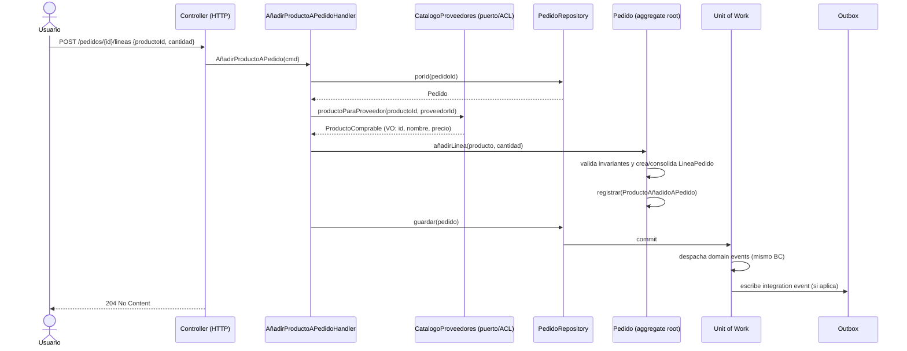
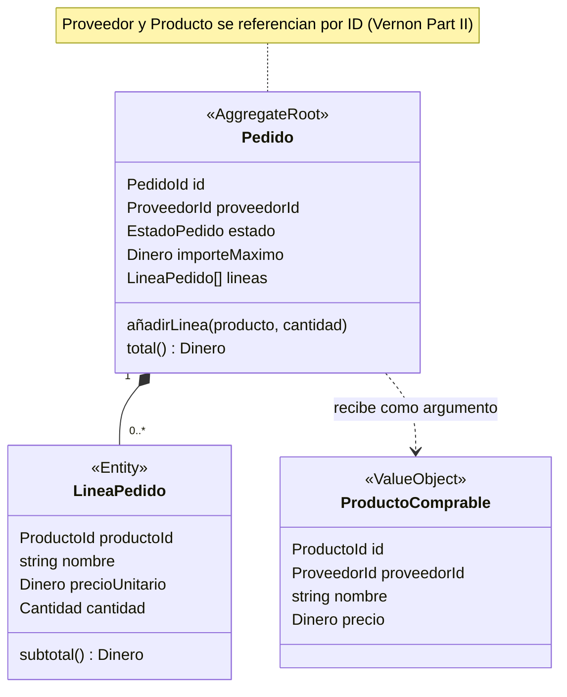
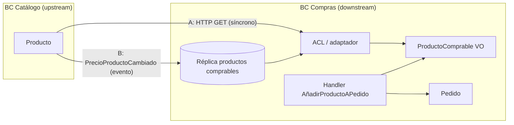
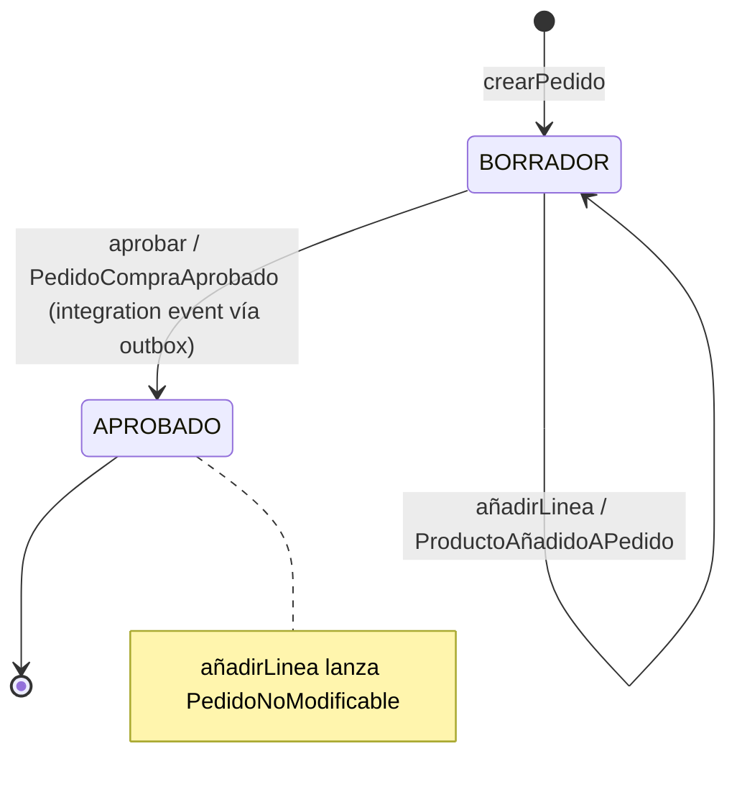

# Flujo táctico: añadir un producto a un pedido (BC Compras)

Lectura del caso: en el bounded context **Compras**, un usuario añade un producto de un proveedor a un **pedido de compra** en borrador. El producto "vive" en otro contexto (Catálogo). Notas relacionadas: `ddd/building-blocks-tacticos.md` y `ddd/comunicacion-entre-bounded-contexts.md`.

## Resumen del flujo

1. Llega un **comando** `AñadirProductoAPedido` (intención, en imperativo).
2. El **application service** (o command handler) orquesta: no tiene lógica de negocio ([Arkency](https://blog.arkency.com/application-service-ruby-rails-ddd/): *"Should the Application Service contain business logic? Nope"*).
3. Resuelve **antes** lo que el agregado necesita de fuera: los datos del producto vía un puerto hacia Catálogo. Vernon: *"Use a repository or domain service to look up dependent objects ahead of invoking the aggregate behavior"* ([Part II](https://www.dddcommunity.org/wp-content/uploads/files/pdf_articles/Vernon_2011_2.pdf)).
4. **Carga el agregado `Pedido`** con su repositorio.
5. Llama al **método de la raíz** `pedido.añadirLinea(...)`, que valida invariantes y crea la `LineaPedido`. Las líneas nunca se crean ni se modifican desde fuera ([Microsoft](https://learn.microsoft.com/en-us/dotnet/architecture/microservices/microservice-ddd-cqrs-patterns/net-core-microservice-domain-model)).
6. El agregado **registra un domain event** `ProductoAñadidoAPedido` (no lo despacha).
7. El application service **guarda** el agregado. El Unit of Work persiste y despacha los eventos. Si otro contexto lo necesita, se escribe un **integration event** en el outbox.



## Qué invariantes protege `Pedido`

Vernon define la invariante como *"a business rule that must always be consistent"* y el agregado como *"synonymous with transactional consistency boundary"* ([Part I](https://dddcommunity.org/wp-content/uploads/files/pdf_articles/Vernon_2011_1.pdf)). Su ejemplo canónico es justo de compras: *"A purchase order is assigned a maximum allowable total, and the sum of all line items must not surpass the total."* Por eso las líneas van **dentro** del agregado: la regla afecta a todas a la vez.

Reglas típicas al añadir una línea (las tres primeras salen de las fuentes; las demás son ejemplos de modelado):

| Regla | Origen |
|---|---|
| Suma de líneas ≤ importe máximo autorizado | Vernon Part I (purchase order) |
| Si el producto ya está en el pedido, se consolida en una línea con más unidades | Microsoft, `AddOrderItem` |
| Con descuentos distintos para el mismo producto, se aplica el mayor | Microsoft, `AddOrderItem` |
| Solo se modifica en estado `BORRADOR` (un pedido aprobado no cambia) | Ejemplo de modelado; análogo a la regla "no modificar tras aprobación" de [Alibaba Cloud](https://www.alibabacloud.com/blog/an-in-depth-understanding-of-aggregation-in-domain-driven-design_598034) |
| Cantidad > 0, misma moneda | Ejemplo de modelado (validación de VOs) |



## El producto viene de otro contexto: referencia por ID + snapshot

- **Referencia por identidad**: Vernon, *"Prefer references to external aggregates only by their globally unique identity, not by holding a direct object reference"* ([Part II](https://www.dddcommunity.org/wp-content/uploads/files/pdf_articles/Vernon_2011_2.pdf)). `Pedido` guarda `productoId` y `proveedorId`, nunca un objeto `Producto` de Catálogo.
- **Copia de nombre y precio en la línea**: en eShopOnContainers, `AddOrderItem(productId, productName, unitPrice, discount, pictureUrl, units)` recibe nombre y precio y los guarda en `OrderItem` ([Microsoft](https://learn.microsoft.com/en-us/dotnet/architecture/microservices/microservice-ddd-cqrs-patterns/net-core-microservice-domain-model)). El motivo, que es una inferencia mía porque las fuentes no lo dicen explícitamente: el precio pactado en el pedido no debe cambiar si Catálogo cambia el precio después.
- **Modelo propio de producto en Compras**: [Milan Jovanović](https://milanjovanovic.tech/blog/bounded-context-ddd-explained) muestra que Ordering tiene su propio `Product` con *"Just ProductId + Name + Price, not the full catalog"*, y que otro contexto mantiene sus datos de producto *"synced through events"* en vez de consultar la BD ajena.

Dos formas de obtener `ProductoComprable`:

| Opción | Cómo | Pro | Contra |
|---|---|---|---|
| **A. Consulta síncrona vía ACL** | Puerto `CatalogoProveedores` con adaptador HTTP que traduce el DTO de Catálogo a un VO de Compras | Dato fresco | Acoplamiento temporal: si Catálogo cae, no se puede añadir |
| **B. Réplica local** | Compras consume integration events (`PrecioProductoCambiado`…) y mantiene su tabla de productos comprables | Autonomía | Dato eventualmente consistente |



## Código (TypeScript)

```ts
// ---------- Dominio (BC Compras) ----------
class ProductoComprable {               // VO: lo que Compras necesita saber de un producto
  constructor(readonly id: ProductoId, readonly proveedorId: ProveedorId,
              readonly nombre: string, readonly precio: Dinero) {}
}

class ProductoAñadidoAPedido implements DomainEvent {
  constructor(readonly pedidoId: PedidoId, readonly productoId: ProductoId,
              readonly cantidad: number, readonly ocurridoEn: Date) {}
}

class LineaPedido {                     // entidad interna: sin repositorio propio
  constructor(readonly productoId: ProductoId, readonly nombre: string,
              readonly precioUnitario: Dinero, private _cantidad: number) {}
  get cantidad() { return this._cantidad; }
  incrementar(n: number) { this._cantidad += n; }
  subtotal(): Dinero { return this.precioUnitario.por(this._cantidad); }
}

class Pedido extends AggregateRoot {
  private lineas: LineaPedido[] = [];
  constructor(readonly id: PedidoId, readonly proveedorId: ProveedorId,
              private estado: "BORRADOR" | "APROBADO",
              private importeMaximo: Dinero) { super(); }

  añadirLinea(producto: ProductoComprable, cantidad: number): void {
    if (this.estado !== "BORRADOR") throw new PedidoNoModificable(this.id);
    if (cantidad <= 0) throw new CantidadInvalida(cantidad);
    if (!producto.proveedorId.equals(this.proveedorId))
      throw new ProductoDeOtroProveedor(producto.id);

    const existente = this.lineas.find(l => l.productoId.equals(producto.id));
    const totalResultante = this.total().mas(producto.precio.por(cantidad));
    if (totalResultante.mayorQue(this.importeMaximo))      // invariante de Vernon
      throw new ImporteMaximoSuperado(this.id, this.importeMaximo);

    if (existente) existente.incrementar(cantidad);       // consolidar (Microsoft)
    else this.lineas.push(new LineaPedido(producto.id, producto.nombre, producto.precio, cantidad));

    this.registrar(new ProductoAñadidoAPedido(this.id, producto.id, cantidad, new Date()));
  }

  total(): Dinero {
    return this.lineas.reduce((acc, l) => acc.mas(l.subtotal()), Dinero.cero("EUR"));
  }
}

// Puerto de salida hacia Catálogo (lo implementa la infraestructura: ACL o réplica)
interface CatalogoProveedores {
  productoComprable(id: ProductoId, proveedorId: ProveedorId): Promise<ProductoComprable | null>;
}

// ---------- Aplicación ----------
class AñadirProductoAPedido {           // comando: datos, sin comportamiento
  constructor(readonly pedidoId: string, readonly productoId: string, readonly cantidad: number) {}
}

class AñadirProductoAPedidoHandler {
  constructor(private pedidos: PedidoRepository,
              private catalogo: CatalogoProveedores,
              private uow: UnitOfWork) {}

  async handle(cmd: AñadirProductoAPedido): Promise<void> {
    const pedido = await this.pedidos.porId(PedidoId.de(cmd.pedidoId));
    if (!pedido) throw new PedidoNoEncontrado(cmd.pedidoId);

    // Vernon: resolver dependencias ANTES de invocar el comportamiento del agregado
    const producto = await this.catalogo.productoComprable(
      ProductoId.de(cmd.productoId), pedido.proveedorId);
    if (!producto) throw new ProductoNoDisponible(cmd.productoId);

    pedido.añadirLinea(producto, cmd.cantidad);   // toda la lógica, dentro del agregado
    await this.uow.guardar([pedido]);             // un agregado por transacción
  }
}

// ---------- Infraestructura: ACL (opción A) ----------
class CatalogoProveedoresHttp implements CatalogoProveedores {
  constructor(private http: HttpClient) {}
  async productoComprable(id: ProductoId, prov: ProveedorId) {
    const dto = await this.http.get(`/catalogo/proveedores/${prov}/productos/${id}`);
    if (!dto || !dto.activo) return null;
    // traducción del modelo de Catálogo al lenguaje de Compras
    return new ProductoComprable(id, prov, dto.descripcionCorta, Dinero.de(dto.precioNeto, dto.moneda));
  }
}
```

Antipatrón: crear la línea en el handler y añadirla a la colección, por ejemplo `pedido.lineas.push(new LineaPedido(...))`. Microsoft: *"If you go around the aggregate root, the aggregate root cannot guarantee its invariants, its validity, or its consistency."*

## Qué pasa después: domain event vs. integration event

- `ProductoAñadidoAPedido` es un **domain event**: se despacha en memoria dentro de Compras (ver "Cómo se crea y se publica un Domain Event" en `building-blocks-tacticos.md`).
- Normalmente **no** hace falta publicar un integration event por cada línea. Otros contextos se suelen interesar por hitos como `PedidoCompraAprobado`, que se publica vía outbox. Esto es una recomendación de diseño mía, coherente con que los eventos de integración son un contrato entre contextos ([Milan Jovanović](https://milanjovanovic.tech/blog/bounded-context-ddd-explained): *"It's not a domain event (which is internal to a context)"*).
- Si añadir la línea debiera modificar **otro** agregado (p. ej. un `Presupuesto` de departamento), Vernon pide hacerlo en otra transacción vía evento: *"An aggregate command method publishes a domain event that is in time delivered to one or more asynchronous subscribers"*.



## Concurrencia: dos usuarios añadiendo a la vez

Vernon avisa: *"Any one addition is not permitted to exceed the limit, but concurrent additions by multiple users could collectively do so"* ([Part I](https://dddcommunity.org/wp-content/uploads/files/pdf_articles/Vernon_2011_1.pdf)). Por eso el agregado entero es la unidad de bloqueo: el repositorio guarda con **control optimista** (versión del `Pedido`). Si dos handlers cargan la versión 7 y ambos guardan, el segundo falla y se reintenta con el estado nuevo, donde la invariante del total se vuelve a evaluar. [Arkency](https://blog.arkency.com/application-service-ruby-rails-ddd/) también menciona cargar con lock cuando importan las ediciones concurrentes.

## Errores frecuentes

- Lógica en el handler (validar el límite fuera del agregado): el handler se convierte en transaction script.
- `LineaPedidoRepository`: las entidades internas no tienen repositorio propio; se guardan con la raíz.
- Guardar una referencia de objeto a `Producto` de Catálogo dentro de `Pedido`, en vez de su ID y un snapshot.
- Llamar a Catálogo desde dentro de `Pedido.añadirLinea`: el agregado no debe hacer I/O; los datos se resuelven antes (Vernon Part II).
- Modificar `Pedido` y otro agregado en la misma transacción "por comodidad".
