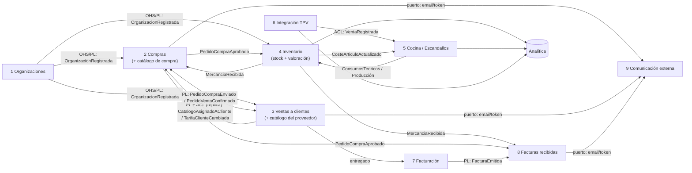
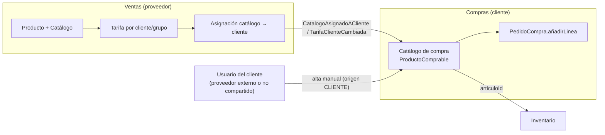

# Mapa de bounded contexts del ERP marketplace

Recoge lo tratado en [flujo de añadir producto a pedido](flujo-anadir-producto-a-pedido.md), [facturas en marketplace B2B](facturas-en-marketplace-b2b.md), [unidades de medida](unidades-de-medida-compra-stock-cocina.md) y [costes, escandallos y producción](costes-escandallos-produccion-pmp-fifo.md). Los patrones de relación (Customer/Supplier, ACL, OHS, Published Language, Partnership) están en [Comunicación entre bounded contexts](comunicacion-entre-bounded-contexts.md) y los building blocks (agregados, strongly-typed IDs, domain vs. integration events, outbox) en [DDD táctico: building blocks](building-blocks-tacticos.md).

> **Catálogo no es un bounded context propio.** Las notas anteriores hablan de un "BC Catálogo" upstream de Compras. Aquí ese catálogo se reparte en dos (ver [Catálogo: compartido por el proveedor o gestionado por el cliente](#catálogo-compartido-por-el-proveedor-o-gestionado-por-el-cliente)): el **catálogo del proveedor** vive en **Ventas a clientes** y el **catálogo de compra** (`ProductoComprable`) vive en **Compras**. Donde otra nota dice "Catálogo", léase "catálogo del proveedor, en Ventas".

> Es una **propuesta mía** a partir de esas notas, no algo que digan las fuentes. Las fuentes aportan los criterios: modelos distintos por contexto (Fowler), clasificación en core y genéricos (Evans) y no depender de llamadas síncronas (Microsoft).

## Contextos propuestos

| # | Bounded context | Qué contiene (lenguaje propio) | Tipo de subdominio |
|---|---|---|---|
| 1 | **Organizaciones** | Empresas de la plataforma, usuarios, permisos, política de valoración (PMP/FIFO) | Genérico |
| 2 | **Compras** (lado cliente) | `ProveedorDeCliente` (plataforma o externo), **catálogo de compra** (`ProductoComprable`, incluye productos de externos), `PedidoCompra`, líneas con copia de precio y factor | **Core** |
| 3 | **Ventas a clientes** (lado proveedor) | **Catálogo del proveedor** (productos, formatos, tarifas por cliente o grupo, asignación a clientes), `PedidoVenta`, agenda de clientes (incluidos externos), confirmación y entrega | **Core** |
| 4 | **Inventario** | Artículos del cliente, almacenes, `StockArticulo`, unidad de stock y equivalencias, recepciones, recuentos, mermas, traspasos, **valoración PMP/FIFO** | **Core** |
| 5 | **Cocina / Escandallos** | Recetas y sub-recetas, rendimientos, modo de descuento, explosión de ventas en consumos, órdenes de producción, coste teórico | **Core** |
| 6 | **Integración TPV** | Tickets de los TPV externos traducidos a `VentaRegistrada` | Genérico (ACL) |
| 7 | **Facturación** (emitidas) | Facturas del proveedor, rectificativas, VeriFactu y e-factura | Genérico (candidato a comprar) |
| 8 | **Facturas recibidas** | `FacturaRecibida`, cotejo a tres bandas, retenciones | De soporte |
| 9 | **Comunicación externa** | Envío de email a externos, enlaces con token, lectura de e-facturas entrantes | Genérico |
| — | **Analítica** (read models) | Food cost, teórico vs. real, varianzas | Proyecciones, no un modelo de dominio |

Evans: el core se destila (*"Boil the model down"*, *"Make the core small"*) y recibe el mejor talento. Para los genéricos: *"consider off-the-shelf solutions or published models"* y *"give their continuing development lower priority than the core domain"* ([DDD Reference](https://domainlanguage.com/wp-content/uploads/2016/05/DDD_Reference_2015-03.pdf)). En la práctica: Facturación (VeriFactu/e-factura), Comunicación e Integración TPV son buenos candidatos a librería o servicio externo detrás de un puerto.

## Context map



## Relaciones clave

| Relación | Patrón (ver [Comunicación entre bounded contexts](comunicacion-entre-bounded-contexts.md)) | Mecanismo |
|---|---|---|
| Compras ↔ Ventas (pedidos) | Partnership + Published Language si los dos contratos evolucionan y se despliegan juntos; si no, dos relaciones U→D independientes (cada uno upstream de su evento, PL + ACL en el consumidor). Ver [comunicación bidireccional](comunicacion-entre-bounded-contexts.md#puede-haber-comunicación-bidireccional-entre-bounded-contexts) | Integration events (outbox). Pedido de compra y pedido de venta son agregados distintos con id vinculado |
| Ventas (catálogo del proveedor) → Compras (catálogo de compra) | Customer/Supplier + ACL | `CatalogoAsignadoACliente`, `TarifaClienteCambiada` alimentan una réplica local (`ProductoComprable`), con fallback (cache-aside). Va en el mismo sentido que la relación de pedidos de Ventas a Compras |
| Compras → Inventario | Customer/Supplier | `PedidoCompraAprobado` (pendiente) y `MercanciaRecibida` (físico), con cantidades en las dos unidades |
| TPV → Cocina | ACL | Traduce el ticket de cada TPV a `VentaRegistrada` |
| Cocina ↔ Inventario | Customer/Supplier en ambos sentidos: dos relaciones U→D, no una simétrica ([opción 1 de comunicación bidireccional](comunicacion-entre-bounded-contexts.md#puede-haber-comunicación-bidireccional-entre-bounded-contexts)) | Cocina pide consumos y producciones; Inventario publica costes |
| Facturación → Facturas recibidas | Published Language | `FacturaEmitida` (plataforma) o e-factura por email (externos) |
| Organizaciones → resto | Open-host Service | Identidad y políticas por organización |

## Catálogo: compartido por el proveedor o gestionado por el cliente

Hay dos catálogos con dueños distintos, que encajan con la polisemia de Fowler: "producto" no significa lo mismo para quien vende que para quien compra.

**1. Catálogo del proveedor (lado venta).** OrderCloud lo modela así ([Products, pricing & ordering in marketplaces](https://ordercloud.io/knowledge-base/products-pricing-ordering-in-marketplaces)):
- el proveedor es dueño de productos, catálogos y tarifas;
- *"Suppliers can assign catalogs they own directly to buyers they have a relationship to"*;
- el mismo producto puede tener **tarifas distintas por comprador o por grupo** ([Multiple prices](https://doc.sitecore.com/ordercloud/en/developers/platform/multiple-prices.html)).

**2. Catálogo de compra del cliente (lado compra).** Es la lista de lo que *ese* cliente compra a *ese* proveedor: su referencia interna, el formato, el precio pactado y el artículo de inventario al que se vincula. Es el que usa `añadirLinea` (`ProductoComprable`). Es lo único que existe con proveedores **externos**. Este segundo catálogo es diseño mío; OrderCloud no lo cubre.

Relación (propuesta mía):
- Si el proveedor **comparte** su catálogo, cada producto compartido alimenta el catálogo de compra del cliente por eventos (`CatalogoAsignadoACliente`, `TarifaClienteCambiada`). La entrada queda con `origen = PROVEEDOR`.
- Si el cliente lo **gestiona** él (proveedor externo, o no compartido), la entrada tiene `origen = CLIENTE` y es editable.
- En las entradas sincronizadas, el **precio y el formato los manda el proveedor**. El cliente solo puede editar sus campos propios: referencia interna, artículo vinculado, almacén por defecto. Si negocia otro precio, eso es una **tarifa del proveedor para ese cliente** (tarifas por comprador), no una edición local. Así no hay dos verdades.
- Cuando un externo se registra en la plataforma, sus entradas pueden **vincularse** a sus productos y pasar a `origen = PROVEEDOR`.



```ts
// Compras: una entrada del catálogo de compra del cliente
type Origen = { tipo: "PROVEEDOR"; productoProveedorId: string; version: number } | { tipo: "CLIENTE" };

class ProductoComprable extends AggregateRoot {
  constructor(readonly id: ProductoComprableId, readonly clienteOrgId: OrgId,
              readonly proveedorId: ProveedorId, private origen: Origen,
              private nombre: string, private formato: FactorConversion, private precio: Dinero,
              private referenciaInterna?: string, private articuloId?: ArticuloId) { super(); }

  // Solo el proveedor (vía evento) cambia precio y formato si la entrada está sincronizada
  aplicarTarifaProveedor(precio: Dinero, formato: FactorConversion, version: number) {
    if (this.origen.tipo !== "PROVEEDOR") return;
    if (version <= this.origen.version) return;            // eventos fuera de orden o repetidos
    this.precio = precio; this.formato = formato;
    this.origen = { ...this.origen, version };
  }

  editarPrecio(precio: Dinero) {                            // el usuario del cliente
    if (this.origen.tipo === "PROVEEDOR") throw new PrecioGestionadoPorProveedor(this.id);
    this.precio = precio;
  }

  vincularArticulo(articuloId: ArticuloId) { this.articuloId = articuloId; } // siempre editable
}
```

## Decisiones abiertas (trade-offs)

- **Catálogo:** resuelto en la sección anterior. El catálogo del proveedor va dentro de **Ventas** (sus productos, catálogos y tarifas por cliente) y el catálogo de compra va dentro de **Compras**. No hay BC Catálogo propio (ya reflejado en la tabla y el context map).
- **¿Valoración separada de Inventario?** La he dejado dentro porque el coste cambia con cada movimiento (misma consistencia). Un BC Costes aparte tendría sentido si Contabilidad necesita recalcular o cerrar periodos.
- **¿Producción dentro de Cocina o de Inventario?** Dentro de Cocina, con varias transacciones, es más DDD. Dentro de Inventario, con una sola transacción, es más simple.
- **Microservicios o monolito modular.** Un bounded context no obliga a un despliegue propio. Con la mayoría de relaciones asíncronas (Microsoft: *"The important rule is to not create synchronous dependencies between your microservices"*), empezar con módulos dentro de un mismo despliegue y eventos con outbox permite separar más adelante. Esto es recomendación mía.
- **Ventas en sala.** Si algún día el ERP tiene TPV propio, sería un BC más (core o genérico según el negocio) y el 6 pasaría a ser solo integración con terceros.

## Relacionado

- [Comunicación entre bounded contexts](comunicacion-entre-bounded-contexts.md): patrones de context mapping, REST vs. eventos, comunicación bidireccional.
- [DDD táctico: building blocks](building-blocks-tacticos.md): agregados (`ProductoComprable extends AggregateRoot`), strongly-typed IDs (`ProductoComprableId`, `ArticuloId`), domain vs. integration events y outbox.
