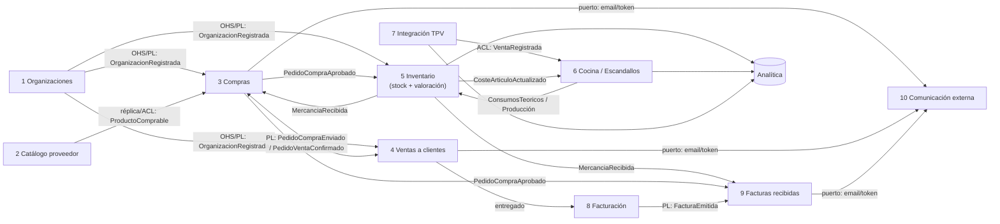

# Mapa de bounded contexts del ERP marketplace

Recoge lo tratado en `flujo-anadir-producto-a-pedido.md`, `facturas-en-marketplace-b2b.md`, `unidades-de-medida-compra-stock-cocina.md` y `costes-escandallos-produccion-pmp-fifo.md`. Los patrones de relación están en `comunicacion-entre-bounded-contexts.md`.

> Es una **propuesta mía** a partir de esas notas, no algo que digan las fuentes. Las fuentes aportan los criterios: modelos distintos por contexto (Fowler), clasificación en core y genéricos (Evans) y no depender de llamadas síncronas (Microsoft).

## Contextos propuestos

| # | Bounded context | Qué contiene (lenguaje propio) | Tipo de subdominio |
|---|---|---|---|
| 1 | **Organizaciones** | Empresas de la plataforma, usuarios, permisos, política de valoración (PMP/FIFO) | Genérico |
| 2 | **Catálogo de proveedor** | Productos que ofrece cada proveedor de la plataforma, formatos de compra, tarifas | De soporte |
| 3 | **Compras** (lado cliente) | `ProveedorDeCliente` (plataforma o externo), productos de externos, `PedidoCompra`, líneas con copia de precio y factor | **Core** |
| 4 | **Ventas a clientes** (lado proveedor) | `PedidoVenta`, agenda de clientes (incluidos externos), confirmación y entrega | **Core** |
| 5 | **Inventario** | Artículos del cliente, almacenes, `StockArticulo`, unidad de stock y equivalencias, recepciones, recuentos, mermas, traspasos, **valoración PMP/FIFO** | **Core** |
| 6 | **Cocina / Escandallos** | Recetas y sub-recetas, rendimientos, modo de descuento, explosión de ventas en consumos, órdenes de producción, coste teórico | **Core** |
| 7 | **Integración TPV** | Tickets de los TPV externos traducidos a `VentaRegistrada` | Genérico (ACL) |
| 8 | **Facturación** (emitidas) | Facturas del proveedor, rectificativas, VeriFactu y e-factura | Genérico (candidato a comprar) |
| 9 | **Facturas recibidas** | `FacturaRecibida`, cotejo a tres bandas, retenciones | De soporte |
| 10 | **Comunicación externa** | Envío de email a externos, enlaces con token, lectura de e-facturas entrantes | Genérico |
| — | **Analítica** (read models) | Food cost, teórico vs. real, varianzas | Proyecciones, no un modelo de dominio |

Evans: el core se destila (*"Boil the model down"*, *"Make the core small"*) y recibe el mejor talento. Para los genéricos: *"consider off-the-shelf solutions or published models"* y *"give their continuing development lower priority than the core domain"* ([DDD Reference](https://domainlanguage.com/wp-content/uploads/2016/05/DDD_Reference_2015-03.pdf)). En la práctica: Facturación (VeriFactu/e-factura), Comunicación e Integración TPV son buenos candidatos a librería o servicio externo detrás de un puerto.

## Context map

## Relaciones clave

| Relación | Patrón (ver `comunicacion-entre-bounded-contexts.md`) | Mecanismo |
|---|---|---|
| Compras ↔ Ventas | Partnership + Published Language | Integration events (outbox). Pedido de compra y pedido de venta son agregados distintos con id vinculado |
| Catálogo → Compras | Customer/Supplier + ACL | Réplica local por eventos, con fallback (cache-aside) |
| Compras → Inventario | Customer/Supplier | `PedidoCompraAprobado` (pendiente) y `MercanciaRecibida` (físico), con cantidades en las dos unidades |
| TPV → Cocina | ACL | Traduce el ticket de cada TPV a `VentaRegistrada` |
| Cocina ↔ Inventario | Customer/Supplier en ambos sentidos | Cocina pide consumos y producciones; Inventario publica costes |
| Facturación → Facturas recibidas | Published Language | `FacturaEmitida` (plataforma) o e-factura por email (externos) |
| Organizaciones → resto | Open-host Service | Identidad y políticas por organización |

## Decisiones abiertas (trade-offs)

- **¿Catálogo dentro de Ventas?** Si solo lo gestiona el proveedor y solo lo consume Compras, puede ser un módulo de Ventas. Lo separaría solo si tiene reglas propias (tarifas por cliente, promociones).
- **¿Valoración separada de Inventario?** La he dejado dentro porque el coste cambia con cada movimiento (misma consistencia). Un BC Costes aparte tendría sentido si Contabilidad necesita recalcular o cerrar periodos.
- **¿Producción dentro de Cocina o de Inventario?** Dentro de Cocina, con varias transacciones, es más DDD. Dentro de Inventario, con una sola transacción, es más simple.
- **Microservicios o monolito modular.** Un bounded context no obliga a un despliegue propio. Con la mayoría de relaciones asíncronas (Microsoft: *"The important rule is to not create synchronous dependencies between your microservices"*), empezar con módulos dentro de un mismo despliegue y eventos con outbox permite separar más adelante. Esto es recomendación mía.
- **Ventas en sala.** Si algún día el ERP tiene TPV propio, sería un BC más (core o genérico según el negocio) y el 7 pasaría a ser solo integración con terceros.
