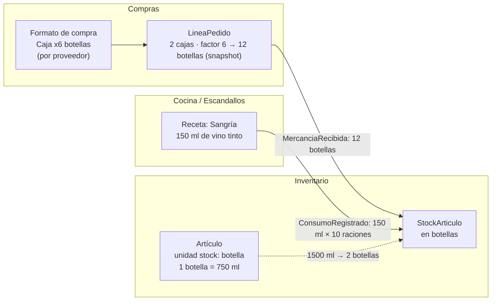

# Unidades de medida: compra, stock y cocina

Continúa `ddd/flujo-anadir-producto-a-pedido.md` (Compras, Inventario, marketplace con proveedores externos).

## Resumen

Un mismo artículo se mide de tres formas, y cada una pertenece al contexto que la usa:

| Unidad | Definición en la fuente | Ejemplo (harina) | Contexto dueño |
|---|---|---|---|
| **Compra** | *"the unit of measurement … used when the inventory item is purchased from suppliers"* | Saco (1 saco = 50 kg) | Compras / catálogo del proveedor |
| **Stock** | *"the primary unit of measurement"*, la de los informes de inventario | kg | Inventario |
| **Receta** | La que se usa *"when the inventory item is being used for creating sub-recipes"* | g | Cocina / Escandallos |

Fuente de la tabla: [Mosaic / Resto iQ](https://support.mosaic-solutions.com/knowledge/guide-to-stock-recipe-and-purchasing-unit-conversions).

La regla clave sale de ERPNext: *"The conversion factor translates the commercial quantity into the quantity used by the Stock Ledger"* y *"The Stock Ledger posts the Stock UOM"* ([ERPNext](https://docs.frappe.io/erpnext/purchasing-in-different-unit)). Es decir: se **compra** en la unidad del proveedor, pero el **stock** siempre se apunta en la unidad de stock.

## Value object `Cantidad` (patrón Quantity de Fowler)

Fowler modela *Quantity* como `amount : Number` + `units : Unit`, con operaciones aritméticas, y una *Unit Conversion Ratio* con unidades `from` y `to` ([Analysis Patterns, cap. 3](https://www.martinfowler.com/apsupp/apchap3.pdf)). En la práctica: **nunca un `number` suelto** para cantidades que cruzan contextos.

Restaurant365 añade una idea útil: toda unidad se define en función de otra equivalente y al final se reduce a un **tipo de medida** (volumen, peso o unidades sueltas), y *"must be based on an existing equivalent unit of measure in the system"* ([Restaurant365](https://docs.restaurant365.com/docs/unit-of-measure)).

```ts
type TipoMedida = "PESO" | "VOLUMEN" | "UNIDAD";

class Unidad {                       // VO: kg, g, l, ml, ud, caja6, saco50kg...
  constructor(readonly codigo: string, readonly tipo: TipoMedida) {}
}

class Cantidad {                     // VO inmutable (Fowler: amount + unit)
  constructor(readonly valor: number, readonly unidad: Unidad) {
    if (valor < 0) throw new Error("Cantidad negativa");
  }
  mas(o: Cantidad) { this.mismaUnidad(o); return new Cantidad(this.valor + o.valor, this.unidad); }
  private mismaUnidad(o: Cantidad) {
    if (o.unidad.codigo !== this.unidad.codigo) throw new UnidadesDistintas(this.unidad, o.unidad);
  }
}

class FactorConversion {             // Fowler: Unit Conversion Ratio (from → to)
  constructor(readonly desde: Unidad, readonly hacia: Unidad, readonly factor: number) {}
  convertir(c: Cantidad): Cantidad {
    if (c.unidad.codigo !== this.desde.codigo) throw new UnidadesDistintas(c.unidad, this.desde);
    return new Cantidad(c.valor * this.factor, this.hacia);
  }
}
```

## Dónde vive cada conversión

Hay tres tipos de conversión con dueños distintos (propuesta mía sobre las fuentes):

| Conversión | Ejemplo | Naturaleza | Dónde vive |
|---|---|---|---|
| Física | 1 kg = 1000 g; 1 l = 1000 ml | Universal, no cambia | Librería compartida (*shared kernel* pequeño) |
| Del artículo | 1 botella = 750 ml; 1 ud huevo ≈ 60 g | Propia del artículo del cliente | Artículo en Inventario (unidad de stock + equivalencias a receta) |
| Del formato de compra | 1 caja = 6 botellas (proveedor A), 1 caja = 12 (proveedor B) | Propia de cada proveedor | Formato de compra en Compras / catálogo del proveedor |

ERPNext guarda el factor en la ficha del artículo. En un marketplace, el mismo artículo puede venir en formatos distintos según el proveedor, así que lo pongo en el **formato de compra** (`ProductoComprable`). Restaurant365 no confirma que tenga conversiones por proveedor; esto es decisión mía.



## Cómo afecta al flujo de pedido y stock

1. **Añadir producto al pedido:** la línea guarda una cantidad en **unidad de compra** y una **copia del factor** a unidad de stock, igual que guarda copia del precio. Si el proveedor cambia el formato después, los pedidos antiguos no cambian. ERPNext también fija el precio por unidad de compra: *"Supplier rates must match the purchase UOM"*.
2. **Recepción:** Inventario apunta el stock en **unidad de stock** (10 cajas × 20 = 200 unidades en el ejemplo de ERPNext). Para eso, el evento lleva las dos cantidades.
3. **Cocina:** las recetas piden en unidad de receta. Al consumir (ventas o producción), Inventario convierte con la equivalencia del artículo y descuenta en unidad de stock.
4. **Facturas:** el cotejo a tres bandas compara en **unidad de compra**, porque así factura el proveedor.

```ts
// Compras: la línea guarda una copia del formato, como hace con el precio
class LineaPedido {
  constructor(readonly productoId: ProductoId,
              readonly cantidadCompra: Cantidad,            // 2 cajas
              readonly factorAStock: FactorConversion,      // caja → botella ×6 (copia)
              readonly precioPorUnidadCompra: Dinero) {}
  cantidadEnStock(): Cantidad { return this.factorAStock.convertir(this.cantidadCompra); } // 12 botellas
}

// Contrato del integration event: explícito en ambas unidades
interface LineaRecibida {
  productoId: string;
  cantidadCompra: { valor: number; unidad: string };   // { 2, "caja6" }
  cantidadStock:  { valor: number; unidad: string };   // { 12, "botella" }
}

// Inventario: consumo desde Cocina, convertido a unidad de stock
class StockArticulo {
  // ...
  consumir(cantidad: Cantidad, equivalencias: EquivalenciasArticulo, ref: string) {
    const enStock = equivalencias.aUnidadStock(cantidad);   // 1500 ml → 2 botellas
    this.fisico -= enStock.valor;
    this.registrar(new StockConsumido(this.productoId, enStock, ref));
  }
}
```

## Errores frecuentes

- Guardar `cantidad: number` sin unidad y dar por hecho cuál es: el clásico "¿son cajas o botellas?".
- Una sola tabla global de conversiones que mezcla las físicas, las del artículo y las de cada proveedor.
- Recalcular pedidos antiguos con el factor actual del proveedor, en vez de usar la copia guardada en la línea.
- Sumar cantidades de unidades distintas sin convertir antes: el VO debe impedirlo, como hace `mismaUnidad`.
- Convertir de volumen a peso sin una equivalencia propia del artículo (densidad): Restaurant365 obliga a reducir cada unidad a su tipo de medida.
