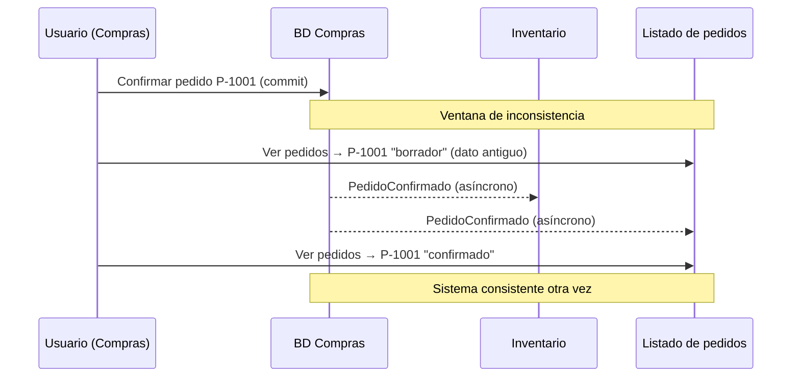
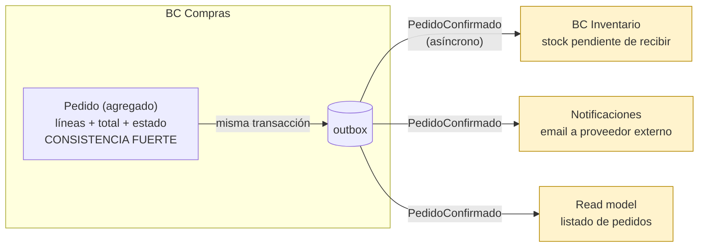
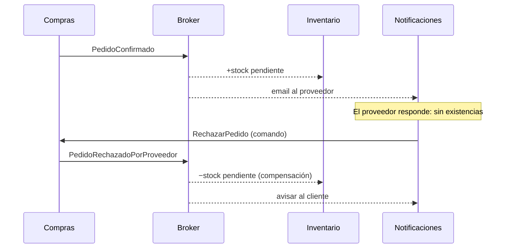

# Consistencia eventual

## Resumen

**Consistencia eventual** es una garantía débil sobre datos replicados o repartidos en varios sitios: si dejan de llegar cambios, al cabo de un tiempo todas las lecturas devolverán el último valor. Mientras tanto, alguien puede leer un valor antiguo.

Werner Vogels (CTO de Amazon) la define así: el sistema *"guarantees that if no new updates are made to the object, eventually all accesses will return the last updated value"* ([Vogels, 2008](https://www.allthingsdistributed.com/2008/12/eventually_consistent.html)).

En un ERP como el marketplace de hostelería aparece cuando un cambio en un sitio (confirmar un `Pedido` en Compras) tiene que reflejarse en otro (stock esperado en Inventario, listado de pedidos, email al proveedor externo) **sin una única transacción** que lo abarque todo. Durante unos milisegundos o segundos, esos sitios no coinciden.

## Consistencia fuerte, débil y eventual

Vogels distingue tres niveles ([Vogels, 2008](https://www.allthingsdistributed.com/2008/12/eventually_consistent.html)):

| Tipo | Definición (Vogels) | Qué significa en la práctica |
|---|---|---|
| Fuerte | *"After the update completes, any subsequent access (by A, B, or C) will return the updated value."* | Tras el commit, todos leen lo nuevo. |
| Débil | *"The system does not guarantee that subsequent accesses will return the updated value."* | Puede que nunca lo veas sin condiciones extra. |
| Eventual | Forma de consistencia débil: si no hay más cambios, *"eventually all accesses will return the last updated value."* | Lo verás, pero no al instante. |

El periodo en que unos ven lo nuevo y otros lo viejo es la **ventana de inconsistencia**: *"The period between the update and the moment when it is guaranteed"*. Su tamaño depende de *"communication delays, the load on the system, and the number of replicas involved"*.

Vogels pone como ejemplo clásico el **DNS**: cambias un registro y las cachés se van actualizando con el tiempo hasta que *"eventually, all clients will see the update."*



## Por qué existe: CAP y sistemas distribuidos

Vogels lo enlaza con el teorema CAP de Brewer: de tres propiedades, *"data consistency, system availability, and tolerance to network partition"*, *"only two can be achieved at any given time"*. Si hay particiones de red y quieres seguir disponible, tienes que renunciar a la consistencia fuerte. Por eso afirma que en sistemas distribuidos grandes la inconsistencia *"has to be tolerated"*.

No hace falta ser Amazon para encontrarla. Aparece en cuanto hay **dos almacenes o dos transacciones** que se sincronizan de forma asíncrona:

- Entre **agregados** del mismo bounded context (ver más abajo).
- Entre **bounded contexts** que se comunican por eventos ([comunicación entre bounded contexts](../ddd/comunicacion-entre-bounded-contexts.md)).
- Entre **escritura y lectura** en CQRS con almacenes separados ([CQRS, nivel 3](../cqrs/cqrs-que-es-cuando-y-niveles-de-separacion.md)). Microsoft lo resume: *"The read data might not show the most recent changes immediately. This delay results in stale data."* ([Azure CQRS pattern](https://learn.microsoft.com/en-us/azure/architecture/patterns/cqrs)).

Que sea aceptable o no depende del negocio. Vogels: *"Whether or not inconsistencies are acceptable depends on the client application."*

## Variantes: qué garantías extra puedes pedir

"Eventual" a secas es poco. Vogels describe variantes que la refuerzan ([Vogels, 2008](https://www.allthingsdistributed.com/2008/12/eventually_consistent.html)):

| Variante | Garantía | Ejemplo en el ERP |
|---|---|---|
| Causal | Si A avisa a B de que ha escrito, B ve ese cambio. | Si Inventario recibe `PedidoConfirmado`, ve el pedido confirmado al consultarlo. |
| Read-your-writes | Quien escribe *"will never see an older value"*. | El jefe de cocina confirma un pedido y en su pantalla ya sale confirmado. |
| Sesión | Read-your-writes mientras dure la sesión. | Igual, pero solo dentro de su sesión. |
| Lecturas monotónicas | Una vez visto un valor, nunca verás uno anterior. | El estado no "retrocede" de confirmado a borrador al refrescar. |
| Escrituras monotónicas | Las escrituras de un mismo proceso se aplican en orden. | `LineaAñadida` no se aplica después de `PedidoConfirmado`. |

Según Vogels, read-your-writes y lecturas monotónicas son las *"most desirable"*, aunque *"not always required"*.

## En DDD: consistencia fuerte dentro del agregado, eventual fuera

Vaughn Vernon lo formula como regla de diseño de agregados: **"Use Eventual Consistency Outside the Boundary"**. *"Any rule that spans AGGREGATES will not be expected to be up-to-date at all times."* ([Vernon, Effective Aggregate Design II](https://www.dddcommunity.org/wp-content/uploads/files/pdf_articles/Vernon_2011_2.pdf))

- **Dentro** del agregado `Pedido`: líneas, total y estado cambian en una transacción. Consistencia fuerte. Ver [building blocks tácticos](../ddd/building-blocks-tacticos.md).
- **Fuera**: el stock esperado en Inventario o la factura del proveedor se actualizan después, al reaccionar a un evento.

Para decidir qué va en cada lado, Vernon propone preguntar **de quién es el trabajo**: *"ask whether it's the job of the user executing the use case to make the data consistent. If it is another user's job, or the job of the system, allow it to be eventually consistent."* Y añade que conviene preguntar al experto: *"Domain experts are sometimes far more comfortable with the idea of delayed consistency than are developers."*

Aplicado al ERP (la clasificación es mía, a partir del criterio de Vernon):

| Regla | ¿Trabajo de quién confirma? | Consistencia |
|---|---|---|
| Un pedido confirmado debe tener al menos una línea | Sí | Fuerte (invariante de `Pedido`) |
| El total del pedido es la suma de sus líneas | Sí | Fuerte |
| Inventario sabe qué cantidad está "pendiente de recibir" | No, del sistema | Eventual |
| El proveedor externo recibe el pedido por email | No, del sistema | Eventual |
| El listado de pedidos del cliente muestra el nuevo estado | No, del sistema | Eventual (read model) |



## Ejemplo en PHP: confirmar un pedido

### 1. El agregado registra el evento (consistencia fuerte dentro)

```php
<?php
final class Pedido
{
    private array $eventos = [];
    private int $version = 0;

    /** @param LineaPedido[] $lineas */
    private function __construct(
        private PedidoId $id,
        private ProveedorId $proveedorId,
        private EstadoPedido $estado,
        private array $lineas,
    ) {}

    public function confirmar(\DateTimeImmutable $ahora): void
    {
        if ($this->estado !== EstadoPedido::Borrador) {
            throw new PedidoNoConfirmable($this->id);
        }
        if ($this->lineas === []) {
            throw new PedidoSinLineas($this->id); // invariante: se cumple SIEMPRE
        }

        $this->estado = EstadoPedido::Confirmado;
        $this->version++;
        $this->eventos[] = new PedidoConfirmado(
            pedidoId: $this->id->valor,
            proveedorId: $this->proveedorId->valor,
            lineas: array_map(fn (LineaPedido $l) => $l->toArray(), $this->lineas),
            version: $this->version,
            ocurridoEn: $ahora,
        );
    }

    public function liberarEventos(): array
    {
        [$e, $this->eventos] = [$this->eventos, []];
        return $e;
    }
}
```

### 2. Guardar el pedido y el evento en la misma transacción (outbox)

Sin outbox, si el proceso cae entre el commit y la publicación, Inventario nunca se entera y el sistema **no** converge. El outbox guarda el mensaje en la misma transacción que el agregado ([Richardson, Transactional outbox](https://microservices.io/patterns/data/transactional-outbox)). Así la consistencia es eventual, pero llega.

```php
<?php
final class ConfirmarPedidoHandler
{
    public function __construct(
        private PDO $db,
        private PedidoRepository $pedidos,
        private Outbox $outbox,
        private Clock $clock,
    ) {}

    public function __invoke(ConfirmarPedido $cmd): int
    {
        $this->db->beginTransaction();
        try {
            $pedido = $this->pedidos->get(new PedidoId($cmd->pedidoId));
            $pedido->confirmar($this->clock->now());
            $this->pedidos->save($pedido);

            foreach ($pedido->liberarEventos() as $evento) {
                $this->outbox->add($evento); // INSERT en tabla outbox, misma TX
            }
            $this->db->commit();
        } catch (\Throwable $e) {
            $this->db->rollBack();
            throw $e;
        }

        return $pedido->version(); // útil para read-your-writes en la UI
    }
}
```

### 3. El consumidor en Inventario es idempotente

El relay entrega *al menos una vez*, así que el mismo evento puede llegar dos veces. Microsoft recomienda consumidores idempotentes ([Azure CQRS pattern](https://learn.microsoft.com/en-us/azure/architecture/patterns/cqrs)).

```php
<?php
final class AlConfirmarPedidoRegistrarStockPendiente
{
    public function __construct(private PDO $db) {}

    public function __invoke(PedidoConfirmadoIntegrationEvent $e): void
    {
        $this->db->beginTransaction();
        try {
            // Si ya procesamos este evento, salimos: idempotencia
            $stmt = $this->db->prepare(
                'INSERT INTO eventos_procesados (event_id) VALUES (:id) ON CONFLICT DO NOTHING'
            );
            $stmt->execute(['id' => $e->eventId]);
            if ($stmt->rowCount() === 0) {
                $this->db->rollBack();
                return;
            }

            foreach ($e->lineas as $linea) {
                $this->db->prepare(<<<SQL
                    UPDATE stock SET pendiente_recibir = pendiente_recibir + :cantidad
                    WHERE producto_id = :producto AND almacen_id = :almacen
                SQL)->execute([
                    'cantidad' => $linea['cantidadEnUnidadStock'],
                    'producto' => $linea['productoId'],
                    'almacen'  => $e->almacenId,
                ]);
            }
            $this->db->commit();
        } catch (\Throwable $ex) {
            $this->db->rollBack();
            throw $ex; // el broker reintentará
        }
    }
}
```

## Cuando algo falla después: acciones compensatorias

Con consistencia eventual no hay `ROLLBACK` global. Si un paso posterior falla, hay que **deshacer con otra operación de negocio**. Microsoft describe así el modelo: una operación *"consists of a series of separate steps. During these steps, the overall view of the system state might be inconsistent. But the system should become consistent again when all steps finish."* Y para los fallos: *"Implement a compensating transaction that undoes the effects of completed steps in the original operation."* ([Microsoft, Compensating Transaction](https://learn.microsoft.com/en-us/azure/architecture/patterns/compensating-transaction))

Dos matices de la misma fuente:

- Compensar no es volver al estado exacto anterior: *"doesn't necessarily return the system data to its state at the start"*, porque podrías pisar cambios concurrentes de otros.
- Los pasos de compensación también deben ser idempotentes: *"so that you can repeat them if the compensating transaction itself fails."*

Ejemplo en el marketplace: el pedido se confirmó, Inventario ya sumó el stock pendiente, y el proveedor lo **rechaza** (por email o desde la plataforma). No se "borra" la confirmación: se emite `PedidoRechazadoPorProveedor` y cada contexto compensa.



```php
<?php
// Inventario: compensación idempotente, no un "deshacer" literal
final class AlRechazarPedidoLiberarStockPendiente
{
    public function __invoke(PedidoRechazadoPorProveedorIntegrationEvent $e): void
    {
        // Mismo esquema que el consumidor anterior (tabla eventos_procesados),
        // pero restando: pendiente_recibir = GREATEST(pendiente_recibir - :cantidad, 0)
    }
}
```

Microsoft también avisa del coste: la consistencia eventual *"requires more complex code in order to detect possible inconsistencies... and the need to implement compensatory actions"* ([Microsoft, Domain events](https://learn.microsoft.com/en-us/dotnet/architecture/microservices/microservice-ddd-cqrs-patterns/domain-events-design-implementation)).

## Cómo se nota en la interfaz y cómo suavizarlo

El síntoma típico: el usuario confirma un pedido, vuelve al listado y aún lo ve como borrador. Es un fallo de **read-your-writes**. Opciones (propuestas de diseño; las garantías vienen de Vogels, la implementación es mía):

1. **Devolver la versión** desde el comando y que la consulta espere o reintente hasta que el read model llegue a esa versión.
2. **UI optimista**: pintar "confirmado" con lo que el usuario ya envió.
3. **Leer del lado de escritura** solo para quien acaba de escribir (sesión), y del read model para los demás.
4. **Diseñar el flujo**: mostrar "Pedido enviado al proveedor" en lugar de recargar el listado al instante.

```php
<?php
// Opción 1: la consulta espera a que la proyección alcance la versión del comando
final class ObtenerPedidoQuery
{
    public function __construct(private PDO $lectura) {}

    public function __invoke(string $pedidoId, ?int $versionMinima = null): ?array
    {
        for ($intento = 0; $intento < 5; $intento++) {
            $stmt = $this->lectura->prepare('SELECT * FROM pedidos_resumen WHERE id = :id');
            $stmt->execute(['id' => $pedidoId]);
            $fila = $stmt->fetch(PDO::FETCH_ASSOC) ?: null;

            if ($versionMinima === null || ($fila && $fila['version'] >= $versionMinima)) {
                return $fila;
            }
            usleep(100_000); // 100 ms
        }
        return $fila; // devolver lo que haya y marcarlo como "actualizando..."
    }
}
```

## Cuándo NO usar consistencia eventual

- Cuando la regla es una **invariante** que el usuario debe ver cumplida al terminar su acción (Vernon: es "su trabajo"). Va dentro de un agregado con consistencia fuerte.
- Cuando el negocio no tolera la ventana, por ejemplo no vender por encima del stock disponible si eso tiene un coste alto. Hay que preguntarlo al experto, como sugiere Vernon, en vez de suponerlo.
- Cuando todo vive en una BD y un monolito modular: una transacción local es más simple. Kurrent recuerda que separar comandos y consultas *"does not automatically imply an eventually consistent system"* (citado en la [nota de CQRS](../cqrs/cqrs-que-es-cuando-y-niveles-de-separacion.md)).

## Errores frecuentes

- **Publicar el evento fuera de la transacción** sin outbox: si cae el proceso, el sistema nunca converge. Eso ya no es consistencia eventual, es inconsistencia.
- **Consumidores no idempotentes**: el reintento duplica el stock pendiente.
- **No tener orden ni versión**: un evento antiguo llega tarde y pisa uno nuevo, rompiendo las lecturas monotónicas. Solución: aplicar solo si `version > version_guardada`.
- **Pensar que compensar es borrar**: se emite un evento de negocio nuevo, con su rastro.
- **Ocultarle la ventana al negocio**: el experto debe decidir si 2 segundos de retraso en el stock son aceptables.

## Relacionado

- [CQRS: qué es, cuándo y niveles de separación](../cqrs/cqrs-que-es-cuando-y-niveles-de-separacion.md), sobre todo el nivel 3 (almacén de lectura separado).
- [Comunicación entre bounded contexts](../ddd/comunicacion-entre-bounded-contexts.md): eventos de integración, outbox y síncrono vs. asíncrono.
- [Building blocks tácticos](../ddd/building-blocks-tacticos.md): agregados como frontera de consistencia.
- [Mapa de contextos del ERP marketplace](../ddd/mapa-de-contextos-erp-marketplace.md).

## Fuentes

- Werner Vogels, ["Eventually Consistent - Revisited"](https://www.allthingsdistributed.com/2008/12/eventually_consistent.html), 2008.
- Vaughn Vernon, ["Effective Aggregate Design, Part II"](https://www.dddcommunity.org/wp-content/uploads/files/pdf_articles/Vernon_2011_2.pdf), 2011.
- Microsoft, ["Compensating Transaction pattern"](https://learn.microsoft.com/en-us/azure/architecture/patterns/compensating-transaction).
- Microsoft, ["CQRS pattern"](https://learn.microsoft.com/en-us/azure/architecture/patterns/cqrs).
- Microsoft, ["Domain events: design and implementation"](https://learn.microsoft.com/en-us/dotnet/architecture/microservices/microservice-ddd-cqrs-patterns/domain-events-design-implementation).
- Chris Richardson, ["Pattern: Transactional outbox"](https://microservices.io/patterns/data/transactional-outbox).
