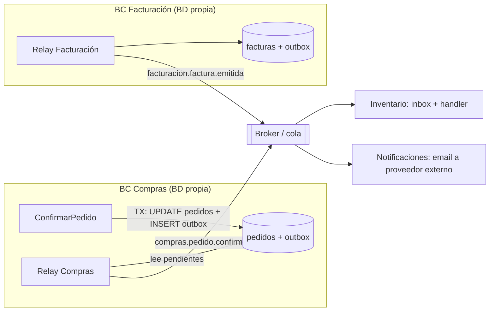

# Outbox por bounded context para eventos de integración

## Resumen

**Sí tiene sentido**, y es exactamente el patrón **Transactional Outbox**: cada bounded context (BC) guarda sus eventos de integración en una tabla `outbox` de **su propia base de datos**, en la **misma transacción** que el agregado, y un proceso aparte (el *message relay*) los publica después en la cola o broker.

Richardson lo resume así: *"first store the message in the database as part of the transaction that updates the business entities. A separate process then sends the messages to the message broker"* ([microservices.io](https://microservices.io/patterns/data/transactional-outbox)).

Tres matices que conviene tener claros desde el principio:

1. El outbox es **por BC** porque tiene que compartir transacción con los datos del BC. No es una decisión estética.
2. En el outbox van **eventos de integración** (contrato público), no los eventos de dominio internos.
3. El outbox da **at-least-once**: el consumidor recibirá duplicados y tiene que ser **idempotente** (inbox).

Ejemplo del marketplace de hostelería: Compras confirma un `Pedido` y escribe `PedidoConfirmado` en su outbox. Un relay lo publica en la cola. Inventario lo consume y suma el stock *pendiente de recibir*.

## El problema que resuelve: la doble escritura

Confirmar un pedido toca dos sistemas: la base de datos de Compras y el broker. No hay una transacción que abarque ambos. Microsoft lo dice así: *"you usually can't enlist message brokers and databases into a single distributed transaction"*, y recomienda *"the Transactional Outbox pattern to persist the state change and event atomically"* ([Microsoft, CQRS](https://learn.microsoft.com/en-us/azure/architecture/patterns/cqrs)).

Sin outbox hay dos órdenes posibles y los dos fallan:

| Orden | Qué pasa si el proceso cae entre los dos pasos |
|---|---|
| Commit en BD → publicar en cola | El pedido queda confirmado e Inventario **nunca** se entera. |
| Publicar en cola → commit en BD | Inventario suma stock de un pedido que luego hace rollback. **Evento fantasma.** |

Con outbox la garantía es la que da Richardson: *"Messages are guaranteed to be sent if and only if the database transaction commits"* ([microservices.io](https://microservices.io/patterns/data/transactional-outbox)).

## Por qué un outbox por bounded context

La tabla outbox tiene que vivir **en la misma base de datos** que las entidades que cambian, porque se escribe en la misma transacción local ([microservices.io](https://microservices.io/patterns/data/transactional-outbox)). Si cada BC es dueño de sus datos, cada BC tiene su outbox.

En un **monolito modular** con una sola base de datos física pasa lo mismo a nivel de esquema. Jovanović coloca el outbox dentro del módulo emisor: *"The outbox message is a plain entity in the Ordering module's schema"* ([Jovanović](https://milanjovanovic.tech/blog/event-driven-communication-modules)).

Ventajas de tenerlo por BC (razonamiento propio, coherente con las fuentes):

- **Propiedad clara**: el BC decide qué publica y con qué formato. Es su *published language*.
- **Se puede extraer**: si Compras pasa a ser un servicio con su propia BD, el outbox se va con él.
- **Fallos aislados**: si el relay de Compras se atasca, Facturación sigue publicando.

Una tabla outbox **compartida** por todos los BC funciona técnicamente en un monolito, pero acopla esquemas y rompe en cuanto separas bases de datos.



## Qué guardar en el outbox: eventos de integración, no de dominio

El evento de integración es un contrato **entre** contextos. Jovanović: *"Integration events cross module boundaries and are processed in separate transactions"* y *"Modules never reference each other's internals"* ([Jovanović](https://milanjovanovic.tech/blog/event-driven-communication-modules)). Por eso al outbox debe ir el evento ya **traducido** a ese contrato: versionado, con ids y datos planos, sin objetos de dominio.

Columnas mínimas. Debezium define esta estructura para su *Outbox Event Router*: `id` (*"the unique ID of the event"*), `aggregatetype`, `aggregateid`, `type` y `payload` ([Debezium](https://debezium.io/documentation/reference/2.4/transformations/outbox-event-router.html)). Usarla aunque hoy hagas polling te deja la puerta abierta a CDC sin migrar la tabla.

```sql
-- Esquema del BC Compras
CREATE TABLE compras.outbox (
    id             UUID PRIMARY KEY,          -- id del evento: clave de deduplicación en el consumidor
    aggregatetype  VARCHAR(100) NOT NULL,     -- 'pedido' → decide el topic/cola
    aggregateid    VARCHAR(100) NOT NULL,     -- id del Pedido → clave de ordenación/partición
    type           VARCHAR(150) NOT NULL,     -- 'compras.pedido.confirmado.v1'
    payload        JSONB        NOT NULL,
    occurred_at    TIMESTAMPTZ  NOT NULL,
    published_at   TIMESTAMPTZ  NULL,         -- solo para polling; con CDC no hace falta
    attempts       INT          NOT NULL DEFAULT 0
);
CREATE INDEX outbox_pendientes ON compras.outbox (occurred_at) WHERE published_at IS NULL;
```

## Ejemplo PHP: escribir en el outbox dentro de la transacción

El agregado `Pedido` emite el evento de dominio `PedidoConfirmado`. El caso de uso lo traduce a evento de integración y lo guarda en el outbox en la **misma** transacción.

```php
<?php
// Contrato público de Compras (published language)
final class PedidoConfirmadoV1
{
    public function __construct(
        public readonly string $eventId,
        public readonly string $pedidoId,
        public readonly string $clienteId,
        public readonly string $proveedorId,
        /** @var list<array{productoId: string, cantidad: string, unidad: string}> */
        public readonly array $lineas,
        public readonly string $occurredAt,
    ) {}
}

final class ConfirmarPedidoHandler
{
    public function __construct(
        private PDO $db,
        private PedidoRepository $pedidos,
        private Outbox $outbox,
    ) {}

    public function __invoke(ConfirmarPedido $cmd): void
    {
        $this->db->beginTransaction();
        try {
            $pedido = $this->pedidos->get(new PedidoId($cmd->pedidoId));
            $pedido->confirmar();                       // emite PedidoConfirmado (dominio)
            $this->pedidos->save($pedido);

            foreach ($pedido->releaseEvents() as $evento) {
                if ($evento instanceof PedidoConfirmado) {
                    $this->outbox->add(                 // INSERT en compras.outbox, misma TX
                        aggregateType: 'pedido',
                        aggregateId: $pedido->id()->value,
                        type: 'compras.pedido.confirmado.v1',
                        payload: PedidoConfirmadoV1Mapper::fromDomain($evento),
                    );
                }
            }
            $this->db->commit();
        } catch (\Throwable $e) {
            $this->db->rollBack();
            throw $e;
        }
    }
}
```

Lo importante es que `save()` y `outbox->add()` usan **la misma conexión** y la misma transacción. Si cualquiera falla, no queda ni pedido confirmado ni evento.

## El relay: polling o lectura del log (CDC)

Richardson describe dos formas de implementar el relay ([microservices.io](https://microservices.io/patterns/data/transactional-outbox)):

| | Polling publisher | Transaction log tailing (CDC, p. ej. Debezium) |
|---|---|---|
| Cómo | Consulta periódica de filas no publicadas | Lee el WAL/binlog y publica cada INSERT del outbox |
| Pros | *"Works with any SQL database"* ([polling](https://microservices.io/patterns/data/polling-publisher.html)) | Sin consultas a la tabla; menor latencia |
| Contras | *"Tricky to publish events in order"* ([polling](https://microservices.io/patterns/data/polling-publisher.html)); añade latencia | *"Requires database specific solutions"*, *"tricky to avoid duplicate publishing"* ([log tailing](https://microservices.io/patterns/data/transaction-log-tailing.html)); más infraestructura (Kafka Connect) |

Con Debezium, `aggregatetype` decide el topic (el ejemplo de la doc publica `Order` en `outbox.event.order`) y `aggregateid` se usa como clave del mensaje, lo cual es *"important for maintaining correct order in Kafka partitions"* ([Debezium](https://debezium.io/documentation/reference/2.4/transformations/outbox-event-router.html)).

Namastack señala que *"pure polling will always add some latency"* y recomienda CDC si necesitas casi tiempo real ([Namastack](https://dev.to/namastack/outbox-pattern-the-hard-parts-and-how-namastack-outbox-helps-507m)).

**Recomendación** (mía): empezar con polling. En un ERP de hostelería unos cientos de milisegundos de retraso entre confirmar un pedido y ver el stock pendiente no importan, y evitas operar Kafka Connect. Pasa a CDC si la latencia o la carga de las consultas empiezan a doler.

### Relay por polling en PHP

```php
<?php
final class OutboxRelay
{
    public function __construct(private PDO $db, private MessagePublisher $publisher) {}

    public function runOnce(int $batch = 100): void
    {
        $this->db->beginTransaction();
        $rows = $this->db->query(
            "SELECT id, aggregatetype, aggregateid, type, payload
               FROM compras.outbox
              WHERE published_at IS NULL
              ORDER BY occurred_at
              LIMIT {$batch}
              FOR UPDATE SKIP LOCKED"
        )->fetchAll(PDO::FETCH_ASSOC);

        foreach ($rows as $row) {
            $this->publisher->publish(
                routingKey: "compras.{$row['aggregatetype']}",
                messageId: $row['id'],              // el consumidor deduplica con esto
                partitionKey: $row['aggregateid'],  // mismo pedido → mismo orden
                type: $row['type'],
                body: $row['payload'],
            );
            $this->db->prepare('UPDATE compras.outbox SET published_at = now() WHERE id = ?')
                     ->execute([$row['id']]);
        }
        $this->db->commit();
    }
}
```

Si el proceso cae después de `publish()` y antes del `commit()`, la fila sigue pendiente y se publicará **otra vez**. Es el duplicado que Richardson avisa: *"The Message relay might publish a message more than once"* ([microservices.io](https://microservices.io/patterns/data/transactional-outbox)).

## Garantías: at-least-once, duplicados y ordenación

**At-least-once, nunca exactly-once.** Microsoft: *"It's impractical to guarantee exactly-once delivery across a distributed system"*, y RabbitMQ, Kafka o Service Bus dan at-least-once ([Microsoft, Idempotent Consumer](https://learn.microsoft.com/en-us/azure/architecture/patterns/idempotent-consumer)). El outbox no cambia eso: solo garantiza que el evento **no se pierde**.

**Ordenación.** El outbox conserva el orden de escritura, pero se rompe fácilmente:

- Con varios workers de relay: *"Across workers, order is not guaranteed"*; `SKIP LOCKED` deja que un worker publique la fila 11 mientras otro sigue con la 10 ([Anhaia](https://dev.to/gabrielanhaia/symfony-messenger-transports-building-a-transactional-outbox-on-top-3op3)).
- Con reintentos: si un evento falla y el resto sigue, llegan desordenados. Jovanović recomienda *"stop the batch at the first failure"* si el consumidor depende del orden ([Jovanović](https://milanjovanovic.tech/blog/event-driven-communication-modules)).

Casi nunca necesitas orden global. Namastack: el objetivo de orden global *"is usually the wrong goal"*; basta con ordenar **por clave de negocio** ([Namastack](https://dev.to/namastack/outbox-pattern-the-hard-parts-and-how-namastack-outbox-helps-507m)). En el ejemplo, importa que `PedidoConfirmado` llegue antes que `PedidoCancelado` **del mismo pedido**, no el orden entre pedidos distintos. Por eso se usa `aggregateid` como clave de partición.

Opciones si necesitas orden por agregado:

- Un único worker de relay (simple; suficiente para muchos ERPs).
- Particionar por `aggregateid` (Kafka lo hace con la clave del mensaje).
- Poner un número de secuencia por agregado en el evento y que el consumidor descarte lo antiguo ([Anhaia](https://dev.to/gabrielanhaia/symfony-messenger-transports-building-a-transactional-outbox-on-top-3op3)).

## El otro lado: inbox / consumidor idempotente

Si el productor tiene outbox, el consumidor necesita **inbox**. Richardson: el handler inserta el id del mensaje en una tabla `PROCESSED_MESSAGES` dentro de su transacción y *"the INSERT will fail if the message has been already processed successfully"* ([Idempotent Consumer](https://microservices.io/patterns/communication-style/idempotent-consumer.html)).

Microsoft insiste en que sea **en la misma transacción** que el efecto de negocio. Si no, *"a crash between the two operations leaves the side effects applied but the key unrecorded"*. A esa variante la llama *Inbox pattern* ([Microsoft](https://learn.microsoft.com/en-us/azure/architecture/patterns/idempotent-consumer)).

```php
<?php
// BC Inventario
final class AlRecibirPedidoConfirmado
{
    public function __construct(private PDO $db, private StockRepository $stock) {}

    public function __invoke(string $messageId, PedidoConfirmadoV1 $evento): void
    {
        $this->db->beginTransaction();
        try {
            $insert = $this->db->prepare(
                'INSERT INTO inventario.inbox (message_id, processed_at) VALUES (?, now())
                 ON CONFLICT (message_id) DO NOTHING'
            );
            $insert->execute([$messageId]);
            if ($insert->rowCount() === 0) {      // duplicado: ya procesado
                $this->db->commit();
                return;
            }

            foreach ($evento->lineas as $linea) {
                $this->stock->sumarPendienteDeRecibir(
                    $evento->clienteId, $linea['productoId'], $linea['cantidad'], $linea['unidad'],
                );
            }
            $this->db->commit();
        } catch (\Throwable $e) {
            $this->db->rollBack();
            throw $e;                              // el broker reintentará
        }
    }
}
```

Sin el inbox, un duplicado sumaría dos veces el stock pendiente. Es el mismo caso que pone Richardson con un `AccountDebited` que resta dos veces del saldo ([Idempotent Consumer](https://microservices.io/patterns/communication-style/idempotent-consumer.html)).

**Retención de ids.** Microsoft: guarda cada registro *"at least as long as the broker can still redeliver the original message"*, y ten en cuenta los mensajes reenviados a mano desde la dead-letter queue ([Microsoft](https://learn.microsoft.com/en-us/azure/architecture/patterns/idempotent-consumer)).

Algunos consumidores son idempotentes por naturaleza y no necesitan inbox: por ejemplo, un `UPSERT` que fija el estado a `confirmado`. Sumar o restar cantidades **no** lo es.

## Alternativas y críticas

| Alternativa | Problema / cuándo encaja |
|---|---|
| Publicar directamente a la cola tras el commit | Si el proceso cae entre commit y publish, el evento se pierde. Es la doble escritura de arriba. |
| `DispatchAfterCurrentBusStamp` de Symfony Messenger | Retrasa el envío hasta después del commit, pero *"It does not kill the first [problem]. Commit happens, then the broker send happens as a separate step"* ([Anhaia](https://dev.to/gabrielanhaia/symfony-messenger-transports-building-a-transactional-outbox-on-top-3op3)). |
| CDC sobre las tablas de negocio (sin outbox) | Evita la tabla outbox, pero publica tu esquema interno como contrato. Debezium promueve precisamente la tabla outbox para separar el estado interno de los eventos que consumen otros ([Debezium](https://debezium.io/documentation/reference/2.4/transformations/outbox-event-router.html)). |
| Event sourcing | El event store ya es fuente de eventos y hace de outbox (razonamiento propio). Solo compensa si ya usas event sourcing por otros motivos. |
| Handlers en proceso, misma transacción (monolito) | Si el consumidor está en la misma BD y puede ir en la misma transacción, no necesitas cola ni outbox. Pero ya no es consistencia eventual ni hay aislamiento de fallos. Jovanović avisa de que el bus síncrono es *"decoupled in code, not decoupled at runtime"* ([Jovanović](https://milanjovanovic.tech/blog/event-driven-communication-modules)). |

**Cuándo no merece la pena** (opinión propia): si ningún otro BC necesita reaccionar al evento, no lo publiques. El outbox añade una tabla, un proceso relay que monitorizar, limpieza de filas y un inbox en cada consumidor.

## Implementarlo en PHP con Symfony Messenger

El transporte Doctrine de Messenger escribe en una tabla por la misma conexión que el handler. Por eso *"If a transaction is open on that connection, the insert joins it"*, y ya hace de outbox si:

- usas el middleware `doctrine_transaction` en el bus de comandos;
- **no** añades `DispatchAfterCurrentBusStamp`;
- ejecutas `messenger:consume` sobre ese transporte como relay hacia el broker real.

Además necesitas handlers idempotentes y una estrategia de orden si la necesitas ([Anhaia](https://dev.to/gabrielanhaia/symfony-messenger-transports-building-a-transactional-outbox-on-top-3op3)).

Hay paquetes que lo empaquetan, por ejemplo `goetas/messenger-doctrine-outbox`, que *"provides a middleware and a transport to implement the Transactional outbox pattern"* ([Packagist](https://packagist.org/packages/goetas/messenger-doctrine-outbox)). Revisa su mantenimiento antes de adoptarlo.

## Operación: lo que suele olvidarse

- **Limpieza**: borra o archiva filas publicadas (p. ej. tras 7 días). Sin esto, la tabla crece sin límite. Las fuentes consultadas no fijan un plazo, así que elígelo según tu auditoría.
- **Mensajes que siempre fallan**: tras N intentos, márcalos como `FAILED` y alerta. Namastack: *"At some point, you need a deterministic outcome"* ([Namastack](https://dev.to/namastack/outbox-pattern-the-hard-parts-and-how-namastack-outbox-helps-507m)).
- **Monitorización**: alerta si hay filas pendientes más antiguas que X minutos. Significa que el relay está caído.
- **Versionado del contrato**: incluye la versión en `type` (`compras.pedido.confirmado.v1`) para poder evolucionar el payload sin romper a los consumidores.

## Relación con otras notas

- [Consistencia eventual](./consistencia-eventual.md): por qué Inventario ve el pedido con retraso y cómo convivir con ello.
- [Comunicación entre bounded contexts](../ddd/comunicacion-entre-bounded-contexts.md): eventos de integración frente a dominio, y dónde encaja el outbox en el mapa de contextos.
- [CQRS](../cqrs/cqrs-que-es-cuando-y-niveles-de-separacion.md): el mismo outbox alimenta proyecciones de lectura.
- [Building blocks tácticos](../ddd/building-blocks-tacticos.md): agregado `Pedido` y evento `PedidoConfirmado`.

## Fuentes

- Chris Richardson, ["Pattern: Transactional outbox"](https://microservices.io/patterns/data/transactional-outbox), ["Polling publisher"](https://microservices.io/patterns/data/polling-publisher.html), ["Transaction log tailing"](https://microservices.io/patterns/data/transaction-log-tailing.html), ["Idempotent Consumer"](https://microservices.io/patterns/communication-style/idempotent-consumer.html).
- Debezium, ["Outbox Event Router"](https://debezium.io/documentation/reference/2.4/transformations/outbox-event-router.html).
- Microsoft, ["CQRS pattern"](https://learn.microsoft.com/en-us/azure/architecture/patterns/cqrs) e ["Idempotent Consumer pattern"](https://learn.microsoft.com/en-us/azure/architecture/patterns/idempotent-consumer).
- Milan Jovanović, ["Event-Driven Communication Between Modules in .NET"](https://milanjovanovic.tech/blog/event-driven-communication-modules).
- Gabriel Anhaia, ["Symfony Messenger Transports: Building a Transactional Outbox on Top"](https://dev.to/gabrielanhaia/symfony-messenger-transports-building-a-transactional-outbox-on-top-3op3).
- Namastack, ["Outbox Pattern: The Hard Parts"](https://dev.to/namastack/outbox-pattern-the-hard-parts-and-how-namastack-outbox-helps-507m).
- [goetas/messenger-doctrine-outbox](https://packagist.org/packages/goetas/messenger-doctrine-outbox) en Packagist.
